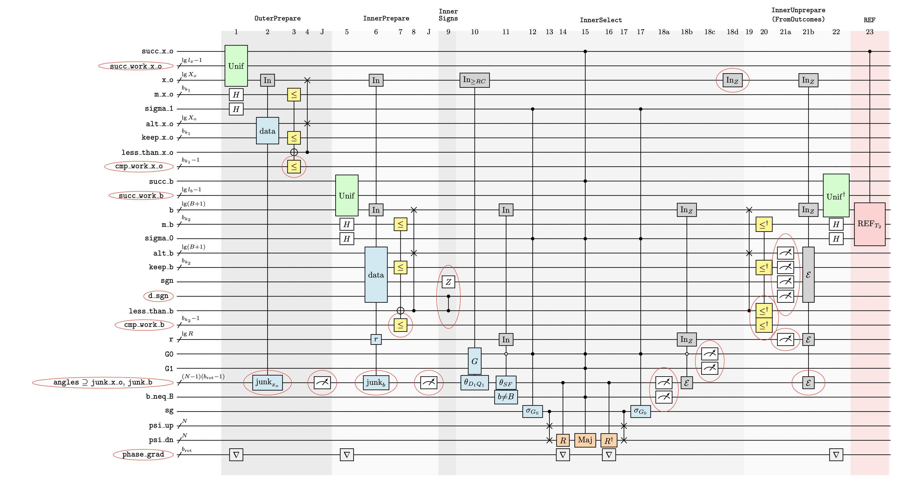

# dfthc: the DFTHC block encoding in PennyLane

A fully compiled PennyLane implementation of the DFTHC block encoding of
[Low et al., PRX 15, 041016 (2025)](https://journals.aps.org/prx/abstract/10.1103/pb2g-j9cw)
([arXiv:2502.15882](https://arxiv.org/abs/2502.15882)): the block encoding, its qubitized walk, the
controlled walk and an iterative phase estimation. Every block is a modular PennyLane `Operator2`
with one pinned decomposition rule. Programs compile with `qp.qjit(capture=True)` and graph-based
`qp.decompose` down to Cliffords, Toffolis, measured AND-uncomputes, mid-circuit measurements and
a phase-gradient state, and `qp.analyze` counts their resources exactly. The Qualtran
implementation [dfthcbe](https://github.com/Covestro-HPQC/dfthcbe) serves as the reference.

## Results

Toffolis per walk step (Toffoli plus `TemporaryAND`), each compiled count equal to its closed form
in `dfthc.costs`:

| System | Walk qubits | Ours | dfthcbe | Paper |
| --- | ---: | ---: | ---: | ---: |
| H2, STO-3G | 177 | 341 | 392 | 400 |
| naphthalene | 327 | 1,910 | 1,937 | 1,965 |
| Fe2S2 | 498 | 4,411* | 4,420 | 4,506 |
| Fe4S4 | 757 | 6,533* | 6,336 | 6,556 |
| FeMoco-54 | 1,049 (paper: 1,131) | 9,790 | 9,641 | 9,997 |

\* Closed form; not recompiled since the 2026-11-17 changes (`--large fe2s2|fe4s4`).

Each difference from dfthcbe and from the paper is broken down by cause in
[`docs/resources.md`](docs/resources.md), which reports every block of every system, with
measurements, Cliffords and qubits. The FeMoco-54 walk compiles in about a minute below 2 GB.

## Circuit

The first half of the block encoding plus REF<sub>T2</sub> (paper steps 1-23), drawn at the same
granularity as the [dfthcbe figure](https://github.com/Covestro-HPQC/dfthcbe). Red circles mark the
wires and gates that differ from it; [`docs/figures/dfthcbe_comparison.md`](docs/figures/dfthcbe_comparison.md)
explains each difference step by step.



How to read the figure:

- **Colours** are as in the dfthcbe figure: green is the flagged uniform preparation, blue the
  data loads, yellow the comparators, grey the index and erase boxes, orange the rotations and the
  Majorana gate, and pink the reflection.
- **Meters** are an H followed by a measurement and reset, i.e. an X-basis measurement.
- **Junk.** The junk registers `junk_x_o` ((K<sub>1</sub>−1)d<sub>1</sub> wires) and `junk_b`
  ((K<sub>2</sub>−1)d<sub>2</sub> wires) are the first wires of `angles`. They are X-measured in
  the columns J, right after each prepare (Q-1 variant (b)). Their outcomes feed the fix-ups of the
  unprepares from outcomes; for `junk_x_o` that is steps 24-27, which are not drawn.
- **In<sub>Z</sub>** is a phase fix-up over the index, computed from measurement parities.
  **ℰ** is its one-hot register on reset wires. In step 21b that is the target together with the
  first 2<sup>k<sub>e2</sub>+w<sub>b</sub></sup> − d<sub>2</sub> wires of `angles`.
- **≤<sup>†</sup>** is a measured comparator uncompute, which costs no Toffoli.
- **∇** marks `phase_grad` used as a catalyst.
- **Not drawn:** the shared `work` pool, and the `GlobalPhase(π)` inside REF<sub>T2</sub>.
- **Symbols:** X<sub>o</sub> = N + RC; l<sub>x</sub> and l<sub>b</sub> are the odd parts of
  X<sub>o</sub> and B + 1.
- **Red circles** mark the wires and gates that differ from the dfthcbe figure.

## Quick start

```bash
scripts/setup_env.sh                            # Python 3.12 venv with nightly PennyLane and Catalyst
scripts/test.sh -m "not slow and not release"   # per-commit tier, about 15 minutes
```

```python
import pennylane as qp
import dfthc

params = dfthc.H2_STO3G_TEST  # a small H2 test preset
tables = dfthc.WalkTables.from_factors(dfthc.load_factors("h2_sto3g_R2_B2_C1"), params)
wires = dfthc.WalkLayout.from_params(params)

@qp.qjit(capture=True)
@qp.decompose(gate_set=dfthc.GATE_SET)
@qp.qnode(qp.device("null.qubit", wires=wires.num_wires))
def walk():
    qp.PhaseGradientStatePrep(wires.phase_grad)
    dfthc.DFTHCWalk(params, tables, **wires.groups())
    return qp.probs(wires=0)

counts = qp.analyze(walk)().resources.counts
print(counts["Toffoli"] + counts["TemporaryAND"])  # 158
```

Run it with `PYTHONPATH=src .venv/bin/python`. Importing `dfthc` registers one decomposition rule
per operator with `qp.add_decomps`, and the graph-based `qp.decompose` finds them. `qp.analyze`
warns once that it could not determine a conditional's branch; the counts are exact.

## Verification

1,386 tests in three tiers ([`docs/verification.md`](docs/verification.md)) cover:

- per-block semantics on `lightning.qubit` and a sparse simulator;
- the block encoding and walk end to end on H2, against the encoded Hamiltonian to 1e-10;
- GF(2) certificates for every measured erase;
- exact QPE on a toy walk;
- exact T, M and A counts against closed forms;
- canary tests that pin every known PennyLane or Catalyst limitation.

## Repository layout

```text
src/dfthc/
  params.py, data/    classical data: factors, alias and angle tables, the encoded Hamiltonian
  ops/                Operator2 blocks: primitives, the paper's blocks, block encoding and walk
  qpe.py              controlled walk powers and iterative phase estimation
  registers.py        WalkLayout: the named wire groups of the walk
  compile.py          gate set, pinned rules, compiled_resources() (the tests' compile-and-count helper)
  costs.py            closed-form T, M and A of every block
  costs_reference.py  the paper's and dfthcbe's costs, and the causes of each difference
  testing/            sparse simulator, walk cases, memory watchdog, compile cache provenance
data/dfthc/           DFTHC factors vendored from dfthcbe (Apache-2.0)
scripts/              environment setup, test runner, resource report, fixture generators
tests/                the test suite
spikes/               early feasibility probes
docs/
  architecture.md     layers, the walk call by call, compilation rules (start here)
  resources.md        the resource report (resources.json: machine-readable, with compile cache)
  verification.md     what each test establishes, and the test tiers
  limitations.md      PennyLane and Catalyst limitations, and their canaries
  conventions.md      indices, signs, fermions, angles, registers
  environment.md      the pinned nightly toolchain, load limits, commands
  upstream/           draft issue reports with reproducers
  superpowers/        the design spec and the implementation plans
  agents/             handoff notes and the ledger of the agent-driven development
```
