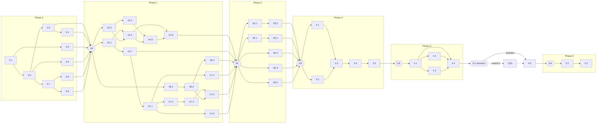

# DFTHC Block Encoding, Walk and QPE in PennyLane: Master Implementation Plan

> **For agentic workers:** REQUIRED SUB-SKILL: Use superpowers:subagent-driven-development (recommended) or superpowers:executing-plans to implement this plan task-by-task. Steps use checkbox (`- [ ]`) syntax for tracking.

**Goal:** Implement the DFTHC sum-of-squares block encoding, its qubitized walk, the controlled walk and an iterative QPE wrapper of Low et al. (PRX 15, 041016 (2025)) as `Operator2` building blocks compiled with `qp.qjit(capture=True)` and `qp.decompose`. Count their resources exactly with `qp.analyze`, verify them end to end, and compare against the paper and dfthcbe without tuning.

**Architecture:** Five layers per spec section 5.1:
- L0, classical data: factors, tables, the encoded model;
- L1, primitives: unary iteration, QROAM read and erase, phase fixup, uniform preparation, reflections;
- L2, paper blocks: prepares, angle loads, Givens ladders, the Majorana gate;
- L3, assembly: block encoding and walk with controlled versions;
- L4, application: QPE.

Tooling cuts across all layers: `dfthc.compile`, `dfthc.costs`, the sparse simulator and the resource report. Every operator has exactly one pinned rule per key, exact closed-form costs, and tests T2 to T6.

**Tech Stack:** Python 3.12; nightly PennyLane `0.46.0.dev151` and Catalyst `0.16.0.dev140` (snapshot of 2026-11-11, bumped per spec 7.1); JAX 0.7.1; NumPy and SciPy; pytest with pytest-xdist; ruff. Reference fixtures from Qualtran and dfthcbe in a separate `.venv-ref`.

## Global Constraints

Every task's requirements implicitly include this section. Values are copied verbatim from the
spec (`docs/superpowers/specs/2026-11-11-dfthc-pennylane-design.md`); section numbers refer to it.

**Standing requirements (spec 2.1)**
- R-1: Use the latest nightly PennyLane and Catalyst, installed as in §7.1.
- R-2: Compile with `qp.qjit(capture=True)` and `qp.decompose` (the graph decomposition system). Obtain resources with `qp.analyze`.
- R-3: Decomposition rules are lowered as part of the `qjit` call. The precompiled decomposition-rule bytecode file is not used.
- R-4: Every building block is an `Operator2` with clear documentation. The code is modular. Documented exemption, decided by the user (§16, Q-3): a top-level algorithm that returns classical measurement values, namely the iterative QPE driver of §11, is a plain quantum function. Its quantum content per round remains `Operator2`s (`QPERound`, `ControlledWalkPower`).
- R-5: Resource-aware tests accompany all development.
- R-6: Verifiability, testability and comprehensiveness: other people must be able to understand what was done and how the code works.
- R-7: No workarounds to match the paper's or dfthcbe's resource counts beyond the paper's own constructions. Deltas are documented.
- R-8: Scope: block encoding, walk, controlled walk, and an iterative QPE wrapper on the controlled walk. All are compiled and resource-counted. QPE is simulated only at toy sizes.
- R-9: Gate set: Toffoli level, with rotations done by phase-gradient addition (§7.3).
- R-10: Verification: a purpose-built sparse-state simulator checks ⟨0|BE|0⟩ = H_SA/Λ − I end to end on H2. Correctness for every erase-measurement outcome is certified at block level (§12.5). Per-block checks run on `lightning.qubit`.
- R-11: Git: local branches only. Never push and never modify remotes.

**Toolchain (spec header and 7.1)**
- Toolchain snapshot: PennyLane `0.46.0.dev151`, Catalyst `0.16.0.dev140`, Lightning `0.46.0.dev34` (nightlies of 2026-11-11).
- One canonical environment serves all agents and worktrees: `.venv` in the repository root, CPython 3.12.
- Always use plain `pip`; never `uv pip`.
- Export `CATALYST_SILENCE_RULE_LOWERING_WARNINGS=0` before Python starts.
- Do not install the package in editable mode. Use pytest's `pythonpath = ["src"]`.
- Reference fixtures come from `.venv-ref`, a separate environment with Qualtran and dfthcbe at commit `930255020cec30172e0a7d17c0071d9476a687d1` (Q-2, decided: yes).

**Gate set and accounting (spec 7.3 and 7.6)**
```python
GATE_SET = {
    "PauliX": 1, "PauliY": 1, "PauliZ": 1, "Hadamard": 1, "S": 1, "Adjoint(S)": 1,
    "CNOT": 1, "CZ": 1, "SWAP": 1, "GlobalPhase": 1, "MidMeasure": 1,
    "Adjoint(TemporaryAND)": 1, "PhaseGradientStatePrep": 1,
    "Toffoli": 1000, "TemporaryAND": 1000,
}
```
- Toffoli count T: number of `Toffoli` plus number of `TemporaryAND`. M: number of `MidCircuitMeasure`, the explicit erase measurements. A: number of `Adjoint(TemporaryAND)`, the measured AND uncomputes.
- What tests assert: Toffoli and measurement counts are exact and asserted against `dfthc.costs` closed forms. Clifford counts are reported, not asserted.
- Baseline at FeMoco-54 (§9.24): 9,793 Toffolis per walk and 9,795 per controlled walk; M = 2,524; A = 8,675 (controlled 8,677); M + A = 11,199 (controlled 11,201).

**Rules for operators and decomposition rules (spec 7.4, one line each)**
1. No allocation inside rules: no `qp.allocate`, no `work_wires=` in `qp.register_resources`; every ancilla is an explicit wire argument; every operator exposes `required_wires(**compilable_args) -> dict[str, int]`.
2. Resource-function keys are `Operator2` abstract instances built through `dfthc.compile.resource_key`; every emitted operator is declared; counts are Python integers; resource functions never raise.
3. Every argument that determines circuit structure is in `compilable_argnames`; `static_argnames` are not used; `dynamic_argnames` only for runtime data (`PhaseFixup` parities, `QPERound` earlier bits, K-1 remedy tables).
4. Bodies of auto-adjointed operators contain no `qp.for_loop` or `qp.cond`; `qp.cond` only on mid-circuit measurement outcomes in erase operators and the QPE wrapper; `qp.for_loop` only in `ControlledWalkPower`.
5. Measurement-based uncompute lives only in `QROAMErase`, `AngleErase` and explicit `Adjoint(Op)` rules with signature `(base)`; an operator that contains a measurement is never placed under `qp.ctrl`.
6. Controlled versions come only from explicit `C(Op)` rules with signature `(base, control_wires, control_values, work_wires, work_wire_type)`.
7. One base rule per operator; explicit adjoint and controlled rules are pinned (§7.5).
8. Unique class names; a test asserts that PennyLane registers none of our names.
9. Rules run in both capture and tape mode; mode-specific classical code is confined to helpers (`dfthc.compile.mcm_parities`).
10. Exact swaps only (`CSWAP`).
11. No `Subroutine`, and no `qp.pow` on our operators.
12. Tests fail on any `RuleLoweringWarning` that names a dfthc operator, and filter the PennyLane noise of §7.1.

**Rules added by the Phase 0 dry-run (2026-11-11; canaries L-24, L-25)**
- Compilable integers must fit in signed 64 bits; table entries are tuples of 32-bit words, least significant word first.
- Apply adjoints as `qp.adjoint(Op(...))`, never `qp.adjoint(Op)(*positional_args)`: under capture the positional form traces compilable arguments.

**Conventions (spec 6.7)**
- Integers in registers are big-endian: the first wire is the most significant bit.
- Register names follow dfthcbe: `x_o`, `succ_x_o`, `sigma_1`, `m_x_o`, `less_than_x_o`, `alt_x_o`, `keep_x_o`, `junk_x_o`, `b`, `succ_b`, `sigma_0`, `m_b`, `less_than_b`, `alt_b`, `keep_b`, `sgn`, `d_sgn`, `r`, `junk_b`, `angles`, `G0`, `G1`, `b_neq_B`, `sg`, `psi_up`, `psi_dn`, `phase_grad`, `work`.

**Tests (spec 12.6)**
- Markers: `compiled`, `slow`, `release`, `canary`, `femoco`, `subprocess`. `release` implies `slow`.
- `scripts/test.sh` runs 2 xdist workers at lowered priority (`DFTHC_TEST_WORKERS` overrides).
- Per commit: `scripts/test.sh -m "not slow and not release"` (15 min). Nightly: `scripts/test.sh -m "slow and not release"` (4 h), only at phase gates, started by the orchestrator. Release: `scripts/test.sh` (8 h), once, at the end of Phase 5, after the user's go-ahead.

**Load limits (master plan section 12.9; spec 15)**
- The development laptop has 10 cores and 16 GB, and the user works on it. No process tree may exceed 8 GB of memory.
- A heavy process is a run whose process tree exceeds 4 GB, keeps more than 2 cores busy or lasts longer than 30 minutes, or any FeMoco-shaped compile. Only the orchestrator starts heavy processes, one at a time, under the watchdog (`dfthc.testing.watchdog`), and logs each in the ledger.
- During TDD, run only the targeted tests; run the per-commit tier once at commit time. Never start a heavy process yourself.
- The per-commit and nightly tiers contain no FeMoco-shaped compile. FeMoco-54 values are asserted on the closed forms (`dfthc.costs`); the FeMoco-54 walk and controlled walk are compiled once, in Task 4.5.

**Git (spec 15)**
- Local branches and worktrees only. Merges go into local `main`. Never push, never modify remotes. The repo-local git identity (`dwierichs` / `david.wierichs@xanadu.ai`) is shared by all worktrees.
- Each task runs in a git worktree on a branch named `phase<N>/<task-id>` from local `main`; only the orchestrator merges.

---

## 1. How to use this plan

This is a **rolling-wave** plan. It lists every task of Phases 0 to 5 with its id, files, interfaces, acceptance tests, tier, reviewers, dependencies and definition of done. Code-level steps exist now only for Phase 0:

| File | Content |
| --- | --- |
| `docs/superpowers/plans/2026-11-11-dfthc-master-plan.md` | this file |
| `docs/superpowers/plans/2026-11-11-dfthc-phase0-infrastructure.md` | Tasks 0.1, 0.2, 0.5 in full TDD steps |
| `docs/superpowers/plans/2026-11-11-dfthc-phase0-canaries.md` | Tasks 0.3, 0.4 |
| `docs/superpowers/plans/2026-11-11-dfthc-phase0-spikes.md` | Tasks 0.6 to 0.9 |
| `docs/superpowers/plans/2026-11-11-dfthc-phase<N>-<topic>.md` | written at gate G(N-1) per section 12.7 |
| `docs/agents/HANDOFF.md` | the shared context every agent reads first |
| `docs/agents/LEDGER.md` | durable task, spike, decision and gate record |

**Task ids** are `<phase>.<n>` or `<phase><workstream>.<n>` (`0.3`, `1A.4`, `2E.2`). Each code-level task heading reads `### Task <id>: <title>`, so the superpowers `task-brief` script extracts it: `task-brief <plan file> <id>`. The branch is `phase<N>/<id>` and the worktree `../dfthc-be-worktrees/<id>`.

**Code provenance:** every code block in the Phase 0 files was executed on 2026-11-11 in a scratch replica of this repository and passed as stated. Section 3 lists what those dry-runs taught.

---

## 2. Decisions and baseline

| Decision | Outcome | Where it acts |
| --- | --- | --- |
| Q-1 early junk measurement | **Open.** Decided by the user after the K-10 spike (Task 0.8) and the Phase 4 resource report, preferring variant (b) if K-10 passes. | the Q-1 decision before G4; conditional Task Q1b |
| Q-2 reference fixtures | **Yes:** Qualtran and dfthcbe go into a separate `.venv-ref` | Task 1A.6; HANDOFF |
| Q-3 QPE driver | **Yes:** `iterative_phase_estimation` is a plain quantum function, exempt from R-4; `QPERound` and `ControlledWalkPower` stay `Operator2` | Task 4.1 |
| Q-4 unary iteration | **Exact** now; truncated iteration and pruning are later optimizations | Tasks 1C.1, 1C.3, 1C.4 |
| Q-5 Givens rotations | **dfthcbe's exact construction** at 2(b_rot − 1) Toffolis per rung | Task 2E.4 |
| Load limits (user, 2026-11-11: "Keep large-scale compilations to a minimum"; "Try to not run heavy processes throughout") | **No process tree above 8 GB; heavy processes only by the orchestrator, one at a time, under the watchdog; 2 test workers at lowered priority; about six FeMoco-scale compiles for the whole project** | section 12.9; HANDOFF 3.5; spec 12.6, 15 |
| Agent models (user, 2026-11-11) | **Tier A implementers and the Opus reviewer use `inherit`,** the orchestrator's own model | section 12.1 |
| Where compiles above the cap run | **Open.** If the K-1 projection exceeds 8 GB or 60 minutes after any remedy (Tasks 0.9, 0.9b), the user decides at G0: a larger machine, or an approved idle-time window with a higher cap. The one decision covers every FeMoco-size compile, including Task 4.5's, and every other compile projected above the cap (for example Task 4.3's `fe4s4` walks). | G0; Tasks 0.9, 0.9b, 4.3, 4.5 |

Baseline (spec 9.24, FeMoco-54):
- Toffolis: walk 9,793; controlled walk 9,795; block encoding 9,749.
- Explicit erase measurements M = 2,524.
- Measured AND uncomputes A = 8,675 (8,677 controlled), so M + A = 11,199 (11,201 controlled) physical measurements.
- Qubits: `WalkLayout` gives 1,564 with a 44-wire work pool (spec estimate about 1,570).

---

## 3. Findings from the plan dry-runs (2026-11-11)

These shape the later tasks and are recorded in HANDOFF and in the Phase 0 canaries:

1. **Compilable integers must fit in int64 (L-24).** Wide table entries are tuples of 32-bit words. `WalkTables.as_compilable()` exposes fields below 2^31, and operators compose entries as words (Tasks 1A.4, 1C.3).
2. **`qp.adjoint(OpClass)(*positional)` traces compilable arguments (L-25).** Always use `qp.adjoint(Op(...))`.
3. **Inside rules, wire registers are arrays.** Never test them for truth (`work[:n] or None`); slice with explicit lengths.
4. **Declared resource keys must equal emitted operators,** including compilable arguments and wire-register sizes. An emitted operator with an undeclared signature is left undecomposed; `compiled_resources` then fails the gate-set closure check.
5. **The verbose rule listing (spec 12.1 T6) is capturable only with `qp.qjit(verbose=True)`.** `dfthc.testing.resources.verbose_program` and `chosen_rules` implement it.
6. **Hinted conditionals** count expected gates, summed per gate type over the program and rounded up once (L-17 canary). Unhinted conditionals inside PennyLane's `SemiAdder` rule trigger the "unable to determine the branch" warning on every compile; it is filtered, and Task 1C.4 asserts that our erase conditionals are hinted.
7. **Canaries whose behaviour differs from the spec's original claims:** L-2, L-6, L-9, L-15 (two items), L-19 and L-20. Task 0.4 updates spec section 14.
8. **Compile cost at FeMoco shape** (K-10 dry-run while writing this plan, development laptop, other compiles running; quoted, not reproduced, in `spikes/results/k10_femoco_dryrun.json`):
   - one 8,640-address erase fixup with packed parities compiled in 199 to 274 s;
   - the same with masks as compilable data took 1,517 s.

   So masks are derived inside rules from the table and never passed as compilable data. At 544 and 1,088 addresses with the same widths, parts 1 and 2 compiled in 13.2 and 11.6 s, and 30.9 and 23.2 s (peaks 1.1 and 1.75 GB): the gap of part 2 opens only at larger sizes.
9. **K-1 calibration and projection** (round-3 plan check, stand-in walk; memory is the sampled peak of the process tree, with the getrusage sum in parentheses):

   | Shape | Gates (walk) | Walk | Controlled walk |
   | --- | ---: | --- | --- |
   | small, 4-bit precisions | 2,161 | 9 s, 0.5 to 0.6 GB (0.6) | 17 s, 0.8 to 0.9 GB (0.9) |
   | `mid10` (N = 10, R = 8, B = 6, C = 5, the `naphthalene` shape) | 34,827 | 60 s, 1.6 GB (2.1) | 124 s, 2.3 GB (2.9) |
   | `mid14` (N = 14, R = 6, B = 13, C = 8) | 65,997 | 128 to 146 s, 1.7 to 2.3 GB (2.7 to 3.4) | not measured |
   | FeMoco-54 | 627,557 | not compiled | not compiled |

   Gates are the stand-in's emitted gates from its resource functions (no compile; at the small shape T, M and A equal the compiled counts and the total is within 2 % of the compiled one). The K-1 method (Task 0.9) gives, from these numbers, a FeMoco walk of 31 to 57 minutes and 12.5 to 17.6 GB, and a controlled walk of about 2 hours and 17 GB (its `mid14` point estimated from the `mid10` ratios). Both exceed the 8 GB cap of section 12.9, so the FeMoco compile is not expected to run on this machine; Task 0.9 measures again and the G0 rule applies. The same method puts the stand-in at 4 to 6 GB for the `fe2s2` walk and controlled walk (193,129 gates) and at 6 to 9 GB for the `fe4s4` ones (307,388 gates), so the report's `fe4s4` walks may also exceed the cap (Task 4.3).
10. **The agent sandbox forbids `ps` and setpriority().** `dfthc.testing.watchdog` reads memory through macOS `libproc`, which works there. `nice` only warns and runs the command unchanged, so `scripts/test.sh` and the watchdog fall back to the utility QoS clamp of `taskpolicy`, which child processes inherit.
11. **Resident memory undercounts under memory pressure.** With two test workers allocating at once, 300 MB of random data read as 190 to 220 MB resident, and a 400 MB process tree stayed below a 200 MB cap. The watchdog therefore sums the physical footprint, which equals the resident size while memory is free and keeps counting compressed and swapped-out pages.
12. **`qp.density_matrix` is not supported under capture;** compiled state checks use `qp.state()`. Under capture, never `qp.apply` an operator you just constructed (it is queued twice).
13. **Measuring adjoint rules under control (L-2):** the solver silently controls the unitary inverse of the base rule instead of failing. This is one more reason for spec 7.4 rule 5: never control a measuring operator.

---

## 4. Task overview

Tier A uses `inherit` (the orchestrator's own model), Tier B uses `claude-sonnet-5-5-high`. Every task is reviewed by GPT-5.6 (`gpt-5.6-sol-high-fast`); Tier A tasks also get an Opus review, which also uses `inherit`. The "Plan" column gives the file that holds the task's code-level steps.

| Id | Title | Tier | Depends on | Plan |
| --- | --- | --- | --- | --- |
| 0.1 | Scaffold, environment, lock, test runner | B | none | phase0-infrastructure |
| 0.2 | `dfthc.compile`, resource assertions, canary runner | A | 0.1 | phase0-infrastructure |
| 0.3 | Canary suite A (L-1 to L-14, L-19, L-23 to L-25) | B | 0.2 | phase0-canaries |
| 0.4 | Canary suite B (L-15 to L-18, L-20 to L-22), spec section 14 update | B | 0.3 | phase0-canaries |
| 0.5 | Vendored dfthcbe data and license | B | 0.1 | phase0-infrastructure |
| 0.6 | Spike K-7: comparator and adder adjoints | B | 0.2 | phase0-spikes |
| 0.7 | Spike K-3: mode-agnostic measured erase; shared prototypes | A | 0.2 | phase0-spikes |
| 0.8 | Spike K-10: measurement arrays as dynamic arguments | A | 0.7 | phase0-spikes |
| 0.9 | Spike K-1: small and mid compiles, FeMoco projection | A | 0.7 | phase0-spikes |
| 0.9b | (conditional) K-1 remedy 1 in the stand-in | A | 0.9 (projection over the limits) | written at G0 if needed |
| 1A.1 | `WalkParams`, presets and `WalkLayout` | B | G0 | phase1-data |
| 1A.2 | `DFTHCFactors`, loaders, `random_factors`; fermion matrices | B | G0 | phase1-data |
| 1A.3 | Sum-of-squares quantities, both offset frames, spec 8.6 checks 1 to 3 | A | 1A.2 | phase1-data |
| 1A.4 | Alias tables, Givens angles, `WalkTables` | B | 1A.1, 1A.2 | phase1-data |
| 1A.5 | Encoded-Hamiltonian model and failure signs | A | 1A.3, 1A.4 | phase1-data |
| 1A.6 | dfthcbe reference fixtures (`.venv-ref`) | B | 1A.4, 1A.5 | phase1-data |
| 1A.7 | `dfthc.costs`: closed forms of spec 9.24 | B | 1A.1 | phase1-data |
| 1B.1 | Sparse simulator core and differential tests | A | G0 | phase1-simulator |
| 1B.2 | Measurements, conditionals, policies, tape front end | A | 1B.1 | phase1-simulator |
| 1B.3 | Simulator benchmark gate | B | 1B.2 | phase1-simulator |
| 1C.1 | Unary iteration helper and `PhaseGradientRotation` | A | 1A.7 | phase1-primitives |
| 1C.2 | `FlaggedUniformPrep` | A | 1C.1 | phase1-primitives |
| 1C.3 | `QROAMRead` | A | 1C.1 | phase1-primitives |
| 1C.4 | `PhaseFixup` and `emit_phase_fixup` | A | 1C.3 | phase1-primitives |
| 1C.5 | `QROAMErase` and round-trip certificates | A | 1C.4, 1B.2 | phase1-primitives |
| 1C.6 | `ZeroReflection` | B | 1C.1 | phase1-primitives |
| 2D.1 | `OuterPrepare` and its pinned adjoint | A | G1 | phase2-blocks |
| 2D.2 | `InnerPrepare`, its pinned adjoint, `InnerSigns` | A | 2D.1 | phase2-blocks |
| 2E.1 | `TailAngleLoad`, `SFAngleLoad` | B | G1 | phase2-blocks |
| 2E.2 | `AngleErase` | A | 2E.1 | phase2-blocks |
| 2E.3 | `SpinMux`, `SpinSwap` | B | G1 | phase2-blocks |
| 2E.4 | `GivensRotation`, `GivensLadder` | A | G1 | phase2-blocks |
| 2E.5 | `MajoranaGate` | A | G1 | phase2-blocks |
| 3.1 | `InnerSelect` and its pinned adjoint | A | G2 | phase3-assembly |
| 3.2 | `RefT2`, `RefAB` and controlled versions | B | G2 | phase3-assembly |
| 3.3 | `DFTHCBlockEncoding` and `C(DFTHCBlockEncoding)` | A | 3.1, 3.2 | phase3-assembly |
| 3.4 | `DFTHCWalk`, `C(DFTHCWalk)`, whole-program counts at the test and mid presets | A | 3.3 | phase3-assembly |
| 3.5 | End-to-end checks E-1 to E-4 and tier budgets | A | 3.4 | phase3-assembly |
| 4.1 | QPE: `ControlledWalkPower`, `QPERound`, driver, energies, `ToyWalk` | A | G3 | phase4-application |
| 4.2 | QPE resource counts (compiled at the test presets) | B | 4.1 | phase4-application |
| 4.3 | Resource report and `dfthc.costs_reference` | B | 4.1 | phase4-application |
| 4.4 | Documentation set and docstring audit | B | 4.1, 4.2, 4.3 | phase4-application |
| Q1b | (conditional) Q-1 variant (b): unprepare-from-outcomes operators | A | the Q-1 decision after 4.4 | written at the decision if chosen |
| 4.5 | The single FeMoco walk and controlled-walk compile; report finalization | B | 4.4, the Q-1 decision, Q1b if chosen | phase4-application |
| 5.1 | Whole-branch final review | A (+ GPT-5.6) | G4 | phase5-final |
| 5.2 | Fix wave, release tier, final merge | A | 5.1 | phase5-final |

**Counts:** 44 planned tasks (Phase 0: 9, Phase 1: 16, Phase 2: 7, Phase 3: 5, Phase 4: 5, Phase 5: 2), plus 2 conditional tasks (0.9b, Q1b). Tier A has 25 tasks and Tier B 19; both conditional tasks are Tier A.

---

## 5. Dependency graph and parallel waves



**Parallel waves** (tasks in one wave touch disjoint files and run in separate worktrees; merges are serialized). At most two implementers run at once (section 12.9), so a wave with more tasks runs in turns, critical-path tasks first. Tasks that edit the same module are serialized rather than split: 1C.3 → 1C.4 → 1C.5 all edit `src/dfthc/ops/qroam.py`, and 2D.1 → 2D.2 both edit `src/dfthc/ops/prepare.py` and `tests/ops/test_certificates_prepare.py`. Spec 5.2 fixes those module layouts and 9.4 names `dfthc.ops.qroam.emit_phase_fixup`; the pairs also share code (the erase builds on the read and the fixup; the two prepares share the alias-sampling rule skeleton). 1C.6 waits for 1C.1, which creates `src/dfthc/ops/__init__.py`.

| Wave | Tasks | Notes |
| --- | --- | --- |
| 0-a | 0.1 | |
| 0-b | 0.2, 0.5 | |
| 0-c | 0.3, 0.6, 0.7 | Phase 1 A and B plans drafted now (section 12.7) |
| 0-d | 0.4, 0.8, 0.9 | 0.9's small and mid compiles take about 15 minutes and stay below 4 GB, so they are not heavy; its FeMoco compile runs only if the projection allows it, started by the orchestrator, alone (section 12.9) |
| 1-a | 1A.1, 1A.2, 1B.1 | Phase 1 C plan written once K-3 and K-7 are recorded |
| 1-b | 1A.3, 1A.4, 1A.7, 1B.2 | |
| 1-c | 1A.5, 1B.3, 1C.1 | |
| 1-d | 1A.6, 1C.2, 1C.3, 1C.6 | |
| 1-e | 1C.4 | |
| 1-f | 1C.5 | |
| 2-a | 2D.1, 2E.1, 2E.3, 2E.4, 2E.5 | two implementers at a time; start 2D.1 and 2E.1 first (both head two-task chains) |
| 2-b | 2D.2, 2E.2 | |
| 3 | 3.1 and 3.2, then 3.3, 3.4, 3.5 | critical path |
| 4 | 4.1, then 4.2 and 4.3, then 4.4; then the Q-1 decision, and Q1b if variant (b) is chosen; then 4.5 | 4.3's `fe2s2` and `fe4s4` compiles and 4.5's FeMoco compile are heavy: the orchestrator runs them alone (section 12.9); G4 follows 4.5 |
| 5 | 5.1, then 5.2 | the release tier runs once in 5.2, after the user's go-ahead |

The critical path is 0.1 → 0.2 → 0.7 → 0.9 → G0 → 1A.1 → 1A.7 → 1C.1 → 1C.3 → 1C.4 → 1C.5 → G1 → 2D.1 → 2D.2 → G2 → 3.1 → 3.3 → 3.4 → 3.5 → G3 → 4.1 → 4.3 → 4.4 → (Q1b) → 4.5 → G4 → 5.1 → 5.2. Two segments are ties: in Phase 2, 2E.1 → 2E.2 is as long as 2D.1 → 2D.2; in Phase 4, 4.1 → 4.2 → 4.4 is as long as 4.1 → 4.3 → 4.4. With at most two implementers at once, waves 0-c, 0-d, 1-a to 1-d and 2-a take turns, which stretches the calendar time but not this path. The gates' nightly-tier runs (one to four hours each, alone) and the heavy runs of Tasks 4.3 and 4.5 add to it. If K-1 escalates at G0, the user's answer gates Tasks 1C.3 to 1C.5 (section 12.6).

---

## 6. Phase 0 tasks: foundation and feasibility

Code-level steps: the three `phase0-*` files. The entries below are the master record.

### Task 0.1: Scaffold, environment, lock and test runner
- **Tier:** B. **Reviewers:** GPT-5.6. **Depends on:** none. **Branch:** `phase0/0.1`.
- **Files:** `pyproject.toml`, `requirements-nightly.lock`, `scripts/setup_env.sh`, `scripts/test.sh`, `src/dfthc/__init__.py`, `tests/conftest.py`, `tests/test_infrastructure.py`, `docs/environment.md`.
- **Interfaces:** Consumes nothing. Produces:
  - `scripts/test.sh [pytest args]` (exports `CATALYST_SILENCE_RULE_LOWERING_WARNINGS=0`; uses `$DFTHC_VENV` or the main checkout's `.venv`; `-n ${DFTHC_TEST_WORKERS:-2}`; lowered priority through `nice -n 10`, or `taskpolicy -c utility` in the agent sandbox);
  - markers `compiled`, `slow`, `release`, `canary`, `femoco`, `subprocess` under `--strict-markers`, with `release` implying `slow`;
  - `dfthc.__version__ == "0.1.0"`.
- **Acceptance tests:** `tests/test_infrastructure.py`, 12 tests (package import, variable exported, 2 workers by default, lowered priority, warnings recorded, lock pins PennyLane/Catalyst/Lightning, scripts executable, `release` implies `slow`).
- **Definition of done:** 12 passed; the per-commit filter gives 11 passed, 1 deselected; ruff clean; committed.

### Task 0.2: `dfthc.compile`, resource assertions and canary runner
- **Tier:** A. **Reviewers:** GPT-5.6, Opus. **Depends on:** 0.1. **Branch:** `phase0/0.2`.
- **Files:** `src/dfthc/compile.py`, `src/dfthc/testing/{__init__,resources,canary,watchdog}.py`, `tests/conftest.py` (replaced), `tests/test_compile.py`, `tests/test_primitive_costs.py`, `tests/test_canary_helper.py`, `tests/test_watchdog.py`.
- **Interfaces produced** (signatures in the Phase 0 infrastructure file):
  - from `dfthc.compile`: `GATE_SET`, `ANALYZE_NAMES`, `FIXED_DECOMPS`, `register_rule(op, rule)`, `resource_key(build)`, `CompiledResources(toffoli, measurements, measured_and_uncomputes, counts, num_wires)` with `.physical_measurements`, `compiled_resources(qfunc, num_wires, *, device, level, fixed_decomps)`, `dfthc_operator_names(keys=None)`, `surviving_dfthc_operators(names, keys=None)`, `mcm_parities(outcomes, masks)`, `pack_masks`, `packed_parities`;
  - from `dfthc.testing.resources`: `classify_rule_warning`, `install_warning_filters`, `verbose_program`, `chosen_rules`, `assert_resources`;
  - from `dfthc.testing.canary`: `run_snippet`, `outcome`;
  - from `dfthc.testing.watchdog` (section 12.9): `MEMORY_CAP_MB`, `HEAVY_MEMORY_MB`, `HEAVY_SECONDS`, `memory_mb(pid)`, `tree_memory_mb(root)`, `lowered_priority_prefix()`, `WatchedRun`, `run_watched(command, *, cap_mb, timeout_s, capture)` and the command line `python -m dfthc.testing.watchdog [--cap-mb] [--timeout-min] -- CMD`, which prints one `WATCHDOG {json}` line for the ledger.
- **Acceptance tests:** 83 tests.
  - The gate set matches spec 7.3.
  - Pins: one rule per key, and `qp.list_decomps(key) == [rule]`.
  - T6 pattern counts `{"CNOT": 1, "Hadamard": 2, "MidCircuitMeasure": 1, "PauliX": 1, "PauliZ": 1}`; the verbose listing names the pinned rules.
  - Symbolic counts and operations outside the gate set are rejected.
  - At `level="device"`, a dfthc operator is rejected bare and under `C(...)` and `Adjoint(...)`, and a decomposed program passes.
  - `mcm_parities` is exact on all 2^5 vectors in tape mode, linear on 100 random 70-bit pairs in the capture core, and correct in a compiled circuit.
  - The 53 primitive-cost pins of spec 9.24 hold.
  - The canary runner reports OK and ERROR lines.
  - The watchdog sums the memory of a process tree including grandchildren; kills the whole tree above its memory cap and at its time limit, and reports why; passes a command within its limits; runs the command at lowered priority; and its command line exits with status 3 and a `WATCHDOG` line after a kill.
- **Definition of done:** 83 passed; per-commit tier 94 passed (1 deselected); ruff clean; the T6 finding recorded.

### Task 0.3: Canary suite A
- **Tier:** B. **Reviewers:** GPT-5.6. **Scout:** Grok 4.7 for the L-10 reproducer. **Depends on:** 0.2. **Branch:** `phase0/0.3`.
- **Files:** `tests/canary/test_l01_to_l05_rules.py`, `test_l06_to_l11_control.py`, `test_l12_l13_l14_l19_templates.py`, `test_l23_l24_l25_arguments.py`, `tests/canary/reproducers/catalyst_3431.{py,json}`, `docs/limitations.md`.
- **Interfaces:** Consumes `run_snippet` and `outcome`. Produces 20 canaries with the spec 14 names, the L-10 reproducer interface (`ORDERS`, `build(order)`, JSON `{"issue", "outcomes"}` with at least one order that compiles), and `docs/limitations.md` sections 1 and 2.
- **Acceptance tests:** 20 passed, with the observations listed in the canaries file (for example L-12 overlap 0.8125, L-8 `{"PauliX": 4, "Toffoli": 1}`).
- **Definition of done:** 20 passed; limitations documented; committed.

### Task 0.4: Canary suite B and spec section 14 update
- **Tier:** B. **Reviewers:** GPT-5.6 (the orchestrator approves the spec edit at merge). **Depends on:** 0.3. **Branch:** `phase0/0.4`.
- **Files:** `tests/canary/test_l15_to_l17_measure_analyze.py`, `test_l18_l20_warnings_runtime.py`, `test_l21_compile_time.py`, `compile_baseline.json`; `docs/limitations.md` (append); spec sections 7.4, 8.4 and 14.
- **Interfaces:** Produces 16 canaries, among them the per-commit L-21 rule-compile canary and the slow L-21 benchmark. Also the baseline JSON with the update switch `DFTHC_UPDATE_COMPILE_BASELINE=1`, and spec 14 entries matching the canaries (L-24, L-25 added; L-2, L-5, L-6, L-9, L-15, L-19, L-20, L-21 updated). The L-21 and L-5 edits state what the canary shows: identical tables in one program share their rule compiles, while each distinct table compiles separately.
- **Acceptance tests:** per-commit tier 35 passed over `tests/canary` (the L-21 benchmark deselected); the slow L-21 benchmark, run targeted (`-m "slow and not release" tests/canary`, about 90 s and 1.6 GB, not heavy), gives 1 passed.
- **Definition of done:** as acceptance; the spec edit limited to the eleven listed changes; committed.

### Task 0.5: Vendored data and license
- **Tier:** B. **Reviewers:** GPT-5.6. **Depends on:** 0.1. **Branch:** `phase0/0.5`.
- **Files:** `data/dfthc/**` (18 files), `data/dfthc/LICENSE`, `data/dfthc/NOTICE`, `tests/data/test_vendored.py`.
- **Interfaces:** Produces the data paths of spec 8.1 for Task 1A.2.
- **Acceptance tests:** 23 tests: the exact file set, each SHA-256 digest at commit `930255020cec30172e0a7d17c0071d9476a687d1`, Apache-2.0 license, a NOTICE naming the source and commit, and the H2 data loading.
- **Definition of done:** 23 passed; committed.

### Task 0.6: Spike K-7
- **Tier:** B. **Reviewers:** GPT-5.6. **Depends on:** 0.2. **Branch:** `phase0/0.6`.
- **Files:** `tests/test_primitive_capabilities.py`.
- **Acceptance tests:** 6 tests: both comparators and `SemiAdder` are correct on all inputs, and forward followed by adjoint restores the input exactly.
- **Definition of done:** 6 passed; K-7 recorded as resolved. Otherwise the fallback (own comparator with an explicit adjoint) is added to Phase 1C at G0.

### Task 0.7: Spike K-3 and shared prototypes
- **Tier:** A. **Reviewers:** GPT-5.6, Opus. **Depends on:** 0.2. **Branch:** `phase0/0.7`.
- **Files:** `spikes/prototypes.py`, `spikes/k3_mode_agnostic_erase.py`, `spikes/results/k3.json`.
- **Interfaces:** Produces the `prototypes` module (signatures in the spikes file), used by Tasks 0.8, 0.9 and 1B.3.
- **Acceptance tests:** the script verdict is `pass`:
  - tape-mode `assert_valid_decomp_rule` passes for both rules;
  - capture counts are T = 9, M = 4, and five seeds restore the state exactly;
  - the tape path with deferred measurements is exact.
- **Definition of done:** the verdict JSON is committed. On failure, the spec fallback (mode-specific branches in `mcm_parities`) moves into Task 1C.5.

### Task 0.8: Spike K-10
- **Tier:** A. **Reviewers:** GPT-5.6, Opus. **Depends on:** 0.7. **Branch:** `phase0/0.8`.
- **Files:** `spikes/k10_measurement_arrays.py`, `spikes/results/k10.json`, `spikes/results/k10_femoco_dryrun.json` (copied verbatim from the spikes file).
- **Acceptance tests:** three parts are exact in both modes at small size:
  1. the parity array;
  2. junk outcomes passed to an `InnerUnprepareFromOutcomes`-shaped operator;
  3. `earlier_bits` of shape (t,).

  Parts 1 and 2 also compile at two mid sizes with the FeMoco inner-erase widths (544 and 1,088 addresses, 416 outcomes, 390 of them junk), with 416 measurements and non-symbolic counts; the growth exponent of each part's compile time is recorded. The FeMoco shape is not compiled (section 12.9): `k10_femoco_dryrun.json` quotes the plan's dry-run timings (199 to 274 s and 1,517 s) as what they are, a measurement taken while writing the plan and not reproduced.
- **Definition of done:** verdict and compile times recorded. The outcome feeds Q-1 and Task 4.1 (section 13).

### Task 0.9: Spike K-1
- **Tier:** A. **Reviewers:** GPT-5.6, Opus. **Depends on:** 0.7. **Branch:** `phase0/0.9`.
- **Files:** `spikes/k1_whole_program.py`, `spikes/results/k1_small.json`, `spikes/results/k1_mid10.json`, `spikes/results/k1_mid14.json`, `spikes/results/k1_projection.json`; `spikes/results/k1_femoco.json` only if the FeMoco compile runs.
- **Acceptance tests:**
  - At the small shape: walk T = 236, controlled walk T = 238, M = 68, A = 175 and 177, inner prepare T = 35, inner select T = 66, all within 5 min and 4 GB.
  - At the mid shapes `mid10` (walk and controlled walk) and `mid14` (walk, controlled walk, inner prepare and inner select): every compile within 15 min and 4 GB, so none is heavy, and controlled minus walk equals +2 T, +2 A and +0 M.
  - `--project` fits the small and mid results (gates from the resource functions; time as a power law through the mid shapes, exponent at least 1; memory as a least-squares line) and writes the projected FeMoco walk and controlled walk to `k1_projection.json`, with `femoco_allowed` true only if both stay within 60 min and 8 GB.
  - Every compile runs under `run_watched`, which kills it at its memory limit and records the kill. Memory is the sampled peak of the process tree; the getrusage sum is recorded as an upper bound.
  - The FeMoco driver refuses (exit 2, no compile) without a projection of the current code within the limits, and after one FeMoco run of the current code.
- **Definition of done:** the four result files committed, with the projection and its method in the report. If `femoco_allowed` is true, the orchestrator runs `--shape femoco --all` once, alone (two of the six FeMoco-scale compiles, section 12.9), and commits `k1_femoco.json`; if that run exceeds 60 min or 8 GB, or the projection is over the limits, the gate rule of section 12.6 applies.

### Task 0.9b (conditional): K-1 remedy 1 in the stand-in
- **Opened** by the orchestrator at G0 only if Task 0.9's projection or FeMoco run exceeds the limits. **Tier:** A. **Reviewers:** GPT-5.6, Opus. **Depends on:** 0.9 (projection over the limits). **Branch:** `phase0/0.9b`.
- **Scope:** in `spikes/k1_whole_program.py`, the stand-in reads, angle loads and erases take their bulk tables as dynamic arrays and iterate with `qp.for_loop` and `qp.cond` (spec 16, K-1 remedy 1; never-adjointed operators only). Then re-run the small and mid shapes and `--project`; nothing is compiled at FeMoco shape in this task.
- **Acceptance tests:** same limits, plus Toffoli counts unchanged against Task 0.9 at every shape.
- **Definition of done:** the new results and projection are recorded. If `femoco_allowed` is now true, the orchestrator runs the FeMoco driver once, as in Task 0.9. Otherwise the projection goes to the user at G0 (section 12.6).

---

## 7. Phase 1 tasks: parallel workstreams

All Phase 1 tasks consume the Phase 0 interfaces (`dfthc.compile`, `dfthc.testing.resources`, the markers and `scripts/test.sh`). Operators follow spec 9.0:
- the docstring sections, in order;
- a constructor that validates register lengths against `required_wires(**compilable_args) -> dict[str, int]`;
- exactly one pinned rule per key, registered with `register_rule`;
- costs asserted from `dfthc.costs`.

**FeMoco values in tests (Phases 1 to 3; section 12.9).** Wherever a task lists a FeMoco-54 value, the test asserts it on the closed forms of `dfthc.costs` and compiles nothing at FeMoco shape. Compiled T4 runs at `H2_STO3G_TEST` and `H2_631G_TEST` (per commit) and at `MID_NAPHTHALENE` (nightly), which gives every operator three compiled sizes. Table-free operators at FeMoco widths, such as `ZeroReflection` on 46 wires or a 53-rung `GivensLadder`, compile in seconds and are not FeMoco-shaped; they may be compiled in any tier.

### Workstream A: classical data and the encoded model

#### Task 1A.1: `WalkParams`, presets and `WalkLayout`
- **Tier:** B. **Reviewers:** GPT-5.6. **Depends on:** G0. **Branch:** `phase1/1A.1`.
- **Files:** `src/dfthc/params.py`, `src/dfthc/registers.py`, `tests/data/test_params.py`, `tests/test_registers.py`.
- **Interfaces produced:**
  - `@dataclass(frozen=True) class WalkParams`:
    - fields `N, R, B, C, n_plus, b_rot, b_k1, b_k2, s_u, k1, k2, ke1, ke2: int`;
    - derived properties `X_o, RC, n_minus, w_x, w_b, w_r, d1, d2, b_grad, K1, K2, M1, M2: int`, with `lg(y) = ceil(log2 y)`;
    - `__post_init__` raises `ValueError` naming the violated constraint of spec 8.3;
    - `as_compilable() -> tuple[int, ...]` (the 13 fields in declaration order) and `WalkParams.from_compilable(values) -> WalkParams`, so composite operators take one compilable `params` argument.
  - Presets (spec 8.3):
    - `FEMOCO54 = WalkParams(N=54, R=10, B=27, C=27, n_plus=27, b_rot=15, b_k1=15, b_k2=15, s_u=7, k1=2, k2=4, ke1=4, ke2=2)`;
    - `H2_STO3G_TEST = WalkParams(N=2, R=2, B=2, C=1, n_plus=1, b_rot=4, b_k1=2, b_k2=2, s_u=3, k1=1, k2=1, ke1=1, ke2=1)`;
    - `H2_631G_TEST = WalkParams(N=4, R=2, B=2, C=2, n_plus=3, b_rot=4, b_k1=2, b_k2=2, s_u=3, k1=1, k2=1, ke1=1, ke2=1)`;
    - `MID_NAPHTHALENE = WalkParams(N=10, R=8, B=6, C=5, n_plus=5, b_rot=15, b_k1=15, b_k2=15, s_u=7, k1=2, k2=1, ke1=2, ke2=1)`, the mid size for compiled T4 (the `naphthalene` factors; the K-1 stand-in compiled its walk at this shape in about 1 minute and 1.6 GB).
  - `dfthc.registers.WalkLayout`:
    - `WalkLayout.from_params(params, qpe_bits=0) -> WalkLayout`;
    - one `Wires` attribute per register of spec 10.1 (`psi_up` … `junk_b`, `angles`, `G0`, `G1`, `b_neq_B`, `sg`, `phase_grad`, `work`, and `qpe_control`, `qpe_grad` when `qpe_bits > 0`);
    - group properties `system`, `outer`, `inner`, `select: Wires` and `num_wires: int`;
    - `angle_register(k) -> Wires`;
    - static `register_sizes(params) -> dict[str, int]` and static `split_group(params, group: str, wires) -> dict[str, Wires]`, the only way operators split grouped wires;
    - `work_size(params) = max(w_x + b_k1 + w_b + b_k2, b_rot - 1, w_x + w_b, lg(l_x) + 2 s_u - 1, lg(l_b) + 2 s_u - 1, 2)`, where `l_x` and `l_b` are the odd parts of X_o and B + 1.
  - Register sizes follow spec 9.7 and 9.8: `succ_work_* = max(lg(l) - 1, 0)`, `cmp_work_* = b_k - 1`, `junk_x_o = (K1 - 1) d1`, `junk_b = (K2 - 1) d2`.
- **Acceptance tests:**
  - Constraint violations raise for each of the spec 8.3 bounds.
  - Derived values at FEMOCO54: X_o = 324, w_x = 9, w_b = 5, w_r = 4, d1 = 24, d2 = 26, M1 = 81, M2 = 540.
  - Group sizes at FEMOCO54: system 108, phase_grad 15, outer 143, inner 455, select 799, work 44; `num_wires == 1564`.
  - `H2_STO3G_TEST.num_wires == 63`, and work = 8.
  - Groups never overlap; `split_group` inverts the group layout; `angle_register(k)` is `angles[k b_rot:(k+1) b_rot]`.
- **Definition of done:** tests green; the work-size formula documented as provisional. Task 3.3 asserts that every operator's `required_wires()["work"]` fits.

#### Task 1A.2: Factors, loaders and fermion matrices
- **Tier:** B. **Reviewers:** GPT-5.6. **Depends on:** G0. **Branch:** `phase1/1A.2`.
- **Files:** `src/dfthc/data/{__init__,factors,fermion}.py`, `tests/data/test_factors.py`, `tests/data/test_fermion.py`.
- **Interfaces produced:**
  - `@dataclass(frozen=True) class DFTHCFactors`:
    - array fields `U (R,B,N)`, `W (R,B,C)`, `w_B (R,C)`, `w_plus (N+)`, `u_plus (N+,N)`, `w_minus (N-)`, `u_minus (N-,N)`, `h1`, `h_sym`, `h1_shifted (N,N)`;
    - scalar fields `beta_1`, `lambda_h1`, `lambda_h2`, `e_upper: float` and `eta: int`;
    - properties `N`, `R`, `B`, `C`, `n_plus`, `n_minus`;
    - `validate()` checks shapes, unit rows of `U`, `u_plus` and `u_minus` (1e-10), N+ + N- = N, and w± ≥ 0.
  - Loaders: `DATA_DIR`, `load_factors(system) -> DFTHCFactors`, `load_summary(system) -> dict`, `load_integrals(system) -> dict` (`h1e`, `eri`, `core_energy`), and `random_factors(N, R, B, C, n_plus, seed) -> DFTHCFactors`.
  - `dfthc.data.fermion` (dense, N ≤ 4, ψ↑ ⊗ ψ↓ ordering, qubit 0 most significant):
    - `majorana(j, flavour, spin, N)`, `annihilation(j, spin, N)`, `number(j, spin, N)`, `rotated_majorana(u, flavour, spin, N)`;
    - `sector_projector(N, eta)` and `occupation_index(up_bits, dn_bits, N) -> int`.
- **Acceptance tests:**
  - Every vendored system loads and validates.
  - The preset sizes of 1A.1 equal the H2 and `naphthalene` factor shapes, including `MID_NAPHTHALENE.n_plus == 5`.
  - `random_factors` validates at FeMoco shape with n_plus = 27.
  - The representation is spec 6.2's: an independent Jordan-Wigner string on each spin register. Checked at N = 3:
    - within one spin register, {γ_{j,f,σ}, γ_{k,g,σ}} = 2 δ_jk δ_fg I;
    - across spin registers, [γ_{j,f,↑}, γ_{k,g,↓}] = 0: odd operators on different spins commute, not anticommute;
    - the even identities the walk relies on: i γ_{j,0,σ} γ_{j,1,σ} = −Z_{j,σ} (the SF Majorana action) and a†_{jσ} a_{jσ} = n_{jσ} = (I − Z_{j,σ})/2;
    - on qubit 0 of a register (the Majorana-gate target), γ_0 = X, γ_1 = Y and a = (X + iY)/2;
    - `annihilation` lowers the particle number by one, and `sector_projector` commutes with every same-spin bilinear a†_{jσ} a_{kσ}.
- **Definition of done:** tests green.

#### Task 1A.3: Sum-of-squares quantities and the two offset frames
- **Tier:** A: conflating the walk-frame and physical-frame offsets was a load-bearing finding in the spec reviews. **Reviewers:** GPT-5.6, Opus. **Depends on:** 1A.2. **Branch:** `phase1/1A.3`.
- **Files:** `src/dfthc/data/sos.py`, `tests/data/test_sos.py`.
- **Interfaces produced:**
  - Weights and offsets: `outer_weights(factors) -> ndarray (X_o,)` (SF first, then 2 w_+, then 2 w_-), `inner_weights(factors) -> ndarray (RC, B+1)` (signed, w_B at b = B), `normalization(factors) -> float`, `e_sos_walk(factors) -> float`, `e_sos_phys(summary) -> float`, `frame_shift(factors, summary) -> float`, `lambda_eff(Lambda, e_gap) -> float`.
  - Dense Hamiltonians: `walk_integrals(factors) -> (h1, eri)` (port of dfthcbe), `h_sa_dense(factors)`, `h_walk_dense(factors)` and `h_phys_dense(integrals)`, each an `ndarray (4^N, 4^N)`.
- **Acceptance tests (spec 8.6 checks 1 to 3):**
  - Scalars against `summary.json`, relative 1e-10: Λ equals `lambda_sos`, λ_eff equals `lambda_eff`, and e_sos equals e_upper − e_gap.
  - Walk frame for the three H2 systems: H_SA equals H_walk − E_SoS^walk to 1e-10, and H_SA is PSD.
  - The lowest eigenvalue of H_SA on the η-electron sector equals e_gap within 1e-10, 3e-2 and 1e-3 for the three systems.
  - For `h2_sto3g_R2_B2_C1`: H_phys − H_walk = Δ_η I on the sector to 1e-10, with E_SoS^walk = −0.6923157, E_SoS^phys = −2.0132705 and Δ_η = −1.3209547 (7 decimals).
- **Definition of done:** tests green.

#### Task 1A.4: Alias tables, Givens angles and `WalkTables`
- **Tier:** B. **Reviewers:** GPT-5.6. **Depends on:** 1A.1, 1A.2. **Branch:** `phase1/1A.4`.
- **Files:** `src/dfthc/data/{alias,angles,tables}.py`, `tests/data/test_alias.py`, `tests/data/test_angles.py`, `tests/data/test_tables.py`.
- **Interfaces produced:**
  - `alias.py`: `alias_tables(weights, bits) -> (alt: ndarray[int], keep: ndarray[int])` (dfthcbe's algorithm), `alias_probabilities(alt, keep, bits) -> ndarray` (spec 6.4 formula), and `inner_alias_row(signed_row, bits) -> (alt, keep, sgn, d_sgn)`.
  - `angles.py`:
    - `angles_from_vector(u) -> ndarray (N-1,)` in [0, 2π);
    - `givens_vector(theta) -> ndarray (N,)`, the continuum inverse of `angles_from_vector`;
    - `discretize_angles(theta, b_rot) -> ndarray[int]`, with x = round(θ/(2π) · 2^(b−1)) mod 2^(b−1);
    - `vector_from_angles(x, b_rot) -> ndarray (N,)`, equal to `givens_vector(4π x / 2^b_rot)`, the ũ of spec 8.5;
    - `ladder_matrix(x, b_rot, N) -> ndarray`, the dense U on one spin register built from the integer angles.
  - `@dataclass(frozen=True) class WalkTables`:
    - fields `outer_alt`, `outer_keep`, `inner_alt`, `inner_keep`, `inner_sgn`, `inner_d_sgn`, `tail_angles` (N × (N−1)) and `sf_angles` (R × B × (N−1)), all nested tuples of int;
    - `from_factors(factors, params) -> WalkTables`;
    - `as_compilable() -> tuple[tuple, ...]` (the eight fields in declaration order) and `WalkTables.from_compilable(values) -> WalkTables`. Every int is below 2^31 (L-24); operators compose wide entries as 32-bit word tuples. A tuple rather than a dict, because nested tuples are the compilable type the K-1 stand-in exercised.
- **Acceptance tests:**
  - Alias probabilities reproduce the weights to within 2^-bits per entry, and the spec 6.4 formula holds.
  - Continuum factorization: `givens_vector(angles_from_vector(u)) == u` to 1e-12 for random unit vectors at N = 2, 4, 10, 54.
  - Discretized reconstruction: with δ_k the wrapped rounding error of angle k, ‖`vector_from_angles(discretize_angles(θ, b), b)` − u‖₂ ≤ Σ_k |δ_k| ≤ (N − 1) π / 2^(b−1). Each rung is a planar rotation, so the error adds at most linearly. Checked at b = 4, 8, 15 and N = 2, 4, 10, 54; the bound is about 1.02e-2 at FeMoco-54.
  - Ladder against the same integers: for integer angles x and ũ = `vector_from_angles(x, b)`, `ladder_matrix(x, b, N)` satisfies U† γ_{0,f} U = Σ_j ũ_j γ_{j,f} to 1e-12, densely for N ≤ 4 (spec 6.3).
  - `WalkTables` is hashable; `as_compilable()` round-trips through `from_compilable`, and every int in it is nonnegative and below 2^31.
  - Table shapes at FeMoco-54 with `random_factors`: inner tables (270, 28); tail (54, 53); SF (10, 27, 53).
- **Definition of done:** tests green.

#### Task 1A.5: Encoded-Hamiltonian model and failure signs
- **Tier:** A. **Reviewers:** GPT-5.6, Opus. **Depends on:** 1A.3, 1A.4. **Branch:** `phase1/1A.5`.
- **Files:** `src/dfthc/data/encoded.py`, `tests/data/test_encoded.py`.
- **Interfaces produced:**
  - `encoded_block(params, tables, factors) -> tuple[ndarray, float]`, giving (H̃_SA, Λ̃) as in spec 8.5;
  - `encoded_factors(params, tables, factors) -> DFTHCFactors`, in dfthcbe's convention;
  - `uniform_failure_probability(L, s) -> float`, a port of dfthcbe's `failure_probability`;
  - `dfthcbe_failure_signs(params, tables) -> ndarray`, a port including `_leaf`;
  - `our_failure_signs(params, tables) -> ndarray`, all +1 per spec 8.5.
- **Acceptance tests:**
  - The two constructions of H̃_SA (direct generators, and H_walk − E_SoS^walk of the encoded factors) agree to 1e-10 for both test presets.
  - H̃_SA approaches H_SA as the precision bits grow: at b_rot = b_k1 = b_k2 = 12 the error is below 1e-2.
  - Failure signs: ours are +1. The dfthcbe port equals ours when 2^{w_b} ≤ ⌈(B+1)/2^{k2}⌉ 2^{k2}, and differs as documented at (B+1, k2) = (5, 1) and (7, 0) (spec 8.5; T1 part of the spec 12.1 T3 item 3).
- **Definition of done:** tests green. This model is the E-1 oracle (risk K-5).

#### Task 1A.6: dfthcbe reference fixtures (spec 8.6 check 4)
- **Tier:** B. **Reviewers:** GPT-5.6. **Depends on:** 1A.4, 1A.5. **Branch:** `phase1/1A.6`.
- **Files:** `scripts/make_dfthcbe_fixtures.py`, `src/dfthc/testing/fixtures.py`, `tests/fixtures/dfthcbe/{provenance.json,tables_h2_sto3g_test.json,tables_h2_631g_test.json,encoded_h2_sto3g_test.npz,femoco_block_toffolis.json}`, `tests/data/test_dfthcbe_fixtures.py`.
- **Interfaces produced:**
  - The script runs only in `.venv-ref` (recipe in HANDOFF) and writes these fixtures:
    - the alias and angle tables for the given bits;
    - dfthcbe's ⟨0|BE|0⟩ for `H2_STO3G_TEST`, contracted with `exact_erase=True`;
    - dfthcbe's per-block Toffoli counts at FeMoco-54 with ke1 = 4, ke2 = 2, s_u = 7;
    - provenance: commit, Qualtran version and parameters.
  - `dfthc.testing.fixtures` (spec 5.2): `FIXTURE_DIR`, `load_dfthcbe_fixture(name: str) -> dict | np.ndarray`, and `require_fixture(name) -> Path`, which calls `pytest.skip` with the explicit reason "dfthcbe fixtures not generated: run scripts/make_dfthcbe_fixtures.py in .venv-ref" if the file is missing.
- **Acceptance tests:**
  - Our tables equal the fixture tables exactly (integers).
  - `encoded_block` equals the fixture matrix to 1e-10.
  - The fixture counts are loadable by Task 4.3.
  - The provenance names commit `930255020cec30172e0a7d17c0071d9476a687d1`.
- **Definition of done:** fixtures committed and the tests green (not skipped) on the development machine.

#### Task 1A.7: `dfthc.costs`, the closed forms of spec 9.24
- **Tier:** B. **Reviewers:** GPT-5.6. **Depends on:** 1A.1. **Branch:** `phase1/1A.7`.
- **Files:** `src/dfthc/costs.py`, `tests/test_costs.py`.
- **Interfaces produced:** `@dataclass(frozen=True) class Cost(toffoli: int, measurements: int = 0)`, and these functions returning `Cost` unless noted:
  - building blocks: `unary(lo, hi, n, controlled) -> int`, `unary_nested(outer, inner, controlled) -> int` (each argument a `(lo, hi, n)` tuple), `truncated_unary(L, controlled) -> int`, `onehot(ob) -> int`;
  - L1 primitives: `phase_gradient_rotation(k, m)`, `flagged_uniform_prep(L, s)`, `flagged_uniform_unprep(L, s)`, `qroam_read(ranges, block_bits, width, controlled)`, `phase_fixup(high_ranges, onehot_bits, controlled)`, `qroam_erase(ranges, block_bits, width, onehot_bits, controlled)`, `zero_reflection(n_w, controlled)`;
  - L2 and L3 blocks: `outer_prepare(p)`, `outer_unprepare(p)`, `inner_prepare(p)`, `inner_unprepare(p)`, `tail_angle_load(p)`, `sf_angle_load(p)`, `spin_mux()`, `spin_swap(p)`, `givens_rotation(p)`, `givens_ladder(p)`, `majorana_gate()`, `angle_erase(p)`, `inner_select(p)`, `ref_t2(p, controlled)`, `ref_ab(p, controlled)`, `block_encoding(p, controlled)`, `walk(p, controlled)`;
  - L4 and totals: `controlled_walk_power(p, power)`, `qpe_round(p, j, t)`, `iterative_qpe(p, t)`, `toffoli_only(p) -> int` (T_Toffoli), `measured_and_uncomputes(p, controlled) -> int` (A);
  - `cheapest_block_bits(p) -> tuple[int, int, int, int]` (k1, k2, ke1, ke2).
- **Acceptance tests** (every row of the spec 9.24 evaluation table at FEMOCO54, exactly):
  - unary: outer read 84, inner read 543; erase high parts 22 and 70; tail 61; SF 291;
  - uniform preparation: F(X_o) and F†(X_o) are 30 and 24; F(B+1) and F†(B+1) are 18 and 16;
  - reads and erases: T_read,out 156, T_read,in 933; T_erase,out 36, T_erase,in 196;
  - prepares: outer 210 / 69 with M 96; inner 971 / 217 with M 416;
  - select pieces: `GivensLadder` 1,484, `AngleErase` 102 (M 798), `InnerSelect` 3,537;
  - reflections: `RefT2` 20 / 21, `RefAB` 44 / 45;
  - totals: block encoding 9,749 (M 2,524); walk 9,793; controlled walk 9,795; T_Toffoli 1,118; A 8,675 / 8,677; M + A 11,199 / 11,201.

  Also: `truncated_unary` matches spec 9.24; `unary` equals `spikes/prototypes.unary_toffolis` on a 200-case grid; `cheapest_block_bits` returns a brute-force minimizer of `walk(p).toffoli`.
- **Definition of done:** tests green; the docstring of every function cites its spec 9.24 row.

### Workstream B: the sparse-state simulator

#### Task 1B.1: Simulator core and differential tests
- **Tier:** A. **Reviewers:** GPT-5.6, Opus. **Depends on:** G0. **Branch:** `phase1/1B.1`.
- **Files:** `src/dfthc/testing/sparse_sim.py`, `tests/sim/test_sparse_sim.py`.
- **Interfaces produced:**
  - `class SparseState`:
    - fields `num_wires`, `keys: ndarray[uint64] (terms, ceil(num_wires/64))` and `amps: ndarray[complex128]`;
    - constructors `SparseState.basis(num_wires, value: int)` and `SparseState.from_dense(vector)`;
    - methods `to_dense()` (≤ 25 wires), `probability(wire, outcome) -> float` and `prune(threshold=1e-14)`.
  - `class SparseSimulator(num_wires, *, policy, strict=True)`:
    - methods `apply(op)` and `run(operations) -> SparseState`;
    - one handler per spec 12.3 row for every `GATE_SET` member;
    - raises `UnsupportedOperation` for anything else.
  - `TemporaryAND` and `Adjoint(TemporaryAND)` assert their preconditions on every term; `PhaseGradientStatePrep` asserts that its register is |0>.
- **Acceptance tests:**
  - Every handler matches `default.qubit` on 20 random states of 3 to 10 qubits, to 1e-12.
  - Random circuits mixing all unitary handlers match.
  - Precondition violations raise `AssertionError` with the offending key.
  - `GlobalPhase(φ)` multiplies by e^{−iφ}.
- **Definition of done:** tests green, under 2 minutes in the per-commit tier.

#### Task 1B.2: Measurements, conditionals, policies and the tape front end
- **Tier:** A. **Reviewers:** GPT-5.6, Opus. **Depends on:** 1B.1. **Branch:** `phase1/1B.2`.
- **Files:** `src/dfthc/testing/sparse_sim.py` (extend), `src/dfthc/testing/tape.py`, `tests/sim/test_measurements.py`, `tests/sim/test_tape.py`.
- **Interfaces produced:**
  - Policies: `ForcedPolicy(schedule: Sequence[int])`, `SeededPolicy(seed: int)`, `BranchPolicy(wires: Collection)`.
  - `SparseSimulator.run_branches(operations) -> list[Branch]`, with `Branch(record: dict, state: SparseState, probability: float)`.
  - Handlers:
    - `MidMeasure`: postselect, policy, renormalization, record, reset;
    - `Conditional`: `meas_val.concretize(record)`, recursive.
  - Strict mode asserts p = 1/2 (1e-12) for non-branch measurements.
  - `dfthc.testing.tape.decompose_for_simulation(qfunc, *args, **kwargs) -> QuantumScript` runs `qp.transforms._tape_decompose` with `GATE_SET` and `FIXED_DECOMPS`, with the graph enabled.
- **Acceptance tests:**
  - Differential tests against `default.qubit` with deferred measurements (analytic): `Conditional` with `^` and sums mod 2, `MidMeasure` with `reset` and with `postselect`, and random mixed circuits.
  - Forced schedules are honoured.
  - The K-3 prototype round trip (`spikes/prototypes.py`) restores its state exactly under the zero schedule and all four unit schedules.
- **Definition of done:** tests green.

#### Task 1B.3: Simulator benchmark gate
- **Tier:** B: it runs a defined benchmark and records measurements; the simulator's design lives in 1B.1 and 1B.2. If a spec 12.6 mitigation is needed (batching, vectorized handlers), the orchestrator re-dispatches the task to Tier A with an Opus review. **Reviewers:** GPT-5.6. **Depends on:** 1B.2. **Branch:** `phase1/1B.3`.
- **Files:** `tests/sim/test_benchmark.py` (marked `slow`), `docs/agents/LEDGER.md` row (written by the orchestrator).
- **Interfaces:**
  - Consumes `spikes/k1_whole_program.py`'s `Shape`, `Layout`, `random_tables` and the stand-in walk.
  - Builds the stand-in at the `H2_STO3G_TEST` shape (`Shape(N=2, R=2, B=2, C=1, n_plus=1, b_rot=4, b_k1=2, b_k2=2, k1=1, k2=1)`) and at the `H2_631G_TEST` shape, decomposes it with `decompose_for_simulation`, and simulates it with `ForcedPolicy` (all zeros).
- **Acceptance tests (spec 12.6 benchmark gate):**
  - One full E-1-like schedule (16 basis inputs) at the H2_STO3G_TEST shape finishes within 20 minutes and 4 GB, so it is not a heavy process.
  - One H2_631G_TEST input finishes within 10 minutes and 4 GB.
  - Each run goes through `run_watched` with a 4 GB cap, which records its peak memory.

  The stand-in has the walk's structure and sizes, so it is the Phase 1 proxy. Task 3.5 re-measures on the real walk.
- **Definition of done:** the measurements are in the report and the ledger. If over budget, apply the spec 12.6 mitigations in order (batch inputs, vectorize hot handlers, a k1 = k2 = 0 preset for the per-commit and nightly tiers). If still over budget, escalate (section 12.6).

### Workstream C: L1 primitives (code-level plan written after the K-3 and K-7 results)

#### Task 1C.1: Unary iteration helper and `PhaseGradientRotation`
- **Tier:** A. **Reviewers:** GPT-5.6, Opus. **Depends on:** 1A.7. **Branch:** `phase1/1C.1`.
- **Files:** `src/dfthc/ops/{__init__,unary,phase_gradient}.py`, `tests/ops/test_unary.py`, `tests/ops/test_phase_gradient.py`.
- **Interfaces produced:**
  - `dfthc.ops.unary.iterate(address, lo, hi, work, leaf, control=None, control_value=1) -> None`, where `leaf(flag_wire, value)` is called for every value in [lo, hi) with a flag that is 1 exactly when the address equals value. It is exact, with negative controls through `control_values` or X conjugation (the choice is documented).
  - `iterate_nested(registers, work, leaf, control=None, control_value=1)`, where `registers` is a sequence of `(wires, lo, hi)`.
  - `work_required(widths, controlled) -> int`.
  - `PhaseGradientRotation(k, m, target, phase_grad, scratch, work)` with `required_wires(k, m)`.
- **Acceptance tests:**
  - T4: the iteration Toffolis equal `dfthc.costs.unary` on a grid of (lo, hi, n, c) with n ≤ 6, and nested iteration equals `unary_nested`.
  - T3: every basis address at n ≤ 4 raises exactly the right flag (`lightning.qubit`).
  - `PhaseGradientRotation` applies e^{2πikt/2^m} exactly for k = 1, 2^m − 1 and m = 1..5, with the sign pinned against spec 6.5.
  - T2 `assert_valid_decomp_rule` at two sizes; T5 closure; the adjoint is auto-derived (subtraction).
- **Definition of done:** tests green; spec 9.0 docstring.

#### Task 1C.2: `FlaggedUniformPrep`
- **Tier:** A. **Reviewers:** GPT-5.6, Opus. **Depends on:** 1C.1. **Branch:** `phase1/1C.2`.
- **Files:** `src/dfthc/ops/uniform.py`, `tests/ops/test_uniform.py`.
- **Interfaces produced:** `FlaggedUniformPrep(L, s, target, succ, succ_work, phase_grad, work)` with `required_wires(L, s)`, and `amplitude_angles(L, s) -> tuple[int, int]` (k1, k2), following dfthcbe's `UniformViaPhaseGradient`.
- **Acceptance tests:**
  - T4: T = 3n + 2s − 5 for the prepare and 2n + 2s − 4 for the adjoint when l > 1, and 0 when l = 1. At FeMoco: X_o = 324 gives 30 / 24, and B + 1 = 28 gives 18 / 16. Also L = 5, 7, 12 and the power of two L = 8.
  - T3 for L ∈ {3, 5, 6, 7} and s ∈ {3, 7}: the succ = 1 part is exactly uniform over [0, L), the succ = 0 part is supported on t ≥ L, and the failure probability equals `uniform_failure_probability` (1e-12).
  - The adjoint round-trips; T2, T5.
- **Definition of done:** tests green.

#### Task 1C.3: `QROAMRead`
- **Tier:** A. **Reviewers:** GPT-5.6, Opus. **Depends on:** 1C.1. **Branch:** `phase1/1C.3`.
- **Files:** `src/dfthc/ops/qroam.py` (`QROAMRead` part), `tests/ops/test_qroam_read.py`.
- **Interfaces produced:**
  - `QROAMRead(table, address_widths, live_ranges, width, block_bits, control_value, address, target, junk, work, control)`, where `table` is a tuple of `(address, words)` pairs (entries of `width` bits as 32-bit words, L-24);
  - static `loaded_bits(table, address, *, address_widths, live_ranges, width, block_bits) -> int`;
  - static `junk_layout(block_bits, low) -> list[int]`;
  - static `loaded_set(...) -> list[int]`;
  - `required_wires(...)`.
- **Acceptance tests:**
  - T3, exhaustive failed-address tests item 1 (spec 12.1) for (B+1, k2) ∈ {(3,1), (5,1), (6,2), (7,0), (28,4)}: for every computational address, the loaded target ‖ junk equals `loaded_bits`, including failed x_o ≥ X_o, failed b ≥ B+1, one-body rows and dead positions.
  - T4: T = U(visited blocks) + (2^k − 1) width at 3 or more sizes, including the FeMoco outer read (156) and inner read (933).
  - The read adds no phase.
  - T2, T5; the auto adjoint equals a re-read (test reference).
- **Definition of done:** tests green.

#### Task 1C.4: `PhaseFixup` and `emit_phase_fixup`
- **Tier:** A. **Reviewers:** GPT-5.6, Opus. **Depends on:** 1C.3 (same module, `qroam.py`; the fixup tests use `QROAMRead.loaded_set` for realistic covered sets). **Branch:** `phase1/1C.4`.
- **Files:** `src/dfthc/ops/qroam.py` (fixup part), `tests/ops/test_phase_fixup.py`.
- **Interfaces produced:**
  - `PhaseFixup(parities, address_widths, covered, onehot_bits, control_value, address, onehot, work, control)`. `parities` is dynamic and converted to an array in `__init__` (L-23).
  - static `address_order(address_widths, covered) -> list[int]`.
  - `emit_phase_fixup(parities, *, address, address_widths, covered, onehot, onehot_bits, work, control=None, control_value=1) -> None`. Every conditional carries `qp.hint({"branch-prob": 0.5})`.
- **Acceptance tests:**
  - T3 (risk K-2): on uniform superpositions, random, all-ones and single-bit parity tables give exactly (−1)^{f(a)} on the covered set and nothing elsewhere.
  - The `onehot_bits = 0` fallback is equivalent.
  - T4: T = U(covered high ranges) + O(ob) at FeMoco outer (22 + 14) and inner (70 + 126), plus 2 small sizes.
  - `test_erase_conditionals_are_hinted`: compiling a `PhaseFixup` emits no "unable to determine the branch" warning (check with `warnings.simplefilter("always")`).
  - T2 in tape mode.
- **Definition of done:** tests green.

#### Task 1C.5: `QROAMErase` and round-trip certificates
- **Tier:** A. **Reviewers:** GPT-5.6, Opus. **Depends on:** 1C.4 (and through it 1C.3), 1B.2. **Branch:** `phase1/1C.5`.
- **Files:** `src/dfthc/ops/qroam.py` (erase part), `tests/ops/test_qroam_erase.py`, `tests/ops/test_certificates_qroam.py` (marked `slow`).
- **Interfaces produced:** `QROAMErase(<QROAMRead's compilable arguments>, onehot_bits, address, target, junk, work, control, extra_onehot)`.
  - The rule X-measures target ‖ junk with reset, computes the parities with `mcm_parities` from masks built inside the rule, and calls `emit_phase_fixup` with the reset wires as its one-hot register.
  - It is never adjointed or controlled.
  - If K-3 failed, `mcm_parities` gains the mode-specific fallback here.
- **Acceptance tests:**
  - T4: FeMoco outer T = 36, M = 96; inner T = 196, M = 416; two small sizes.
  - T6 signature: M = K · width, A equals the expected count, and T equals the erase closed form.
  - Spec 12.5 certificates, sparse simulator with forced schedules (zero and every unit vector): standalone read → erase round trips in the outer and inner shapes of both test presets, with the address restored exactly and all ancillas |0>.
  - Lightning smoke runs with five seeds.
  - The linearity test of `mcm_parities` at the inner-erase shape.
- **Definition of done:** tests green; certificates in the nightly tier.

#### Task 1C.6: `ZeroReflection`
- **Tier:** B. **Reviewers:** GPT-5.6. **Depends on:** 1C.1 (which creates `src/dfthc/ops/__init__.py`; `dfthc.costs` from 1A.7 comes with it). **Branch:** `phase1/1C.6`.
- **Files:** `src/dfthc/ops/reflections.py` (`ZeroReflection` part), `tests/ops/test_zero_reflection.py`.
- **Interfaces produced:** `ZeroReflection(zero_wires, one_wires, work)` with pinned `Adjoint(ZeroReflection)` (self) and `C(ZeroReflection)`, and `required_wires(n_zero, n_one, controlled=False)`.
- **Acceptance tests:**
  - n_w = 1, 2, 3, 6 and 46 (FeMoco `RefAB`), each for both pattern values of the target wire, uncontrolled and controlled.
  - The exact matrix 2Π − I, including the global sign, for n_w ≤ 6; the controlled matrix is |0⟩⟨0| ⊗ I + |1⟩⟨1| ⊗ (2Π − I).
  - T = max(n_w − 2, 0), controlled n_w − 1.
  - `ValueError` for n_w = 0.
- **Definition of done:** tests green.

---

## 8. Phase 2 tasks: paper blocks

Common to all: the operator interface is exactly the spec 9.x table (wire names, compilable arguments, rules, pins); T2 to T6 at two or more sizes, with compiled T4 at the test presets and `MID_NAPHTHALENE`; FeMoco-54 T4 values asserted on `dfthc.costs` without compiling (section 7, "FeMoco values in tests").

#### Task 2D.1: `OuterPrepare` and its pinned adjoint
- **Tier:** A. **Reviewers:** GPT-5.6, Opus. **Depends on:** G1. **Branch:** `phase2/2D.1`.
- **Files:** `src/dfthc/ops/prepare.py` (`OuterPrepare` part), `tests/ops/test_outer_prepare.py`, `tests/ops/test_certificates_prepare.py` (outer part, `slow`).
- **Interfaces produced:** `OuterPrepare(X_o, alt, keep, b_k1, k1, ke1, s_u, x_o, succ_x_o, succ_work_x_o, sigma_1, m_x_o, less_than_x_o, cmp_work_x_o, alt_x_o, keep_x_o, junk_x_o, phase_grad, work)` and the pinned `Adjoint(OuterPrepare)` per spec 9.7.
- **Acceptance tests:**
  - T4: prepare T = 210; unprepare T = 69 with M = 96 at FeMoco.
  - T3: the succ = 1 part carries √p̃(x) with p̃ from `alias_probabilities` (lightning at the H2 test shape).
  - T6 signature: M = d1 + (K1 − 1) d1 and A as expected.
  - Certificate `OuterPrepare` → `Adjoint(OuterPrepare)`.
- **Definition of done:** tests green.

#### Task 2D.2: `InnerPrepare`, its pinned adjoint, and `InnerSigns`
- **Tier:** A. **Reviewers:** GPT-5.6, Opus. **Depends on:** 2D.1 (same module, `prepare.py`, and the same certificate test file; reuses the alias-sampling rule skeleton that 2D.1 introduces). **Branch:** `phase2/2D.2`.
- **Files:** `src/dfthc/ops/prepare.py` (inner part), `tests/ops/test_inner_prepare.py`, `tests/ops/test_certificates_prepare.py` (inner part).
- **Interfaces produced:** `InnerPrepare(N, R, B, C, alt, keep, sgn_table, d_sgn_table, b_k2, k2, ke2, s_u, x_o, b, succ_b, succ_work_b, sigma_0, m_b, less_than_b, cmp_work_b, alt_b, keep_b, sgn, d_sgn, r, junk_b, phase_grad, work)`; `Adjoint(InnerPrepare)` (pinned); `InnerSigns(sgn, d_sgn, less_than_b)` with pinned self-adjoint.
  - The spec's table names `sgn` and `d_sgn` are the wire registers' names too, so the table arguments are `sgn_table` and `d_sgn_table`; the docstring says so.
- **Acceptance tests:**
  - T4 at FeMoco: 971 / 217 / M 416; `InnerSigns` costs 0.
  - Exhaustive failed-address tests items 2 and 3 (spec 12.1).
  - Certificate `InnerPrepare` → `Adjoint(InnerPrepare)`.
- **Definition of done:** tests green.

#### Task 2E.1: `TailAngleLoad`, `SFAngleLoad`
- **Tier:** B. **Reviewers:** GPT-5.6. **Depends on:** G1. **Branch:** `phase2/2E.1`.
- **Files:** `src/dfthc/ops/angle_data.py` (loads), `tests/ops/test_angle_loads.py`.
- **Interfaces produced:** `TailAngleLoad(tail_angles, n_plus, RC, X_o, x_o, angles, G0, G1, work)` and `SFAngleLoad(sf_angles, R, B, r, b, G0, angles, b_neq_B, work)`, where the SF load is enabled on G0 = 0.
- **Acceptance tests:**
  - T4: 61 and 291 at FeMoco.
  - T3: loaded angles and flags for every address of the H2 test shape. Tail rows have G0 = 1 and G1 = [x_o − RC ≥ N+]. SF branches are untouched by the tail load and vice versa.
  - T2, T5.
- **Definition of done:** tests green.

#### Task 2E.2: `AngleErase`
- **Tier:** A. **Reviewers:** GPT-5.6, Opus. **Depends on:** 2E.1. **Branch:** `phase2/2E.2`.
- **Files:** `src/dfthc/ops/angle_data.py` (erase), `tests/ops/test_angle_erase.py`, `tests/ops/test_certificates_angles.py` (`slow`).
- **Interfaces produced:** `AngleErase(tail_angles, sf_angles, n_plus, N, R, B, C, b_rot, sf_onehot_bits, angles, b_neq_B, G0, G1, x_o, r, b, work)`, following the four-step order of spec 9.17.
- **Acceptance tests:**
  - T4: T = 102, M = 798 at FeMoco; two small sizes.
  - Certificate loads → `AngleErase` (spec 12.5); the conditionals are hinted.
- **Definition of done:** tests green.

#### Task 2E.3: `SpinMux`, `SpinSwap`
- **Tier:** B. **Reviewers:** GPT-5.6. **Depends on:** G1. **Branch:** `phase2/2E.3`.
- **Files:** `src/dfthc/ops/spin.py`, `tests/ops/test_spin.py`.
- **Interfaces produced:** `SpinMux(G0, sigma_0, sigma_1, sg)` and `SpinSwap(sg, psi_up, psi_dn)`, with pinned self-adjoints.
- **Acceptance tests:**
  - On every basis input, sg ⊕= σ_{G0}, and the swap is controlled by sg.
  - T = 1 and T = N.
  - T2 with `check_matrix=True`.
- **Definition of done:** tests green.

#### Task 2E.4: `GivensRotation`, `GivensLadder`
- **Tier:** A. **Reviewers:** GPT-5.6, Opus. **Depends on:** G1. **Branch:** `phase2/2E.4`.
- **Files:** `src/dfthc/ops/givens.py`, `tests/ops/test_givens.py`.
- **Interfaces produced:** `GivensRotation(q_i, q_j, angle, phase_grad, work)` and `GivensLadder(b_rot, system, angles, phase_grad, work)`, both with auto-derived adjoints.
- **Acceptance tests:**
  - The dense rung matrix equals [[cos θ, −sin θ], [sin θ, cos θ]] on {|01⟩, |10⟩} and the identity on {|00⟩, |11⟩}, for every x < 2^(b_rot−1) at b_rot ≤ 4, with sign and no leakage into the ancillas. This is the check the spec's 2026-11-11 probe ran: the 4 × 4 action on the mode qubits from all four basis inputs, with the angle and phase-gradient registers projected out.
  - The ladder equals `ladder_matrix` for N ≤ 4.
  - T4: 2(b_rot − 1) per rung; 1,484 per ladder at FeMoco.
  - The adjoint compiles (L-6 watch).
- **Definition of done:** tests green.

#### Task 2E.5: `MajoranaGate`
- **Tier:** A. **Reviewers:** GPT-5.6, Opus. **Depends on:** G1. **Branch:** `phase2/2E.5`.
- **Files:** `src/dfthc/ops/majorana.py`, `tests/ops/test_majorana.py`.
- **Interfaces produced:** `MajoranaGate(succ_x_o, succ_b, G0, G1, b_neq_B, flavour, target, work)`, with an auto-derived adjoint.
- **Acceptance tests:**
  - The action of spec 9.16 on every branch: SF gives −Z when s ∧ [b ≠ B]; D1 and Q1 give a and a† with flavour |+⟩ (spec 6.2).
  - T = 5, with 3 `Toffoli` and 2 `TemporaryAND`; the same for the adjoint.
- **Definition of done:** tests green.

---

## 9. Phase 3 tasks: assembly and end-to-end checks

#### Task 3.1: `InnerSelect` and its pinned adjoint
- **Tier:** A. **Reviewers:** GPT-5.6, Opus. **Depends on:** G2. **Branch:** `phase3/3.1`.
- **Files:** `src/dfthc/ops/select.py`, `tests/ops/test_inner_select.py`.
- **Interfaces produced:** `InnerSelect(tail_angles, sf_angles, N, R, B, C, n_plus, b_rot, fixup_bits, select, outer, inner, system, phase_grad, work)`, with grouped wires split through `WalkLayout.split_group`. `Adjoint(InnerSelect)` is pinned and uses the adjoint Majorana gate.
- **Acceptance tests:**
  - T4: T = 3,537, M = 798 at FeMoco.
  - T3 on valid branches: V† Maj V for the H2 test shape (sparse simulator).
  - The adjoint is load first, erase last.
- **Definition of done:** tests green.

#### Task 3.2: `RefT2`, `RefAB` and controlled versions
- **Tier:** B. **Reviewers:** GPT-5.6. **Depends on:** G2. **Branch:** `phase3/3.2`.
- **Files:** `src/dfthc/ops/reflections.py` (`RefT2`, `RefAB`), `tests/ops/test_ref_t2_ab.py`.
- **Interfaces produced:** `RefT2(outer, inner, work)` and `RefAB(outer, inner, work)`, with pinned self-adjoints and `C(...)` rules that call `C(ZeroReflection)`.
- **Acceptance tests:**
  - T4 at FeMoco: 20 / 21 and 44 / 45.
  - Exact action, including the global sign, at the H2 shape: controlled with the control in |+⟩.
- **Definition of done:** tests green.

#### Task 3.3: `DFTHCBlockEncoding` and its controlled version
- **Tier:** A. **Reviewers:** GPT-5.6, Opus. **Depends on:** 3.1, 3.2. **Branch:** `phase3/3.3`.
- **Files:** `src/dfthc/ops/walk.py` (block encoding), `tests/ops/test_block_encoding.py`, `tests/test_work_pool.py`.
- **Interfaces produced:** `DFTHCBlockEncoding(params, tables, outer, inner, select, system, phase_grad, work)`, with compilable `params = WalkParams.as_compilable()` and `tables = WalkTables.as_compilable()`; the rules rebuild both with `from_compilable` and split the wire groups with `WalkLayout.split_group`. `C(DFTHCBlockEncoding)` is pinned and controls only `RefT2`.
- **Acceptance tests:**
  - T4: the closed forms give T = 9,749 (controlled +1) and M = 2,524 at FeMoco, asserted without compiling.
  - The compiled counts equal the closed forms at the test presets (per commit) and at `MID_NAPHTHALENE` (nightly).
  - `test_work_pool`: every operator call in the walk receives exactly `required_wires(...)`, and `max(work)` is at most `len(layout.work)`.
  - The prepare/unprepare part (E-4 precursor) passes on the sparse simulator.
- **Definition of done:** tests green.

#### Task 3.4: `DFTHCWalk`, `C(DFTHCWalk)` and whole-program counts at the test and mid presets
- **Tier:** A. **Reviewers:** GPT-5.6, Opus. **Depends on:** 3.3. **Branch:** `phase3/3.4`.
- **Files:** `src/dfthc/ops/walk.py` (walk), `tests/ops/test_walk.py`, `tests/integration/test_walk_counts.py` (the `MID_NAPHTHALENE` cases marked `slow`).
- **Interfaces produced:** `DFTHCWalk(params, tables, outer, inner, select, system, phase_grad, work)`, with the same arguments as `DFTHCBlockEncoding`. `C(DFTHCWalk)` is pinned: the controlled block encoding, then the controlled `RefAB`.
- **Acceptance tests:**
  - The walk and controlled walk compile each as one program on `null.qubit` at the test presets and at `MID_NAPHTHALENE`. T, M and A equal the closed forms exactly, and `is_symbolic == False`.
  - At FeMoco-54 the closed forms give T = 9,793 and 9,795, M = 2,524, A = 8,675 and 8,677, asserted without compiling. The FeMoco compile is Task 4.5's (D-3).
  - T5 at `level="device"` for the H2 walk: no dfthc name survives.
  - Compile time and memory at `MID_NAPHTHALENE` (through `run_watched`) are recorded and compared with the Task 0.9 stand-in at `mid10`, the same shape.
- **Definition of done:** tests green, the slow `MID_NAPHTHALENE` cases included (run targeted; each a few minutes and below 4 GB); the numbers in the ledger.

#### Task 3.5: End-to-end checks E-1 to E-4 and tier budgets
- **Tier:** A. **Reviewers:** GPT-5.6, Opus. **Depends on:** 3.4. **Branch:** `phase3/3.5`.
- **Files:** `tests/integration/test_end_to_end.py`, `tests/integration/conftest.py` (schedules and inputs).
- **Interfaces:** consumes `encoded_block`, the sparse simulator, `decompose_for_simulation` and the walk.
- **Acceptance tests (spec 12.4, schedules per spec 12.6):**
  - **E-1:** ⟨0|BE|0⟩ = H̃_SA/Λ̃ − I to 1e-10 (16 inputs under S0 and the 4 fixed inputs under S1, nightly; all 16 under S1, and one seeded schedule on the 4 fixed inputs, in the release tier; `H2_631G_TEST`'s 28 two-electron inputs, S0, in the release tier).
  - **E-2:** k = 1, 2, against the Chebyshev polynomials.
  - **E-3:** the three control states, with |+⟩ detecting global-phase errors.
  - **E-4:** U†U on all 16 inputs.

  The per-commit and nightly tiers are timed with the default 2 workers against their budgets (15 min and 4 h); the nightly run is the orchestrator's, alone, under the watchdog. The release tier is not run here (section 12.9): the task times one input of each release-only check and projects the release run against its 8 h budget.
- **Definition of done:** D-2 met under the nightly schedules (the release schedules run once, in Task 5.2); the budgets and the release projection are in the ledger. If the projection exceeds 8 h, escalate with options before Phase 5.

---

## 10. Phase 4 tasks: application, report and documentation

#### Task 4.1: QPE operators, driver, energies and the toy walk
- **Tier:** A. **Reviewers:** GPT-5.6, Opus. **Depends on:** G3. **Branch:** `phase4/4.1`.
- **Files:** `src/dfthc/qpe.py`, `src/dfthc/testing/toy_walk.py`, `tests/integration/test_qpe_toy.py`, `tests/test_qpe.py`.
- **Interfaces produced:**
  - `ControlledWalkPower(power, params, tables, control, outer, inner, select, system, phase_grad, work)`: `qp.for_loop` with the static bound `power` over `qp.ctrl(DFTHCWalk(params, tables, ...), control)`; never adjointed.
  - `WalkPowerSpec(op_name: str, compilable: tuple, wire_sizes: tuple[int, ...], wires: Wires)`, a named tuple naming the walk-power operator (`"ControlledWalkPower"` or `"ToyControlledWalkPower"`), its compilable arguments after `power`, and its wire groups after `control` as one flat register with group sizes.
  - `QPERound(j, num_bits, earlier_bits, walk_op, walk_compilable, walk_wire_sizes, control, qpe_grad, correction_wires, walk_wires)`, with dynamic `earlier_bits` of shape (t,) (spec 11.1). An `Operator2` cannot take a Python callable, and it cannot mix compilable with hybrid (nested) wire arguments. So `walk_wires` is one flat register split by `walk_wire_sizes`, and the rule looks up `walk_op` in a registry of walk-power classes and calls it with `(2**j, *walk_compilable, control, *groups)`. The final form is fixed by the K-10 result in the Phase 4 plan.
  - `iterative_phase_estimation(walk_power_factory, control, num_bits, qpe_grad, correction_wires) -> list`, the measured bits m_{t−1} … m_0, with `walk_power_factory() -> WalkPowerSpec`. It is a plain quantum function (Q-3) and raises `ValueError` if `num_bits > len(qpe_grad)`.
  - `energy_from_phase(phi, Lambda, shift=1.0) -> float` and `physical_energy(E_SA, e_sos_phys, core_energy=0.0) -> float`.
  - `ToyWalk(system, ancilla)` with a pinned `C(ToyWalk)`, and `ToyControlledWalkPower`.
- **Acceptance tests:**
  - At t = 3 with input |0⟩: the exact distribution φ ∈ {1/8, 7/8} with probability cos²(π/8) and {3/8, 5/8} with sin²(π/8) (sparse simulator `BranchPolicy`).
  - The `lightning.qubit` smoke test with 2,000 shots agrees within five standard deviations.
  - `earlier_bits` has shape (t,) in every round, including round t − 1.
  - Energy helpers match spec 11.1.
- **Definition of done:** D-4, first half.

#### Task 4.2: QPE resource counts
- **Tier:** B. **Reviewers:** GPT-5.6. **Depends on:** 4.1. **Branch:** `phase4/4.2`.
- **Files:** `tests/integration/test_qpe_counts.py` (marked `slow`).
- **Acceptance tests:**
  - The QPE program compiles at `H2_STO3G_TEST` and `H2_631G_TEST` for t ∈ {1, 2, 3}. Its worst-case T = (2^t − 1) T_C(W) + (t³ − t)/6 and M = (2^t − 1) M_W + t equal `dfthc.costs.iterative_qpe` exactly, with T_C(W) and M_W compiled at the same preset.
  - The hinted expected counts are recorded.
  - It is not compiled at FeMoco-54 shape (spec 11.3). There the report evaluates the closed form with the controlled-walk counts of Task 4.5.
- **Definition of done:** D-4, second half.

#### Task 4.3: Resource report and `dfthc.costs_reference`
- **Tier:** B. **Reviewers:** GPT-5.6. **Depends on:** 4.1 (the report compiles the QPE program at the test presets, spec 13.3 step 2). **Branch:** `phase4/4.3`.
- **Files:** `src/dfthc/costs_reference.py`, `src/dfthc/testing/provenance.py`, `scripts/resource_report.py`, `docs/resources.md`, `docs/resources.json`, `tests/report/test_report.py`.
- **Interfaces produced:**
  - `costs_reference.paper_table3(p) -> dict[str, int]` and `costs_reference.dfthcbe_blocks(p) -> dict[str, int]`;
  - `dfthc.testing.provenance.code_hash() -> str`: SHA-256 over the syntax trees of `src/dfthc/**/*.py` without docstrings and comments (`testing/` excluded) and the lock file, so documentation edits keep the hash; `environment() -> dict` (Python, platform, package versions, lock digest); `project_compile(points, gates) -> dict`, the K-1 projection method of Task 0.9 (power law in time, least-squares line in memory, over measured `(gates, seconds, peak_mb)` points), with gates from `DecompositionGraph.resource_estimate`;
  - `resource_report.main(argv) -> int`, which writes the spec 13.3 rows: block, steps, calls, measured T or a closed-form mark, closed form (must equal every measured value), dfthcbe, paper, deltas, reason code, measurements, A, Cliffords (upper bound or expected), qubits from `WalkLayout`, compile time and peak memory. Its option `--large SYSTEM` first projects each of that system's heavy programs from the report's smaller compiles and compiles only those projected within 8 GB and 60 min, one subprocess each through `run_watched` (8 GB cap). It stores the counts in the `"compiled"` section of `docs/resources.json` with `code_hash()`, `environment()`, wall time and peak memory, and records a refused program with its projection. Without `--large`, the report reuses an entry whose code hash matches and marks the others pending.
- **Acceptance tests** (the outputs of spec 13.3, enumerated):
  - **Systems:** FeMoco-54 (`random_factors`, fixed seed); every vendored system with default precisions: `h2_sto3g_R2_B2_C1`, `h2_631g_R2_B2_C2`, `h2_631g_R2_B3_C3`, `naphthalene`, `fe2s2` and `fe4s4`.
  - **Programs** (the report rows), each compiled separately with `compiled_resources` on `null.qubit`:
    - L1: `PhaseGradientRotation`, `FlaggedUniformPrep` and its adjoint, `QROAMRead`, `PhaseFixup`, `QROAMErase`, `ZeroReflection` and its controlled version;
    - L2: `OuterPrepare` and its adjoint, `InnerPrepare` and its adjoint, `InnerSigns`, `TailAngleLoad`, `SFAngleLoad`, `SpinMux`, `SpinSwap`, `GivensRotation`, `GivensLadder` and its adjoint, `MajoranaGate` and its adjoint, `AngleErase`, `InnerSelect` and its adjoint;
    - L3: `RefT2` and `RefAB` with their controlled versions, `DFTHCBlockEncoding` and its controlled version, the walk, the controlled walk;
    - L4: `ControlledWalkPower` with p = 1 and 2, and the QPE program with t = 1, 2, 3.
  - **What is compiled where** (spec 13.3 step 2; section 12.9):
    - the H2 systems and `naphthalene`: every program (the QPE programs at the H2 systems only); not heavy;
    - `fe2s2` and `fe4s4`: every operator, the walk and the controlled walk through `--large`, run by the orchestrator, alone. These are heavy: the K-1 stand-in projects 4 to 6 GB for the `fe2s2` walks and 6 to 9 GB for the `fe4s4` walks (section 3, item 9). A program projected above 8 GB is not compiled on this machine; it goes where the G0 decision sends FeMoco-size compiles, or its row stays the closed form, marked pending;
    - FeMoco-54: no per-operator compile. Each operator's row is its closed form, validated exactly by the compiles above; the walk and controlled walk totals are Task 4.5's, pending until then.
  - **Columns per row:** block and paper steps; calls per walk; measured T, M and A where compiled, else the closed-form mark; our closed form (the script exits non-zero if it differs from a measured value); gate-set closure (asserted by `compiled_resources`); the dfthcbe and paper values; the deltas; a reason code from spec 13.3 for every nonzero delta; Clifford counts marked "upper bound" or "expected (hinted)"; qubits from `WalkLayout`; compile time and peak memory.
  - **Tests:**
    - `test_report_h2` (per commit): runs on `H2_STO3G_TEST` only and checks every program and column above, with measured equal to closed form.
    - `test_report_mid` (nightly; `slow`): `naphthalene` as above.
    - `test_report_fails_on_mismatch`: a monkeypatched formula makes the script exit non-zero.
    - `test_large_compile_is_watched`: `--large` on a stand-in program that allocates past a monkeypatched 200 MB cap is killed and recorded as killed, not cached; a program whose projection exceeds the limits is refused without compiling.
    - `test_cache_needs_matching_code_hash`: an entry with another code hash is not reused, and a docstring edit keeps `code_hash()`.
- **Definition of done:** `docs/resources.md` and `docs/resources.json` generated with the `fe2s2` and `fe4s4` compiles (one ledger entry per heavy run) and the FeMoco walk totals pending, and committed. Task 4.5 completes D-3.

#### Task 4.4: Documentation set and docstring audit
- **Tier:** B. **Reviewers:** GPT-5.6. **Depends on:** 4.1, 4.2, 4.3. **Branch:** `phase4/4.4`.
- **Files:** `docs/architecture.md`, `docs/conventions.md`, `docs/verification.md`, `docs/limitations.md` (consolidated), `docs/environment.md` (refreshed), `tests/test_docstrings.py`.
- **Acceptance tests:**
  - `test_docstrings`: every `Operator2` subclass in `dfthc.ops` has the nine spec 9.0 sections in order, and its cost section names an existing `dfthc.costs` function.
  - The documentation links resolve to existing files.
- **Definition of done:** D-6 met.

#### Task Q1b (conditional): Q-1 variant (b)
- **Opened** at the Q-1 decision after Task 4.4, only if the user chooses variant (b) and K-10 passed. G4 completes only after Q1b, because Q1b changes artifacts that D-3 and D-6 rest on. **Tier:** A. **Reviewers:** GPT-5.6, Opus. **Depends on:** the Q-1 decision after 4.4. **Branch:** `phase4/Q1b`.
- **Scope (spec 16, Q-1 variant (b)):**
  - `OuterUnprepareFromOutcomes` and `InnerUnprepareFromOutcomes`: the prepare's wires except junk, the prepare's compilable arguments, and dynamic `junk_outcomes` in `QROAMRead.junk_layout` order;
  - their pinned rules;
  - the block-encoding rule measuring junk after each prepare;
  - `WalkLayout` aliasing the freed junk wires with the angle registers;
  - spec section 9 catalog entries and the spec 10.3 qubit budget;
  - T2 to T6 and the spec 12.5 certificates over target and junk outcomes;
  - the D-3 and D-6 artifacts brought up to date:
    - regenerate `docs/resources.md` and `docs/resources.json` with `scripts/resource_report.py` (the orchestrator reruns the `--large` systems, because the code hash changed); Task 4.5 then performs the single FeMoco compile;
    - update `docs/architecture.md` (blocks and layout), `docs/verification.md` (the new certificates) and the operator docstrings.
- **Acceptance tests:**
  - The closed forms keep T (9,793; controlled 9,795) and the total M (2,524); compiled counts equal the closed forms at the test presets and `MID_NAPHTHALENE`; qubits are reduced by about 460 (exact value from `WalkLayout`).
  - E-1 to E-4 still pass under the nightly schedules.
  - The report and documentation tests pass again: `tests/report/test_report.py` (including `test_report_mid` in the nightly tier) and `tests/test_docstrings.py`.
- **Definition of done:** the code-level plan is written at the Q-1 decision and executed; the regenerated report and updated documents are committed; then Task 4.5 runs, and G4 completes after it.

#### Task 4.5: The single FeMoco walk and controlled-walk compile, and report finalization
- **Tier:** B: it runs the report's large-compile mode once and checks exact equalities; a mismatch goes to a Tier A fix dispatch. **Reviewers:** GPT-5.6. **Depends on:** 4.4, the Q-1 decision, and Q1b if chosen, so that the code is final and the FeMoco compile happens once. **Branch:** `phase4/4.5`.
- **Files:** `docs/resources.md` and `docs/resources.json` (regenerated, with the cached compile), `tests/report/test_femoco_cache.py` (marked `release`, `femoco`).
- **Procedure (section 12.9):** the implementer prepares the branch and stops; the orchestrator runs the compile. First `scripts/resource_report.py --large femoco54` projects the walk and controlled walk from the report's `naphthalene`, `fe2s2` and `fe4s4` compiles (Task 4.3) with gates from the resource functions. It compiles each once, under `run_watched`, only where the G0 decision allows: on this machine if the projection is within 8 GB and 60 min, or else on the machine or in the window the user approved at G0, with that cap. These are two of the six FeMoco-scale compiles, each with a ledger entry.
- **Acceptance tests:**
  - FeMoco-54 compiled counts: walk T = 9,793, M = 2,524, A = 8,675; controlled walk T = 9,795, M = 2,524, A = 8,677; `is_symbolic == False`; gate-set closure.
  - The exact cross-check: the sum over the report rows of calls per walk times the closed form equals the compiled totals of T, M and A, for the walk and the controlled walk. The QPE rows at FeMoco-54 use the compiled T_C(W) and M_W.
  - `docs/resources.json` holds each compile with its code hash, environment, wall time and peak memory.
  - `test_femoco_cache` (release tier): with a cache entry matching `code_hash()`, it asserts the cached counts and the cross-check without compiling; with a stale entry it fails and names the recompile needed.
- **Definition of done:** D-3 met; the report regenerated and committed. Then G4 can complete.

---

## 11. Phase 5 tasks: final review

#### Task 5.1: Whole-branch final review
- **Tier:** A. Reviewers are Opus (`inherit`, the final whole-branch review per superpowers requesting-code-review) and GPT-5.6, in parallel. **Depends on:** G4. **Branch:** none (read-only).
- **Inputs:** the review package `review-package <first project commit> main`; the ledger's Minor-findings list; spec D-1 to D-7.
- **Output:** one consolidated findings list (Critical, Important, Minor) in `docs/agents/final-review.md`. The reviews read the counts cached in `docs/resources.json` and compile nothing.
- **Definition of done:** both reviews are in and merged into one list.

#### Task 5.2: Fix wave, release tier and final merge
- **Tier:** A. **Reviewers:** GPT-5.6 and Opus re-review. **Depends on:** 5.1. **Branch:** `phase5/5.2`.
- **Scope:** one fixer with the complete findings list (superpowers rule), then the release tier, then the D-1 to D-7 checklist in the ledger.
  - The release tier (spec 12.6, reduced) runs once, after the user's go-ahead, started by the orchestrator, alone, under the watchdog: `scripts/test.sh` within 8 h with 2 workers.
  - It takes the FeMoco counts from the cache while `code_hash()` matches. If the fixes changed code (not only docstrings or comments), the orchestrator recompiles the FeMoco walk and controlled walk once, where the G0 decision allows: the budget's contingency pair (section 12.9). `fe2s2` and `fe4s4` are not recompiled; the report shows the code hash of their cached totals.
- **Definition of done:** release tier green; every D criterion checked with evidence; merged into local `main`; nothing pushed.

---

## 12. Orchestration

### 12.1 Roles and models

| Role | Model id | Used for |
| --- | --- | --- |
| Orchestrator | main session | plan, ledger, worktrees, merges, gates, rolling-wave plans |
| Tier A implementer | `inherit` (the orchestrator's own model) | subtle circuits, the simulator, assembly, end-to-end debugging, spikes |
| Tier B implementer | `claude-sonnet-5-5-high` | well-specified tasks: data, layout, reflections, report plumbing, documentation |
| Review gate (every task) | `gpt-5.6-sol-high-fast` | spec compliance and correctness against the spec |
| Opus reviewer (Tier A tasks, phase and final reviews) | `inherit` (the orchestrator's own model) | deep correctness: phases, registers, measurements, costs |
| Scout | `grok-4.7-high-fast` | quick read-only source lookups in PennyLane, Catalyst, dfthcbe and GitHub issues |

Always pass the model explicitly when dispatching a subagent: `inherit` for Tier A implementers and the Opus reviewer, and the ids above for the others. The user chose `inherit` on 2026-11-11, when `claude-opus-5-5-high-fast` stopped being offered.

### 12.2 Per-task workflow

For task `<id>` of phase `<N>` (consistent with superpowers subagent-driven-development and spec 15). `<main checkout>` is the repository root holding `.venv`; `<skills>` is the superpowers skills directory, on the development machine `/Users/david.wierichs/.cursor/plugins/cache/cursor-public/superpowers/d884ae04edebef577e82ff7c4e143debd0bbec99/skills`.

1. **Check the ledger** (`docs/agents/LEDGER.md` and `.superpowers/sdd/progress.md`): a task marked complete is never re-dispatched.
2. **Create the worktree and record the base:**
   ```bash
   git -C <main checkout> worktree add ../dfthc-be-worktrees/<id> -b phase<N>/<id> main
   BASE=$(git -C <main checkout> rev-parse main)
   ```
3. **Extract the brief:** `<skills>/subagent-driven-development/scripts/task-brief <plan file> <id>` prints the brief path; the report path is the brief path with `-brief` replaced by `-report`.
4. **Dispatch the implementer** (template 12.5.1, model per tier). Answer questions before work starts. Handle DONE, DONE_WITH_CONCERNS, NEEDS_CONTEXT and BLOCKED per the skill: change something (more context, a stronger model, a smaller task, or escalate) before any retry.
5. **The implementer works TDD in the worktree:** failing test, implementation, the targeted tests while iterating, then the per-commit tier `scripts/test.sh -m "not slow and not release"` once at commit time, `ruff check .`, the self-review checklist (HANDOFF), commits on `phase<N>/<id>`, report file. It never starts a heavy process; a task that needs one names the command, and the orchestrator runs it (section 12.9).
6. **Generate the review package:** `<skills>/subagent-driven-development/scripts/review-package $BASE <head>`, run in the worktree, prints the diff file path.
7. **Review:** dispatch the GPT-5.6 reviewer (12.5.2); for Tier A tasks dispatch the Opus reviewer (12.5.3) in parallel. Resolve every "⚠️ cannot verify from diff" item yourself.
8. **Fix loop:** Critical and Important findings go to a fix dispatch (12.5.5) with the covering tests named; then re-review with a fresh package (new BASE..HEAD range). Minor findings go to the ledger for Task 5.1. A finding that conflicts with the plan text goes to the user (plan contradiction).
9. **Merge** after the tests pass and both reviews approve:
   ```bash
   git -C ../dfthc-be-worktrees/<id> rebase main
   (cd ../dfthc-be-worktrees/<id> && scripts/test.sh -m "not slow and not release" -q)
   git -C <main checkout> merge --no-ff phase<N>/<id> -m "Merge phase<N>/<id>: <title>"
   git -C <main checkout> worktree remove ../dfthc-be-worktrees/<id>
   ```
   The branch is kept for traceability. Never push.
10. **Ledger:** the orchestrator updates the task row in `docs/agents/LEDGER.md` on `main` (status, branch, merge commit, test evidence, review verdicts, open issues) and appends `Task <id>: complete (commits <base7>..<head7>, review clean)` to `.superpowers/sdd/progress.md`.

### 12.3 Parallel execution rules

- Only tasks in the same wave of section 5, each in its own worktree, may run in parallel. At most two local implementers run at once, because each runs tests and compiles (section 12.9). Reviewers and scouts are read-only and do not count.
- Merges are serialized in dependency order. Before each merge the branch is rebased onto the current `main`, and the fast suite runs on the rebased branch.
- Tasks that edit the same file are ordered by dependency rather than resolved by merge: 0.3 → 0.4 (`docs/limitations.md`), 1C.3 → 1C.4 → 1C.5 (`qroam.py`), 2D.1 → 2D.2 (`prepare.py`), 2E.1 → 2E.2 (`angle_data.py`).
- Package `__init__.py` files hold only a docstring and never re-export, so only the task that creates one ever edits it (0.1 `dfthc`, 0.2 `dfthc.testing`, 1A.2 `dfthc.data`, 1C.1 `dfthc.ops`). Code-level phase plans keep each task's file list disjoint from every other task in its wave.
- This relaxes the superpowers rule "never dispatch implementers in parallel". The rule exists to prevent working-tree conflicts, which separate worktrees, disjoint file sets and serialized merges rule out.

### 12.4 Git rules

- Local branches and worktrees only. Never `git push`, never `git remote add/set-url/remove`, never change remotes.
- Implementers commit on their task branch only and never merge. Only the orchestrator merges into local `main`, with `--no-ff`.
- Identity: the repo-local `dwierichs` / `david.wierichs@xanadu.ai`, shared by all worktrees.
- Commit messages are imperative and name the change; the code-level plans give them.
- Nothing under `.scratch/`, `.venv*/` or `.superpowers/` is committed.

### 12.5 Prompt templates

Fill the `{slots}`. Keep dispatches short: the brief file carries the requirements, and HANDOFF carries the shared context.

#### 12.5.1 Implementer (Tier A or B)

```text
description: "Implement Task {task_id}: {task_title}"
model: {model}   # inherit (Tier A) or claude-sonnet-5-5-high (Tier B); always pass it explicitly
prompt: |
  You are implementing Task {task_id} ({task_title}) of the DFTHC project: the block encoding,
  walk and QPE of Low et al. (PRX 15, 041016) as PennyLane Operator2 blocks compiled with Catalyst.

  Read first, in this order:
  1. {repo}/docs/agents/HANDOFF.md: environment, rules, conventions, limitations, commands, git,
     self-review checklist, report format.
  2. {brief_path}: your requirements, with the exact values, code and commands to use verbatim.
     It comes from {plan_path}; that file's "Global Constraints" section binds you as well.

  Work only in {worktree} (branch phase{phase}/{task_id}, created from local main at {base_sha}).

  Context the brief cannot know: {context_from_earlier_tasks}
  Resolved ambiguities: {resolutions_or_none}

  If anything is unclear, ask now (status NEEDS_CONTEXT) before writing code.

  Do:
  1. Follow the brief's steps in order: failing test first, then the implementation (TDD).
  2. Run only the task's targeted tests while iterating; before committing run once
     `scripts/test.sh -m "not slow and not release" -q` and `ruff check .`. Never start a
     heavy process (HANDOFF 3.5): if your brief names one, stop there and report; the
     orchestrator runs it.
  3. Commit on your branch with the brief's messages. Never push, merge, or touch remotes.
  4. Complete the self-review checklist in HANDOFF.
  5. Write the full report to {report_path}; reply in at most 15 lines: Status
     (DONE | DONE_WITH_CONCERNS | BLOCKED | NEEDS_CONTEXT), commits, one-line test summary,
     concerns, report path.

  Stop and report BLOCKED or NEEDS_CONTEXT if an expected output differs and you cannot see why,
  if the brief and the spec disagree, if you would change files outside the brief's list, or if
  a compiler crash or order-dependent compile appears (L-10: keep a minimal reproducer under
  tests/canary/reproducers/ and stop).
```

#### 12.5.2 GPT-5.6 review gate (every task)

```text
description: "Review Task {task_id} (spec + quality)"
model: gpt-5.6-sol-high-fast
prompt: |
  You are reviewing one task's implementation: first whether it matches its requirements, then
  whether it is well-built. This is a task-scoped gate; a whole-branch review happens later.

  What was requested: read {brief_path}.
  Global constraints that bind this task (verbatim from the plan):
  {global_constraints_block}
  Spec sections to check against: {spec_sections} of
  docs/superpowers/specs/2026-11-11-dfthc-pennylane-design.md.

  What the implementer claims: read {report_path}. Treat it as unverified.
  Diff: base {base_sha}, head {head_sha}, file {diff_path}. Read it once; it is your view of the
  change. Inspect code outside the diff only for a risk you can name, and name it.
  Read-only: do not modify the working tree, index, HEAD or branches. Do not re-run the suite;
  run one focused test only for a specific doubt.

  Part 1, spec compliance: missing, extra, misunderstood; for operators also check the spec 9.0
  docstring sections, T2 to T6, exact counts asserted against dfthc.costs, declared resource keys
  equal to emitted operators (compilable arguments and wire sizes), pins through register_rule,
  none of the forbidden constructs of spec 7.4, and pristine test output.
  Part 2, code quality: separation, error handling, DRY, edge cases, tests that verify behaviour,
  file responsibilities, growth of files.

  Output, starting directly with the verdict:
  ### Spec Compliance (✅ | ❌ with file:line | ⚠️ cannot verify from diff)
  ### Strengths
  ### Issues (Critical | Important | Minor; each with file:line, why, how to fix)
  ### Assessment: Task quality Approved | Needs fixes, with a 1-2 sentence reason
```

#### 12.5.3 Opus correctness review (Tier A tasks, in addition)

```text
description: "Opus correctness review of Task {task_id}"
model: inherit
prompt: |
  Review the correctness of Task {task_id} beyond spec compliance; the GPT-5.6 gate covers the
  rest. Inputs: brief {brief_path}, report {report_path}, diff {diff_path} (base {base_sha}, head
  {head_sha}), spec sections {spec_sections}. Read-only.

  Check independently, with file:line evidence:
  - phases and signs (global phases under control, phase-gradient sign of spec 6.5, Majorana
    signs of spec 6.2), register widths and endianness (spec 6.7), wire aliasing;
  - measurement semantics: every outcome restores the state (spec 12.5), resets, hints;
  - failure branches (spec 8.5) and the loaded set (spec 9.3);
  - adjoint and controlled rules (signatures, pins, nothing measuring under control);
  - the cost formula: re-derive one count by hand from the code and compare with dfthc.costs.
  Same output format as the GPT-5.6 review. Do not pre-judge severities; report what you find.
```

#### 12.5.4 Scout

```text
description: "Scout: {short_question}"
model: grok-4.7-high-fast
prompt: |
  Answer one lookup question. Read-only: do not edit files, run builds, or run tests.
  Question: {question}
  Where to look: {venv}/lib/python3.12/site-packages/{pennylane|catalyst}, /tmp/dfthcbe-ref
  (dfthcbe at 930255020cec30172e0a7d17c0071d9476a687d1), or {github_url} via
  `gh issue view|pr view ... --json title,body,comments` (network access needs approval).
  Reply with: the answer in at most 10 lines; file:line or URL for every claim; verbatim code
  of at most 40 lines when code is the answer; "unknown" if you did not find it.
```

#### 12.5.5 Fix dispatch

```text
description: "Fix review findings for Task {task_id}"
model: {model of the task's tier}
prompt: |
  Fix the Critical and Important findings listed in {review_file} for Task {task_id}, working in
  {worktree}. Do not change anything else. Re-run the covering tests {test_files} and the fast
  suite, append the commands, outputs and a fix summary to {report_path}, commit, and reply in at
  most 10 lines.
```

#### 12.5.6 Rolling-wave plan review (GPT-5.6)

```text
description: "Review the Phase {N} code-level plan"
model: gpt-5.6-sol-high-fast
prompt: |
  Review {plan_path} against the master plan's Phase {N} entries, the spec sections they cite, and
  the code on local main at {main_sha}. Check: every master-plan task of the phase is present with
  its interfaces unchanged (or each change justified); names and signatures match the merged code;
  no placeholders ("TBD", "similar to Task", steps without code); exact expected counts from spec
  9.24 where applicable; every load-bearing snippet marked as dry-run with its evidence; TDD step
  order; commands that run from a worktree. Report Critical / Important / Minor with line numbers.
```

### 12.6 Phase gates and escalation

Each gate is a checklist the orchestrator completes and records in the ledger's gate log. The user receives a short summary at each gate and is asked only about escalations, the Q-1 decision and the go-ahead for the release run. At every gate the orchestrator runs the nightly tier once, alone, under the watchdog, and logs it as a heavy run (section 12.9).

| Gate | Exit criteria | Escalation rules |
| --- | --- | --- |
| **G0** (Phase 0) | All Phase 0 tasks merged. Fast suite green on `main`. Nightly tier run once. Spike verdicts recorded: K-7, K-3, K-10, K-1 with its measurements and FeMoco projection (and the FeMoco result if the projection allowed the run). Spec section 14 updated (Task 0.4). Phase 1 plans reviewed and approved. | **K-1 limits:** if Task 0.9's projection, or its FeMoco run, exceeds 60 min or 8 GB, run Task 0.9b (remedy 1, evaluated at the mid shapes). If its projection is within the limits, the orchestrator runs the FeMoco driver once. Otherwise escalate to the user with the measurements, the projections and their method, and the options: run the FeMoco-size compiles (and any other compile projected above 8 GB) on a larger machine, or in an approved idle-time window with a higher cap; a redesigned table representation; an upstream Catalyst fix. Until the answer, Phase 1 runs except Tasks 1C.3 to 1C.5, whose table representation remedy 1 would change. Per-block compiles never replace the deliverable (D-3). A K-3 failure adds the mode-specific fallback to Task 1C.5. A K-7 failure adds an own-comparator task to Phase 1C. A K-10 failure applies the spec fallbacks (corrections in the driver; Q-1 variant (a) only). |
| **G1** (Phase 1) | Each workstream's tests green and reviewed. `dfthc.costs` equals the spec 9.24 table. The 1B.3 benchmark gate passes (20 min and 4 GB per E-1 schedule). Fixtures generated (or the skip reason recorded). Phase 2 plan approved. | **Simulator benchmark:** apply the spec 12.6 mitigations in order. If still over budget, escalate with measurements and options; checks are never dropped silently. |
| **G2** (Phase 2) | Every paper block merged with T2 to T6 green. Erase certificates green in the nightly tier. Phase 3 plan approved. | Any block whose measured count differs from its closed form: the task fixes the construction or, if the construction is right, the orchestrator records a spec 9.24 correction with its delta (R-7: never tune a construction toward the paper). |
| **G3** (Phase 3) | D-2 met under the nightly schedules: certificates and E-1 to E-4 (the release schedules run once, in Task 5.2). Walk and controlled-walk counts equal the closed forms at the test presets and `MID_NAPHTHALENE`; the closed forms give 9,793 and 9,795 at FeMoco-54, with M and A as in spec 9.24. The release run projected within 8 h (Task 3.5). Phase 4 plan approved. | Release projection over 8 h: escalate with measurements and options. An order-dependent compile (L-10) anywhere: compiler blocker; stop the task, preserve a reproducer, escalate. |
| **G4** (Phase 4) | Tasks 4.1 to 4.5 merged; resource report committed with the FeMoco totals of Task 4.5. **Q-1 decision** (between 4.4 and 4.5): present the report and the K-10 result; the user chooses variant (b) or the baseline. If variant (b): Task Q1b, including the regenerated report and updated documentation, is merged before Task 4.5. Then D-3, D-4 and D-6 are checked on the final artifacts, and the Phase 5 plan is approved. | The Q-1 decision is the one planned user question of this gate. If the G0 decision left the FeMoco compile to another machine or a later window, G4 waits for it. |
| **G5** (Phase 5) | D-1 to D-7 met with evidence; release tier green (run once, after the user's go-ahead); ledger complete. | Unresolved Critical or Important findings block the final merge. |

**Always escalate** a contradiction between the spec and a merged result, a canary that flips during development (record it; it does not block unless a mitigation breaks), and any request to push or change remotes (refuse).

### 12.7 Rolling-wave planning rule

1. **When:** the code-level plan of Phase N+1 is written at gate G(N), against the code that exists on `main` and the spike results by then.
2. **Who:** the orchestrator writes it using the writing-plans skill. It keeps the master plan's task ids, interfaces and acceptance tests, or documents each change in the plan's preamble and in this master plan.
3. **Evidence:** every load-bearing snippet (every new rule body, the unary helper, the simulator handlers, the walk assembly) is dry-run in `.scratch/plan-check/` with `CATALYST_SILENCE_RULE_LOWERING_WARNINGS=0 .venv/bin/python` before it enters the plan.
4. **Review:** GPT-5.6 reviews the plan (template 12.5.6). The orchestrator fixes Critical and Important findings and approves.
5. **User:** receives a short summary (tasks, waves, changes from the master plan, risks) and is asked only about escalations.
6. **No idle time:**
   - Phase 1 workstreams A and B do not depend on the spikes, so their code-level plans (`phase1-data`, `phase1-simulator`) are drafted while Phase 0 runs, during wave 0-c.
   - Workstream C (`phase1-primitives`) waits for the K-3 and K-7 results, because K-3 decides the shape of `mcm_parities` and the erase rule, and K-7 whether a custom comparator is needed.
   - Phase 2 to 5 plans are written at their gates.

### 12.8 Ledger and progress

- `docs/agents/LEDGER.md` (committed on `main` by the orchestrator) holds one row per task, the spike results, the decision log, the heavy-runs log (section 12.9), the gate log and the Minor-findings list for Task 5.1.
- `.superpowers/sdd/progress.md` (git-ignored) mirrors one line per completed task for the superpowers workflow. After any context loss, trust the ledger and `git log` over memory.

### 12.9 Load limits: heavy processes and large-scale compiles

The user's directives of 2026-11-11: "Keep large-scale compilations to a minimum" and "Try to not run heavy processes throughout. Delay input from my side if it is easily doable." The development laptop has 10 cores and 16 GB, and the user works on it while agents run.

**Definitions.**
- A *heavy process* is any run whose process tree exceeds 4 GB of memory at its peak, keeps more than 2 cores busy, or lasts longer than 30 minutes, and any FeMoco-shaped compile.
- A *FeMoco-shaped compile* compiles a program that holds a FeMoco-54 table: the walk, the controlled walk, the block encoding, the prepares, the select, and every read, erase, fixup, angle load and angle erase at FeMoco-54 shape, as well as the K-1 and K-10 stand-ins at that shape. Table-free operators at FeMoco widths (`ZeroReflection` on 46 wires, a 53-rung `GivensLadder`) and the L-21 benchmark's synthetic 8,640-entry table (22 s, 1.6 GB) are not.
- *Memory* is the summed physical footprint of the process tree, as sampled by `dfthc.testing.watchdog` (section 3, items 10 and 11). The getrusage sum is recorded beside it as an upper bound.

**Rules.**
1. **Memory cap.** No process tree exceeds 8 GB. Runs that could approach it go through `run_watched` or the watchdog command line, which kill the tree at the cap and record the kill: the K-1 driver, Task 1B.3's benchmark, the report's `--large` mode, and every nightly and release run. A check whose budget would exceed 8 GB first measures at smaller sizes, projects, and escalates before it runs.
2. **Test runs.** `scripts/test.sh` runs 2 workers at lowered priority (`DFTHC_TEST_WORKERS` overrides). During TDD agents run only the targeted tests, then the per-commit tier once at commit time; a per-commit run with 2 workers is not heavy, and its 15-minute budget stays (the Phase 0 replica's 158 tests: 115 s wall, about 1.5 busy cores). The nightly tier runs only at phase gates, started by the orchestrator, one at a time. The release tier runs once, at the end of Phase 5, after the user's go-ahead. It is reduced (spec 12.6): an 8-hour budget with 2 workers, fewer duplicate smoke schedules, and FeMoco counts from the cache.
3. **Concurrency.** At most two local implementers run at once. A heavy process never runs at the same time as another heavy process or another agent's test suite: the orchestrator starts every heavy process itself, only while no implementer is active, and implementers never start one. A task that needs a heavy run names the command in its report, and the orchestrator runs it.
4. **Ledger.** Every heavy run gets a row in the ledger's "Heavy runs" table, with the command, wall time, peak memory, whether the watchdog killed it, and whether it counts toward the large-compile budget. The watchdog command line prints the row's values as one `WATCHDOG {json}` line:
   ```bash
   PYTHONPATH=src "$VENV/bin/python" -m dfthc.testing.watchdog --timeout-min 300 -- \
       scripts/test.sh -m "slow and not release"
   ```
5. **Large-scale compiles.** About six FeMoco-scale compiles for the whole project, each with a ledger row; going over needs the user's approval. Planned:
   - the K-1 walk and controlled walk (Task 0.9 or 0.9b), only if the projection is within 8 GB and 60 min, or where the G0 decision says;
   - the report's walk and controlled walk (Task 4.5), once;
   - one contingency pair, for a Phase 5 recompile after a code change.

   The per-commit and nightly tiers contain none. FeMoco-54 values in tests are asserted on the closed forms; per-operator FeMoco numbers in the report are closed forms validated exactly at the smaller compiled sizes and cross-checked exactly against the compiled walk totals. K-10 repeats none of its FeMoco compiles: the plan's dry-run timings stand as a quoted record.
6. **Caching.** Compiled FeMoco counts are cached in `docs/resources.json` with `code_hash()`, which ignores docstrings and comments. Phase 5 and the release tier reuse them while the hash matches.
7. **Questions to the user.** Asked at gates only: the G0 escalation if K-1 projects above the limits (where compiles above the cap run), the Q-1 decision, the go-ahead for the release run, and any compile beyond the six. Everything else with an obvious recommended choice is decided by the orchestrator and recorded in the ledger.

The watchdog works inside the agent sandbox (it reads memory through `libproc` and lowers priority with `taskpolicy`), so heavy runs need no elevated permission.

---

## 13. Open items and how they are resolved

| Item | Resolved by | Feeds |
| --- | --- | --- |
| Q-1 early junk measurement | K-10 verdict (Task 0.8) at G0, then the user's decision after Task 4.4, from the resource report (Task 4.3) | Task Q1b (with the report and documentation regenerated) before G4 completes, or the baseline unchanged |
| K-1 compile budget | Task 0.9 (and 0.9b) at G0: small and mid measurements and the FeMoco projection; the FeMoco compile only if projected within 8 GB and 60 min | whether bulk tables become dynamic arrays (then spec 7.4 rule 3's exception applies to Tasks 1C.3 to 1C.5, 2E.1, 2E.2); Tasks 1C.3 to 1C.5 wait for it |
| Where compiles above the cap run | the user, at G0, if K-1 escalates: a larger machine, or an approved idle-time window with a higher cap | the K-1 FeMoco compile, Task 4.3's `fe4s4` walks if projected above 8 GB, Task 4.5, a Phase 5 recompile |
| K-3 mode-agnostic erase | Task 0.7 | Task 1C.5: `mcm_parities` stays mode-agnostic or gains mode-specific branches |
| K-7 comparator adjoints | Task 0.6 | Tasks 1C.2, 2D.1, 2D.2: PennyLane comparators or an own comparator |
| K-10 measurement arrays | Task 0.8 | Task 4.1 (`QPERound` as `Operator2` with `earlier_bits` (t,), or the corrections in the driver); Q-1 variant (b) feasibility |
| K-2 one-hot fixup | Task 1C.4 | Task 1C.5 (fallback `onehot_bits = 0` with its delta reported) |
| K-5 encoded-model fidelity | Tasks 1A.5, 1A.6, then E-1 in Task 3.5 | the dfthcbe fixture decides which side is wrong |
| K-6 simulator performance | Task 1B.3, then Task 3.5 | tier contents (spec 12.6 mitigations) |
| K-8 nightly churn | the lock, the canaries and the bump procedure (`docs/environment.md`) | continuous |
| K-9 qubits above the paper's | Task 4.3 report; Q-1 | documentation |
| L-10 reproducer | Task 0.3 Step 3 (scout fetches catalyst#3431) | canary `test_order_dependent_compile` |

---

## 14. Spec coverage map

| Spec section | Tasks |
| --- | --- |
| 1, 2.1 (R-1 to R-11) | Global Constraints; R-1 0.1; R-2 0.2; R-3 0.2 (in-call lowering); R-4 every operator task, 4.1; R-5 every task (T4); R-6 4.4, spec 9.0 docstrings; R-7 4.3 and gate rules; R-8 phases 3 and 4; R-9 0.2 (`GATE_SET`); R-10 1B, 3.5, 1C.5, 2E.2; R-11 12.4 |
| 2.2 scope | phases 1 to 4; non-goals not planned (Q-1 conditional, Q-4 deferred) |
| 2.3 D-1 to D-7 | D-1 phases 1 to 3 plus 4.4; D-2 3.5 (nightly schedules), 5.2 (release schedules); D-3 4.3, 4.5 (single compile, cached); D-4 4.1, 4.2; D-5 0.3, 0.4; D-6 4.4; D-7 12.2, 12.4, 5.2 |
| 3 background | 1A.3 (frames, 3.2.1), 1A.5 (3.3), 4.1 (3.4), all blocks (3.5 step table) |
| 4.4 decision record | 1C.1 and 1C.3 (exact iteration), 2E.4 (Givens), 1A.1 (comparator work registers), 0.9 (K-1 single program) |
| 5.1 to 5.3 layers, layout, data flow | file lists of every task (`testing/watchdog.py` 0.2, `testing/provenance.py` 4.3) |
| 5.4 delivery phases | sections 6 to 11 |
| 6 conventions | 1A.2 (fermions), 1A.4 (angles, alias), 1C.1 (phase gradient), 3.2 (reflections), 1A.1 (registers) |
| 7.1 environment and load limits | 0.1 (runner: 2 workers, lowered priority), 0.2 (watchdog), HANDOFF |
| 7.2 to 7.6 compilation model, gate set, rules, pins, accounting | 0.2; rules enforced by reviews and HANDOFF |
| 8.1 vendored data | 0.5 |
| 8.2 to 8.4 data model, parameters (presets including `MID_NAPHTHALENE`), tables | 1A.1, 1A.2, 1A.4 |
| 8.5 encoded model | 1A.5 |
| 8.6 checks against dfthcbe | 1A.3 (checks 1 to 3), 1A.6 (check 4, reference fixtures) |
| 9.0 operator conventions | every operator task; 4.4 audit |
| 9.1 to 9.6 L1 operators | 1C.1 to 1C.6 |
| 9.7 to 9.18 L2 blocks | 2D.1, 2D.2, 2E.1 to 2E.5, 3.1 |
| 9.19 to 9.22 reflections, block encoding, walk | 3.2, 3.3, 3.4 |
| 9.23 `ControlledWalkPower` | 4.1 |
| 9.24 cost formulas | 1A.7; asserted in every T4; FeMoco values asserted on the closed forms (section 7) |
| 10 layout and budget | 1A.1, 3.3 (work pool), 4.3 (qubit report) |
| 11 QPE | 4.1, 4.2 (compiled at the test presets), 4.5 (FeMoco evaluation from the compiled controlled walk) |
| 12.1 taxonomy T1 to T8 | T1 1A; T2 to T6 operator tasks; T7 0.3, 0.4; T8 3.5 |
| 12.2 compiled semantics | operator tasks (lightning checks) |
| 12.3 sparse simulator | 1B.1, 1B.2 |
| 12.4 end-to-end | 3.5 |
| 12.5 certificates | 1C.5, 2D.1, 2D.2, 2E.2 (and Q1b) |
| 12.6 tiers, benchmark gate | 0.1 (markers, runner), 1B.3, 3.5 (budgets, release projection), 5.2 (release run); section 12.9 |
| 13 report | 4.3, 4.5 |
| 14 limitations | 0.3, 0.4 (plus L-24, L-25; L-5 and L-21 wording) |
| 15 orchestration and load policy | section 12 of this plan (12.9 load limits); HANDOFF; LEDGER |
| 16 risks and open questions | section 13 of this plan; Phase 0 spikes (K-1 projection, K-10 at mid sizes) |
