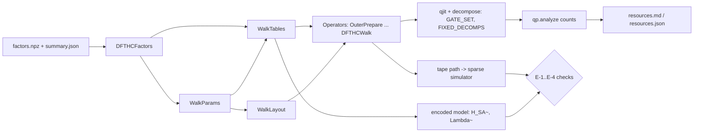

# DFTHC block encoding, qubitized walk and phase estimation in PennyLane: design specification

| | |
| --- | --- |
| Date | 2026-11-11 |
| Status | Written for user review; the implementation plan is written after approval |
| Branch | `docs/design-spec` (local only) |
| Paper | G. H. Low et al., "Fast quantum simulation of electronic structure by spectral amplification", Phys. Rev. X 15, 041016 (2025), arXiv:2502.15882. Called "the paper" below. |
| Reference implementation | [Covestro-HPQC/dfthcbe](https://github.com/Covestro-HPQC/dfthcbe) at commit `930255020cec30172e0a7d17c0071d9476a687d1` (Qualtran). Called "dfthcbe" below. |
| Toolchain snapshot | PennyLane `0.46.0.dev151`, Catalyst `0.16.0.dev140`, Lightning `0.46.0.dev34` (nightlies of 2026-11-11) |

## Table of contents

1. [Summary](#1-summary)
2. [Requirements](#2-requirements)
3. [Background: the construction](#3-background-the-construction)
4. [Approaches considered and decision](#4-approaches-considered-and-decision)
5. [Architecture](#5-architecture)
6. [Conventions](#6-conventions)
7. [Toolchain and compilation model](#7-toolchain-and-compilation-model)
8. [Data and classical preprocessing](#8-data-and-classical-preprocessing)
9. [Operator catalog](#9-operator-catalog)
10. [Register layout and qubit budget](#10-register-layout-and-qubit-budget)
11. [Iterative phase estimation](#11-iterative-phase-estimation)
12. [Verification and tests](#12-verification-and-tests)
13. [Expected resources and the resource report](#13-expected-resources-and-the-resource-report)
14. [Known limitations and mitigations](#14-known-limitations-and-mitigations)
15. [Orchestration overview](#15-orchestration-overview)
16. [Risks and open questions](#16-risks-and-open-questions)
17. [References](#17-references)

## 1. Summary

We implement the paper's block encoding of the DFTHC sum-of-squares Hamiltonian, $\mathrm{BE}[H_{\mathrm{SA}}/\Lambda - I]$, its qubitized walk operator $W$, the controlled walk, and an iterative phase-estimation (QPE) wrapper around the controlled walk. The implementation targets PennyLane and Catalyst nightlies:

- Every building block is an `Operator2` with explicit decomposition rules.
- Programs are compiled with `qp.qjit(capture=True)` and `qp.decompose`, Catalyst's graph-based decomposition, to a Toffoli-level gate set. Every rotation is a phase-gradient addition.
- Resources are read with `qp.analyze`.
- Decomposition rules are lowered inside the `qjit` call.

Correctness is established in three ways:
- per block: rule validity, behaviour on `lightning.qubit`, and exact Toffoli and measurement counts against closed forms;
- end to end on H2, with a purpose-built sparse-state simulator;
- for QPE, on a toy walk.

The expected cost at FeMoco-54 is about 9.8k Toffolis per walk, against the paper's 9,997 and dfthcbe's 9,641. Differences are explained in a generated report, not tuned away.

## 2. Requirements

### 2.1 Standing requirements

These come from the user and apply to every part of the project.

| ID | Requirement |
| --- | --- |
| R-1 | Use the latest nightly PennyLane and Catalyst, installed as in §7.1. |
| R-2 | Compile with `qp.qjit(capture=True)` and `qp.decompose` (the graph decomposition system). Obtain resources with `qp.analyze`. |
| R-3 | Decomposition rules are lowered as part of the `qjit` call. The precompiled decomposition-rule bytecode file is not used. |
| R-4 | Every building block is an `Operator2` with clear documentation. The code is modular. |
| R-5 | Resource-aware tests accompany all development. |
| R-6 | Verifiability, testability and comprehensiveness: other people must be able to understand what was done and how the code works. |
| R-7 | No workarounds to match the paper's or dfthcbe's resource counts beyond the paper's own constructions. Deltas are documented. |
| R-8 | Scope: block encoding, walk, controlled walk, and an iterative QPE wrapper on the controlled walk. All are compiled and resource-counted. QPE is simulated only at toy sizes. |
| R-9 | Gate set: Toffoli level, with rotations done by phase-gradient addition (§7.3). |
| R-10 | Verification: a purpose-built sparse-state simulator checks $\langle 0\vert\mathrm{BE}\vert 0\rangle = H_{\mathrm{SA}}/\Lambda - I$ end to end on H2, covering both outcomes of every erase measurement (§12.5). Per-block checks run on `lightning.qubit`. |
| R-11 | Git: local branches only. Never push and never modify remotes. |

### 2.2 Scope and non-goals

In scope:
- classical preprocessing from given DFTHC factors (the vendored dfthcbe data);
- all operators of steps 1–28 of the circuit (§3.5);
- the controlled walk;
- the QPE wrapper;
- compilation and resource counting;
- the resource-delta report;
- verification tooling and documentation.

Not in scope for this phase:
- computing DFTHC factorizations or the sum-of-squares shift from molecular integrals;
- Clifford+T synthesis and T counts;
- Qualtran-specific refinements: aligned-block pruning of unary iteration, heterogeneous target layouts, early junk measurement for qubit reuse;
- spacetime or surface-code costing;
- hardware execution;
- simulating QPE on DFTHC instances.

### 2.3 Definition of done

| ID | Criterion |
| --- | --- |
| D-1 | Every operator in §9 exists with documentation per §9.0 and passes its rule-validity, semantics, exact-resource, gate-set-closure and rule-selection tests. |
| D-2 | End-to-end checks E-1 to E-4 (§12.4) pass on `h2_sto3g_R2_B2_C1` with tolerance $10^{-10}$, for every outcome schedule of §12.5. |
| D-3 | The FeMoco-54-shaped walk and controlled walk compile, and `qp.analyze` gives non-symbolic Toffoli and measurement counts. Those counts appear in `docs/resources.md` next to the paper's and dfthcbe's numbers, with every delta explained. |
| D-4 | The QPE wrapper recovers the exact phases of the toy walk (§11.4). It compiles and is resource-counted for a DFTHC instance. |
| D-5 | The canary suite (§14) runs and records the current state of every known limitation. |
| D-6 | The documentation set of §5.2 exists and is consistent with the code. |
| D-7 | All work is committed on local branches and merged into local `main` after review gates. Nothing is pushed. |

## 3. Background: the construction

### 3.1 Symbols

Register widths use $\lg y := \lceil \log_2 y \rceil$. A register of width 0 is omitted. "FeMoco-54" is the 54-orbital FeMoco active space with $(R, B, C) = (10, 27, 27)$ and the precisions of the paper's Table III. Its values are listed for orientation.

| Symbol | Meaning | FeMoco-54 |
| --- | --- | --- |
| $N$ | Spatial orbitals; each spin register has $N$ qubits | 54 |
| $R$, $B$, $C$ | DFTHC rank, terms per rank, copies per rank | 10, 27, 27 |
| $X_o = N + RC$ | Values of the generator index $x_o$ | 324 |
| $N_+$, $N_-$ | Positive and negative eigenvalues of the effective one-body matrix $h^{(1)\prime}$, with $N_+ + N_- = N$ | data |
| $b_{\mathrm{rot}}$ | Bits per Givens angle | 15 |
| $b_{\mathrm{grad}}$ | Width of the phase-gradient register; $b_{\mathrm{grad}} = b_{\mathrm{rot}}$ | 15 |
| $b_{k1}$, $b_{k2}$ | Bits of the outer and inner alias keep values | 15, 15 |
| $s_u$ | Bits of the rotation angles inside a flagged uniform preparation; $s_u \le b_{\mathrm{grad}}$ | 7 |
| $w_x = \lg X_o$, $w_b = \lg (B+1)$, $w_r = \lg R$ | Widths of the $x_o$, $b$ and $r$ registers | 9, 5, 4 |
| $d_1 = w_x + b_{k1}$ | Bits of one outer table entry: alt and keep | 24 |
| $d_2 = w_b + b_{k2} + 2 + w_r$ | Bits of one inner table entry: alt, keep, sgn, d_sgn and $r$ | 26 |
| $k_1$, $k_2$; $K_i = 2^{k_i}$ | Block bits of the outer and inner QROAM reads | 2, 4 |
| $k_{e1}$ | One-hot bits of the outer erase fixup: low bits of $x_o$ | 4 |
| $k_{e2}$ | One-hot bits of the inner erase fixup, counted as low bits of $x_o$; the one-hot also spans all $w_b$ bits of $b$ | 2 |
| $M_1 = \lceil X_o/K_1 \rceil$ | Live leaves of the outer read | 81 |
| $M_2 = RC \lceil (B+1)/K_2 \rceil$ | Live leaves of the inner read | 540 |
| $\Lambda$ | Block-encoding normalization (§3.2) | data |
| $\tilde\Lambda$, $\tilde H_{\mathrm{SA}}$ | Normalization and Hamiltonian that the circuit encodes for the rounded tables (§8.5) | data |
| $E_{\mathrm{SoS}}$, $E_{\mathrm{gap}}$, $\lambda_{\mathrm{eff}}$ | Sum-of-squares offset, spectral gap and effective normalization (§3.3) | data |
| $T$ | Toffoli count: number of `Toffoli` plus number of `TemporaryAND` (§7.6) | |

### 3.2 The sum-of-squares Hamiltonian

With its two-body tensor DFTHC-factorized, the electronic-structure Hamiltonian $H$ on $N$ spatial orbitals satisfies, up to a constant $E_{\mathrm{SoS}}$:

$$H_{\mathrm{SA}} = H - E_{\mathrm{SoS}} = \sum_{\alpha} O_\alpha^\dagger O_\alpha \succeq 0 .$$

The sum runs over $2N + RC$ generators, written with rotated Majoranas $\tilde\gamma_{u\sigma f} = \sum_p u_p \gamma_{p\sigma f}$ of flavour $f \in \{0, 1\}$ and spin $\sigma$, and with $a_{u\sigma} = (\tilde\gamma_{u\sigma 0} + i\tilde\gamma_{u\sigma 1})/2$:

- **SF (two-body) generators**, one per $r \in [R]$, $c \in [C]$:
  $$O_{\mathrm{SF},rc} = \tfrac{1}{\sqrt 2}\Big(w_B^{(r,c)} + \tfrac{i}{2} \sum_{b\in[B],\,\sigma} w_b^{(r,c)}\, \tilde\gamma_{u_b^{(r)}\sigma 0}\, \tilde\gamma_{u_b^{(r)}\sigma 1}\Big).$$
  Here $u_b^{(r)}$ are unit vectors, $w_b^{(r,c)}$ real weights, and $w_B^{(r,c)}$ is the identity weight, indexed as the extra term $b = B$.
- **D1 and Q1 (one-body) generators**: D1 annihilates and Q1 creates an electron in a rotated orbital. They come from the eigenvectors $u_\pm^{(r)}$ of $h^{(1)\prime}$, for both spins:
  $$O_{D_1\sigma,r} = \sqrt{w_+^{(r)}}\, a_{u_+^{(r)}\sigma}, \qquad O_{Q_1\sigma,r} = \sqrt{w_-^{(r)}}\, a^\dagger_{u_-^{(r)}\sigma}.$$

The LCU (linear combination of unitaries) weights are:
- $\lambda_{D_1\sigma,r} = \sqrt{w_+^{(r)}}$;
- $\lambda_{Q_1\sigma,r} = \sqrt{w_-^{(r)}}$;
- $\lambda_{\mathrm{SF},rc} = \tfrac{1}{\sqrt 2}\sum_{b\in[B+1]}\lvert w_b^{(r,c)}\rvert$.

The normalization is:

$$\Lambda = \tfrac12 \sum_\alpha \lambda_\alpha^2 = \lVert h^{(1)\prime}\rVert_1 + \tfrac14 \sum_{r,c}\Big(\sum_{b\in[B+1]}\lvert w_b^{(r,c)}\rvert\Big)^2 .$$

Here $\lVert\cdot\rVert_1$ is the sum of absolute eigenvalues. $E_{\mathrm{SoS}}$ follows the paper (Eq. 30 in the walk's frame, as in dfthcbe's `walk_e_sos` and `walk_integrals`). Our implementation must reproduce dfthcbe's `summary.json` value `e_sos` (§8.6).

### 3.3 Block encoding, walk and controlled walk

The construction has the following pieces:
- $\mathrm{PREP}\lvert 0\rangle = \lambda_{\mathrm{sqrt}}^{-1}\sum_\alpha \lambda_\alpha \lvert\alpha\rangle\lvert\mathrm{garb}_\alpha\rangle$, with $\lambda_{\mathrm{sqrt}}^2 = \sum_\alpha \lambda_\alpha^2$.
- $\mathrm{SEL} = \sum_\alpha \lvert\alpha\rangle\langle\alpha\rvert \otimes \mathrm{BE}[O_\alpha/\lambda_\alpha]$ and $U = \mathrm{SEL}\cdot\mathrm{PREP}$.
- For any register set $X$, $\mathrm{REF}_X := 2\lvert 0\rangle\langle 0\rvert_X - I$.
- $\mathrm{REF}_{T_2} := 2\Pi_{T_2} - I$, with $\Pi_{T_2} = \lvert 0\rangle\langle 0\rvert_{\mathcal B} \otimes \lvert 1\rangle\langle 1\rvert_{\mathrm{succ}_{x_o}}$. It is $-I$ where the uniform preparation of $x_o$ failed.
- $\mathcal A = (x_o, m_{x_o}, \sigma_1)$ are the outer index registers. $\mathcal B = (b, m_b, \sigma_0)$ are the inner index registers.

From these:

$$\mathrm{BE}\Big[\frac{H_{\mathrm{SA}}}{\Lambda} - I\Big] = U^\dagger\, \mathrm{REF}_{T_2}\, U, \qquad W = \mathrm{REF}_{\mathcal A\cup\mathcal B}\; U^\dagger\, \mathrm{REF}_{T_2}\, U .$$

Spectrum and cost:
- $W$ has eigenphases $\pm\arccos(E_j/\Lambda - 1)$ for the eigenvalues $E_j$ of $H_{\mathrm{SA}}$.
- The lowest eigenvalue is $E_{\mathrm{gap}} = E_{\mathrm{gs}} - E_{\mathrm{SoS}}$.
- Resolving energies near the gap to $\delta E$ takes about $\lambda_{\mathrm{eff}}/\delta E$ walk steps, with $\lambda_{\mathrm{eff}} = \sqrt{E_{\mathrm{gap}}(2\Lambda - E_{\mathrm{gap}})}$.

On states whose ancillas start in $\lvert 0\rangle$ we have $U^\dagger U = I$. So the controlled walk controls only the two reflections:

$$C(W) = C(\mathrm{REF}_{\mathcal A\cup\mathcal B})\; U^\dagger\; C(\mathrm{REF}_{T_2})\; U .$$

The controlled reflections must reproduce the global sign of $2\Pi - I$ exactly, because control turns a global phase into a relative one.

### 3.4 Energy estimation

QPE on $C(W)$ estimates an eigenphase $\theta$. The energy follows as $E = \tilde\Lambda(1 + \cos\theta)$, where $\tilde\Lambda$ is the effective normalization of §8.5. The two eigenphases $\pm\theta$ that belong to one eigenvalue give the same energy.

### 3.5 The circuit, step by step

The numbering follows dfthcbe's README.

| Steps | Operation | Operator |
| --- | --- | --- |
| 1 | Flagged uniform superposition over $x_o \in [X_o)$; $\lvert +\rangle$ on $m_{x_o}$ and $\sigma_1$ | `FlaggedUniformPrep` in `OuterPrepare` |
| 2 | Read (alt, keep) at $x_o$ | `QROAMRead` in `OuterPrepare` |
| 3 | $\mathrm{keep} \le m_{x_o}$ into $\mathrm{less\_than}_{x_o}$ | comparator in `OuterPrepare` |
| 4 | Swap alt with $x_o$ if $\mathrm{less\_than}_{x_o}$ | CSWAPs in `OuterPrepare` |
| 5 | Flagged uniform superposition over $b \in [B+1)$; $\lvert +\rangle$ on $m_b$ and $\sigma_0$ | `FlaggedUniformPrep` in `InnerPrepare` |
| 6 | Read (alt, keep, sgn, d_sgn, $r$) at $(x_o, b)$ | `QROAMRead` in `InnerPrepare` |
| 7, 8 | Keep test, alias swap | `InnerPrepare` |
| 9 | Signs of the surviving $w_b$ | `InnerSigns` |
| 10 | Tail angles and family flags $G_0$, $G_1$ at $x_o \ge RC$ | `TailAngleLoad` |
| 11 | SF angles and $[b \ne B]$ at $(r, b)$ if $G_0 = 0$ | `SFAngleLoad` |
| 12 | $\sigma \leftarrow \sigma_{G_0}$ | `SpinMux` |
| 13 | Swap $\psi_{\uparrow}$ with $\psi_{\downarrow}$ if $\sigma$ | `SpinSwap` |
| 14 | Givens ladder on $\psi_{\downarrow}$ | `GivensLadder` |
| 15 | Majorana gate on $\psi_{\downarrow}[0]$ | `MajoranaGate` |
| 16 | Inverse Givens ladder | adjoint of `GivensLadder` |
| 17 | Undo the swap, unbuild $\sigma$ | `SpinSwap`, `SpinMux` |
| 18 | Erase angles, $[b \ne B]$, $G_0$, $G_1$ by measurement | `AngleErase` |
| 19–22 | Undo 5–8; erase inner data by measurement | explicit `Adjoint(InnerPrepare)` rule |
| 23 | $\mathrm{REF}_{T_2}$ | `RefT2` |
| 24–27 | Undo 1–4; erase outer data by measurement | explicit `Adjoint(OuterPrepare)` rule |
| 28 | $\mathrm{REF}_{\mathcal A \cup \mathcal B}$ | `RefAB` |

Steps 10–18 form `InnerSelect`. Steps 5–22 run twice per block encoding:
1. Before $\mathrm{REF}_{T_2}$: `InnerPrepare`, `InnerSigns`, `InnerSelect`, adjoint `InnerPrepare`.
2. After it: `InnerPrepare`, adjoint `InnerSelect`, `InnerSigns`, adjoint `InnerPrepare`.

The adjoint of `InnerSelect` is the same circuit with the adjoint Majorana gate, because the Majorana gate is not Hermitian.

## 4. Approaches considered and decision

### 4.1 Options

1. **Paper-structured operators on PennyLane primitives.**
   - One `Operator2` per block of the paper's circuit, with the same boundaries as the paper's Table III and the dfthcbe bloqs.
   - Blocks are built from PennyLane primitives that compile cleanly to the gate set: `TemporaryAND`, `SemiAdder`, the comparators, `CSWAP`, `MultiControlledX` with work wires, `PhaseGradientStatePrep`.
   - New code is written only where PennyLane lacks the functionality.
2. **Template-first.** Compose PennyLane's existing templates: `AliasSampling`, `UniformPrep`, `Select`, `QROM`, and the THC templates.
3. **Literal port of dfthcbe.** A class-by-class translation, including Qualtran-specific cost refinements.

### 4.2 Measured comparison at FeMoco-54

These are estimates assembled from compiled per-block counts (`qp.analyze` at FeMoco-54 sizes with random tables of the right shape), combined with the paper's per-walk call structure. Toffolis per walk:

| Part | Paper | Option 1 with PennyLane `QROM` reads | Option 2 |
| --- | --- | --- | --- |
| Outer prepare and unprepare | 310 | ~550 | ~770 |
| Inner prepare and unprepare (×2) | 2,308 | ~7,000 | ~11,600 |
| Rotation-angle load and erase (×2) | 722 | ~1,700 | ~2,600 |
| Select: Givens ladders, swaps, Majorana gate (×2) | 6,590 | ~6,200 | ~6,200 |
| Reflections | 67 | ~70 | ~70 |
| **Total** | **9,997** | **~15,500** | **~21,200** |

Two effects drive the gaps:
- **Uncompute strategy, about +5,700, Option 2 only.** No PennyLane template uncomputes loaded data by measurement, so every unprepare re-runs its table read.
- **Table-read construction, about +5,500.** PennyLane's `QROM` returns its work wires clean, so its select-swap variant runs two selects and four swap networks.
  - At 324 × 24 bits the solver therefore picks plain unary iteration: 326 Toffolis, against the paper's 177 for read, test and swap together.
  - The combined-address inner read costs about 2,860 against the paper's 860.
  - The paper instead keeps the swap junk until a measured erase.

Option 2 is also not viable for other reasons:
- `UniformPrep` and `AliasSampling` need arbitrary-angle rotations, so they do not compile to the gate set.
- `Select` crashes Catalyst when its operators share target wires.
- The sum-of-squares-specific parts have no templates: the Majorana gate, the spin multiplexer and swap, $\mathrm{REF}_{T_2}$ with success flags, and the D1/Q1 terms.
- Under capture, `C(ChangeOpBasis)` loses its "control only the middle" saving ([pennylane#10357](https://github.com/PennyLaneAI/pennylane/issues/10357)), so a template-based controlled walk would control the entire walk.

Remedying Option 2 converges on Option 1. Option 3 re-implements primitives PennyLane provides and imports the refinements that R-7 defers.

### 4.3 Decision

**Option 1, with a paper-faithful `QROAMRead`** (user decision, 2026-11-11):
- The read keeps its swap junk on caller-provided wires until the measured erase.
- It iterates only over rows that hold data: unary iteration over $x_o$, the swap network over $b$.
- Qualtran-specific refinements (aligned-block pruning, heterogeneous target layouts) stay deferred.

### 4.4 Decision record: changes since the reviewed design summary

1. **`QROAMRead` replaces PennyLane `QROM`.** It is used for the alias reads and the angle loads, with the paper's construction (§9.3).
2. **The erase phase fixup is our own construction** (`PhaseFixup` and its rule helper `emit_phase_fixup`, §9.4). It applies `CZ`/`Z` gates directly. It does not load parity bits through a `QROM` into a $\lvert -\rangle$ ancilla, because PennyLane's select-swap `QROM` adds complex phases unless its block size is 1 (§14, L-12). The fallback is plain unary iteration (§9.4).
3. **Explicit `C(...)` rules are required, not only tidier** ([pennylane#10357](https://github.com/PennyLaneAI/pennylane/issues/10357)).
4. **Structure-determining data are compilable arguments** ([catalyst#3172](https://github.com/PennyLaneAI/catalyst/issues/3172)). A measured fallback exists if compile time at FeMoco size is too high (§16, K-1).
5. **Bodies of operators that are auto-adjointed contain no `qp.for_loop`/`qp.cond`** ([catalyst#3217](https://github.com/PennyLaneAI/catalyst/issues/3217)).
6. **Rule selection is asserted.** Tests use measurement-count signatures and, where the output is capturable, the verbose rule listing of `catalyst.passes.graph_decomposition`. Conditionals carry `qp.hint` branch probabilities.
7. **Junk persists from read to erase.** The qubit count therefore exceeds the paper's (§10.3).

## 5. Architecture

### 5.1 Layers

The system is layered. Each layer depends only on the layers below it.

| Layer | Content | Depends on |
| --- | --- | --- |
| L0, classical data | Factors, parameters, alias and angle tables, the encoded-Hamiltonian model, fermion matrices. NumPy and SciPy only. | none |
| L1, primitives | `PhaseGradientRotation`, `FlaggedUniformPrep`, `QROAMRead`, `PhaseFixup`, `QROAMErase`, `ZeroReflection`, and the unary-iteration helper | L0 table formats; PennyLane primitives |
| L2, paper blocks | `OuterPrepare`, `InnerPrepare`, `InnerSigns`, `TailAngleLoad`, `SFAngleLoad`, `SpinMux`, `SpinSwap`, `GivensRotation`, `GivensLadder`, `MajoranaGate`, `AngleErase`, `InnerSelect`, `RefT2`, `RefAB` | L1 |
| L3, assembly | `DFTHCBlockEncoding`, `DFTHCWalk` and their controlled versions; `WalkLayout` | L2 |
| L4, application | `ControlledWalkPower`, iterative QPE, phase-to-energy conversion | L3 |
| Tooling | `dfthc.compile` (gate set, pins, compile and analyze helpers), `dfthc.costs` (closed forms), `dfthc.testing` (sparse simulator, fixtures, toy walk), resource report | all layers, read-only |

### 5.2 Package and repository layout

```text
dfthc-be/
  pyproject.toml              package "dfthc" (src layout); pytest config with pythonpath = ["src"]
  requirements-nightly.lock   pip freeze of the canonical environment (§7.1)
  scripts/
    setup_env.sh              the environment recipe of §7.1
    make_dfthcbe_fixtures.py  generates reference fixtures from dfthcbe in a separate environment (§8.6)
    resource_report.py        writes docs/resources.md and docs/resources.json (§13.3)
  data/dfthc/                 vendored dfthcbe data, LICENSE (Apache-2.0) and NOTICE (§8.1)
  src/dfthc/
    params.py                 WalkParams: sizes, precisions, block bits, presets
    registers.py              WalkLayout: named wires for every register and work pool
    compile.py                GATE_SET, FIXED_DECOMPS, compiled_resources(), resource_key(), mcm_parities()
    costs.py                  closed-form costs of our construction
    costs_reference.py        the paper's Table III formulas and dfthcbe's formulas
    data/
      factors.py              DFTHCFactors, loaders, validation, random_factors()
      sos.py                  outer and inner weights, Λ, E_SoS, λ_eff
      alias.py                alias tables and their probabilities
      angles.py               Givens angles from unit vectors, discretization, reconstruction
      tables.py               WalkTables: everything the circuit loads, as compilable tuples
      fermion.py              Jordan-Wigner Majorana matrices, Fock-space operators (N <= 4)
      encoded.py              the Hamiltonian and normalization the circuit encodes (§8.5)
    ops/
      unary.py                unary-iteration helper (Python function used inside rules)
      phase_gradient.py       PhaseGradientRotation
      uniform.py              FlaggedUniformPrep
      qroam.py                QROAMRead, PhaseFixup, QROAMErase
      reflections.py          ZeroReflection, RefT2, RefAB
      prepare.py              OuterPrepare, InnerPrepare, InnerSigns
      angle_data.py           TailAngleLoad, SFAngleLoad, AngleErase
      spin.py                 SpinMux, SpinSwap
      givens.py               GivensRotation, GivensLadder
      majorana.py             MajoranaGate
      select.py               InnerSelect
      walk.py                 DFTHCBlockEncoding, DFTHCWalk
    qpe.py                    ControlledWalkPower, iterative_phase_estimation(), energy_from_phase()
    testing/
      sparse_sim.py           sparse-state simulator (§12.3)
      tape.py                 tape-path decomposition for simulation
      toy_walk.py             ToyWalk and ToyControlledWalkPower for QPE tests (§11.4)
      fixtures.py             small parameter sets, loaders for reference fixtures
      resources.py            assertions on compiled resources, warning filters
  tests/
    conftest.py  data/  ops/  integration/  sim/  canary/  report/  fixtures/
  docs/
    architecture.md  conventions.md  environment.md  limitations.md  verification.md
    resources.md (generated)  agents/HANDOFF.md  agents/LEDGER.md
    superpowers/specs/ (this file)  superpowers/plans/ (the implementation plan)
```

### 5.3 Data flow



### 5.4 Delivery phases

The implementation plan expands each phase into tasks.

| Phase | Content | Exit criterion |
| --- | --- | --- |
| 0. Foundation and feasibility | Repository scaffold, environment script and lock, `dfthc.compile`, test infrastructure, canary suite, vendored data. Three spikes: the FeMoco-size compile check (K-1), the mode-agnostic erase rule (K-3), and the comparator-adjoint check (K-7). | Fast suite green; spike results recorded in the ledger and §16 updated |
| 1. Parallel workstreams | (A) L0 classical data and the encoded model, with reference fixtures; (B) the sparse simulator; (C) L1 primitives | Each workstream's tests green and reviewed |
| 2. Paper blocks | (D) `OuterPrepare`, `InnerPrepare`, `InnerSigns`; (E) the select components: angle loads, `AngleErase`, `SpinMux`, `SpinSwap`, Givens, `MajoranaGate` | Same |
| 3. Assembly | `InnerSelect`, reflections, `DFTHCBlockEncoding`, `DFTHCWalk`, controlled versions, end-to-end checks E-1 to E-4 | D-2 met |
| 4. Application and report | QPE wrapper and toy tests; resource report; documentation | D-3, D-4 and D-6 met |
| 5. Final review | Cross-review, fixes, final merge into local `main` | D-1 to D-7 met |

## 6. Conventions

These conventions follow dfthcbe unless stated otherwise, so blocks can be compared one-to-one.

### 6.1 Indices and flags

- **Generator index $x_o$, SF first.**
  - $x_o < RC$ is an SF generator, with $x_o = rC + c$.
  - The last $N$ values are the one-body tail: $x_o = RC + j$ for $j \in [N)$. The $N_+$ D1 rows come first, then the $N_-$ Q1 rows.
- **Family flags.**
  - $G_0 = 0$ means SF; $G_0 = 1$ means one-body.
  - On one-body rows, $G_1 = 0$ means D1 and $G_1 = 1$ means Q1.
  - `TailAngleLoad` writes both flags; `SFAngleLoad` acts only on $G_0 = 0$.
- **Inner index $b \in [B+1)$.** $b = B$ is the identity term $w_B$. The flag $[b \ne B]$ is 1 exactly on SF rows with $b < B$; `SFAngleLoad` writes it.
- **Signs.**
  - `InnerPrepare` loads $\mathrm{sgn} = [w_b < 0]$ and $\mathrm{d\_sgn} = \mathrm{sgn} \oplus \mathrm{sgn}[\mathrm{alt}]$.
  - `InnerSigns` applies $Z(\mathrm{sgn})$ and $CZ(\mathrm{less\_than}_b, \mathrm{d\_sgn})$, so every branch carries the sign of the surviving $b$.
- **Rank register.** $r = \lfloor x_o / C\rfloor$ on SF rows. The inner read writes it and the inner erase clears it.
- **Spins.**
  - $\sigma_0$ is the inner spin: the spin sum on SF, and the Majorana flavour ancilla on D1/Q1.
  - $\sigma_1$ is the outer spin: the spin label of D1/Q1 generators.
  - $\sigma$ (register `sg`) $= \sigma_{G_0}$ controls the spin swap.

### 6.2 Fermions

- **Jordan-Wigner on each spin register.** $\gamma_{j,0} = Z_0\cdots Z_{j-1}X_j$ and $\gamma_{j,1} = Z_0\cdots Z_{j-1}Y_j$, with qubit 0 the most significant. So $\lvert 1\rangle$ is occupied, $a_j = Z_0\cdots Z_{j-1}(X_j + iY_j)/2$, and $n_j = (1 - Z_j)/2$.
- **Fock ordering.** The system state is $\psi_{\uparrow} \otimes \psi_{\downarrow}$ with $\psi_{\uparrow}$ first. The dense $4^N$ matrices of `dfthc.data.fermion` use this order.
- **Majorana gate.** It acts on $\psi_{\downarrow}[0]$, where the Jordan-Wigner string is empty: $\gamma_0 = X$ and $\gamma_1 = Y$.
  - SF applies $i\gamma_0\gamma_1 = -Z$.
  - D1 applies $a = (X + iY)/2$; Q1 applies $a^\dagger = (X - iY)/2$.
  - The paper's Fig. 4 applies $+Z$ on SF, which would flip every $w_b$ relative to $w_B$. We follow dfthcbe's $-Z$.

### 6.3 Givens angles

- **Ladder.** Rung $k \in [N-1)$ acts on modes $(q_k, q_{k+1})$ with angle $\theta_k$. The ladder applies $U(u)$ with $U(u)^\dagger \gamma_{0,f} U(u) = \sum_j u_j\gamma_{j,f}$.
- **Angles and storage.** Angles come from the one-column Givens factorization of $u$ (`angles_from_vector`). They are stored as $x_k = \mathrm{round}(\theta_k/(2\pi)\cdot 2^{b_{\mathrm{rot}}-1}) \bmod 2^{b_{\mathrm{rot}}}$. The rung realizes $\theta = 4\pi x/2^{b_{\mathrm{rot}}}$ exactly.
- **Rung matrix.** In the basis $\{\lvert 01\rangle, \lvert 10\rangle\}$ of $(q_k, q_{k+1})$ it is $\begin{pmatrix}\cos\theta & -\sin\theta\\ \sin\theta & \cos\theta\end{pmatrix}$. The states $\lvert 00\rangle$ and $\lvert 11\rangle$ are fixed.

### 6.4 Alias sampling

- A row of non-negative weights $w_\ell$ gives tables $(\mathrm{alt}_\ell, \mathrm{keep}_\ell)$ with $\mathrm{keep}_\ell \in [0, 2^{b_k})$. Index $\ell$ survives with probability $\mathrm{keep}_\ell/2^{b_k}$ and is replaced by $\mathrm{alt}_\ell$ otherwise.
- The prepared distribution is $p_\ell = \big(\mathrm{keep}_\ell + \sum_{j:\mathrm{alt}_j = \ell}(2^{b_k} - \mathrm{keep}_j)\big)/(L\, 2^{b_k})$.
- The comparator writes $\mathrm{less\_than} = [\mathrm{keep} \le m]$, where $m$ is uniform over $[0, 2^{b_k})$. A set flag swaps in alt.
- The D1/Q1 rows of the inner table are all zero and load nothing.

### 6.5 Phase-gradient register

- The register holds the state that PennyLane's `PhaseGradientStatePrep` prepares on $b_{\mathrm{grad}}$ wires. It is prepared once at the start of every top-level circuit, outside the walk, and returned unchanged by every operator ("catalysed").
- Adding the integer $k$ into the register multiplies the state by $e^{\pm 2\pi i k/2^{b_{\mathrm{grad}}}}$. A unit test pins the sign by checking the phase that `SemiAdder` kicks back when it adds 1.
- Adding into the top $m$ qubits gives the phase $e^{\pm 2\pi i k/2^m}$.

### 6.6 Reflections and global phases

- $\mathrm{REF}_X = 2\lvert 0\rangle\langle 0\rvert_X - I$ and $\mathrm{REF}_{T_2} = 2\Pi_{T_2} - I$ are implemented exactly, including the global sign: uncontrolled with `GlobalPhase`, controlled with a `Z` on the control (§9.6).
- Generic `C(GlobalPhase)` is never used, because its rule produces a phase shift, which is outside the gate set.

### 6.7 Wires and registers

- Integers in registers are big-endian: the first wire is the most significant bit.
- Register names follow dfthcbe: `x_o`, `succ_x_o`, `sigma_1`, `m_x_o`, `less_than_x_o`, `alt_x_o`, `keep_x_o`, `junk_x_o`, `b`, `succ_b`, `sigma_0`, `m_b`, `less_than_b`, `alt_b`, `keep_b`, `sgn`, `d_sgn`, `r`, `junk_b`, `angles`, `G0`, `G1`, `b_neq_B`, `sg`, `psi_up`, `psi_dn`, `phase_grad`, `work`.
- `angles` is the concatenation of $N - 1$ registers of $b_{\mathrm{rot}}$ wires; register $k$ drives rung $k$.
- Composite operators take grouped wire arguments (`outer`, `inner`, `select`, `system`, `phase_grad`, `work`). `dfthc.registers.WalkLayout` defines the order of the registers inside each group, and every operator splits groups only through `WalkLayout` helpers.

## 7. Toolchain and compilation model

### 7.1 Environment

One canonical environment serves all agents and worktrees: `.venv` in the repository root, CPython 3.12.

```bash
python3.12 -m venv .venv
source .venv/bin/activate
pip install --upgrade pip
# Catalyst nightly first (this is the user's `catame` alias), then the PennyLane nightly on top:
pip install --extra-index-url=https://test.pypi.org/simple/ --pre pennylane-catalyst --upgrade
pip install --extra-index-url=https://test.pypi.org/simple/ --pre pennylane --upgrade
pip install pytest pytest-xdist ruff          # from PyPI, without the TestPyPI index
pip freeze > requirements-nightly.lock
```

`scripts/setup_env.sh` runs exactly these commands. Pitfalls, all observed on 2026-11-11:

- **Always use plain `pip`; never `uv pip`.** uv's default first-index strategy resolves `pennylane-catalyst` from PyPI and silently installs the stable 0.15.
- **Expect one pip error.** The second install prints `ERROR: ... pennylane-catalyst 0.16.0.dev140 requires pennylane==0.46.0-dev149, but you have pennylane 0.46.0.dev151`. The override is intended.
- **The linker warning is benign.** `ld: warning: object file ... was built for newer 'macOS' version (28.0) than being linked (27.0)` appears on every compile.
- **Set `CATALYST_SILENCE_RULE_LOWERING_WARNINGS=0`.** Catalyst otherwise drops broken or excluded rules silently ([catalyst#3190](https://github.com/PennyLaneAI/catalyst/pull/3190)). `tests/conftest.py` sets it.
- **Keep the lock file.** `--pre` with the TestPyPI extra index also pulls dev builds of transitive dependencies (for example `termcolor 3.3.1.dev66` and `urllib3 2.8.1.dev35`). `requirements-nightly.lock` records the exact set.
- **Do not install the package in editable mode.** Use pytest's `pythonpath = ["src"]`, so every git worktree runs against the shared `.venv` with its own sources.
- **Filter the built-in warning noise.** Excluded-rule warnings for PennyLane's own rules print on every compile: `Excluded the <rule> decomposition rule for <op> since --decompose-lowering cannot work with multiple registers yet` for `_ppm`, `_lattice_surgery_ppm`, `_toffoli_elbow`, `_cphase_to_single_phase` and the MCX `*_worker(s)` rules, and `Skipped the _adjoint_temporary_and... rule for C(Adjoint(TemporaryAND))`. `dfthc.testing.resources` filters exactly these.
- **The "could not be parsed" error means there is no decomposition path.** The text is `failed to load built-in decomposition rules from '...mlirbc': the rules file could not be parsed`. Catalyst tries the bytecode file only as a fallback after its solver failed. Look in stderr for `Decomposition rule not found for operator '<op>'`. The file itself is intentionally not shipped (R-3).
- **Activating the venv is recommended but not required.** Calling `.venv/bin/python` directly also works with in-call rule lowering.

**Bumping the nightlies.**
1. Recreate `.venv` with the recipe.
2. Run the full test suite, including the canaries.
3. Update §14 and `docs/limitations.md` for every canary whose state changed.
4. Refresh the lock file and the snapshot in `docs/environment.md`.
5. Commit on a branch.

### 7.2 Compilation pipeline

Every compiled program uses this decorator stack:

```python
import pennylane as qp
from dfthc.compile import GATE_SET, FIXED_DECOMPS

dev = qp.device("null.qubit", wires=layout.num_wires)  # resource counting; "lightning.qubit" for semantics

@qp.qjit(capture=True)
@qp.decompose(gate_set=GATE_SET, fixed_decomps=FIXED_DECOMPS)
@qp.qnode(dev)
def circuit():
    qp.PhaseGradientStatePrep(layout.phase_grad)
    DFTHCWalk(...)
    return qp.probs(wires=[0])

counts = qp.analyze(circuit, level="user")().resources
```

Facts the design relies on:
- **`qp.decompose` is a compiler pass only.** Under `qjit(capture=True)` it always runs Catalyst's `graph-decomposition`; there is no non-graph fallback ([pennylane#10304](https://github.com/PennyLaneAI/pennylane/pull/10304), [catalyst#3058](https://github.com/PennyLaneAI/catalyst/pull/3058)). A gate without a path to the gate set is a hard compile error.
- **Rules are collected from the Python registry and lowered during the `qjit` call.** This is Catalyst's default `collect_decomp_rules=True` ([catalyst#3061](https://github.com/PennyLaneAI/catalyst/pull/3061)). We never pass precompiled rules (R-3).
- **`qp.analyze` works only on `qjit`-compiled QNodes.** `dfthc.compile.compiled_resources()` wraps the stack above. It:
  - returns a record with the Toffoli count, measurements, the full counts and the wire count;
  - asserts that the counts are not symbolic;
  - asserts gate-set closure (§12.1).
- **Two decomposition levels.** Executing on `lightning.qubit` runs a second decomposition pass to the device gate set ([catalyst#3275](https://github.com/PennyLaneAI/catalyst/pull/3275)). `level="user"` reports counts after our pass and is the level for all resource numbers. `level="device"` is used once per composite operator to check that no undecomposed operator remains: an undecomposed `OperatorOp` would run as a bare named gate ([catalyst#3430](https://github.com/PennyLaneAI/catalyst/pull/3430)).
- **Devices.** `null.qubit` is used for resource counting at any size. `lightning.qubit` is used for semantics up to 25 wires.

### 7.3 Gate set and weights

```python
GATE_SET = {
    "PauliX": 1, "PauliY": 1, "PauliZ": 1, "Hadamard": 1, "S": 1, "Adjoint(S)": 1,
    "CNOT": 1, "CZ": 1, "SWAP": 1, "GlobalPhase": 1, "MidMeasure": 1,
    "Adjoint(TemporaryAND)": 1, "PhaseGradientStatePrep": 1,
    "Toffoli": 1000, "TemporaryAND": 1000,
}
```

How the gate set behaves:
- The weights make the solver minimize Toffolis first.
- `TemporaryAND` costs one Toffoli. `Adjoint(TemporaryAND)` is a measurement-based uncompute and costs no Toffoli.
- `PhaseGradientStatePrep` stays a primitive. It is a one-time resource state, prepared outside the walk.
- No arbitrary-angle rotation is in the set, so every rotation must come from phase-gradient addition (R-9).
- `qp.analyze` names mid-circuit measurements `MidCircuitMeasure`.

### 7.4 Rules for writing operators and decomposition rules

Each rule exists because of a confirmed limitation (§14).

1. **No allocation inside rules.**
   - No `qp.allocate`, and no `work_wires=` in `qp.register_resources`. Catalyst excludes such rules even when they are pinned ([catalyst#3243](https://github.com/PennyLaneAI/catalyst/pull/3243)).
   - Every ancilla is an explicit wire argument. Every operator exposes a static method `required_wires(**compilable_args) -> dict[str, int]`.
2. **Resource functions.**
   - Keys are `Operator2` abstract instances, for example `qp.TemporaryAND(Wire[3])`, `qp.adjoint(qp.TemporaryAND(Wire[3]))`, `qp.ops.MidMeasure(Wire[1], reset=True)`, or our operators built from abstract inputs. Legacy `resource_rep` helpers raise for `Operator2`, which makes Catalyst drop the rule silently.
   - Keys are built inside `qp.capture.pause()` through `dfthc.compile.resource_key`, because Catalyst evaluates resource functions with capture on ([pennylane#10162](https://github.com/PennyLaneAI/pennylane/issues/10162)). This is a precaution: abstract `TemporaryAND` and `MidMeasure` keys worked without pausing in the 2026-11-11 spikes, but keys of composite `Operator2`s may bind primitives.
   - Every emitted operator is declared, including adjoint and controlled variants ([pennylane#10341](https://github.com/PennyLaneAI/pennylane/pull/10341)).
   - Counts are Python integers. Resource functions never raise.
3. **Arguments.**
   - Every argument that determines circuit structure is in `compilable_argnames`: sizes, live ranges, block bits, tables. Rules are compiled once against abstract inputs, and only compilable values are concrete inside them ([catalyst#3172](https://github.com/PennyLaneAI/catalyst/issues/3172)).
   - `static_argnames` are not used, because an operator cannot mix static and compilable arguments.
   - `dynamic_argnames` are used only for runtime data: the parity bits of `PhaseFixup`, and the bulk tables of the K-1 fallback (§16) if it is activated.
4. **Control flow.**
   - Bodies of operators that are auto-adjointed contain no `qp.for_loop` or `qp.cond`, because adjoint lowering can crash on nested control flow ([catalyst#3217](https://github.com/PennyLaneAI/catalyst/issues/3217)). Loops are unrolled in Python with static bounds, which also keeps `qp.analyze` counts concrete.
   - `qp.cond` appears only on mid-circuit measurement outcomes, inside erase operators and the QPE wrapper.
   - `qp.for_loop` appears only in `ControlledWalkPower`, which is never adjointed.
   - Exception: if the K-1 fallback (§16) is activated, `qp.for_loop` and data-dependent `qp.cond` may also appear in the bodies of never-adjointed operators (`QROAMRead`, the angle loads, the erases).
   - PennyLane primitives that we use under an adjoint (`SemiAdder`, the comparators) are covered by Phase 0 capability tests (K-7).
5. **Measurement-based uncompute.**
   - It lives only in dedicated erase operators (`QROAMErase`, `AngleErase`) and in explicit `Adjoint(Op)` rules with signature `(base)`. Their resource functions declare the measurements.
   - An operator that contains a measurement is never placed under `qp.ctrl`, because Catalyst rejects measurements in control regions.
6. **Controlled versions.**
   - They come only from explicit `C(Op)` rules with signature `(base, control_wires, control_values, work_wires, work_wire_type)`.
   - Such rules are provided for `ZeroReflection`, `RefT2`, `RefAB`, `DFTHCBlockEncoding`, `DFTHCWalk` and the toy walk.
   - Generic controlled wrapping is never relied on: [pennylane#10357](https://github.com/PennyLaneAI/pennylane/issues/10357), [pennylane#10080](https://github.com/PennyLaneAI/pennylane/issues/10080), [catalyst#3330](https://github.com/PennyLaneAI/catalyst/pull/3330).
7. **One base rule per operator.** Explicit adjoint and controlled rules are pinned (§7.5). The solver chooses by cost, and with unweighted counts it once preferred an auto-derived unitary inverse over our measured erase.
8. **Unique class names.** Rules are keyed by class name, and a test asserts that PennyLane registers none of our names. On 2026-11-11 none collide.
9. **Rules run in both modes.**
   - They must work under capture (PennyLane's program capture into a jaxpr, used by `qjit`) and in tape mode (the non-captured path that records operations in a `QuantumScript`). `qp.testing.assert_valid_decomp_rule` and the sparse simulator use tape mode.
   - Mode-specific classical code is confined to helpers. `dfthc.compile.mcm_parities` computes the fixup parities (§9.5) as a packed-bit matrix-vector product with `jax.numpy` under capture, and as XORs of `MeasurementValue`s in tape mode. `MeasurementValue` supports `^` and `% 2`, confirmed on 2026-11-11.
10. **Exact swaps only.** `CSWAP` decomposes to one Toffoli and two CNOTs. Approximate swaps that leave signs are not used, because those signs would survive the measured erase.
11. **No `Subroutine`, and no `qp.pow` on our operators.** `Subroutine` cannot take part in graph decomposition. Catalyst supports only the adjoint and control modifiers on custom operators.
12. **Warning policy.** Tests fail on any `RuleLoweringWarning` that names a dfthc operator, and filter the PennyLane noise of §7.1.

### 7.5 Pinned rules

`dfthc.compile.FIXED_DECOMPS` pins every rule registered for a dfthc operator, base and symbolic. It never pins a PennyLane operator name: a pin also applies to nested instances of the same operator, and pinning PennyLane's `QROM` to select-swap broke the `QROM` nested inside it. The symbolic keys are:

| Key | Rule |
| --- | --- |
| `Adjoint(OuterPrepare)` | measured-erase unprepare (§9.7) |
| `Adjoint(InnerPrepare)` | measured-erase unprepare (§9.8) |
| `Adjoint(InnerSelect)` | the same circuit with the adjoint Majorana gate (§9.18) |
| `Adjoint(InnerSigns)`, `Adjoint(SpinMux)`, `Adjoint(SpinSwap)`, `Adjoint(ZeroReflection)`, `Adjoint(RefT2)`, `Adjoint(RefAB)` | self-adjoint rules |
| `C(ZeroReflection)`, `C(RefT2)`, `C(RefAB)` | exact controlled reflections (§9.6) |
| `C(DFTHCBlockEncoding)`, `C(DFTHCWalk)` | control only the reflections (§9.21, §9.22) |
| `C(ToyWalk)` | control only the toy reflection (§11.4) |

`fixed_decomps` keys containing parentheses work in this Catalyst ([catalyst#3336](https://github.com/PennyLaneAI/catalyst/pull/3336)). This was confirmed with `Adjoint(...)` and `C(...)` keys on 2026-11-11.

### 7.6 Resource accounting

- **Toffoli count** $T$: number of `Toffoli` plus number of `TemporaryAND`. `Adjoint(TemporaryAND)` is reported separately as "measured uncompute" and costs no Toffoli.
- **Measurements:** number of `MidCircuitMeasure`. Each `qp.measure(..., reset=True)` also adds one conditional `PauliX`.
- **Cliffords:** `PauliX`, `PauliY`, `PauliZ`, `Hadamard`, `S`, `Adjoint(S)`, `CNOT`, `CZ`, `SWAP`, `GlobalPhase`.
  - Without hints, `qp.analyze` counts a conditional at its maximum branch, so these counts are upper bounds.
  - Erase conditionals carry `qp.hint({"branch-prob": 0.5})`, so the report shows expected counts ([pennylane#10230](https://github.com/PennyLaneAI/pennylane/pull/10230)). The report states which kind each number is.
- **One-time cost:** `PhaseGradientStatePrep` on $b_{\mathrm{grad}}$ wires, outside the walk.
- **Qubits:** the wire count of `WalkLayout` (§10). `qp.analyze` totals sum allocations rather than track the peak.
- **What tests assert:** Toffoli and measurement counts are exact and asserted against `dfthc.costs` closed forms. Clifford counts are reported, not asserted.

## 8. Data and classical preprocessing

### 8.1 Vendored data and license

`data/dfthc/` holds an unmodified copy of dfthcbe's `data/dfthc/` at the pinned commit (about 400 KB):

| System | Files |
| --- | --- |
| `h2_sto3g_R2_B2_C1` ($N=2$) | `factors.npz`, `integrals.npz`, `summary.json` |
| `h2_631g_R2_B2_C2` ($N=4$) | same |
| `h2_631g_R2_B3_C3` ($N=4$) | same |
| `naphthalene` ($N=10$) | same |
| `fe2s2` ($N=20$) | `factors.npz`, `summary.json`, `best.json` |
| `fe4s4` ($N=36$) | same |

The license material sits next to the data:
- `data/dfthc/LICENSE` is a copy of dfthcbe's Apache-2.0 license.
- `data/dfthc/NOTICE` names the source URL and commit, and states that the files are unmodified.

### 8.2 Data model

`dfthc.data.factors.DFTHCFactors` is a frozen dataclass loaded from `factors.npz`:

| Field | Shape | Meaning |
| --- | --- | --- |
| `U` | $(R, B, N)$ | unit vectors $u_b^{(r)}$ |
| `W` | $(R, B, C)$ | weights $w_b^{(r,c)}$ |
| `w_B` | $(R, C)$ | identity weights $w_B^{(r,c)}$ |
| `w_plus`, `u_plus` | $(N_+)$, $(N_+, N)$ | D1 eigenvalues and eigenvectors |
| `w_minus`, `u_minus` | $(N_-)$, $(N_-, N)$ | Q1 eigenvalues (magnitudes) and eigenvectors |
| `h1`, `h_sym`, `h1_shifted` | $(N, N)$ | one-body term; the symmetry shift the factorization applies (BLISS); the shifted one-body term |
| `beta_1`, `lambda_h1`, `lambda_h2`, `e_upper`, `eta` | scalars | as stored by dfthcbe |

Validation covers four things:
- array shapes;
- unit norms of the rows of `U`, `u_plus` and `u_minus`;
- $N_+ + N_- = N$;
- $w_\pm \ge 0$.

`random_factors(N, R, B, C, n_plus, seed)` produces valid factors of a given shape. It is used for resource counting at FeMoco-54, where no data is vendored. Toffoli counts depend only on shapes and live ranges, not on table values.

### 8.3 Parameters

`dfthc.params.WalkParams` is a frozen dataclass:
- **Fields:** $N, R, B, C, N_+, b_{\mathrm{rot}}, b_{k1}, b_{k2}, s_u, k_1, k_2, k_{e1}, k_{e2}$.
- **Derived quantities:** $X_o, w_x, w_b, w_r, d_1, d_2, b_{\mathrm{grad}}, K_i, M_1, M_2$.
- **Constraints:**
  - $N \ge 2$ and $R, B, C \ge 1$;
  - $b_{\mathrm{rot}} \ge 3$, $b_{k1}, b_{k2} \ge 1$, and $3 \le s_u \le b_{\mathrm{grad}}$;
  - $0 \le k_1 \le w_x$ and $0 \le k_2 \le w_b$;
  - $0 \le k_{e1} \le w_x$ and $0 \le k_{e2} \le \lg(RC)$.
- **Block-bit defaults** come from `dfthc.costs.cheapest_block_bits`, which minimizes our closed-form Toffoli count, as dfthcbe does.

Presets:

| Preset | Values |
| --- | --- |
| `FEMOCO54` | $N=54$, $R=10$, $B=27$, $C=27$, $b_{\mathrm{rot}}=15$, $b_{k1}=b_{k2}=15$, $s_u=7$, $k_1=2$, $k_2=4$, $k_{e1}=4$, $k_{e2}=2$; $N_+$ from the random factors |
| `H2_STO3G_TEST` | the `h2_sto3g_R2_B2_C1` factors, $b_{\mathrm{rot}}=4$, $b_{k1}=b_{k2}=2$, $s_u=3$, $k_1=k_2=1$, $k_{e1}=k_{e2}=1$ |
| `H2_631G_TEST` | the `h2_631g_R2_B2_C2` factors with the same precisions |

### 8.4 Tables

- **Outer weights.** At $x_o = rC + c$ the weight is $\lambda_{\mathrm{SF},rc}^2 = (\sum_{b<B}\lvert w_b\rvert + \lvert w_B\rvert)^2/2$. The tail weights are $2w_+$ (D1) and $2w_-$ (Q1); the factor 2 counts the two spins. $\Lambda$ is half their sum.
- **Inner weights.** These are signed, with shape $(RC, B+1)$ and $w_B$ at $b = B$.
- **Alias tables.**
  - The outer table is $(\mathrm{alt}, \mathrm{keep})$ with $b_{k1}$ bits.
  - The inner table is $(\mathrm{alt}, \mathrm{keep}, \mathrm{sgn}, \mathrm{d\_sgn})$ with $b_{k2}$ bits, computed per SF row.
  - `alias_probabilities` reproduces the prepared distribution.
- **Angles.**
  - Tail rows give $u_+$ rows (D1 first), then $u_-$ rows (Q1); SF rows give `U[r, b]` for $b < B$.
  - `angles_from_vector`, `discretize_angles` and `vector_from_angles` implement §6.3.
  - The tail table has shape $(N, N-1)$; the SF table has shape $(R, B, N-1)$.
- **`WalkTables`.** A frozen, hashable dataclass of all of the above. `WalkTables.as_compilable()` returns the nested tuples of integers that operators take as compilable arguments.

### 8.5 The encoded-Hamiltonian model

`dfthc.data.encoded.encoded_block(params, tables)` returns $(\tilde H_{\mathrm{SA}}, \tilde\Lambda)$ such that the circuit satisfies $\langle 0\vert\mathrm{BE}\vert 0\rangle = \tilde H_{\mathrm{SA}}/\tilde\Lambda - I$. $\tilde H_{\mathrm{SA}}$ is a dense matrix on the $4^N$ Fock space, for $N \le 4$. The model accounts for:
- alias rounding, through probabilities from the tables;
- the sign columns;
- the rounded angles, as $\tilde u = $ `vector_from_angles` of the discretized angles;
- the identity term $b = B$;
- failed uniform preparation of $x_o$: $\mathrm{REF}_{T_2}$ is $-I$ there, which renormalizes $\Lambda$ by $1 - P_{\mathrm{fail}}(x_o)$ as in dfthcbe;
- failed uniform preparation of $b$: the Majorana gate is gated on $\mathrm{succ}_b$ for SF branches only.

It is built from the Jordan-Wigner matrices of `dfthc.data.fermion`. This model is the oracle for the end-to-end checks (§12.4).

### 8.6 Checks against dfthcbe

1. **Scalars against `summary.json`, relative tolerance $10^{-10}$.** These are $\Lambda$ (`lambda_sos`), $E_{\mathrm{SoS}}$ (`e_sos`) and $\lambda_{\mathrm{eff}}$ (`lambda_eff`), computed from the factors.
2. **Ground energy, H2 instances, relative tolerance $10^{-8}$.** The lowest eigenvalue of the dense $H_{\mathrm{SA}}$ built from the unrounded factors equals `e_gap`. This mirrors dfthcbe's `test_walk_integrals_have_the_factors_gap`.
3. **Reference fixtures.**
   - `scripts/make_dfthcbe_fixtures.py` runs once in a separate environment, `.venv-ref`, with Qualtran and dfthcbe at the pinned commit.
   - It writes alias and angle tables for given bits, the encoded $\langle 0\vert\mathrm{BE}\vert 0\rangle$ of `H2_STO3G_TEST` (dfthcbe contracts it with `exact_erase=True`), and dfthcbe's per-block Toffoli counts at FeMoco-54.
   - The output goes to `tests/fixtures/dfthcbe/`, with provenance: commit, Qualtran version and parameters.
   - Our tables and `encoded_block` must match these fixtures exactly (integer tables) or to $10^{-10}$ (matrices).
   - If `.venv-ref` cannot be created, the fixture tests skip with an explicit reason, and checks 1, 2 and the end-to-end simulation still hold.

## 9. Operator catalog

### 9.0 Common conventions for every operator

- **Class.** A subclass of `pennylane.core.Operator2` with `wire_argnames`, `compilable_argnames` and, only for `PhaseFixup`, `dynamic_argnames`.
- **Constructor.** It validates every wire-register length against `required_wires(...)` and every compilable argument against its documented domain, raising `ValueError` with the expected value otherwise.
- **Docstring template.** Sections in this order:
  1. purpose and mathematical action;
  2. register table (name, width, input state, output state);
  3. compilable arguments;
  4. pre- and postconditions;
  5. decomposition outline;
  6. adjoint and control behaviour;
  7. cost formula (the `dfthc.costs` function that the resource test asserts);
  8. paper equations and steps, and the dfthcbe bloq it corresponds to;
  9. a minimal compiled example.
- **Never controlled.** Unless stated otherwise, an operator is never placed under `qp.ctrl`.
- **Defaults for missing rows.** If an operator's table has no Pre or Post row, it acts unitarily on all inputs as stated under Action, and its `work` wires are $\lvert 0\rangle$ before and after. If it has no Compilable row, it takes no compilable arguments, and its sizes follow from its wire lengths.
- **FeMoco-54 cost estimates.** "Cost" below gives our planning estimate at FeMoco-54. The exact closed form is derived during implementation, lives in `dfthc.costs`, and is pinned by the exact-resource test. §13.1 compares totals.

### 9.1 `PhaseGradientRotation`

Used inside `FlaggedUniformPrep` (steps 1, 5, 22, 27) and for QPE corrections.

| | |
| --- | --- |
| Action | $\lvert t\rangle \mapsto e^{i\phi t}\lvert t\rangle$ on qubit `target`, with $\phi = \pm 2\pi k/2^m$ (sign per §6.5) |
| Wires | `target` (1), `phase_grad` ($b_{\mathrm{grad}}$), `scratch` ($m$), `work` ($m-1$) |
| Compilable | `k` (int, $0 \le k < 2^m$), `m` (int, $1 \le m \le b_{\mathrm{grad}}$) |
| Pre | `phase_grad` holds the phase-gradient state; `scratch` and `work` are $\lvert 0\rangle$ |
| Post | The same registers are restored; only `target` picks up the phase |
| Rule | Fan out `target` into the bits of `scratch` where $k$ has ones (CNOTs). Then `SemiAdder(scratch, phase_grad[:m], work)`. Then undo the fan-out. |
| Adjoint | Auto-derived (subtraction); the body has no loops |
| Cost | $m - 1$ (one `SemiAdder`) |

### 9.2 `FlaggedUniformPrep`

Steps 1 and 5; the adjoint appears in steps 22 and 27.

| | |
| --- | --- |
| Action | From $\lvert 0\rangle_t\lvert 0\rangle_{\mathrm{succ}}$, prepare a state whose $\mathrm{succ}=1$ part is exactly uniform over $[0, L)$ and whose $\mathrm{succ}=0$ part is supported on $t \ge L$ |
| Wires | `target` ($\lg L$), `succ` (1), `phase_grad` ($b_{\mathrm{grad}}$), `work` (per `required_wires`) |
| Compilable | `L` (int $\ge 1$), `s` (int, $3 \le s \le b_{\mathrm{grad}}$) |
| Rule | Write $L = 2^\eta l$ with $l$ odd. Apply Hadamards on the low $\eta$ qubits. On the top $n = \lg l$ qubits, run one round of amplitude amplification whose two rotations are `PhaseGradientRotation`s with $s$-bit angles. Compute $\mathrm{succ} = [t_{\mathrm{top}} < l]$ with `LeftClassicalComparator`. If $l = 1$, use Hadamards only and set succ with `X`. (References: Babbush et al. 2018, Fig. 12; Sanders et al. 2020; dfthcbe's `UniformViaPhaseGradient`.) |
| Adjoint | Auto-derived; the body is unrolled in Python. If the adjoint of `LeftClassicalComparator` does not compile (K-7), this operator gets an explicit `Adjoint(FlaggedUniformPrep)` rule with its own comparator. |
| Cost | About $4n + 2s - 5$, the dfthcbe form: ≈37 for $x_o$ and ≈21 for $b$ |

### 9.3 `QROAMRead`

The paper's QROAM read for steps 2 and 6. It is also the engine of steps 10 and 11.

**Background.**
- *Unary iteration* (Babbush et al. 2018) steps through address values with a ladder of AND gates, so that a flag qubit is 1 exactly when the address register holds the current value. It costs about one Toffoli per visited value.
- A *QROAM read* (Berry et al. 2019) loads a whole block of $K$ table entries at each visited value, then moves the requested entry into the output with a *swap network* (a "select-swap" lookup). This trades extra qubits for fewer Toffolis.
- In the paper's variant, the $K - 1$ entries that were not requested stay on extra qubits as *junk*. A later measurement-based erase clears them, so the swap network never has to be undone.
- The unary-iteration helper `dfthc.ops.unary` is a Python function that emits operators inside rules. It is an implementation technique rather than a building block, so it is not an `Operator2`. It is tested through `QROAMRead` with $k = 0$ and through `PhaseFixup`. We do not use PennyLane's `Select` (§14, L-13).

**Address model.**
- **Registers and order.** The address consists of registers $A_1, \dots, A_p$ ($p \le 2$) of widths $w_i$, concatenated with $A_1$ most significant.
- **Live ranges.** Each register has a live range $[lo_i, hi_i)$. Iteration is nested: $A_1$ outer, $A_p$ inner. Entries outside the live ranges are zero and are never visited.
- **Blocks.** The low $k$ bits of $A_p$ select an entry inside a block of $K = 2^k$ entries. The unary iteration visits the blocks $(a_1, \dots, a_{p-1}, a_p \gg k)$ whose ranges intersect the live ranges.

| | |
| --- | --- |
| Action | `target` ← $T[a]$ for live addresses $a$ (and enable satisfied). `junk` ← the other $K-1$ entries of $a$'s block, in the fixed order `QROAMRead.junk_layout`. Nothing is loaded elsewhere. No phases. |
| Wires | `address` ($\sum_i w_i$), `target` (`width`), `junk` ($(K-1)\cdot$`width`), `work` (unary-iteration ancillas, per `required_wires`), `control` (0 or 1 wire) |
| Compilable | `table` (nested tuple of ints of `width` bits), `address_widths`, `live_ranges`, `width`, `block_bits` $k$, `control_value` (`None`, 0 or 1) |
| Pre | `target`, `junk` and `work` are $\lvert 0\rangle$ |
| Post | As in Action. `work` is $\lvert 0\rangle$, the address is unchanged. |
| Rule | 1. Nested unary iteration over live blocks: the `dfthc.ops.unary` helper builds a `TemporaryAND` ladder whose uncompute is measured (`Adjoint(TemporaryAND)`). 2. At each block leaf, fan out all $K$ entries into `target ‖ junk` with CNOTs from the leaf flag. 3. A swap-with-zero network on the low $k$ address bits moves the selected entry into `target`, using $(K-1)\cdot$`width` exact `CSWAP`s. |
| Classical helper | `QROAMRead.loaded_bits(table, address)` returns the full content of `target ‖ junk` for an address. A test checks it against simulation for every address of small instances. |
| Adjoint | The auto-derived adjoint (a reverse re-read) is valid. It is used only as a test reference; the walk erases with `QROAMErase`, a different operator, so the solver never chooses between the two. |
| Cost | (number of live blocks) $- 1$ + [control] + boundary terms + $(K-1)\cdot$`width`. Outer ≈ $80 + 72 = 152$; inner ≈ $539 + 390 = 929$. |

**Known deltas against dfthcbe (deferred refinements).**
- $r$ is part of every inner entry, so it is carried through the swap: +60 per inner read at FeMoco-54. dfthcbe writes it as a "flat" target.
- Unary-iteration boundary terms are not pruned to aligned blocks.

### 9.4 `PhaseFixup`

`PhaseFixup` is the standalone operator for the erase phase fixup. It is validated in isolation and used by callers whose parities are an array.

Its rule body is the helper `dfthc.ops.qroam.emit_phase_fixup`. `QROAMErase` and `AngleErase` call that helper directly with parities derived from measurements, instead of instantiating `PhaseFixup`. In tape mode, measurement results are `MeasurementValue` objects, and those must not become operator arguments.

| | |
| --- | --- |
| Action | Multiplies each live address basis state $\lvert a\rangle$ by $(-1)^{f(a)}$ and applies no other phase |
| Wires | `address`, `onehot` ($2^{\mathrm{ob}}$ wires), `work`, `control` (0 or 1) |
| Arguments | Compilable: `address_widths`, `live_ranges`, `onehot_bits` (ob), `control_value`. Dynamic: `parities`, a boolean array with one entry per live address in the canonical order of `PhaseFixup.address_order`. |
| Pre | `onehot` and `work` are $\lvert 0\rangle$ |
| Post | `onehot` and `work` are $\lvert 0\rangle$; the address register carries the phases |
| Rule | 1. Build the one-hot encoding of the low ob address bits with a `TemporaryAND` tree. 2. Run unary iteration over the high part, visiting only high values with a live address. At leaf $h$, for each one-hot position $j$ whose address $a = (h, j)$ is live, apply `qp.cond(parities[a], qp.CZ)(leaf_flag, onehot[j])` with `qp.hint({"branch-prob": 0.5})`. 3. Uncompute the tree with `Adjoint(TemporaryAND)` (measured, free). |
| Fallback | With `onehot_bits = 0`, this is plain unary iteration with a conditional `Z` on each leaf flag. It costs about one Toffoli per live address and needs no one-hot register. Every caller can switch to it with one argument. |
| Adjoint and control | Never adjointed or controlled |
| Cost | ≈ (live high values $- 1$) + ($2^{\mathrm{ob}} - 2$) + [control] |

Validation is in §12.1, T3. The design deliberately avoids PennyLane's `QROM` here (§14, L-12).

### 9.5 `QROAMErase`

Steps 21 and 26: the measured erase of a `QROAMRead`.

| | |
| --- | --- |
| Wires | Those of the matching read (`address`, `target`, `junk`, `control`), plus `work`, plus `extra_onehot` only when $K\cdot$`width` $< 2^{\mathrm{ob}}$ |
| Compilable | The read's arguments, plus the fixup's `onehot_bits` |
| Pre | `target ‖ junk` hold exactly what the matching read produced for the current address. Operations between read and erase may act on the address and other registers, provided they preserve this. In the walk, they act on the address only as controls or as permutations that are undone before the erase. |
| Post | `target`, `junk` and `work` are $\lvert 0\rangle$. The address state equals its pre-read state exactly, for every measurement outcome. |
| Rule | 1. Apply `H`, then `qp.measure(q, reset=True)`, to every qubit of `target ‖ junk`, giving outcomes $\xi$. 2. Compute the parities $f(a) = \xi\cdot g(a) \bmod 2$, with $g(a) =$ `QROAMRead.loaded_bits(table, a)`, via `dfthc.compile.mcm_parities`. 3. Apply the fixup with `emit_phase_fixup(f, ...)` (§9.4), using the freshly reset `target ‖ junk` wires as its one-hot register. |
| Adjoint and control | Never: its rule contains measurements, which Catalyst excludes from auto-derived adjoints and controls anyway |
| Cost | The fixup cost. Outer (ob = $k_{e1}$ = 4) ≈ $20 + 14 = 34$; inner (ob = $k_{e2} + w_b$ = 7) ≈ $67 + 126 = 193$. |

### 9.6 `ZeroReflection`

| | |
| --- | --- |
| Action | $2\Pi - I$, with $\Pi = \lvert 0\cdots 0\rangle\langle 0\cdots 0\rvert_{\mathrm{zero\_wires}} \otimes \lvert 1\cdots 1\rangle\langle 1\cdots 1\rvert_{\mathrm{one\_wires}}$, exact including the global sign |
| Wires | `zero_wires`, `one_wires` (possibly empty), `work` (for the multi-controlled Z) |
| Rule | Multi-controlled Z with control values 0 on `zero_wires` and 1 on `one_wires`, built from a `TemporaryAND` ladder into `work` with measured uncompute, giving $I - 2\Pi$. Then `GlobalPhase(π)`. |
| Adjoint | Self-adjoint (pinned) |
| Control | Explicit `C(ZeroReflection)` (pinned): multi-controlled Z over control ∪ pattern, then `Z` on the control. This gives exactly $\lvert 0\rangle\langle 0\rvert \otimes I + \lvert 1\rangle\langle 1\rvert \otimes (2\Pi - I)$, because $Z_c\cdot C(I - 2\Pi)$ equals that operator. |
| Cost | ≈ (number of wires) $- 2$; controlled +1 |

### 9.7 `OuterPrepare` (steps 1–4) and its adjoint (steps 24–27)

| | |
| --- | --- |
| Wires | `x_o` ($w_x$), `succ_x_o`, `sigma_1`, `m_x_o` ($b_{k1}$), `less_than_x_o`, `alt_x_o` ($w_x$), `keep_x_o` ($b_{k1}$), `junk_x_o` ($(K_1-1) d_1$), `phase_grad`, `work` |
| Compilable | $X_o$, `alt` and `keep` (tuples of length $X_o$), $b_{k1}$, $k_1$, $k_{e1}$, $s_u$ |
| Base rule | 1. `FlaggedUniformPrep(L=X_o)` on (`x_o`, `succ_x_o`). 2. `H` on `m_x_o` and `sigma_1`. 3. `QROAMRead` of (alt ‖ keep) over $x_o \in [0, X_o)$ with $k_1$ block bits. 4. `LeftQuantumComparator` writes $[\mathrm{keep} \le m]$ into `less_than_x_o`. 5. $w_x$ `CSWAP`s swap `alt_x_o` and `x_o`, controlled by `less_than_x_o`. |
| Post | On $\mathrm{succ}_{x_o} = 1$: $\sum_x \sqrt{\tilde p(x)}\lvert x\rangle\lvert\mathrm{garb}(x)\rangle \otimes \lvert +\rangle_{\sigma_1}$, with $\tilde p$ the $b_{k1}$-bit alias distribution. Failure branches behave as in dfthcbe. |
| `Adjoint(OuterPrepare)` (pinned) | `CSWAP`s (self-inverse), adjoint comparator, `QROAMErase`, `H` on `m_x_o` and `sigma_1`, adjoint `FlaggedUniformPrep` |
| Cost | Prepare ≈ $37 + 152 + 15 + 9 = 213$; unprepare ≈ $9 + 15 + 34 + 37 = 95$ |

### 9.8 `InnerPrepare` (steps 5–8) and its adjoint (steps 19–22)

| | |
| --- | --- |
| Wires | `x_o` (read-only), `b` ($w_b$), `succ_b`, `sigma_0`, `m_b` ($b_{k2}$), `less_than_b`, `alt_b` ($w_b$), `keep_b` ($b_{k2}$), `sgn`, `d_sgn`, `r` ($w_r$), `junk_b` ($(K_2-1) d_2$), `phase_grad`, `work` |
| Compilable | $N, R, B, C$, the inner tables `alt`, `keep`, `sgn`, `d_sgn` (shape $(RC, B+1)$), $b_{k2}$, $k_2$, $k_{e2}$, $s_u$ |
| Base rule | 1. `FlaggedUniformPrep(L=B+1)` on (`b`, `succ_b`). 2. `H` on `sigma_0` and `m_b`. 3. `QROAMRead` with rows $x_o \in [0, RC)$, block axis $b \in [0, B+1)$ with $k_2$ block bits, and entries (alt, keep, sgn, d_sgn, $\lfloor x_o/C\rfloor$). 4. Comparator into `less_than_b`. 5. $w_b$ `CSWAP`s for alt and `b`. One-body rows load nothing, and the uniform preparation of $b$ runs unconditionally (as in dfthcbe). |
| `Adjoint(InnerPrepare)` (pinned) | `CSWAP`s, adjoint comparator, `QROAMErase` (one-hot over the low $k_{e2}$ bits of $x_o$ and all bits of $b$), `H`s, adjoint `FlaggedUniformPrep` |
| Cost | Prepare ≈ $21 + 929 + 15 + 5 = 970$; unprepare ≈ $5 + 15 + 193 + 21 = 234$ |

### 9.9 `InnerSigns` (step 9)

| | |
| --- | --- |
| Wires | `sgn`, `d_sgn`, `less_than_b` |
| Rule | `Z(sgn)`, then `CZ(less_than_b, d_sgn)` |
| Adjoint | Self-adjoint (pinned) |
| Cost | 0 |

### 9.10 `TailAngleLoad` (step 10)

| | |
| --- | --- |
| Wires | `x_o`, `angles` ($(N-1) b_{\mathrm{rot}}$), `G0`, `G1`, `work` |
| Compilable | `tail_angles` ($N \times (N-1)$, D1 rows first), $N_+$, $RC$, $X_o$ |
| Rule | `QROAMRead` with rows $x_o \in [RC, X_o)$, no swap, and entries (angles, $G_0 = 1$, $G_1 = [x_o - RC \ge N_+]$) |
| Post | Tail branches hold their angles and flags; SF branches are untouched |
| Cost | ≈ $(N - 1) +$ boundary ≈ 60 |

### 9.11 `SFAngleLoad` (step 11)

| | |
| --- | --- |
| Wires | `r` ($w_r$), `b` ($w_b$), `G0` (enable, value 0), `angles`, `b_neq_B`, `work` |
| Compilable | `sf_angles` ($R \times B \times (N-1)$), $R$, $B$ |
| Rule | `QROAMRead` with address ($r$ outer over $[0, R)$, $b$ inner over $[0, B)$), no swap, enable on $G_0 = 0$, and entries (angles, $[b \ne B] = 1$) |
| Cost | ≈ $RB + R - 1 + 1$ ≈ 280 |

### 9.12 `SpinMux` (steps 12 and 17)

| | |
| --- | --- |
| Wires | `G0`, `sigma_0`, `sigma_1`, `sg` |
| Action | `sg` ^= ($\sigma_1$ if $G_0$ else $\sigma_0$), that is, $\sigma_0 \oplus G_0(\sigma_0 \oplus \sigma_1)$ |
| Rule | `CNOT(sigma_0, sg)`, `CNOT(sigma_0, sigma_1)`, `Toffoli(G0, sigma_1, sg)`, `CNOT(sigma_0, sigma_1)` |
| Adjoint | Self-adjoint (pinned) |
| Cost | 1 per application, 2 per `InnerSelect` |

### 9.13 `SpinSwap` (steps 13 and 17)

| | |
| --- | --- |
| Wires | `sg`, `psi_up` ($N$), `psi_dn` ($N$) |
| Rule | $N$ `CSWAP`s controlled by `sg` |
| Adjoint | Self-adjoint (pinned) |
| Cost | $N$ per application, $2N$ per `InnerSelect` |

### 9.14 `GivensRotation` and 9.15 `GivensLadder` (steps 14 and 16)

| | `GivensRotation` | `GivensLadder` |
| --- | --- | --- |
| Action | The rung of §6.3 on (`q_i`, `q_j`) with $\theta = 4\pi x/2^{b_{\mathrm{rot}}}$, where $x$ is the integer in `angle`; `angle` is unchanged | $U(u)$ of §6.3 on `system`, with $u$ = `vector_from_angles(angles)` |
| Wires | `q_i`, `q_j`, `angle` ($b_{\mathrm{rot}}$), `phase_grad`, `work` ($b_{\mathrm{rot}} - 1$) | `system` ($N$), `angles`, `phase_grad`, `work` |
| Rule | Basis changes ($\sqrt{X}$, $S$, CNOT, as in dfthcbe's `GivensRotationByPhaseGradient`) around two $R_z(\theta)$ applied by phase-gradient addition of the angle register, one `SemiAdder` pass each. The construction must realize the convention exactly; a test checks every $x$ for $b_{\mathrm{rot}} \le 4$. | Rungs $k = 0, \dots, N-2$ on $(q_k, q_{k+1})$, unrolled in Python, in the order that realizes `angles_from_vector` |
| Adjoint | Auto-derived ($\theta \to -\theta$) | Auto-derived (reverse order; no loops in the body). An explicit rule is added only if the canary for L-6 shows the auto path failing. |
| Cost | $2(b_{\mathrm{rot}} - 1)$ | $(N-1)\cdot 2(b_{\mathrm{rot}} - 1)$ = 1,484 at FeMoco-54 |

### 9.16 `MajoranaGate` (step 15)

| | |
| --- | --- |
| Wires | `succ_x_o`, `succ_b`, `G0`, `G1`, `b_neq_B`, `flavour` (= `sigma_0`), `target` (= `psi_dn[0]`), `work` (2) |
| Action | Let $a = \mathrm{succ}_{x_o}\wedge G_0$ and $s = \mathrm{succ}_{x_o}\wedge\neg G_0\wedge\mathrm{succ}_b$. 1. If $s \wedge [b\ne B]$: $-Z$ on target. 2. If $a$: $X$ on target. 3. If $a \wedge$ flavour: $Z$ on target. 4. If $a \wedge G_1$: $Z$ on flavour. Because flavour arrives in $\lvert +\rangle$ on D1/Q1 branches, the net effect on the target is $a_u$ (D1) or $a_u^\dagger$ (Q1) (§6.2). |
| Rule | Two `TemporaryAND`s for $a$ and $s$; doubly controlled Z or X gates for steps 1–4; measured uncompute |
| Adjoint | Auto-derived; this is the $\mathrm{Maj}^\dagger$ used in `Adjoint(InnerSelect)` |
| Cost | 5 |

### 9.17 `AngleErase` (step 18)

| | |
| --- | --- |
| Wires | `angles`, `b_neq_B`, `G0`, `G1`, `x_o`, `r`, `b`, `work` |
| Compilable | `tail_angles`, `sf_angles`, $N_+$, sizes, and the SF fixup's one-hot bits ($w_b$) |
| Pre | The angle and flag registers hold exactly what `TailAngleLoad` and `SFAngleLoad` wrote |
| Post | All of them are $\lvert 0\rangle$, with exact phases, for every outcome |
| Rule (order matters) | 1. `H` and measure-with-reset on all angle qubits and `b_neq_B`, giving $\xi_a$. 2. SF phase fixup (`emit_phase_fixup`) over $(r, b) \in [0,R)\times[0,B)$, enabled on $G_0 = 0$, with $f(r, b) = \xi_a\cdot(\mathrm{sf\_angles}[r][b] \Vert 1)$. 3. `H` and measure-with-reset on `G0` and `G1`, giving $\xi_g$. 4. Tail phase fixup (`emit_phase_fixup`) over $x_o \in [RC, X_o)$ with $f(x_o) = \xi_a\cdot(\mathrm{tail\_angles}[x_o-RC] \Vert 0) \oplus \xi_g\cdot(1, [x_o - RC \ge N_+])$. The SF fixup must run while $G_0$ still distinguishes SF from tail branches. |
| Adjoint and control | Never |
| Cost | SF ≈ $9 + 30 + 1 = 40$; tail ≈ 60; total ≈ 100 |

### 9.18 `InnerSelect` (steps 10–18) and its adjoint

| | |
| --- | --- |
| Wires | Grouped: `select` (`angles`, `G0`, `G1`, `b_neq_B`, `sg`), the needed registers of `outer` and `inner` (`succ_x_o`, `x_o`, `sigma_1`, `succ_b`, `b`, `r`, `sigma_0`), `system`, `phase_grad`, `work` |
| Compilable | `tail_angles`, `sf_angles`, $N, R, B, C, N_+, b_{\mathrm{rot}}$, fixup bits |
| Base rule | `TailAngleLoad`; `SFAngleLoad`; `SpinMux`; `SpinSwap`; `GivensLadder(psi_dn)`; `MajoranaGate`; adjoint `GivensLadder`; `SpinSwap`; `SpinMux`; `AngleErase` |
| `Adjoint(InnerSelect)` (pinned) | The same sequence with the adjoint `MajoranaGate`: still loading first and erasing last |
| Action | On valid branches it applies $V^\dagger\,\mathrm{Maj}\,V$, with $V$ the spin-selected swap and Givens ladder. This realizes the generator pieces of §3.2. |
| Cost | ≈ $60 + 280 + 1 + 54 + 1484 + 5 + 1484 + 54 + 1 + 100 = 3523$ |

### 9.19 `RefT2` (step 23) and 9.20 `RefAB` (step 28)

| | `RefT2` | `RefAB` |
| --- | --- | --- |
| Action | $2\Pi_{T_2} - I$ | $2\lvert 0\rangle\langle 0\rvert_{\mathcal A\cup\mathcal B} - I$ |
| Rule | `ZeroReflection(zero_wires=(b, m_b, sigma_0), one_wires=(succ_x_o,))` | `ZeroReflection(zero_wires=(x_o, m_x_o, sigma_1, b, m_b, sigma_0))` |
| Adjoint | Self-adjoint (pinned) | Self-adjoint (pinned) |
| Control | Explicit `C(RefT2)` calls `C(ZeroReflection)` (pinned) | Explicit `C(RefAB)`, likewise |
| Cost | ≈ 20; controlled ≈ 21 | ≈ 44; controlled ≈ 45 |

### 9.21 `DFTHCBlockEncoding` (steps 1–27)

| | |
| --- | --- |
| Wires | Grouped: `outer`, `inner`, `select`, `system`, `phase_grad`, `work` (§10) |
| Compilable | `WalkParams` fields and `WalkTables.as_compilable()` |
| Base rule | `OuterPrepare`; [`InnerPrepare`, `InnerSigns`, `InnerSelect`, adjoint `InnerPrepare`]; `RefT2`; [`InnerPrepare`, adjoint `InnerSelect`, `InnerSigns`, adjoint `InnerPrepare`]; adjoint `OuterPrepare` |
| Action | $\langle 0_{\mathrm{anc}}\vert\mathrm{BE}\vert 0_{\mathrm{anc}}\rangle = \tilde H_{\mathrm{SA}}/\tilde\Lambda - I$ |
| Adjoint | Not provided; not used |
| Control | `C(DFTHCBlockEncoding)` (pinned): the same sequence with `qp.ctrl(RefT2)` only |
| Cost | ≈ 9,784; controlled +1 |

### 9.22 `DFTHCWalk` (steps 1–28)

| | |
| --- | --- |
| Base rule | `DFTHCBlockEncoding`, then `RefAB` |
| Control | `C(DFTHCWalk)` (pinned): `qp.ctrl(DFTHCBlockEncoding)`, then `qp.ctrl(RefAB)` |
| Cost | ≈ 9,828; controlled ≈ 9,830 |

### 9.23 `ControlledWalkPower`

| | |
| --- | --- |
| Wires | `control` (1) and the walk's groups |
| Compilable | `power` $p \ge 1$ and the walk's arguments |
| Rule | `qp.for_loop` with static bound $p$ over `qp.ctrl(DFTHCWalk(...), control)`; never adjointed |
| Cost | $p$ times the controlled-walk cost |

## 10. Register layout and qubit budget

### 10.1 `WalkLayout`

`dfthc.registers.WalkLayout.from_params(params, with_qpe=False)` returns non-overlapping named `Wires` in these groups:

| Group | Registers, in order |
| --- | --- |
| `system` | `psi_up` ($N$), `psi_dn` ($N$) |
| `outer` | `x_o`, `succ_x_o`, `sigma_1`, `m_x_o`, `less_than_x_o`, `alt_x_o`, `keep_x_o`, `junk_x_o` |
| `inner` | `b`, `succ_b`, `sigma_0`, `m_b`, `less_than_b`, `alt_b`, `keep_b`, `sgn`, `d_sgn`, `r`, `junk_b` |
| `select` | `angles`, `G0`, `G1`, `b_neq_B`, `sg` |
| `phase_grad` | $b_{\mathrm{grad}}$ wires |
| `work` | Shared pool, sized as the maximum, over all steps, of the work that the active operator requires |
| `qpe_control` | 1 wire, only if `with_qpe` |

### 10.2 Reuse rules

- Sequential operators share `work`. Each one returns it in $\lvert 0\rangle$.
- `QROAMErase` and `AngleErase` reuse their own freshly reset target, junk and angle wires as the one-hot register.
- No other aliasing exists. Tests check that groups do not overlap and that every operator call receives exactly `required_wires(...)`.

### 10.3 Qubit budget

At FeMoco-54 (estimate; `WalkLayout` computes the exact number and the report prints it):

| Group | Wires |
| --- | --- |
| `system` | 108 |
| `phase_grad` | 15 |
| `outer` (51 index and data + 72 junk) | 123 |
| `inner` (49 index and data + 390 junk) | 439 |
| `select` (795 angles + 4 flags) | 799 |
| `work` | ≈ 50 |
| **Total** | **≈ 1,534** |

The paper reports 1,131. Its inner-read temporaries (313 qubits) share the 795 angle qubits, which requires measuring the inner junk before the angle load. In our design the junk persists from read to erase (§4.3), and the angle registers are live in between, so the two cannot share. Early junk measurement is a deferred optimization (§16, Q-1).

The `H2_STO3G_TEST` configuration needs about 60 wires, exactly as computed by `WalkLayout`.

## 11. Iterative phase estimation

### 11.1 Algorithm

`dfthc.qpe.iterative_phase_estimation(apply_controlled_power, control, num_bits, correction_wires)` is a quantum function, not an `Operator2`: it returns mid-circuit measurement results. Rounds run for $j = t-1, \dots, 0$, with $t$ = `num_bits`. Each round:

1. `H(control)`.
2. `apply_controlled_power(2**j, control)`, a `ControlledWalkPower` in the DFTHC case.
3. Phase corrections from the bits already measured: one `qp.cond(m_l, PhaseGradientRotation)(...)` per earlier bit $l > j$, with angle $-2\pi\, 2^{-(l-j+1)}$.
4. `H(control)`.
5. $m_j$ = `qp.measure(control, reset=True)`.

The estimated phase is $\varphi = \sum_j m_j 2^{-(j+1)}$, and $\theta = 2\pi\varphi$. `energy_from_phase(phi, Lambda, shift=1.0)` returns $\tilde\Lambda(\mathrm{shift} + \cos 2\pi\varphi)$: shift 1 for the DFTHC walk, shift 0 for standard qubitization.

### 11.2 Gate set

All gates are in the gate set:
- the corrections are phase-gradient additions;
- there is no inverse QFT;
- the only measurement in each round is on the control wire.

### 11.3 Resources

The QPE program compiles at FeMoco-54 shape for $t \in \{1, 2, 3\}$. Its cost is $(2^t - 1)\,T_{C(W)}$ plus corrections. The report states this closed form, validated against the compiled counts at $t \le 3$, and evaluates it for larger $t$.

### 11.4 Toy-size validation

`dfthc.testing.toy_walk.ToyWalk` is the qubitization walk of $H = (Z + X)/2$, with one system qubit and one LCU ancilla:
- PREP is a Hadamard.
- SELECT is a zero-controlled `Z` plus a one-controlled `X`.
- The walk is $W = \mathrm{REF}_{\mathrm{anc}}\,\mathrm{PREP}^\dagger\,\mathrm{SEL}\,\mathrm{PREP}$, with eigenphases $\pm\pi/4$ and $\pm 3\pi/4$.
- It has an explicit `C(ToyWalk)` rule.

With $t = 3$ and input $\lvert 0\rangle$, QPE returns $\varphi \in \{1/8, 7/8\}$ with total probability $\cos^2(\pi/8)$ and $\varphi \in \{3/8, 5/8\}$ with $\sin^2(\pi/8)$. Two tests check this:
- **Exact distribution:** the sparse simulator branches on the control measurements and forces erasure-type measurements (§12.3).
- **Compiled smoke test:** `lightning.qubit` with 2,000 shots, comparing within five standard deviations. It uses no postselection and no measurement inside `qp.cond` (§14, L-15).

## 12. Verification and tests

### 12.1 Test taxonomy

| Code | Kind | What it establishes |
| --- | --- | --- |
| T1 | Classical data | Tables, $\Lambda$, $E_{\mathrm{SoS}}$, $\lambda_{\mathrm{eff}}$, the encoded model, and agreement with dfthcbe (§8.6) |
| T2 | Rule validity | `qp.testing.assert_valid_decomp_rule(op, rule, check_matrix=...)` for every registered rule of every operator at two or more small sizes: declared resources equal emitted operators. `check_matrix=True` for measurement-free operators on 10 wires or fewer. |
| T3 | Semantics | The action against NumPy references: compiled on `lightning.qubit` up to 25 wires, or with the sparse simulator beyond that. Classical (permutation) operators are checked on every basis input of small instances. Phase operators are checked on uniform superpositions; this is the `PhaseFixup` validation, run for random, all-ones and single-bit parity tables. Erase operators are checked as read-then-erase round trips that restore the address state and clear every ancilla, for every forced outcome pattern up to 10 measured qubits and five seeded schedules beyond that. |
| T4 | Exact resources | `compiled_resources` Toffoli and measurement counts equal the `dfthc.costs` closed forms at three or more sizes per operator, including FeMoco-54 for composite operators in the slow suite. `is_symbolic` is false. |
| T5 | Gate-set closure | The operators in `qp.analyze` output are a subset of `GATE_SET` ∪ {`MidCircuitMeasure`}. At `level="device"`, no undecomposed operator remains. |
| T6 | Rule selection | Count signatures prove that the pinned measured rules were chosen. For example, in the compiled `Adjoint(OuterPrepare)`, `MidCircuitMeasure` equals the number of erased qubits ($d_1 + (K_1 - 1)d_1$), `Adjoint(TemporaryAND)` equals the expected measured AND uncomputes, and the Toffoli count equals the erase closed form rather than a second read. A test also compiles with `catalyst.passes.graph_decomposition(gate_set=..., fixed_decomps=..., verbose=True)` and asserts the listed rule names, if that output is capturable (checked in Phase 0). |
| T7 | Canaries | One test per limitation in §14, asserting today's behaviour. A flipped canary is a signal to revisit the mitigation, not a failure to hide. |
| T8 | End-to-end | §12.4 |

Supporting tests:
- `WalkLayout` correctness;
- the sparse simulator against `lightning.qubit` on random circuits with up to 12 qubits, including mid-circuit measurements and conditionals;
- resource-report generation on a small instance.

### 12.2 Compiled semantics on `lightning.qubit`

`dfthc.testing` compiles test circuits with the stack of §7.2 on `lightning.qubit`:
- **Forcing outcomes:** erase tests use `qp.measure(..., postselect=v)` in analytic mode (no shots). `qp.measure` postselection is honoured under capture.
- **Avoided:** `hw-like` one-shot postselection ([pennylane#8379](https://github.com/PennyLaneAI/pennylane/issues/8379)), measurements nested inside `qp.cond` ([catalyst#2382](https://github.com/PennyLaneAI/catalyst/issues/2382)), and `qp.pauli_measure` with postselection ([catalyst#3338](https://github.com/PennyLaneAI/catalyst/issues/3338)).

### 12.3 Sparse-state simulator

`dfthc.testing.sparse_sim` is a purpose-built simulator for the gate-level circuits.

**Front end.** `dfthc.testing.tape.decompose_for_simulation(qfunc)` builds the tape with capture disabled and runs `qp.transforms._tape_decompose(tape, gate_set=GATE_SET, fixed_decomps=FIXED_DECOMPS)` with the graph enabled. This yields gate-set operators plus `MidMeasure` and `Conditional` with `MeasurementValue` expressions; both were confirmed on 2026-11-11. Our operators have exactly one pinned rule each, so both paths use the same construction for them.

**State.** Basis keys are packed into `uint64` words (one word per 64 wires) in a NumPy array, next to `complex128` amplitudes. Amplitudes below $10^{-14}$ are pruned.

**Operations:**
- `X`, `CNOT`, `Toffoli` and `SWAP`/`CSWAP` permute keys.
- `Z`, `S`, `S†`, `CZ` and `GlobalPhase` multiply phases.
- `H` splits and merges terms.
- `PhaseGradientStatePrep` creates its product state directly.
- `TemporaryAND` asserts that its target is 0 on every term before computing.
- `Adjoint(TemporaryAND)`, when it is a primitive, asserts that its target equals the AND of its controls on every term before uncomputing. These assertions turn every precondition into a check.

**Measurement policies:**
- *forced*: a per-measurement outcome schedule;
- *seeded*: random outcomes from a seed;
- *branch*: on listed wires only, used for QPE control bits.

The simulator projects, renormalizes by $1/\sqrt{p}$, and records $(p, \text{outcome})$. In strict mode it asserts $p = 1/2$ (absolute tolerance $10^{-12}$) for every measurement that is not on a branch wire. An erase measurement has outcome probability exactly 1/2 for every input if and only if the measured qubit is a deterministic function of the other registers. So this assertion certifies every measured erase. Measured AND uncomputes stay primitive `Adjoint(TemporaryAND)` gates in the gate set, and the precondition assertion above certifies those.

**Rule choice for PennyLane primitives.** The tape path may decompose PennyLane primitives with rules that the compiled path does not use; for example, allocating rules exist only in the Python graph. This does not affect the checks: our operators are pinned, primitives are semantically equivalent across rules, and the simulator is used for semantics, never for counts. Counts always come from `qp.analyze` on the compiled program.

**Performance targets.** About 60 s or less per system basis input for `H2_STO3G_TEST` on the development laptop. If needed, three mitigations apply: batch all inputs with a reference register, set $k_1 = k_2 = 0$ (no junk), and lower the test precision. Phases 1 and 3 measure performance.

### 12.4 End-to-end checks

All checks run on `H2_STO3G_TEST`, for all 16 system basis inputs, with all ancillas in $\lvert 0\rangle$. `H2_631G_TEST` runs E-1 in the slow suite, on the particle-number-conserving inputs.

| ID | Check |
| --- | --- |
| E-1 | $\langle 0_{\mathrm{anc}}\vert\mathrm{BE}\vert 0_{\mathrm{anc}}\rangle = \tilde H_{\mathrm{SA}}/\tilde\Lambda - I$ to $10^{-10}$, built column by column from the simulated outputs |
| E-2 | $\langle 0\vert W^k\vert 0\rangle = T_k(\tilde H_{\mathrm{SA}}/\tilde\Lambda - I)$ for $k = 1, 2$, with $T_k$ the Chebyshev polynomials |
| E-3 | $C(W)$: control $\lvert 0\rangle$ gives the identity; control $\lvert 1\rangle$ gives $W$; control $\lvert +\rangle$ gives $(\lvert 0\rangle\lvert\psi\rangle + \lvert 1\rangle W\lvert\psi\rangle)/\sqrt2$. The last case detects global-phase errors in the controlled reflections. |
| E-4 | Prepare followed by unprepare, $U^\dagger U$, returns every ancilla to $\lvert 0\rangle$ and the system unchanged |

### 12.5 Outcome coverage for measured erasure

Enumerating all joint outcomes of the hundreds of measurements in one block encoding is infeasible. Coverage of "both outcomes of every erase measurement" is therefore defined as follows:

- **Schedules.** End-to-end checks run under schedule S0 (every outcome 0), S1 (every outcome 1) and five seeded random schedules. In S0 and S1, every measurement takes both values across runs.
- **Strict mode.** It certifies, at every measurement and for every run, that the outcome probability is exactly 1/2. So every outcome leads to the same normalized post-measurement state up to the fixup.
- **Block level.** Erase operators are enumerated exhaustively over all outcome patterns when they measure 10 qubits or fewer (T3).

### 12.6 Organization and budgets

- **Layout.** `tests/data`, `tests/ops` (one module per operator, holding T2–T6), `tests/integration` (T8 and QPE), `tests/sim`, `tests/canary`, `tests/report`.
- **Markers.** `compiled`, `slow`, `canary`, `femoco`.
- **Development loop.** `python -m pytest -m "not slow" -n auto` must finish within 15 minutes on the development laptop.
- **Phase gates.** The full suite runs at every phase gate and must finish within 3 hours.

## 13. Expected resources and the resource report

### 13.1 Baseline per block

Toffolis per walk at FeMoco-54. The "Ours" column is a planning estimate: exact values come from the report, and the closed forms are pinned by T4. The dfthcbe column evaluates its README formulas at FeMoco-54 with $k_{e1}=4$, $k_{e2}=2$ and $s_u=7$.

| Block (calls per walk) | Paper (Table III) | dfthcbe | Ours (est.) | Main reason for Ours − dfthcbe |
| --- | ---: | ---: | ---: | --- |
| Uniform preparation of $x_o$, prepare and unprepare | 72 | 74 | ≈ 74 | same construction |
| Outer read, keep test and swap | 177 | 175 | ≈ 176 | unary-iteration constants |
| Outer unprepare and erase | 61 | 57 | ≈ 58 | one-hot constants |
| Uniform preparation of $b$ (×4) | 80 | 84 | ≈ 84 | same construction |
| Inner read, keep test and swap (×2) | 1,720 | 1,784 | ≈ 1,898 | $r$ carried through the swap (+60 per read); no aligned-block pruning |
| Inner unprepare and erase (×2) | 508 ¹ | 398 | ≈ 426 | one-hot over 128 positions instead of 112 |
| Angle loads (×2) | 648 | 654 | ≈ 680 | range boundaries; nested $(r, b)$ iteration |
| Angle erase (×2) | 74 ¹ | 180 | ≈ 202 | constants |
| Spin multiplexer (×2) | 0 | 8 | ≈ 4 | one Toffoli to build, one to unbuild |
| Spin swaps (×4) | 216 | 216 | 216 | none |
| Givens ladders (×4) | 6,360 | 5,936 | 5,936 | none (two `SemiAdder` passes per rung) |
| Majorana gate (×2) | 14 | 10 | ≈ 10 | none |
| $\mathrm{REF}_{T_2}$ | 21 | 20 | ≈ 20 | constants |
| $\mathrm{REF}_{\mathcal A\cup\mathcal B}$ | 46 | 45 | ≈ 44 | constants |
| **Total** | **9,997** | **9,641** | **≈ 9,828** | |

¹ The paper counts the tail-angle phase fixup ($N$) under the inner erase (its B50). dfthcbe and we count it under the angle erase (step 18). The report shows both attributions.

Ours minus the paper, by cause:
- Givens ladders: −424, from two `SemiAdder` passes of $b_{\mathrm{rot}} - 1$ Toffolis per rung, against the paper's $b_{\mathrm{rot}}$.
- Inner reads: +178. Our swapped inner entry has $d_2 = 26$ bits (alt, keep, sgn, d_sgn and $r$), against the 20-bit entries of the paper's Table III, so the swap network carries 6 more bits per position.
- Erase, angle-load and constant terms: small, in both directions.

The controlled walk costs two more Toffolis than the walk.

### 13.2 Qubits

See §10.3: about 1,534 against the paper's 1,131.

### 13.3 Report design

`scripts/resource_report.py` does the following:

1. Builds the walk at FeMoco-54 shape (`random_factors`, fixed seed) and at every vendored system with default precisions.
2. Compiles every operator of §9 separately, plus the walk, the controlled walk and the QPE program ($t \le 3$), with `compiled_resources` on `null.qubit`.
3. Evaluates `dfthc.costs` (ours), the paper's Table III formulas and dfthcbe's formulas from `dfthc.costs_reference`, at the same parameters.
4. Writes `docs/resources.md` and `docs/resources.json`.

Each report row contains:
- block and paper steps;
- calls per walk;
- measured $T$;
- our closed form, which must equal the measured value or the script fails;
- the dfthcbe and paper values;
- the deltas;
- a reason code.

Further columns give measurements, `Adjoint(TemporaryAND)` uncomputes, Clifford counts (marked "upper bound" or "expected (hinted)"), qubits from `WalkLayout`, and compile time.

Reason codes:

| Code | Meaning |
| --- | --- |
| `flat-r` | $r$ is carried through the inner swap; heterogeneous targets are deferred |
| `no-prune` | No aligned-block pruning of unary-iteration boundaries |
| `onehot-pad` | The fixup one-hot is padded to a power of two |
| `adder-const` | `SemiAdder` constants differ from Qualtran's |
| `mux` | Spin-multiplexer construction |
| `attrib` | The paper attributes the cost to a different step |
| `junk-qubits` | Junk persists until the erase |

The report never adjusts measured numbers.

## 14. Known limitations and mitigations

"Canary" names the test in `tests/canary/` that pins the current behaviour. Sources were checked on 2026-11-11 against PennyLane `0.46.0.dev151` and Catalyst `0.16.0.dev140`.

1. **L-1: Rules that allocate are excluded.** Rules with `work_wires=` in their resources are excluded, even when pinned ([catalyst#3243](https://github.com/PennyLaneAI/catalyst/pull/3243)). Built-in examples are `_toffoli_elbow`, the MCX `*_worker(s)` rules and the `_ppm` rules.
   - *Mitigation:* explicit ancilla arguments (§7.4, rule 1).
   - *Canary:* `test_allocating_rule_is_excluded`.
2. **L-2: Measurement rules are skipped inside adjoint or control regions.** Rules that declare measurements are skipped when they would be wrapped in such a region, on both the Catalyst side and the PennyLane side ([pennylane#9629](https://github.com/PennyLaneAI/pennylane/pull/9629)). Explicit `Adjoint(Op)` rules taking `base`, and plain explicit `C(Op)` rules, are kept. `C(Adjoint(Op))` with a measuring adjoint rule has no path.
   - *Mitigation:* §7.4, rules 5 and 6.
   - *Canary:* `test_measuring_adjoint_rule_has_no_controlled_path`.
3. **L-3: Rule selection is cost-based.** With unweighted counts, the solver preferred an auto-derived unitary inverse over an explicit measured adjoint rule. A Toffoli-weighted gate set or `fixed_decomps` fixed it.
   - *Mitigation:* §7.3, §7.5, T6.
   - *Canary:* `test_unweighted_solver_prefers_unitary_inverse`.
4. **L-4: `fixed_decomps` also applies to nested same-name operators.** Pinning `QROM` to select-swap made its nested `QROM` unsatisfiable.
   - *Mitigation:* pin dfthc names only.
   - *Canary:* `test_pin_applies_to_nested_instances`.
5. **L-5: Rules are compiled once against abstract inputs.** Only compilable arguments are concrete inside rules ([catalyst#3172](https://github.com/PennyLaneAI/catalyst/issues/3172)). Identical rule variants are recompiled many times, which dominates compile time ([catalyst#3173](https://github.com/PennyLaneAI/catalyst/issues/3173)).
   - *Mitigation:* compilable structure arguments (§7.4, rule 3); the FeMoco-size compile check in Phase 0 (K-1).
   - *Canary:* `test_rule_branch_on_dynamic_value_is_not_specialized`.
6. **L-6: Adjoint lowering can crash.** It hits an `IRMapping` assertion on nested `for_loop` or `cond` inside adjoint regions ([catalyst#3217](https://github.com/PennyLaneAI/catalyst/issues/3217)).
   - *Mitigation:* no loops or conditionals in auto-adjointed bodies (§7.4, rule 4).
   - *Canary:* `test_auto_adjoint_with_nested_control_flow`.
7. **L-7: `C(ChangeOpBasis)` loses its saving under capture.** The "control only the middle" saving is lost ([pennylane#10357](https://github.com/PennyLaneAI/pennylane/issues/10357)).
   - *Mitigation:* explicit `C(DFTHCWalk)` and `C(DFTHCBlockEncoding)` rules.
   - *Canary:* `test_controlled_change_op_basis_controls_everything`.
8. **L-8: Generic controlled wrapping adds Xs.** It counts one `PauliX` per control wire ([pennylane#10080](https://github.com/PennyLaneAI/pennylane/issues/10080)).
   - *Mitigation:* explicit `C(...)` rules with control value 1.
   - *Canary:* `test_generic_ctrl_adds_paulix_per_control`.
9. **L-9: Function calls inside control regions raise.** This is the case for function calls inside `quantum.ctrl` regions ([catalyst#3330](https://github.com/PennyLaneAI/catalyst/pull/3330), [catalyst#3384](https://github.com/PennyLaneAI/catalyst/issues/3384)).
   - *Mitigation:* no `Subroutine`; explicit `C(...)` rules.
   - *Canary:* `test_function_call_in_ctrl_region_raises`.
10. **L-10: Whether a circuit compiles can depend on gate order** ([catalyst#3431](https://github.com/PennyLaneAI/catalyst/issues/3431)).
    - *Mitigation:* if it is hit, reorder commuting operations and record it in the ledger.
    - *Canary:* `test_order_dependent_compile`, built from the issue's reproducer.
11. **L-11: Resource functions run with capture on.** Catalyst evaluates them that way, and SelectTHC pauses capture to cope ([pennylane#10162](https://github.com/PennyLaneAI/pennylane/issues/10162)).
    - *Mitigation:* `resource_key` builds keys under `qp.capture.pause()`.
    - *Canary:* `test_resource_function_runs_with_capture_enabled`.
12. **L-12: PennyLane's select-swap `QROM` is not self-inverse.** It creates complex phases unless its block size is 1, per the comment in `pennylane/transforms/decompositions/select_pauli_rot_phase_gradient.py`. Its `qp.analyze` counts are also symbolic.
    - *Mitigation:* `QROAMRead` with exact CSWAPs; a `PhaseFixup` that applies `CZ`/`Z` directly.
    - *Canary:* `test_select_swap_qrom_twice_is_not_identity` and `test_select_swap_qrom_counts_are_symbolic`.
13. **L-13: `Select` crashes Catalyst when its operators share wires.** The error is `'qref.operator' op qubit operands must refer to distinct qubits`; there is no upstream issue yet.
    - *Mitigation:* our own unary-iteration helper.
    - *Canary:* `test_select_with_shared_target_crashes`.
14. **L-14: `MultiControlledX` without work wires has no path.** Its no-worker rules are unavailable.
    - *Mitigation:* explicit work wires.
    - *Canary:* `test_mcx_without_work_wires_has_no_path`.
15. **L-15: Measurement-related bugs.**
    - Hardware-like one-shot postselection gives wrong results under capture ([pennylane#8379](https://github.com/PennyLaneAI/pennylane/issues/8379)).
    - Measurements nested in `cond` are missed by one-shot execution ([catalyst#2382](https://github.com/PennyLaneAI/catalyst/issues/2382)).
    - `qp.pauli_measure(postselect=...)` is ignored ([catalyst#3338](https://github.com/PennyLaneAI/catalyst/issues/3338)).
    - *Mitigation:* §12.2.
    - *Canaries:* `test_hw_like_postselection_wrong_under_capture`, `test_mcm_inside_cond_missed`, `test_pauli_measure_postselect_ignored`.
16. **L-16: Decomposition to the device gate set runs on execution** ([catalyst#3275](https://github.com/PennyLaneAI/catalyst/pull/3275)).
    - *Mitigation:* resource counts at `level="user"`; closure at `level="device"` (§7.2).
    - *Canary:* `test_device_level_has_no_operator_op`.
17. **L-17: `qp.analyze` works only on `qjit`-compiled QNodes,** and its default conditional counts are upper bounds.
    - *Mitigation:* `compiled_resources()`; hints (§7.6).
    - *Canary:* `test_analyze_requires_qjit`.
18. **L-18: Rule-lowering warnings are silenced by default** ([catalyst#3190](https://github.com/PennyLaneAI/catalyst/pull/3190)), and a solver failure reports a misleading "rules file could not be parsed" error ([catalyst#2767](https://github.com/PennyLaneAI/catalyst/issues/2767)).
    - *Mitigation:* §7.1 and §7.4, rule 12.
    - *Canary:* `test_unreachable_op_reports_missing_rule`.
19. **L-19: UniformPrep and AliasSampling need arbitrary rotations.** `UniformPrep` and `AliasSampling` have no path to the Toffoli-level gate set.
    - *Mitigation:* `FlaggedUniformPrep`.
    - *Canary:* `test_uniform_prep_has_no_toffoli_level_path`.

## 15. Orchestration overview

The implementation plan specifies tasks, prompts and acceptance checks. This section fixes the policy.

**Roles.** Exact model identifiers are pinned in the plan from the list available at execution time; on 2026-11-11 they are `claude-opus-5-5-high-fast`, `claude-sonnet-5-5-high`, `gpt-5.6-sol-high-fast` and `grok-4.7-high-fast`.
- **Orchestrator.** The main session. It owns the plan, the ledger, merges and phase gates.
- **Tier A (Opus 5.5).** Circuit constructions with subtle phases or registers, the sparse simulator, assembly and end-to-end debugging, and phase and final reviews.
- **Tier B (Sonnet 5.5).** Well-specified tasks: classical data, layout, reflections, report plumbing, documentation.
- **Reviewer (GPT-5.6).** An independent review gate on every task: spec compliance and correctness against this document.
- **Scout (Grok 4.7).** Quick source lookups in PennyLane, Catalyst and dfthcbe.

**Workflow for each task.**
1. The orchestrator creates a git worktree on a branch named `phase<N>/<task-id>` from local `main`.
2. The implementer writes tests first, then implements. It runs the task's tests and the fast suite, and fills in the self-review checklist (§9.0 docstring sections present, T2–T6 present, no forbidden constructs from §7.4).
3. The reviewer reviews the diff against this specification.
4. Tier A tasks also get an Opus review.
5. The orchestrator merges into local `main` only after the tests pass and the reviews approve.
6. `docs/agents/LEDGER.md` records status, branch, commit, test evidence, review verdicts and open issues for every task.

**Handoff.** `docs/agents/HANDOFF.md` gives every agent the same context:
- environment recipe and pitfalls (§7.1);
- the rules of §7.4;
- the limitations (§14);
- the conventions (§6);
- commands for the fast and full suites.

**Git.** Local branches and worktrees only. Merges go into local `main`. Never push, never modify remotes. The repo-local git identity (`dwierichs` / `david.wierichs@xanadu.ai`) is shared by all worktrees.

## 16. Risks and open questions

**Risks**, each with how and when it is resolved:

1. **K-1: Compile time and IR size at FeMoco-54.** Contributing factors are the compilable tables, Python-unrolled rules, packed parity constants and rule recompiles ([catalyst#3173](https://github.com/PennyLaneAI/catalyst/issues/3173)).
   - *Resolution, Phase 0 spike:* compile FeMoco-shaped `InnerPrepare` (read and erase) and `InnerSelect` stand-ins built from `QROAMRead`, `QROAMErase` and a 53-rung ladder. Budget: 10 minutes and 16 GB per block; 60 minutes for the walk.
   - *Fallback ladder, applied in order:*
     1. pass bulk tables of never-adjointed operators (`QROAMRead`, the angle loads, the erases) as dynamic arrays, with `qp.for_loop` and `qp.cond` (Toffoli counts stay exact; Clifford counts become hinted);
     2. pack the parity constants;
     3. report the walk as the exact sum of separately compiled blocks, with that method stated in the report.
2. **K-2: Correctness of the √L phase fixup.**
   - *Resolution, Phase 1 (workstream C):* T3 tests of `PhaseFixup` and of the round trips.
   - *Fallback:* `onehot_bits = 0` (§9.4), with the delta reported.
3. **K-3: Rules that run in both tape and capture mode,** especially the measured-erase parity helper.
   - *Resolution, Phase 0 spike:* a prototype `QROAMErase`, emitting its fixup through `emit_phase_fixup` with measurement-derived parities, passes `assert_valid_decomp_rule` in tape mode and compiles under `qjit`.
   - *Fallback:* mode-specific branches inside the helper, keeping one operator and one rule.
4. **K-4: Rule-selection determinism.**
   - *Resolution, Phase 0:* `FIXED_DECOMPS` and the T6 pattern are in place, then re-checked in every phase.
5. **K-5: Fidelity of the encoded model,** especially the failure branches.
   - *Resolution:* Phase 1 compares against dfthcbe fixtures; Phase 3 checks E-1.
   - *If the model and the circuit disagree,* the dfthcbe fixture decides which side is wrong.
6. **K-6: Sparse-simulator performance.**
   - *Resolution:* a Phase 1 benchmark on synthetic circuits, then measurement in Phase 3.
   - *Mitigations:* §12.3.
7. **K-7: Compiling the adjoints of PennyLane comparators** (L-6 risk).
   - *Resolution, Phase 0:* a capability test of `qp.adjoint(LeftQuantumComparator)` and `qp.adjoint(LeftClassicalComparator)`. `qp.adjoint(SemiAdder)` already compiled in the 2026-11-11 probe; the test pins it too.
   - *Fallback:* our own comparator operator with an explicit adjoint rule.
8. **K-8: Nightly churn.**
   - *Resolution:* the lock file, the canaries and the bump procedure (§7.1); continuous.
9. **K-9: Qubits above the paper's count** (§10.3).
   - *Resolution:* documented in the Phase 4 report.

**Open questions for the user.** Neither blocks Phases 0–3.

- **Q-1: Early junk measurement, to be decided after the Phase 4 report.** It would bring qubits near the paper's count (about −460 at FeMoco-54). It needs either an immediate extra phase fixup per read (≈ +420 Toffolis per walk), or classical outcome data carried from the read to the erase across operator boundaries, which `Operator2` rules cannot express.
- **Q-2: Generating dfthcbe reference fixtures.** This requires installing Qualtran from PyPI into the separate `.venv-ref`. We assume that is acceptable; if not, the fixture tests are skipped as described in §8.6.

## 17. References

1. G. H. Low, R. King, D. W. Berry, Q. Han, A. E. DePrince III, A. F. White, R. Babbush, R. D. Somma, N. C. Rubin, "Fast quantum simulation of electronic structure by spectral amplification", Phys. Rev. X 15, 041016 (2025), doi:10.1103/pb2g-j9cw.
2. Covestro-HPQC/dfthcbe, commit `930255020cec30172e0a7d17c0071d9476a687d1`: README (conventions, step table, cost comparison) and sources.
3. R. Babbush et al., "Encoding electronic spectra in quantum circuits with linear T complexity", Phys. Rev. X 8, 041015 (2018): unary iteration and uniform state preparation.
4. D. W. Berry et al., "Qubitization of arbitrary basis quantum chemistry leveraging sparsity and low rank factorization", Quantum 3, 208 (2019): QROAM and measurement-based erasure with phase fixup.
5. Y. R. Sanders et al., "Compilation of fault-tolerant quantum heuristics for combinatorial optimization", PRX Quantum 1, 020312 (2020): phase-gradient rotations.
6. C. Gidney, "Halving the cost of quantum addition", Quantum 2, 74 (2018): temporary AND and measured uncompute.
7. PennyLane and Catalyst issues and pull requests cited inline (§7, §14).
