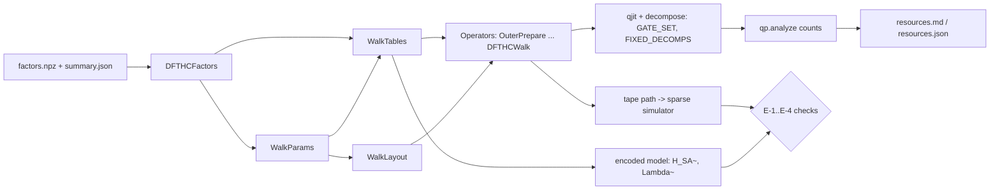

# DFTHC block encoding, qubitized walk and phase estimation in PennyLane: design specification

| | |
| --- | --- |
| Date | 2026-11-11 |
| Status | Written for user review; the implementation plan is written after approval |
| Branch | `docs/design-spec` (local only) |
| Paper | G. H. Low et al., "Fast quantum simulation of electronic structure by spectral amplification", Phys. Rev. X 15, 041016 (2025), arXiv:2502.15882. Called "the paper" below. |
| Reference implementation | [Covestro-HPQC/dfthcbe](https://github.com/Covestro-HPQC/dfthcbe) at commit `930255020cec30172e0a7d17c0071d9476a687d1` (Qualtran). Called "dfthcbe" below. |
| Toolchain snapshot | PennyLane `0.46.0.dev151`, Catalyst `0.16.0.dev140`, Lightning `0.46.0.dev34` (nightlies of 2026-11-11) |

## Table of contents

1. [Summary](#1-summary)
2. [Requirements](#2-requirements)
3. [Background: the construction](#3-background-the-construction)
4. [Approaches considered and decision](#4-approaches-considered-and-decision)
5. [Architecture](#5-architecture)
6. [Conventions](#6-conventions)
7. [Toolchain and compilation model](#7-toolchain-and-compilation-model)
8. [Data and classical preprocessing](#8-data-and-classical-preprocessing)
9. [Operator catalog](#9-operator-catalog)
10. [Register layout and qubit budget](#10-register-layout-and-qubit-budget)
11. [Iterative phase estimation](#11-iterative-phase-estimation)
12. [Verification and tests](#12-verification-and-tests)
13. [Expected resources and the resource report](#13-expected-resources-and-the-resource-report)
14. [Known limitations and mitigations](#14-known-limitations-and-mitigations)
15. [Orchestration overview](#15-orchestration-overview)
16. [Risks and open questions](#16-risks-and-open-questions)
17. [References](#17-references)

## 1. Summary

We implement the paper's block encoding of the DFTHC sum-of-squares Hamiltonian, $\mathrm{BE}[H_{\mathrm{SA}}/\Lambda - I]$, its qubitized walk operator $W$, the controlled walk, and an iterative phase-estimation (QPE) wrapper around the controlled walk. The implementation targets PennyLane and Catalyst nightlies:

- Every building block is an `Operator2` with explicit decomposition rules.
- Programs are compiled with `qp.qjit(capture=True)` and `qp.decompose`, Catalyst's graph-based decomposition, to a Toffoli-level gate set. Every rotation is a phase-gradient addition.
- Resources are read with `qp.analyze`.
- Decomposition rules are lowered inside the `qjit` call.

Correctness is established in three ways:
- per block: rule validity, behaviour on `lightning.qubit`, and exact Toffoli and measurement counts against closed forms;
- end to end on H2, with a purpose-built sparse-state simulator;
- for QPE, on a toy walk.

At FeMoco-54, the exact cost formulas (§9.24, built on probed PennyLane primitive costs) give, per walk:
- 9,793 Toffolis (9,795 for the controlled walk), against the paper's 9,997 and dfthcbe's 9,641;
- 2,524 explicit erase measurements, and 11,199 physical measurements in total once the 8,675 measured AND uncomputes are included;
- about 1,570 qubits, against the paper's 1,131.

Differences are explained in a generated report, not tuned away.

## 2. Requirements

### 2.1 Standing requirements

These come from the user and apply to every part of the project.

| ID | Requirement |
| --- | --- |
| R-1 | Use the latest nightly PennyLane and Catalyst, installed as in §7.1. |
| R-2 | Compile with `qp.qjit(capture=True)` and `qp.decompose` (the graph decomposition system). Obtain resources with `qp.analyze`. |
| R-3 | Decomposition rules are lowered as part of the `qjit` call. The precompiled decomposition-rule bytecode file is not used. |
| R-4 | Every building block is an `Operator2` with clear documentation. The code is modular. Documented exemption, decided by the user (§16, Q-3): a top-level algorithm that returns classical measurement values, namely the iterative QPE driver of §11, is a plain quantum function. Its quantum content per round remains `Operator2`s (`QPERound`, `ControlledWalkPower`). |
| R-5 | Resource-aware tests accompany all development. |
| R-6 | Verifiability, testability and comprehensiveness: other people must be able to understand what was done and how the code works. |
| R-7 | No workarounds to match the paper's or dfthcbe's resource counts beyond the paper's own constructions. Deltas are documented. |
| R-8 | Scope: block encoding, walk, controlled walk, and an iterative QPE wrapper on the controlled walk. All are compiled and resource-counted. QPE is simulated only at toy sizes. |
| R-9 | Gate set: Toffoli level, with rotations done by phase-gradient addition (§7.3). |
| R-10 | Verification: a purpose-built sparse-state simulator checks $\langle 0\vert\mathrm{BE}\vert 0\rangle = H_{\mathrm{SA}}/\Lambda - I$ end to end on H2. Correctness for every erase-measurement outcome is certified at block level (§12.5). Per-block checks run on `lightning.qubit`. |
| R-11 | Git: local branches only. Never push and never modify remotes. |

### 2.2 Scope and non-goals

In scope:
- classical preprocessing from given DFTHC factors (the vendored dfthcbe data);
- all operators of steps 1–28 of the circuit (§3.5);
- the controlled walk;
- the QPE wrapper;
- compilation and resource counting;
- the resource-delta report;
- verification tooling and documentation.

Not in scope for this phase:
- computing DFTHC factorizations or the sum-of-squares shift from molecular integrals;
- Clifford+T synthesis and T counts;
- Qualtran-specific refinements: aligned-block pruning of unary iteration, heterogeneous target layouts;
- deferred cost and qubit optimizations: early junk measurement (Q-1, open) and truncated unary iteration (Q-4, decided as a later optimization);
- spacetime or surface-code costing;
- hardware execution;
- simulating QPE on DFTHC instances.

### 2.3 Definition of done

| ID | Criterion |
| --- | --- |
| D-1 | Every operator in §9 exists with documentation per §9.0 and passes its rule-validity, semantics, exact-resource, gate-set-closure and rule-selection tests. |
| D-2 | The outcome certificates of §12.5 pass for every erase block. End-to-end checks E-1 to E-4 (§12.4) pass on `h2_sto3g_R2_B2_C1` with tolerance $10^{-10}$, under the release-tier schedules (§12.6), which run once, in Phase 5. |
| D-3 | The complete FeMoco-54-shaped walk and controlled walk each compile as a single program, and `qp.analyze` gives non-symbolic Toffoli and measurement counts that equal the closed forms of §9.24. Those counts appear in `docs/resources.md` next to the paper's and dfthcbe's numbers, with every delta explained. No substitute (for example a sum of separately compiled blocks) satisfies this criterion. Each program is compiled once, where the load policy allows (§15), and its counts are cached in `docs/resources.json` with a hash of the code; the cache satisfies this criterion while the hash is unchanged. |
| D-4 | The QPE wrapper recovers the exact phases of the toy walk (§11.4). It compiles and is resource-counted for a DFTHC instance. |
| D-5 | The canary suite (§14) runs and records the current state of every known limitation. |
| D-6 | The documentation set of §5.2 exists and is consistent with the code. |
| D-7 | All work is committed on local branches and merged into local `main` after review gates. Nothing is pushed. |

## 3. Background: the construction

### 3.1 Symbols

Register widths use $\lg y := \lceil \log_2 y \rceil$. A register of width 0 is omitted. "FeMoco-54" is the 54-orbital FeMoco active space with $(R, B, C) = (10, 27, 27)$ and the precisions of the paper's Table III. Its values are listed for orientation.

| Symbol | Meaning | FeMoco-54 |
| --- | --- | --- |
| $N$ | Spatial orbitals; each spin register has $N$ qubits | 54 |
| $R$, $B$, $C$ | DFTHC rank, terms per rank, copies per rank | 10, 27, 27 |
| $X_o = N + RC$ | Values of the generator index $x_o$ | 324 |
| $N_+$, $N_-$ | Positive and negative eigenvalues of the effective one-body matrix $h^{(1)\prime}$, with $N_+ + N_- = N$ | data |
| $b_{\mathrm{rot}}$ | Bits per Givens angle | 15 |
| $b_{\mathrm{grad}}$ | Width of the phase-gradient register; $b_{\mathrm{grad}} = b_{\mathrm{rot}}$ | 15 |
| $b_{k1}$, $b_{k2}$ | Bits of the outer and inner alias keep values | 15, 15 |
| $s_u$ | Bits of the rotation angles inside a flagged uniform preparation; $s_u \le b_{\mathrm{grad}}$ | 7 |
| $w_x = \lg X_o$, $w_b = \lg (B+1)$, $w_r = \lg R$ | Widths of the $x_o$, $b$ and $r$ registers | 9, 5, 4 |
| $d_1 = w_x + b_{k1}$ | Bits of one outer table entry: alt and keep | 24 |
| $d_2 = w_b + b_{k2} + 2 + w_r$ | Bits of one inner table entry: alt, keep, sgn, d_sgn and $r$ | 26 |
| $k_1$, $k_2$; $K_i = 2^{k_i}$ | Block bits of the outer and inner QROAM reads | 2, 4 |
| $k_{e1}$ | One-hot bits of the outer erase fixup: low bits of $x_o$ | 4 |
| $k_{e2}$ | One-hot bits of the inner erase fixup, counted as low bits of $x_o$; the one-hot also spans all $w_b$ bits of $b$ | 2 |
| $M_1 = \lceil X_o/K_1 \rceil$ | Live leaves of the outer read | 81 |
| $M_2 = RC \lceil (B+1)/K_2 \rceil$ | Live leaves of the inner read | 540 |
| $\Lambda$ | Block-encoding normalization (§3.2) | data |
| $\tilde\Lambda$, $\tilde H_{\mathrm{SA}}$ | Normalization and Hamiltonian that the circuit encodes for the rounded tables (§8.5) | data |
| $\eta$ | Number of electrons of the target sector (`eta` in `factors.npz`) | data |
| $E_{\mathrm{SoS}}^{\mathrm{walk}}$ | Walk-frame sum-of-squares offset, from the factors (§3.2) | data |
| $E_{\mathrm{SoS}}^{\mathrm{phys}}$ | Physical-frame offset on the $\eta$-electron sector: `summary.json` `e_sos` (§3.2) | data |
| $\Delta_\eta = E_{\mathrm{SoS}}^{\mathrm{phys}} - E_{\mathrm{SoS}}^{\mathrm{walk}}$ | Frame shift on the $\eta$-electron sector | data |
| $E_{\mathrm{gap}}$, $\lambda_{\mathrm{eff}}$ | Spectral gap and effective normalization (§3.3) | data |
| $T$ | Toffoli count: number of `Toffoli` plus number of `TemporaryAND` (§7.6) | |
| $M$, $A$ | Explicit erase measurements (`MidCircuitMeasure`) and measured AND uncomputes (`Adjoint(TemporaryAND)`); $M + A$ physical measurements (§7.6, §9.24) | |

### 3.2 The sum-of-squares Hamiltonian

With its two-body tensor DFTHC-factorized, the electronic-structure Hamiltonian on $N$ spatial orbitals is written, up to a constant offset (§3.2.1), as the sum-of-squares operator

$$H_{\mathrm{SA}} = \sum_{\alpha} O_\alpha^\dagger O_\alpha \succeq 0 .$$

$H_{\mathrm{SA}}$ is a fixed operator on the whole Fock space; the block encoding encodes exactly this operator and no offset.

The sum runs over $2N + RC$ generators, written with rotated Majoranas $\tilde\gamma_{u\sigma f} = \sum_p u_p \gamma_{p\sigma f}$ of flavour $f \in \{0, 1\}$ and spin $\sigma$, and with $a_{u\sigma} = (\tilde\gamma_{u\sigma 0} + i\tilde\gamma_{u\sigma 1})/2$:

- **SF (two-body) generators**, one per $r \in [R]$, $c \in [C]$:
  $$O_{\mathrm{SF},rc} = \tfrac{1}{\sqrt 2}\Big(w_B^{(r,c)} + \tfrac{i}{2} \sum_{b\in[B],\,\sigma} w_b^{(r,c)}\, \tilde\gamma_{u_b^{(r)}\sigma 0}\, \tilde\gamma_{u_b^{(r)}\sigma 1}\Big).$$
  Here $u_b^{(r)}$ are unit vectors, $w_b^{(r,c)}$ real weights, and $w_B^{(r,c)}$ is the identity weight, indexed as the extra term $b = B$.
- **D1 and Q1 (one-body) generators**: D1 annihilates and Q1 creates an electron in a rotated orbital. They come from the eigenvectors $u_\pm^{(r)}$ of $h^{(1)\prime}$, for both spins:
  $$O_{D_1\sigma,r} = \sqrt{w_+^{(r)}}\, a_{u_+^{(r)}\sigma}, \qquad O_{Q_1\sigma,r} = \sqrt{w_-^{(r)}}\, a^\dagger_{u_-^{(r)}\sigma}.$$

The LCU (linear combination of unitaries) weights are:
- $\lambda_{D_1\sigma,r} = \sqrt{w_+^{(r)}}$;
- $\lambda_{Q_1\sigma,r} = \sqrt{w_-^{(r)}}$;
- $\lambda_{\mathrm{SF},rc} = \tfrac{1}{\sqrt 2}\sum_{b\in[B+1]}\lvert w_b^{(r,c)}\rvert$.

The normalization is:

$$\Lambda = \tfrac12 \sum_\alpha \lambda_\alpha^2 = \lVert h^{(1)\prime}\rVert_1 + \tfrac14 \sum_{r,c}\Big(\sum_{b\in[B+1]}\lvert w_b^{(r,c)}\rvert\Big)^2 .$$

Here $\lVert\cdot\rVert_1$ is the sum of absolute eigenvalues.

#### 3.2.1 Two offset frames

Two different constants relate $H_{\mathrm{SA}}$ to energies. They are not equal in general and must not be conflated.

- **Walk frame, the whole Fock space.** $E_{\mathrm{SoS}}^{\mathrm{walk}} = -2\sum_r w_-^{(r)} - \tfrac12\sum_{r,c}\big(w_B^{(r,c)} - \sum_{b<B} w_b^{(r,c)}\big)^2$, as in dfthcbe's `walk_e_sos`. Then $H_{\mathrm{SA}} + E_{\mathrm{SoS}}^{\mathrm{walk}}$ is exactly the BLISS-shifted Hamiltonian whose integrals dfthcbe's `walk_integrals` returns, as an operator on the whole Fock space.
- **Physical frame, the $\eta$-electron sector.** $E_{\mathrm{SoS}}^{\mathrm{phys}}$ is `summary.json` `e_sos`, which equals `e_upper − e_gap` for every vendored system. On the $\eta$-electron sector, the physical electronic Hamiltonian $H_{\mathrm{phys}}$ satisfies $H_{\mathrm{phys}} = H_{\mathrm{SA}} + E_{\mathrm{SoS}}^{\mathrm{phys}}$. Here $H_{\mathrm{phys}}$ is built from `integrals.npz` (`h1e`, `eri`), without `core_energy`, and `e_upper` is its lowest eigenvalue on the sector (verified for the H2 instances). This holds exactly for exactly factorized instances, and up to the factorization error otherwise. $E_{\mathrm{SoS}}^{\mathrm{phys}}$ is input data from the factorization pipeline; it is not recomputed from the factors.
- **Frame shift.** $\Delta_\eta = E_{\mathrm{SoS}}^{\mathrm{phys}} - E_{\mathrm{SoS}}^{\mathrm{walk}}$ is the constant by which the two frames differ on the $\eta$-electron sector. For `h2_sto3g_R2_B2_C1` (verified on 2026-11-11): $E_{\mathrm{SoS}}^{\mathrm{walk}} = -0.6923157$, $E_{\mathrm{SoS}}^{\mathrm{phys}} = -2.0132705$, and $\Delta_\eta = -1.3209547$. On the two-electron sector, the matrix $H_{\mathrm{phys}} - H_{\mathrm{SA}} - E_{\mathrm{SoS}}^{\mathrm{walk}}$ equals $\Delta_\eta$ times the identity to $10^{-10}$.

### 3.3 Block encoding, walk and controlled walk

The construction has the following pieces:
- $\mathrm{PREP}\lvert 0\rangle = \lambda_{\mathrm{sqrt}}^{-1}\sum_\alpha \lambda_\alpha \lvert\alpha\rangle\lvert\mathrm{garb}_\alpha\rangle$, with $\lambda_{\mathrm{sqrt}}^2 = \sum_\alpha \lambda_\alpha^2$.
- $\mathrm{SEL} = \sum_\alpha \lvert\alpha\rangle\langle\alpha\rvert \otimes \mathrm{BE}[O_\alpha/\lambda_\alpha]$ and $U = \mathrm{SEL}\cdot\mathrm{PREP}$.
- For any register set $X$, $\mathrm{REF}_X := 2\lvert 0\rangle\langle 0\rvert_X - I$.
- $\mathrm{REF}_{T_2} := 2\Pi_{T_2} - I$, with $\Pi_{T_2} = \lvert 0\rangle\langle 0\rvert_{\mathcal B} \otimes \lvert 1\rangle\langle 1\rvert_{\mathrm{succ}_{x_o}}$. It is $-I$ where the uniform preparation of $x_o$ failed.
- $\mathcal A = (x_o, m_{x_o}, \sigma_1)$ are the outer index registers. $\mathcal B = (b, m_b, \sigma_0)$ are the inner index registers.

From these:

$$\mathrm{BE}\Big[\frac{H_{\mathrm{SA}}}{\Lambda} - I\Big] = U^\dagger\, \mathrm{REF}_{T_2}\, U, \qquad W = \mathrm{REF}_{\mathcal A\cup\mathcal B}\; U^\dagger\, \mathrm{REF}_{T_2}\, U .$$

Spectrum and cost:
- $W$ has eigenphases $\pm\arccos(E_j/\Lambda - 1)$ for the eigenvalues $E_j$ of $H_{\mathrm{SA}}$.
- The gap $E_{\mathrm{gap}}$ is the lowest eigenvalue of $H_{\mathrm{SA}}$ on the $\eta$-electron sector. It is frame-independent: $E_{\mathrm{gap}} = E_{\mathrm{gs}}^{\mathrm{phys}} - E_{\mathrm{SoS}}^{\mathrm{phys}}$, with $E_{\mathrm{gs}}^{\mathrm{phys}}$ the physical ground energy (`e_upper`). The two sides agree exactly for exactly factorized instances and up to the factorization error otherwise ($2.1 \cdot 10^{-2}$ for `h2_631g_R2_B2_C2`); `summary.json`'s `e_gap` is the right-hand side. Walk eigenphases and QPE outputs at inexact instances are therefore compared with eigenvalues of the encoded $\tilde H_{\mathrm{SA}}$ (§8.5), never with `e_gap`.
- Resolving energies near the gap to $\delta E$ takes about $\lambda_{\mathrm{eff}}/\delta E$ walk steps, with $\lambda_{\mathrm{eff}} = \sqrt{E_{\mathrm{gap}}(2\Lambda - E_{\mathrm{gap}})}$.

On states whose ancillas start in $\lvert 0\rangle$ we have $U^\dagger U = I$. So the controlled walk controls only the two reflections:

$$C(W) = C(\mathrm{REF}_{\mathcal A\cup\mathcal B})\; U^\dagger\; C(\mathrm{REF}_{T_2})\; U .$$

The controlled reflections must reproduce the global sign of $2\Pi - I$ exactly, because control turns a global phase into a relative one.

### 3.4 Energy estimation

QPE on $C(W)$ estimates an eigenphase $\theta$. The two eigenphases $\pm\theta$ that belong to one eigenvalue give the same energy. Energies follow in three steps:

1. **Sum-of-squares eigenvalue.** $E_{\mathrm{SA}} = \tilde\Lambda(1 + \cos\theta)$ is an eigenvalue of $\tilde H_{\mathrm{SA}}$, with $\tilde\Lambda$ the effective normalization of §8.5.
2. **Physical electronic energy.** For an $\eta$-electron input state, $E_{\mathrm{phys}} = E_{\mathrm{SA}} + E_{\mathrm{SoS}}^{\mathrm{phys}}$. The walk-frame energy is $E_{\mathrm{SA}} + E_{\mathrm{SoS}}^{\mathrm{walk}}$.
3. **Total energy.** Add `core_energy` from `integrals.npz` where it is available.

### 3.5 The circuit, step by step

The numbering follows dfthcbe's README.

| Steps | Operation | Operator |
| --- | --- | --- |
| 1 | Flagged uniform superposition over $x_o \in [X_o)$; $\lvert +\rangle$ on $m_{x_o}$ and $\sigma_1$ | `FlaggedUniformPrep` in `OuterPrepare` |
| 2 | Read (alt, keep) at $x_o$ | `QROAMRead` in `OuterPrepare` |
| 3 | $\mathrm{keep} \le m_{x_o}$ into $\mathrm{less\_than}_{x_o}$ | comparator in `OuterPrepare` |
| 4 | Swap alt with $x_o$ if $\mathrm{less\_than}_{x_o}$ | CSWAPs in `OuterPrepare` |
| 5 | Flagged uniform superposition over $b \in [B+1)$; $\lvert +\rangle$ on $m_b$ and $\sigma_0$ | `FlaggedUniformPrep` in `InnerPrepare` |
| 6 | Read (alt, keep, sgn, d_sgn, $r$) at $(x_o, b)$ | `QROAMRead` in `InnerPrepare` |
| 7, 8 | Keep test, alias swap | `InnerPrepare` |
| 9 | Signs of the surviving $w_b$ | `InnerSigns` |
| 10 | Tail angles and family flags $G_0$, $G_1$ at $x_o \ge RC$ | `TailAngleLoad` |
| 11 | SF angles and $[b \ne B]$ at $(r, b)$ if $G_0 = 0$ | `SFAngleLoad` |
| 12 | $\sigma \leftarrow \sigma_{G_0}$ | `SpinMux` |
| 13 | Swap $\psi_{\uparrow}$ with $\psi_{\downarrow}$ if $\sigma$ | `SpinSwap` |
| 14 | Givens ladder on $\psi_{\downarrow}$ | `GivensLadder` |
| 15 | Majorana gate on $\psi_{\downarrow}[0]$ | `MajoranaGate` |
| 16 | Inverse Givens ladder | `GivensLadderDagger` |
| 17 | Undo the swap, unbuild $\sigma$ | `SpinSwap`, `SpinMux` |
| 18 | Erase angles, $[b \ne B]$, $G_0$, $G_1$ by measurement | `AngleErase` |
| 19–22 | Undo 5–8; erase inner data by measurement | `InnerUnprepare` |
| 23 | $\mathrm{REF}_{T_2}$ | `RefT2` |
| 24–27 | Undo 1–4; erase outer data by measurement | `OuterUnprepare` |
| 28 | $\mathrm{REF}_{\mathcal A \cup \mathcal B}$ | `RefAB` |

Steps 10–18 form `InnerSelect`. Steps 5–22 run twice per block encoding:
1. Before $\mathrm{REF}_{T_2}$: `InnerPrepare`, `InnerSigns`, `InnerSelect`, `InnerUnprepare`.
2. After it: `InnerPrepare`, `InnerSelectDagger`, `InnerSigns`, `InnerUnprepare`.

The adjoint of `InnerSelect`, the operator `InnerSelectDagger`, is the same circuit with the adjoint Majorana gate, because the Majorana gate is not Hermitian. Every adjoint and controlled form of a composite is an operator class of its own (§4.4 item 13, §7.4 rule 6).

## 4. Approaches considered and decision

### 4.1 Options

1. **Paper-structured operators on PennyLane primitives.**
   - One `Operator2` per block of the paper's circuit, with the same boundaries as the paper's Table III and the dfthcbe bloqs.
   - Blocks are built from PennyLane primitives that compile cleanly to the gate set: `TemporaryAND`, `SemiAdder`, the comparators, `CSWAP`, `MultiControlledX` with work wires, `PhaseGradientStatePrep`.
   - New code is written only where PennyLane lacks the functionality.
2. **Template-first.** Compose PennyLane's existing templates: `AliasSampling`, `UniformPrep`, `Select`, `QROM`, and the THC templates.
3. **Literal port of dfthcbe.** A class-by-class translation, including Qualtran-specific cost refinements.

### 4.2 Measured comparison at FeMoco-54

These are estimates assembled from compiled per-block counts (`qp.analyze` at FeMoco-54 sizes with random tables of the right shape), combined with the paper's per-walk call structure. Toffolis per walk:

| Part | Paper | Option 1 with PennyLane `QROM` reads | Option 2 |
| --- | --- | --- | --- |
| Outer prepare and unprepare | 310 | ~550 | ~770 |
| Inner prepare and unprepare (×2) | 2,308 | ~7,000 | ~11,600 |
| Rotation-angle load and erase (×2) | 722 | ~1,700 | ~2,600 |
| Select: Givens ladders, swaps, Majorana gate (×2) | 6,590 | ~6,200 | ~6,200 |
| Reflections | 67 | ~70 | ~70 |
| **Total** | **9,997** | **~15,500** | **~21,200** |

Two effects drive the gaps:
- **Uncompute strategy, about +5,700, Option 2 only.** No PennyLane template uncomputes loaded data by measurement, so every unprepare re-runs its table read.
- **Table-read construction, about +5,500.** PennyLane's `QROM` returns its work wires clean, so its select-swap variant runs two selects and four swap networks.
  - At 324 × 24 bits the solver therefore picks plain unary iteration: 326 Toffolis, against the paper's 177 for read, test and swap together.
  - The combined-address inner read costs about 2,860 against the paper's 860.
  - The paper instead keeps the swap junk until a measured erase.

Option 2 is also not viable for other reasons:
- `UniformPrep` and `AliasSampling` need arbitrary-angle rotations, so they do not compile to the gate set.
- `Select` crashes Catalyst when its operators share target wires.
- The sum-of-squares-specific parts have no templates: the Majorana gate, the spin multiplexer and swap, $\mathrm{REF}_{T_2}$ with success flags, and the D1/Q1 terms.
- Under capture, `C(ChangeOpBasis)` loses its "control only the middle" saving ([pennylane#10357](https://github.com/PennyLaneAI/pennylane/issues/10357)), so a template-based controlled walk would control the entire walk.

Remedying Option 2 converges on Option 1. Option 3 re-implements primitives PennyLane provides and imports the refinements that R-7 defers.

### 4.3 Decision

**Option 1, with a paper-faithful `QROAMRead`** (user decision, 2026-11-11):
- The read keeps its swap junk on caller-provided wires until the measured erase.
- It iterates only over rows that hold data: unary iteration over $x_o$, the swap network over $b$.
- Qualtran-specific refinements (aligned-block pruning, heterogeneous target layouts) stay deferred.

### 4.4 Decision record: changes since the reviewed design summary

1. **`QROAMRead` replaces PennyLane `QROM`.** It is used for the alias reads and the angle loads, with the paper's construction (§9.3).
2. **The erase phase fixup is our own construction** (`PhaseFixup` and its rule helper `emit_phase_fixup`, §9.4). It applies `CZ`/`Z` gates directly. It does not load parity bits through a `QROM` into a $\lvert -\rangle$ ancilla, because PennyLane's select-swap `QROM` adds complex phases unless its block size is 1 (§14, L-12). The fallback is plain unary iteration (§9.4).
3. **Explicit controlled constructions are required, not only tidier** ([pennylane#10357](https://github.com/PennyLaneAI/pennylane/issues/10357)). Since G0 they are operator classes, not `C(...)` rules (item 13).
4. **Structure-determining data are compilable arguments** ([catalyst#3172](https://github.com/PennyLaneAI/catalyst/issues/3172)). If compile time at FeMoco size is too high, the remedies of §16 K-1 keep the walk a single compiled program. Otherwise work stops and is escalated.
5. **Bodies of operators that are auto-adjointed contain no `qp.for_loop`/`qp.cond`** ([catalyst#3217](https://github.com/PennyLaneAI/catalyst/issues/3217)). Since G0 the two operators with loops, `QROAMRead` (item 12) and `ControlledWalkPower`, are never adjointed or controlled, by construction (item 13).
6. **Rule selection is asserted.** Tests use measurement-count signatures and, where the output is capturable, the verbose rule listing of `catalyst.passes.graph_decomposition`. Conditionals carry `qp.hint` branch probabilities.
7. **Junk persists from read to erase.** The qubit count therefore exceeds the paper's (§10.3). An alternative with no Toffoli penalty stays open (Q-1, §16). The user decided to settle it after the Phase 0 probe K-10 and the Phase 4 resource report, preferring the argument variant if it works.
8. **Unary iteration is exact, not truncated** (decided by the user, §16 Q-4). Truncated iteration and aligned-block pruning are later optimizations.
   - *Choice.* A leaf flag fires only for in-range addresses, so out-of-range addresses (failed uniform preparations, one-body rows in the inner read) load nothing. The behaviour on every computational address is specified (§9.3), and failed $b$ branches act as $+I$ (§8.5).
   - *Alternative.* Truncated iteration, as in the Babbush et al. walk, Qualtran and dfthcbe. It routes some out-of-range addresses onto live leaves.
   - *Why exact.* With truncation, routed addresses load live data, so the erase fixup would have to reproduce the read's routing at a different block granularity, and the failure signs would need a classical model (dfthcbe's `failure_signs`). Exact iteration makes the loaded set easy to enumerate and every failed-branch sign trivially $+1$.
   - *Cost at FeMoco-54 (§9.24).* +26 Toffolis per walk against truncated iteration in the alias reads and their erases (outer read 84 vs 79, inner reads 273 vs 268 each, outer fixup 22 vs 19, inner fixups 70 vs 66 each). A further +74 against dfthcbe's aligned-block-pruned angle loads and their fixups (tail 61 vs 56 and SF 291 vs 271 per load, SF fixup 41 vs 34 and tail fixup 61 vs 56 per erase); that pruning is a deferred refinement.
9. **Givens rotations use dfthcbe's exact construction at $2(b_{\mathrm{rot}} - 1)$ Toffolis per rung** (decided, §16 Q-5).
   - *Construction (§9.14).* This is dfthcbe's `GivensRotationByPhaseGradient`, with Qualtran's `RzViaPhaseGradient`, which is a `ControlledAddOrSubtract`. Each $R_z(4\pi x/2^{b_{\mathrm{rot}}})$ on $q$ complements the phase-gradient register when $q = 0$, adds $x$ with an uncontrolled $b_{\mathrm{rot}}$-bit `SemiAdder`, and complements again. That subtracts $x$ exactly when $q = 0$ and adds it when $q = 1$, at $b_{\mathrm{rot}} - 1$ Toffolis. Angles are exact, $\theta = 4\pi x/2^{b_{\mathrm{rot}}}$, with dfthcbe's integer tables.
   - *Verification (2026-11-11).* The probe `.scratch/spec-final/probe_exact_givens.py` compares the dense action on the two mode qubits with the exact Givens matrix for $b = 3, 4$ and every $x < 2^{b-1}$, on all four basis inputs, so both parities. The worst deviation is $2.5\times 10^{-14}$, the sign is correct ($\lvert 01\rangle \mapsto \cos\theta\lvert 01\rangle + \sin\theta\lvert 10\rangle$), and the action on the mode qubits is unitary, so the ancillas come back unentangled. `qp.analyze` gives $2(b-1)$ Toffolis per rotation: 6 at $b = 4$, 28 at $b = 15$.
   - *What it supersedes.* The user chose the half-step grid to save 424 Toffolis per walk. This construction gives the same saving with exact angles and dfthcbe's tables, so it replaces the grid. It also replaces the earlier carry-in circuit, which cost $b_{\mathrm{rot}}$ per $R_z$ and had the wrong sign (review finding P-1).
10. **Comparator work stays dirty until the unprepare.** PennyLane's comparators keep intermediate ANDs on their work wires, and their adjoints uncompute them by measurement at zero Toffolis (probed, §9.24). The keep-test and succ-flag comparator work wires therefore persist from prepare to unprepare as dedicated registers (§10.1). That costs 36 qubits and saves a comparator per unprepare.
11. **No fallback redefines "done".** The complete walk and controlled walk must compile as single programs (D-3). Per-block compiles are diagnostics, never the deliverable (§16, K-1).
12. **Per-leaf read loads (G0, K-1 lever P).** `QROAMRead` takes its data as a dynamic `int64` array with one row per unary leaf and loads each leaf with one `qp.for_loop` over its $K\cdot$`width` bits (§9.3). Measured in the K-1 stand-in (Task 0.9d): 77 captured equations per leaf against 46 per table entry, 945 leaf loops instead of 8,208 entry loops at FeMoco-54, identical T, M and A. The CNOT count becomes an upper bound.
13. **Explicit adjoint and controlled classes (G0, K-1 lever X).** The adjoint and controlled forms of the composites are operator classes with their own pinned base rules: `OuterUnprepare`, `InnerUnprepare`, `InnerSelectDagger`, `GivensLadderDagger`, `ControlledRefT2`, `ControlledRefAB`, `ControlledDFTHCBlockEncoding`, `ControlledDFTHCWalk` and `ControlledToyWalk`. No rule or program calls `qp.adjoint` or `qp.ctrl` on a dfthc composite (§7.4 rule 6). Reason: Catalyst synthesizes, captures and lowers the generic distributed `Adjoint`/`C` candidate of every requested modified target and of its whole subtree, although the pinned rule is chosen. These copies were 95–99% of the K-1 stand-in's distributed IR (Task 0.9d). With both levers the FeMoco-54 controlled-walk stand-in compiled in 51 s at 2,648 MB, against 2,566 MB projected, with exact counts; without either lever its projection was 12.6 GB. Every count and closed form is unchanged (decision "K-1 at G0"; an upstream Catalyst issue is drafted).

## 5. Architecture

### 5.1 Layers

The system is layered. Each layer depends only on the layers below it.

| Layer | Content | Depends on |
| --- | --- | --- |
| L0, classical data | Factors, parameters, alias and angle tables, the encoded-Hamiltonian model, fermion matrices. NumPy and SciPy only. | none |
| L1, primitives | `PhaseGradientRotation`, `FlaggedUniformPrep`, `QROAMRead`, `PhaseFixup`, `QROAMErase`, `ZeroReflection`, and the unary-iteration helper | L0 table formats; PennyLane primitives |
| L2, paper blocks | `OuterPrepare`, `OuterUnprepare`, `InnerPrepare`, `InnerUnprepare`, `InnerSigns`, `TailAngleLoad`, `SFAngleLoad`, `SpinMux`, `SpinSwap`, `GivensRotation`, `GivensLadder`, `GivensLadderDagger`, `MajoranaGate`, `AngleErase`, `InnerSelect`, `InnerSelectDagger`, `RefT2`, `RefAB`, `ControlledRefT2`, `ControlledRefAB` | L1 |
| L3, assembly | `DFTHCBlockEncoding`, `DFTHCWalk` and their controlled classes `ControlledDFTHCBlockEncoding`, `ControlledDFTHCWalk`; `WalkLayout` | L2 |
| L4, application | `ControlledWalkPower`, `QPERound`, the iterative QPE driver (a quantum function, §11.1), phase-to-energy conversion | L3 |
| Tooling | `dfthc.compile` (gate set, pins, compile and analyze helpers), `dfthc.costs` (closed forms), `dfthc.testing` (sparse simulator, fixtures, toy walk), resource report | all layers, read-only |

### 5.2 Package and repository layout

```text
dfthc-be/
  pyproject.toml              package "dfthc" (src layout); pytest config with pythonpath = ["src"]
  requirements-nightly.lock   pip freeze of the canonical environment (§7.1)
  scripts/
    setup_env.sh              the environment recipe of §7.1
    test.sh                   exports CATALYST_SILENCE_RULE_LOWERING_WARNINGS=0, then runs pytest (§7.1, §12.6)
    make_dfthcbe_fixtures.py  generates reference fixtures from dfthcbe in a separate environment (§8.6)
    resource_report.py        writes docs/resources.md and docs/resources.json (§13.3)
  data/dfthc/                 vendored dfthcbe data, LICENSE (Apache-2.0) and NOTICE (§8.1)
  src/dfthc/
    params.py                 WalkParams: sizes, precisions, block bits, presets
    registers.py              WalkLayout: named wires for every register and work pool
    compile.py                GATE_SET, FIXED_DECOMPS, compiled_resources(), resource_key(), mcm_parities()
    costs.py                  closed-form costs of our construction
    costs_reference.py        the paper's Table III formulas and dfthcbe's formulas
    data/
      factors.py              DFTHCFactors, loaders, validation, random_factors()
      sos.py                  outer and inner weights, Λ, E_SoS, λ_eff
      alias.py                alias tables and their probabilities
      angles.py               Givens angles from unit vectors, discretization, reconstruction
      tables.py               WalkTables: everything the circuit loads, as compilable tuples
      fermion.py              Jordan-Wigner Majorana matrices, Fock-space operators (N <= 4)
      encoded.py              the Hamiltonian and normalization the circuit encodes (§8.5)
    ops/
      unary.py                unary-iteration helper (Python function used inside rules)
      phase_gradient.py       PhaseGradientRotation
      uniform.py              FlaggedUniformPrep
      qroam.py                QROAMRead, PhaseFixup, QROAMErase
      reflections.py          ZeroReflection, RefT2, RefAB, ControlledRefT2, ControlledRefAB
      prepare.py              OuterPrepare, OuterUnprepare, InnerPrepare, InnerUnprepare, InnerSigns
      angle_data.py           TailAngleLoad, SFAngleLoad, AngleErase
      spin.py                 SpinMux, SpinSwap
      givens.py               GivensRotation, GivensLadder, GivensLadderDagger
      majorana.py             MajoranaGate
      select.py               InnerSelect, InnerSelectDagger
      walk.py                 DFTHCBlockEncoding, DFTHCWalk, ControlledDFTHCBlockEncoding, ControlledDFTHCWalk
    qpe.py                    ControlledWalkPower, QPERound, iterative_phase_estimation(), energy_from_phase(), physical_energy()
    testing/
      sparse_sim.py           sparse-state simulator (§12.3)
      tape.py                 tape-path decomposition for simulation
      toy_walk.py             ToyWalk, ControlledToyWalk and ToyControlledWalkPower for QPE tests (§11.4)
      fixtures.py             small parameter sets, loaders for reference fixtures
      resources.py            assertions on compiled resources, warning filters
      watchdog.py             memory and time watchdog for heavy runs (§15)
      provenance.py           code hash and environment record of cached compiles (§13.3)
  tests/
    conftest.py  data/  ops/  integration/  sim/  canary/  report/  fixtures/
  docs/
    architecture.md  conventions.md  environment.md  limitations.md  verification.md
    resources.md, resources.json (generated; the json also caches large compiles, §13.3)
    agents/HANDOFF.md  agents/LEDGER.md
    superpowers/specs/ (this file)  superpowers/plans/ (the implementation plan)
```

### 5.3 Data flow



### 5.4 Delivery phases

The implementation plan expands each phase into tasks.

| Phase | Content | Exit criterion |
| --- | --- | --- |
| 0. Foundation and feasibility | Repository scaffold, environment script and lock, `dfthc.compile`, test infrastructure, canary suite, vendored data. Four spikes:<br>• the whole-program compile check: a complete stand-in walk and controlled walk, compiled at small and mid shapes and projected to FeMoco-54 shape, which is compiled once only if the projection fits the machine (K-1);<br>• the mode-agnostic erase rule (K-3);<br>• the measurement-array argument probe that decides Q-1's variant and `QPERound` (K-10);<br>• the comparator-adjoint check (K-7). | Fast suite green, and spike results recorded in the ledger. If K-1's projection or compile exceeds its limits after its remedies, the orchestrator escalates to the user with the measurements and options (§16, K-1). |
| 1. Parallel workstreams | (A) L0 classical data and the encoded model, with reference fixtures; (B) the sparse simulator, including the benchmark gate of §12.6; (C) L1 primitives | Each workstream's tests green and reviewed. If the simulator benchmark misses its budget after the mitigations of §12.6, escalate. |
| 2. Paper blocks | (D) `OuterPrepare`, `InnerPrepare`, `InnerSigns`; (E) the select components: angle loads, `AngleErase`, `SpinMux`, `SpinSwap`, Givens, `MajoranaGate` | Same |
| 3. Assembly | `InnerSelect`, reflections, `DFTHCBlockEncoding`, `DFTHCWalk`, controlled versions, end-to-end checks E-1 to E-4 | D-2 met under the nightly schedules; the release schedules run once, in Phase 5 (§12.6) |
| 4. Application and report | QPE wrapper and toy tests; resource report, ending with the single FeMoco-54 compile of the walk and controlled walk; documentation | D-3, D-4 and D-6 met |
| 5. Final review | Cross-review, fixes, final merge into local `main` | D-1 to D-7 met |

## 6. Conventions

These conventions follow dfthcbe unless stated otherwise, so blocks can be compared one-to-one.

### 6.1 Indices and flags

- **Generator index $x_o$, SF first.**
  - $x_o < RC$ is an SF generator, with $x_o = rC + c$.
  - The last $N$ values are the one-body tail: $x_o = RC + j$ for $j \in [N)$. The $N_+$ D1 rows come first, then the $N_-$ Q1 rows.
- **Family flags.**
  - $G_0 = 0$ means SF; $G_0 = 1$ means one-body.
  - On one-body rows, $G_1 = 0$ means D1 and $G_1 = 1$ means Q1.
  - `TailAngleLoad` writes both flags; `SFAngleLoad` acts only on $G_0 = 0$.
- **Inner index $b \in [B+1)$.** $b = B$ is the identity term $w_B$. The flag $[b \ne B]$ is 1 exactly on SF rows with $b < B$; `SFAngleLoad` writes it.
- **Signs.**
  - `InnerPrepare` loads $\mathrm{sgn} = [w_b < 0]$ and $\mathrm{d\_sgn} = \mathrm{sgn} \oplus \mathrm{sgn}[\mathrm{alt}]$.
  - `InnerSigns` applies $Z(\mathrm{sgn})$ and $CZ(\mathrm{less\_than}_b, \mathrm{d\_sgn})$, so every branch carries the sign of the surviving $b$.
- **Rank register.** $r = \lfloor x_o / C\rfloor$ on SF rows. The inner read writes it and the inner erase clears it.
- **Spins.**
  - $\sigma_0$ is the inner spin: the spin sum on SF, and the Majorana flavour ancilla on D1/Q1.
  - $\sigma_1$ is the outer spin: the spin label of D1/Q1 generators.
  - $\sigma$ (register `sg`) $= \sigma_{G_0}$ controls the spin swap.

### 6.2 Fermions

- **Jordan-Wigner on each spin register.** $\gamma_{j,0} = Z_0\cdots Z_{j-1}X_j$ and $\gamma_{j,1} = Z_0\cdots Z_{j-1}Y_j$, with qubit 0 the most significant. So $\lvert 1\rangle$ is occupied, $a_j = Z_0\cdots Z_{j-1}(X_j + iY_j)/2$, and $n_j = (1 - Z_j)/2$.
- **Fock ordering.** The system state is $\psi_{\uparrow} \otimes \psi_{\downarrow}$ with $\psi_{\uparrow}$ first. The dense $4^N$ matrices of `dfthc.data.fermion` use this order.
- **Majorana gate.** It acts on $\psi_{\downarrow}[0]$, where the Jordan-Wigner string is empty: $\gamma_0 = X$ and $\gamma_1 = Y$.
  - SF applies $i\gamma_0\gamma_1 = -Z$.
  - D1 applies $a = (X + iY)/2$; Q1 applies $a^\dagger = (X - iY)/2$.
  - The paper's Fig. 4 applies $+Z$ on SF, which would flip every $w_b$ relative to $w_B$. We follow dfthcbe's $-Z$.

### 6.3 Givens angles

- **Ladder.** Rung $k \in [N-1)$ acts on modes $(q_k, q_{k+1})$ with angle $\theta_k$. The ladder applies $U(u)$ with $U(u)^\dagger \gamma_{0,f} U(u) = \sum_j u_j\gamma_{j,f}$.
- **Angles and storage.** Angles come from the one-column Givens factorization of $u$ (`angles_from_vector`, angles in $[0, 2\pi)$). They are stored as $x_k = \mathrm{round}(\theta_k/(2\pi)\cdot 2^{b_{\mathrm{rot}}-1}) \bmod 2^{b_{\mathrm{rot}}-1}$, exactly as dfthcbe's `discretize_angles`. So $x_k \in [0, 2^{b_{\mathrm{rot}}-1})$, and the top bit of each $b_{\mathrm{rot}}$-wire angle register is always 0. The rung realizes $\theta = 4\pi x/2^{b_{\mathrm{rot}}}$ exactly.
- **Rung matrix.** In the basis $\{\lvert 01\rangle, \lvert 10\rangle\}$ of $(q_k, q_{k+1})$ it is $\begin{pmatrix}\cos\theta & -\sin\theta\\ \sin\theta & \cos\theta\end{pmatrix}$. The states $\lvert 00\rangle$ and $\lvert 11\rangle$ are fixed.

### 6.4 Alias sampling

- A row of non-negative weights $w_\ell$ gives tables $(\mathrm{alt}_\ell, \mathrm{keep}_\ell)$ with $\mathrm{keep}_\ell \in [0, 2^{b_k})$. Index $\ell$ survives with probability $\mathrm{keep}_\ell/2^{b_k}$ and is replaced by $\mathrm{alt}_\ell$ otherwise.
- The prepared distribution is $p_\ell = \big(\mathrm{keep}_\ell + \sum_{j:\mathrm{alt}_j = \ell}(2^{b_k} - \mathrm{keep}_j)\big)/(L\, 2^{b_k})$.
- The comparator writes $\mathrm{less\_than} = [\mathrm{keep} \le m]$, where $m$ is uniform over $[0, 2^{b_k})$. A set flag swaps in alt.
- The D1/Q1 rows of the inner table are all zero and load nothing.

### 6.5 Phase-gradient register

- The register holds the state that PennyLane's `PhaseGradientStatePrep` prepares on $b_{\mathrm{grad}}$ wires. It is prepared once at the start of every top-level circuit, outside the walk, and returned unchanged by every operator ("catalysed").
- Adding the integer $k$ into the register multiplies the state by $e^{+2\pi i k/2^{b_{\mathrm{grad}}}}$. The 2026-11-11 probes confirmed this sign (§4.4 item 9), and a unit test pins it by checking the phase that `SemiAdder` kicks back when it adds 1.
- Adding into the top $m$ qubits gives the phase $e^{+2\pi i k/2^m}$.

### 6.6 Reflections and global phases

- $\mathrm{REF}_X = 2\lvert 0\rangle\langle 0\rvert_X - I$ and $\mathrm{REF}_{T_2} = 2\Pi_{T_2} - I$ are implemented exactly, including the global sign: uncontrolled with `GlobalPhase`, controlled with a `Z` on the control (§9.6).
- Generic `C(GlobalPhase)` is never used, because its rule produces a phase shift, which is outside the gate set.

### 6.7 Wires and registers

- Integers in registers are big-endian: the first wire is the most significant bit.
- Register names follow dfthcbe: `x_o`, `succ_x_o`, `sigma_1`, `m_x_o`, `less_than_x_o`, `alt_x_o`, `keep_x_o`, `junk_x_o`, `b`, `succ_b`, `sigma_0`, `m_b`, `less_than_b`, `alt_b`, `keep_b`, `sgn`, `d_sgn`, `r`, `junk_b`, `angles`, `G0`, `G1`, `b_neq_B`, `sg`, `psi_up`, `psi_dn`, `phase_grad`, `work`.
- `angles` is the concatenation of $N - 1$ registers of $b_{\mathrm{rot}}$ wires; register $k$ drives rung $k$.
- Composite operators take grouped wire arguments (`outer`, `inner`, `select`, `system`, `phase_grad`, `work`). `dfthc.registers.WalkLayout` defines the order of the registers inside each group, and every operator splits groups only through `WalkLayout` helpers.

## 7. Toolchain and compilation model

### 7.1 Environment

One canonical environment serves all agents and worktrees: `.venv` in the repository root, CPython 3.12.

```bash
python3.12 -m venv .venv
source .venv/bin/activate
pip install --upgrade pip
# Catalyst nightly first (this is the user's `catame` alias), then the PennyLane nightly on top:
pip install --extra-index-url=https://test.pypi.org/simple/ --pre pennylane-catalyst --upgrade
pip install --extra-index-url=https://test.pypi.org/simple/ --pre pennylane --upgrade
pip install pytest pytest-xdist ruff          # from PyPI, without the TestPyPI index
pip freeze > requirements-nightly.lock
```

`scripts/setup_env.sh` runs exactly these commands. Pitfalls, all observed on 2026-11-11:

- **Always use plain `pip`; never `uv pip`.** uv's default first-index strategy resolves `pennylane-catalyst` from PyPI and silently installs the stable 0.15.
- **Expect one pip error.** The second install prints `ERROR: ... pennylane-catalyst 0.16.0.dev140 requires pennylane==0.46.0-dev149, but you have pennylane 0.46.0.dev151`. The override is intended.
- **The linker warning is benign.** `ld: warning: object file ... was built for newer 'macOS' version (28.0) than being linked (27.0)` appears on every compile.
- **Export `CATALYST_SILENCE_RULE_LOWERING_WARNINGS=0` before Python starts.** Catalyst otherwise drops broken or excluded rules silently ([catalyst#3190](https://github.com/PennyLaneAI/catalyst/pull/3190)).
  - Catalyst reads the variable once, when `catalyst/decomposition/rule_lowering_warning.py` is imported. If it is unset or not `0`, that module installs an `ignore` filter for `RuleLoweringWarning`, so setting the variable later in `conftest.py` is too late.
  - `scripts/test.sh` and `docs/agents/HANDOFF.md` export it.
  - `tests/conftest.py` also installs `warnings.filterwarnings("always", category=RuleLoweringWarning)` after importing Catalyst, as a second line of defence.
  - A subprocess canary checks both behaviours (§14, L-18).
- **Keep the lock file.** `--pre` with the TestPyPI extra index also pulls dev builds of transitive dependencies (for example `termcolor 3.3.1.dev66` and `urllib3 2.8.1.dev35`). `requirements-nightly.lock` records the exact set.
- **Do not install the package in editable mode.** Use pytest's `pythonpath = ["src"]`, so every git worktree runs against the shared `.venv` with its own sources.
- **Filter the built-in warning noise.** Excluded-rule warnings for PennyLane's own rules print on every compile: `Excluded the <rule> decomposition rule for <op> since --decompose-lowering cannot work with multiple registers yet` for `_ppm`, `_lattice_surgery_ppm`, `_toffoli_elbow`, `_cphase_to_single_phase` and the MCX `*_worker(s)` rules, and `Skipped the _adjoint_temporary_and(_ppm) decomposition rule for C(Adjoint(TemporaryAND)){control_values:[tensor<2xi1>]}{wires:3}{}: it contains a mid-circuit measurement, which cannot be placed in a control region.` `dfthc.testing.resources` filters exactly these.
- **The "could not be parsed" error means there is no decomposition path.** The text is `failed to load built-in decomposition rules from '...mlirbc': the rules file could not be parsed`. Catalyst tries the bytecode file only as a fallback after its solver failed. Look in stderr for `Decomposition rule not found for operator '<op>'`. The file itself is intentionally not shipped (R-3).
- **Activating the venv is recommended but not required.** Calling `.venv/bin/python` directly also works with in-call rule lowering.

**Machine limits.** The development laptop has 10 cores and 16 GB, and the user works on it while agents run. `scripts/test.sh` runs 2 xdist workers by default (`DFTHC_TEST_WORKERS` overrides) at lowered priority: `nice -n 10`, or, in the agent sandbox, which forbids setpriority(), the utility QoS clamp of `taskpolicy`. Each process tree has a sampled 8 GB memory cap: macOS enforces no memory limit (`setrlimit` rejects lowering `RLIMIT_AS`, `RLIMIT_RSS` and `RLIMIT_DATA`), so the watchdog kills a tree at the first sample above 7.5 GB, and the overshoot is bounded by one 50 ms sampling interval of growth. The heavy-process and large-compile policy is in §15.

**Bumping the nightlies** (orchestrator work, at a phase gate).
1. Recreate `.venv` with the recipe.
2. Run the per-commit tier, which holds most canaries; the gate's nightly-tier run covers the slow canaries. The release tier is not run for a bump (§12.6).
3. Update §14 and `docs/limitations.md` for every canary whose state changed.
4. Refresh the lock file and the snapshot in `docs/environment.md`.
5. Commit on a branch.

### 7.2 Compilation pipeline

Every compiled program uses this decorator stack:

```python
import pennylane as qp
from dfthc.compile import GATE_SET, FIXED_DECOMPS

dev = qp.device("null.qubit", wires=layout.num_wires)  # resource counting; "lightning.qubit" for semantics

@qp.qjit(capture=True, enable_aot_compilation=False)  # analyze-only program (L-27)
@qp.decompose(gate_set=GATE_SET, fixed_decomps=FIXED_DECOMPS)
@qp.qnode(dev)
def circuit():
    qp.PhaseGradientStatePrep(layout.phase_grad)
    DFTHCWalk(...)
    return qp.probs(wires=[0])

counts = qp.analyze(circuit, level="user")().resources
```

Facts the design relies on:
- **`qp.decompose` is a compiler pass only.** Under `qjit(capture=True)` it always runs Catalyst's `graph-decomposition`; there is no non-graph fallback ([pennylane#10304](https://github.com/PennyLaneAI/pennylane/pull/10304), [catalyst#3058](https://github.com/PennyLaneAI/catalyst/pull/3058)). A gate without a path to the gate set is a hard compile error.
- **Rules are collected from the Python registry and lowered during the `qjit` call.** This is Catalyst's default `collect_decomp_rules=True` ([catalyst#3061](https://github.com/PennyLaneAI/catalyst/pull/3061)). We never pass precompiled rules (R-3).
- **`qp.analyze` works only on `qjit`-compiled QNodes.** `dfthc.compile.compiled_resources()` wraps the stack above. It:
  - returns a record with the Toffoli count, measurements, the full counts and the wire count;
  - asserts that the counts are not symbolic;
  - asserts gate-set closure (§12.1).
- **`qp.qjit` AOT-compiles a fully annotated function at decoration, a function without parameters included; `qp.analyze` compiles the program again, so an analyze-only program disables AOT (L-27).** `qp.qjit` AOT-compiles at decoration when every parameter has a Catalyst-supported type annotation; a zero-argument function satisfies this rule vacuously. With `enable_aot_compilation=True` (the default), `QJIT.__init__` compiles a linked binary. `qp.analyze` creates a separate `QJIT` with AOT disabled and compiles through `mlir_opt`, so an analyze-only fully annotated program is compiled twice, and the first capture stays in memory during the second compile. Use `enable_aot_compilation=False` for analyze-only programs. D-3 needs only the analyze compile; a linked binary, if wanted, is compiled in a separate process.
- **Two decomposition levels.** Executing on `lightning.qubit` runs a second decomposition pass to the device gate set ([catalyst#3275](https://github.com/PennyLaneAI/catalyst/pull/3275)). `level="user"` reports counts after our pass and is the level for all resource numbers. `level="device"` is used once per composite operator to check that no undecomposed operator remains: an undecomposed `OperatorOp` would run as a bare named gate ([catalyst#3430](https://github.com/PennyLaneAI/catalyst/pull/3430)).
- **Devices.** `null.qubit` is used for resource counting at any size. `lightning.qubit` is used for semantics up to 25 wires.

### 7.3 Gate set and weights

```python
GATE_SET = {
    "PauliX": 1, "PauliY": 1, "PauliZ": 1, "Hadamard": 1, "S": 1, "Adjoint(S)": 1,
    "CNOT": 1, "CZ": 1, "SWAP": 1, "GlobalPhase": 1, "MidMeasure": 1,
    "Adjoint(TemporaryAND)": 1, "PhaseGradientStatePrep": 1,
    "Toffoli": 1000, "TemporaryAND": 1000,
}
```

How the gate set behaves:
- The weights give the solver a strong, but not lexicographic, preference for fewer Toffolis. A rule with 1,000 more Cliffords could still win.
- Correctness therefore does not rest on the weights. Every rule of our operators is pinned (§7.5). The exact-resource tests (T4) compare counts with the closed forms of §9.24, which name the PennyLane primitive costs they assume, so an unexpected rule choice for a primitive fails a test. Rule selection is also asserted (T6).
- `TemporaryAND` costs one Toffoli. `Adjoint(TemporaryAND)` is a measurement-based uncompute and costs no Toffoli.
- `PhaseGradientStatePrep` stays a primitive. It is a one-time resource state, prepared outside the walk.
- No arbitrary-angle rotation is in the set, so every rotation must come from phase-gradient addition (R-9).
- `qp.analyze` names mid-circuit measurements `MidCircuitMeasure`.

### 7.4 Rules for writing operators and decomposition rules

Each rule exists because of a confirmed limitation (§14).

1. **No allocation inside rules.**
   - No `qp.allocate`, and no `work_wires=` in `qp.register_resources`. Catalyst excludes such rules even when they are pinned ([catalyst#3243](https://github.com/PennyLaneAI/catalyst/pull/3243)).
   - Every ancilla is an explicit wire argument. Every operator exposes a static method `required_wires(**compilable_args) -> dict[str, int]`.
2. **Resource functions.**
   - Keys are `Operator2` abstract instances, for example `qp.TemporaryAND(Wire[3])`, `qp.adjoint(qp.TemporaryAND(Wire[3]))`, `qp.ops.MidMeasure(Wire[1], reset=True)`, or our operators built from abstract inputs. Legacy `resource_rep` helpers raise for `Operator2`, which makes Catalyst drop the rule silently.
   - Keys are built inside `qp.capture.pause()` through `dfthc.compile.resource_key`, because Catalyst evaluates resource functions with capture on ([pennylane#10162](https://github.com/PennyLaneAI/pennylane/issues/10162)). This is a precaution: abstract `TemporaryAND` and `MidMeasure` keys worked without pausing in the 2026-11-11 spikes, but keys of composite `Operator2`s may bind primitives.
   - Every emitted operator is declared, including adjoint and controlled variants ([pennylane#10341](https://github.com/PennyLaneAI/pennylane/pull/10341)).
   - Counts are Python integers. Resource functions never raise.
3. **Arguments.**
   - Every argument that determines circuit structure is in `compilable_argnames`: sizes, live ranges, block bits, tables. Rules are compiled once against abstract inputs, and only compilable values are concrete inside them ([catalyst#3172](https://github.com/PennyLaneAI/catalyst/issues/3172)).
   - `static_argnames` are not used, because an operator cannot mix static and compilable arguments.
   - `dynamic_argnames` are used only for runtime data: the parity bits of `PhaseFixup`, the earlier measured bits of `QPERound`, and the per-leaf table words of `QROAMRead` (§9.3), which its callers build from their compilable tables.
4. **Control flow.**
   - Bodies of operators that are auto-adjointed contain no `qp.for_loop` or `qp.cond`, because adjoint lowering can crash on nested control flow ([catalyst#3217](https://github.com/PennyLaneAI/catalyst/issues/3217)). Loops are unrolled in Python with static bounds, which also keeps `qp.analyze` counts concrete.
   - `qp.cond` on mid-circuit measurement outcomes appears only inside erase operators and the QPE wrapper.
   - `qp.for_loop` appears in two operators, both never adjointed and never controlled: `QROAMRead`, whose per-leaf loads also carry `qp.cond` on table bits (§9.3, K-1 lever P), and `ControlledWalkPower`. The angle loads reach their loops through `QROAMRead`; the erases have none. Static bounds keep the counts concrete.
   - "Never adjointed or controlled" holds by construction since G0: no program wraps a dfthc composite in `qp.adjoint` or `qp.ctrl` (rule 6), so Catalyst synthesizes no distributed candidate of a composite, nor of a looped operator inside one. The inventory test (§12.1, T6) checks this per program.
   - PennyLane primitives that we use under an adjoint (`SemiAdder`, the comparators) are covered by Phase 0 capability tests (K-7).
5. **Measurement-based uncompute.**
   - It lives only in dedicated erase operators (`QROAMErase`, `AngleErase`) and in the base rules of the unprepare classes `OuterUnprepare` and `InnerUnprepare` (§9.7, §9.8), which call `QROAMErase`. Their resource functions declare the measurements.
   - An operator that contains a measurement is never placed under `qp.ctrl`, because Catalyst rejects measurements in control regions.
6. **Adjoint and controlled forms of composites are operator classes (G0, K-1 lever X).**
   - Every adjoint or controlled form of a dfthc composite that a program uses is an `Operator2` of its own whose base rule is the construction: `OuterUnprepare`, `InnerUnprepare`, `InnerSelectDagger`, `GivensLadderDagger`, `ControlledRefT2`, `ControlledRefAB`, `ControlledDFTHCBlockEncoding`, `ControlledDFTHCWalk` and `ControlledToyWalk` (§7.5). No rule and no program calls `qp.adjoint` or `qp.ctrl` on a dfthc composite.
   - *Why.* For every requested modified target Catalyst synthesizes the generic distributed `Adjoint`/`C` candidate, the base rule's body inside an adjoint or control region, and requests the same modifier of every operator in it, so whole subtrees are captured and lowered again although the pinned rule is chosen. In the K-1 stand-in these copies were 95–99% of the distributed IR (Task 0.9d); without them, and with per-leaf loads, the FeMoco-54 controlled walk compiled in 2,648 MB (decision "K-1 at G0"; upstream issue drafted). An explicit class requests no modified form, so nothing is synthesized.
   - Leaf adjoints stay auto-derived where the body has no loop or conditional: `PhaseGradientRotation` (inside `FlaggedUniformPrep`'s), `FlaggedUniformPrep`, `GivensRotation`, `MajoranaGate`, and PennyLane's `SemiAdder` and comparators. Their small distributed candidates are the only modified dfthc targets a walk program captures.
   - The one explicit `C(Op)` rule left is `C(ZeroReflection)`, with signature `(base, control_wires, control_values, work_wires, work_wire_type)`: a tested primitive that no walk program requests, because `ControlledRefT2` and `ControlledRefAB` emit the multi-controlled Z themselves. `DFTHCBlockEncoding` and `DFTHCWalk` have no `C(...)` rule, so `qp.ctrl` of either fails to compile with a `CompileError` (the erases inside cannot be controlled); use `ControlledDFTHCWalk`. A `C(DFTHCWalk)` rule that delegates to `ControlledDFTHCWalk` would compile with the same counts, but its program would capture the whole cascade again (Task G0.1 probe), so it is not provided.
   - *Stray modifiers.* One `qp.adjoint` or `qp.ctrl` of a composite anywhere in a program brings the cascade back for that program: loudly if a measuring operator is inside and no rule exists, silently in memory otherwise. The inventory test (§12.1, T6) fails on any captured `Adjoint(...)` or `C(...)` target whose base is a dfthc composite or `QROAMRead`.
   - Generic controlled wrapping is never relied on: [pennylane#10357](https://github.com/PennyLaneAI/pennylane/issues/10357), [pennylane#10080](https://github.com/PennyLaneAI/pennylane/issues/10080), [catalyst#3330](https://github.com/PennyLaneAI/catalyst/pull/3330).
7. **One base rule per operator.** Every class's base rule is pinned, the adjoint and controlled classes of rule 6 included, and so are the remaining symbolic rules (§7.5). The solver chooses by cost, and with unweighted counts it once preferred an auto-derived unitary inverse over our measured erase.
8. **Unique class names.** Rules are keyed by class name, and a test asserts that PennyLane registers none of our names. On 2026-11-11 none collide.
9. **Rules run in both modes.**
   - They must work under capture (PennyLane's program capture into a jaxpr, used by `qjit`) and in tape mode (the non-captured path that records operations in a `QuantumScript`). `qp.testing.assert_valid_decomp_rule` and the sparse simulator use tape mode.
   - Mode-specific classical code is confined to helpers. `dfthc.compile.mcm_parities` computes the fixup parities (§9.5) as a packed-bit matrix-vector product with `jax.numpy` under capture, and as XORs of `MeasurementValue`s in tape mode. `MeasurementValue` supports `^` and `% 2`, confirmed on 2026-11-11.
10. **Exact swaps only.** `CSWAP` decomposes to one Toffoli and two CNOTs. Approximate swaps that leave signs are not used, because those signs would survive the measured erase.
11. **No `Subroutine`, and no `qp.pow` on our operators.** `Subroutine` cannot take part in graph decomposition. Catalyst supports only the adjoint and control modifiers on custom operators.
12. **Warning policy.** Tests fail on any `RuleLoweringWarning` that names a dfthc operator, except Catalyst's "Skipped the <rule> decomposition rule for <Adjoint/C of a dfthc operator>: it contains a mid-circuit measurement" warning. Catalyst also lowers the generic adjoint and controlled candidates of operators with pinned rules and drops the measuring ones. If a modified operator that the program needs has no remaining rule, the compile fails with a `CompileError`; if a non-measuring rule remains, Catalyst chooses it silently (pins do not prevent this, L-2) and the exact counts (T4) catch the substitute path. The gate-set closure (T5) backs both. Since G0 (rule 6) walk programs request no modified dfthc composite, so this warning appears only in tests that wrap a measuring operator on purpose (Tasks 1C.5 and 3.4). Tests filter the PennyLane noise of §7.1.
13. **Adjoints use the instance form** `qp.adjoint(Op(...))`, never `qp.adjoint(Op)(*positional_args)` (L-25).

### 7.5 Pinned rules

`dfthc.compile.FIXED_DECOMPS` pins every rule registered for a dfthc operator, base and symbolic: one base rule per class (rule 7), the adjoint and controlled classes of rule 6 included. It never pins a PennyLane operator name: a pin also applies to nested instances of the same operator, and pinning PennyLane's `QROM` to select-swap broke the `QROM` nested inside it.

The adjoint and controlled classes (rule 6). Each base rule is the modified rule pinned here before G0, so every count and closed form is unchanged:

| Class | Base rule | Replaces |
| --- | --- | --- |
| `OuterUnprepare` | measured-erase unprepare (§9.7) | `Adjoint(OuterPrepare)` |
| `InnerUnprepare` | measured-erase unprepare (§9.8) | `Adjoint(InnerPrepare)` |
| `InnerSelectDagger` | the select with the adjoint Majorana gate (§9.18) | `Adjoint(InnerSelect)` |
| `GivensLadderDagger` | the ladder's rungs in reverse time order ($k = 0, \dots, N-2$), each an auto-adjointed `GivensRotation` (§9.15) | the auto-derived `Adjoint(GivensLadder)` |
| `ControlledRefT2`, `ControlledRefAB` | exact controlled reflections (§9.19, §9.20) | `C(RefT2)`, `C(RefAB)` |
| `ControlledDFTHCBlockEncoding`, `ControlledDFTHCWalk` | control only the reflections (§9.21, §9.22) | `C(DFTHCBlockEncoding)`, `C(DFTHCWalk)` |
| `ControlledToyWalk` | control only the toy reflection (§11.4) | `C(ToyWalk)` |

The symbolic keys that remain:

| Key | Rule |
| --- | --- |
| `Adjoint(InnerSigns)`, `Adjoint(SpinMux)`, `Adjoint(SpinSwap)`, `Adjoint(ZeroReflection)`, `Adjoint(RefT2)`, `Adjoint(RefAB)` | self-adjoint rules; no walk program requests them, and a registered rule that nothing requests is not captured (Task 0.9d) |
| `C(ZeroReflection)` | the exact controlled reflection (§9.6), a tested primitive that no walk program requests |

`fixed_decomps` keys containing parentheses work in this Catalyst ([catalyst#3336](https://github.com/PennyLaneAI/catalyst/pull/3336)). This was confirmed with `Adjoint(...)` and `C(...)` keys on 2026-11-11.

### 7.6 Resource accounting

- **Toffoli count** $T$: number of `Toffoli` plus number of `TemporaryAND`. `Adjoint(TemporaryAND)` is reported separately as "measured uncompute" and costs no Toffoli.
- **Measurements:** $M$ is the number of `MidCircuitMeasure`, the explicit erase measurements. Each `qp.measure(..., reset=True)` also adds one conditional `PauliX`; it is PennyLane's and unhinted, so `qp.analyze` counts it at its maximum branch and the `PauliX` counts of erases are upper bounds (observed with the pinned toolchain (PennyLane `0.46.0.dev151`, Catalyst `0.16.0.dev140`) on 2026-11-12). The total number of physical measurements is $M + A$, where $A$ counts the measured uncomputes, `Adjoint(TemporaryAND)` (§9.24).
- **Cliffords:** `PauliX`, `PauliY`, `PauliZ`, `Hadamard`, `S`, `Adjoint(S)`, `CNOT`, `CZ`, `SWAP`, `GlobalPhase`.
  - Without hints, `qp.analyze` counts a conditional at its maximum branch, so these counts are upper bounds.
  - Erase conditionals carry `qp.hint({"branch-prob": 0.5})`, so the report shows expected counts ([pennylane#10230](https://github.com/PennyLaneAI/pennylane/pull/10230)). The report states which kind each number is.
  - `qp.analyze`'s "unable to determine the branch" warning is one flag per compiled module: observed with the pinned toolchain (PennyLane `0.46.0.dev151`, Catalyst `0.16.0.dev140`) on 2026-11-12, one `TemporaryAND` with its measured uncompute or one `reset=True` measurement raises it on its own. It therefore cannot show whether the erase conditionals are hinted; exact expected counts do (master plan Task 1C.4).
- **One-time cost:** `PhaseGradientStatePrep` on $b_{\mathrm{grad}}$ wires, outside the walk.
- **Qubits:** the wire count of `WalkLayout` (§10). `qp.analyze` totals sum allocations rather than track the peak.
- **What tests assert:** Toffoli and measurement counts are exact and asserted against `dfthc.costs` closed forms. Clifford counts are reported, not asserted.

## 8. Data and classical preprocessing

### 8.1 Vendored data and license

`data/dfthc/` holds an unmodified copy of dfthcbe's `data/dfthc/` at the pinned commit (about 400 KB):

| System | Files |
| --- | --- |
| `h2_sto3g_R2_B2_C1` ($N=2$) | `factors.npz`, `integrals.npz`, `summary.json` |
| `h2_631g_R2_B2_C2` ($N=4$) | same |
| `h2_631g_R2_B3_C3` ($N=4$) | same |
| `naphthalene` ($N=10$) | same |
| `fe2s2` ($N=20$) | `factors.npz`, `summary.json`, `best.json` |
| `fe4s4` ($N=36$) | same |

The license material sits next to the data:
- `data/dfthc/LICENSE` is a copy of dfthcbe's Apache-2.0 license.
- `data/dfthc/NOTICE` names the source URL and commit, and states that the files are unmodified.

### 8.2 Data model

`dfthc.data.factors.DFTHCFactors` is a frozen dataclass loaded from `factors.npz`:

| Field | Shape | Meaning |
| --- | --- | --- |
| `U` | $(R, B, N)$ | unit vectors $u_b^{(r)}$ |
| `W` | $(R, B, C)$ | weights $w_b^{(r,c)}$ |
| `w_B` | $(R, C)$ | identity weights $w_B^{(r,c)}$ |
| `w_plus`, `u_plus` | $(N_+)$, $(N_+, N)$ | D1 eigenvalues and eigenvectors |
| `w_minus`, `u_minus` | $(N_-)$, $(N_-, N)$ | Q1 eigenvalues (magnitudes) and eigenvectors |
| `h1`, `h_sym`, `h1_shifted` | $(N, N)$ | one-body term; the symmetry shift the factorization applies (BLISS); the shifted one-body term |
| `beta_1`, `lambda_h1`, `lambda_h2`, `e_upper`, `eta` | scalars | as stored by dfthcbe |

Validation covers four things:
- array shapes;
- unit norms of the rows of `U`, `u_plus` and `u_minus`;
- $N_+ + N_- = N$;
- $w_\pm \ge 0$.

`random_factors(N, R, B, C, n_plus, seed)` produces valid factors of a given shape. It is used for resource counting at FeMoco-54, where no data is vendored. Toffoli counts depend only on shapes and live ranges, not on table values.

### 8.3 Parameters

`dfthc.params.WalkParams` is a frozen dataclass:
- **Fields:** $N, R, B, C, N_+, b_{\mathrm{rot}}, b_{k1}, b_{k2}, s_u, k_1, k_2, k_{e1}, k_{e2}$.
- **Derived quantities:** $X_o, w_x, w_b, w_r, d_1, d_2, b_{\mathrm{grad}}, K_i, M_1, M_2$.
- **Constraints:**
  - $N \ge 2$ and $R, B, C \ge 1$;
  - $b_{\mathrm{rot}} \ge 3$, $b_{k1}, b_{k2} \ge 1$, and $3 \le s_u \le b_{\mathrm{grad}}$;
  - $0 \le k_1 \le w_x$ and $0 \le k_2 \le w_b$;
  - $0 \le k_{e1} \le w_x$ and $0 \le k_{e2} \le \lg(RC)$.
- **Block-bit defaults** come from `dfthc.costs.cheapest_block_bits`, which minimizes our closed-form Toffoli count, as dfthcbe does.

Presets:

| Preset | Values |
| --- | --- |
| `FEMOCO54` | $N=54$, $R=10$, $B=27$, $C=27$, $b_{\mathrm{rot}}=15$, $b_{k1}=b_{k2}=15$, $s_u=7$, $k_1=2$, $k_2=4$, $k_{e1}=4$, $k_{e2}=2$; $N_+$ from the random factors |
| `H2_STO3G_TEST` | the `h2_sto3g_R2_B2_C1` factors, $b_{\mathrm{rot}}=4$, $b_{k1}=b_{k2}=2$, $s_u=3$, $k_1=k_2=1$, $k_{e1}=k_{e2}=1$ |
| `H2_631G_TEST` | the `h2_631g_R2_B2_C2` factors with the same precisions |
| `MID_NAPHTHALENE` | the `naphthalene` factors ($N=10$, $R=8$, $B=6$, $C=5$, $N_+=5$), $b_{\mathrm{rot}}=15$, $b_{k1}=b_{k2}=15$, $s_u=7$, $k_1=1$, $k_2=2$, $k_{e1}=3$, $k_{e2}=1$ (the block bits dfthcbe's naphthalene example chooses, and the minimizers of our closed form): the mid size at which compiled counts are checked without a FeMoco-54 compile (§12.1 T4) |

### 8.4 Tables

- **Outer weights.** At $x_o = rC + c$ the weight is $\lambda_{\mathrm{SF},rc}^2 = (\sum_{b<B}\lvert w_b\rvert + \lvert w_B\rvert)^2/2$. The tail weights are $2w_+$ (D1) and $2w_-$ (Q1); the factor 2 counts the two spins. $\Lambda$ is half their sum.
- **Inner weights.** These are signed, with shape $(RC, B+1)$ and $w_B$ at $b = B$.
- **Alias tables.**
  - The outer table is $(\mathrm{alt}, \mathrm{keep})$ with $b_{k1}$ bits.
  - The inner table is $(\mathrm{alt}, \mathrm{keep}, \mathrm{sgn}, \mathrm{d\_sgn})$ with $b_{k2}$ bits, computed per SF row.
  - `alias_probabilities` reproduces the prepared distribution.
- **Angles.**
  - Tail rows give $u_+$ rows (D1 first), then $u_-$ rows (Q1); SF rows give `U[r, b]` for $b < B$.
  - `angles_from_vector`, `discretize_angles` and `vector_from_angles` implement §6.3.
  - The tail table has shape $(N, N-1)$; the SF table has shape $(R, B, N-1)$.
- **`WalkTables`.** A frozen, hashable dataclass of all of the above. `WalkTables.as_compilable()` returns the nested tuples of integers that operators take as compilable arguments. Integers wider than 32 bits are stored as tuples of 32-bit words, least significant word first (L-24).

### 8.5 The encoded-Hamiltonian model

`dfthc.data.encoded.encoded_block(params, tables, factors)` returns $(\tilde H_{\mathrm{SA}}, \tilde\Lambda)$ (the factors give the absolute scale $\Lambda$, which the alias tables lose) such that the circuit satisfies $\langle 0\vert\mathrm{BE}\vert 0\rangle = \tilde H_{\mathrm{SA}}/\tilde\Lambda - I$. $\tilde H_{\mathrm{SA}}$ is a dense matrix on the $4^N$ Fock space, for $N \le 4$. The model accounts for:
- alias rounding, through probabilities from the tables;
- the sign columns;
- the rounded angles, as $\tilde u = $ `vector_from_angles` of the discretized angles;
- the identity term $b = B$;
- failed uniform preparation of $x_o$: $\mathrm{REF}_{T_2}$ is $-I$ there, which renormalizes $\Lambda$ by $1 - P_{\mathrm{fail}}(x_o)$ as in dfthcbe;
- failed uniform preparation of $b$, derived below from our read construction.

It is built from the Jordan-Wigner matrices of `dfthc.data.fermion`, in two independent ways that must agree to $10^{-10}$ (§8.6, check 2):
- directly from the generators of §3.2, with the encoded weights and unit vectors;
- as $H_{\mathrm{walk}} - E_{\mathrm{SoS}}^{\mathrm{walk}}$ of the encoded factors (dfthcbe's convention for `encoded_factors`).

Only the walk-frame offset is involved; the physical-frame offset never enters $\tilde H_{\mathrm{SA}}$ (§3.2.1). This model is the oracle for the end-to-end checks (§12.4).

**Failed uniform preparation of $b$.**
- **Where the failure goes.** The uniform preparation of $b$ leaves probability $P_{\mathrm{fail}}(b)$, the same for every row, on values $b \in [B+1, 2^{w_b})$ with $\mathrm{succ}_b = 0$.
- **What our read loads there.** On SF rows the inner `QROAMRead` loads, for every such $b$, a target entry of zeros (§9.3: padding inside a partially live block, or nothing at all in a block outside the live range). So $\mathrm{keep} = 0$, the comparator always sets $\mathrm{less\_than}_b$, the alias swap moves $\mathrm{alt} = 0$ into `b`, and $\mathrm{sgn} = \mathrm{d\_sgn} = 0$. `InnerSigns` therefore applies no sign. The Majorana gate is off because $\mathrm{succ}_b = 0$, so `InnerSelect` acts as $V^\dagger V = I$.
- **Result.** Every failed branch of an SF row acts as $+I$, so our failure sign is $\sigma_{\mathrm{fail}} = +1$ for every SF row. With $s_b$ the sign of $w_b$ and $\tilde q_b$ the prepared inner probabilities, the inner amplitudes are $a_b = (1 - P_{\mathrm{fail}}(b))\, s_b\, \tilde q_b$ for $b \le B$, and the identity term gains $a_B \mathrel{+}= P_{\mathrm{fail}}(b)\,\sigma_{\mathrm{fail}}$. These become $\tilde w_b = a_b\sqrt{4\Lambda\,\tilde p_{rc}}$ and $\tilde w_\pm = \Lambda\,\tilde p$, with the input factors' $\Lambda$, not $\tilde\Lambda$: the $x_o$ failure enters only through $\tilde\Lambda = \Lambda/(1 - P_{\mathrm{fail}}(x_o))$, since $\tilde H_{\mathrm{SA}}/\tilde\Lambda = (1 - P_{\mathrm{fail}}(x_o)) \sum_x \tilde p_x\, 2 A_x^\dagger A_x$ gives $\tilde H_{\mathrm{SA}} = \Lambda \sum_x \tilde p_x\, 2 A_x^\dagger A_x$. This is the same structure as dfthcbe's `encoded_factors`.
- **One-body rows** are unaffected: their select does not depend on $b$, and their inner read loads nothing for any $b$.

**Comparison with dfthcbe's `failure_signs`.**
- **How dfthcbe differs.** dfthcbe's unary iteration is truncated (its `_leaf`): a failed $b$ whose block index $\lfloor b/2^{k_2}\rfloor$ is at least the live block count $\lceil (B+1)/2^{k_2}\rceil$ lands on a live leaf. It can therefore read a live entry $e \le B$ and inherit that entry's keep-averaged sign. Its `failure_signs` is the mean over failed $b$.
- **When the two agree.** Every failed $b$ reads padding in both constructions when $2^{w_b} \le \lceil (B+1)/2^{k_2}\rceil\, 2^{k_2}$, that is, when the last live block covers the whole register. Then dfthcbe's failure sign is also $+1$. This holds at FeMoco-54 ($B+1 = 28$, $k_2 = 4$) and in both test presets.
- **Where they differ.** For example $B+1 = 5$, $k_2 = 1$ (dfthcbe's own test case): there the failed $b = 6$ reads entry 4 in dfthcbe and padding in ours.
- **Port for comparison.** `dfthc.data.encoded.dfthcbe_failure_signs` ports dfthcbe's function, including `_leaf`, so §12.1 (T1 and T3) can compare the two.

### 8.6 Checks against dfthcbe

1. **Scalars against `summary.json`, relative tolerance $10^{-10}$.**
   - $\Lambda$ from the factors equals `lambda_sos`. The one exception is `fe4s4`, at relative $2 \cdot 10^{-10}$: its stored `lambda_h1` exceeds $\sum w_+ + \sum w_-$ by $5.96 \cdot 10^{-9}$, so $\Lambda$ from its factors is $1.18 \cdot 10^{-10}$ (relative) below `lambda_sos`. Every other system agrees to $10^{-13}$.
   - $\lambda_{\mathrm{eff}}$ from $\Lambda$ and `e_gap` equals `lambda_eff`.
   - The data satisfy `e_sos == e_upper - e_gap`, and $E_{\mathrm{SoS}}^{\mathrm{phys}}$ is read from `e_sos` (§3.2.1).
2. **Walk frame, full Fock space, H2 instances ($N \le 4$).**
   - The dense $H_{\mathrm{SA}}$ built from the generators of §3.2 with `dfthc.data.fermion` equals $H_{\mathrm{walk}} - E_{\mathrm{SoS}}^{\mathrm{walk}}$ to $10^{-10}$, where $H_{\mathrm{walk}}$ is built from our port of dfthcbe's `walk_integrals`.
   - $H_{\mathrm{SA}}$ is positive semidefinite.
3. **Physical frame, $\eta$-electron sector, H2 instances,** with dfthcbe's per-instance factorization tolerances `FACTORS_ERROR`: $10^{-10}$ for `h2_sto3g_R2_B2_C1`, $3\times 10^{-2}$ for `h2_631g_R2_B2_C2`, $10^{-3}$ for `h2_631g_R2_B3_C3`.
   - The lowest eigenvalue of $H_{\mathrm{SA}}$ on the sector equals `e_gap` within the tolerance (mirroring dfthcbe's `test_walk_integrals_have_the_factors_gap`). On 2026-11-11 the observed deviations were below $10^{-15}$, $2.1\times 10^{-2}$ and $5.5\times 10^{-4}$.
   - For the exactly factorized `h2_sto3g_R2_B2_C1`, $H_{\mathrm{phys}}$ (from `integrals.npz`) minus $H_{\mathrm{walk}}$ equals $\Delta_\eta\, I$ on the sector to $10^{-10}$.
4. **Reference fixtures.**
   - `scripts/make_dfthcbe_fixtures.py` runs once in a separate environment, `.venv-ref`, with Qualtran and dfthcbe at the pinned commit.
   - It writes alias and angle tables for given bits, the encoded $\langle 0\vert\mathrm{BE}\vert 0\rangle$ of `H2_STO3G_TEST` (dfthcbe contracts it with `exact_erase=True`), and dfthcbe's per-block Toffoli counts at FeMoco-54.
   - The output goes to `tests/fixtures/dfthcbe/`, with provenance: commit, Qualtran version and parameters.
   - Our tables and `encoded_block` must match these fixtures exactly (integer tables) or to $10^{-10}$ (matrices).
   - If `.venv-ref` cannot be created, the fixture tests skip with an explicit reason, and checks 1, 2 and the end-to-end simulation still hold.

## 9. Operator catalog

### 9.0 Common conventions for every operator

- **Class.** A subclass of `pennylane.core.Operator2` with `wire_argnames`, `compilable_argnames` and, only for `PhaseFixup`, `QPERound` and `QROAMRead`, `dynamic_argnames`.
- **Constructor.** It validates every wire-register length against `required_wires(...)` and every compilable argument against its documented domain, raising `ValueError` with the expected value otherwise.
- **Docstring template.** Sections in this order:
  1. purpose and mathematical action;
  2. register table (name, width, input state, output state);
  3. compilable arguments;
  4. pre- and postconditions;
  5. decomposition outline;
  6. adjoint and control behaviour;
  7. cost formula (the `dfthc.costs` function that the resource test asserts);
  8. paper equations and steps, and the dfthcbe bloq it corresponds to;
  9. a minimal compiled example.
- **Never controlled.** Unless stated otherwise, an operator is never placed under `qp.ctrl`.
- **Adjoint and controlled classes** (§7.4 rule 6). `OuterUnprepare`, `InnerUnprepare`, `InnerSelectDagger`, `GivensLadderDagger`, `ControlledRefT2`, `ControlledRefAB`, `ControlledDFTHCBlockEncoding`, `ControlledDFTHCWalk` and `ControlledToyWalk` are full operators: all nine docstring sections, `required_wires`, constructor validation and T2–T6. Section 1 of the docstring names the operator they invert or control and the identity they satisfy, for example: `OuterUnprepare` after `OuterPrepare` is the identity on the prepare's input, for every measurement outcome; `ControlledDFTHCWalk` is $\lvert 0\rangle\langle 0\rvert \otimes I + \lvert 1\rangle\langle 1\rvert \otimes W$ on ancillas in $\lvert 0\rangle$. Their wires and compilable arguments are the base operator's; the controlled classes add a one-wire `control` register, first among the wire arguments, as in `ControlledWalkPower`. Section 6 states that they are never adjointed or controlled themselves.
- **Wire passing.** A composite passes each child only the registers that child needs, never a whole group or the layout. Reason: an operator bind costs 2 captured equations per wire passed as a list and 4 per wire passed as an array register (PennyLane's `Operator2` takes one scalar operand per wire and unpacks an array register twice; Task 0.9d, Opus finding M-5). The K-1 stand-in passed its whole layout to every child and spent about 41 captured equations per layout wire in its block encoding; its composites held 32% of the projected FeMoco-54 memory with both levers.
- **Defaults for missing rows.** If an operator's table has no Pre or Post row, it acts unitarily on all inputs as stated under Action, and its `work` wires are $\lvert 0\rangle$ before and after. If it has no Compilable row, it takes no compilable arguments, and its sizes follow from its wire lengths.
- **Costs.** Each "Cost" row gives the operator's Toffoli count $T$ and mid-circuit measurement count $M$ as an exact closed form or recurrence in its parameters (§9.24), followed by its value at FeMoco-54. `dfthc.costs` implements exactly these formulas, and T4 asserts them. §13.1 compares totals.

### 9.1 `PhaseGradientRotation`

Used inside `FlaggedUniformPrep` (steps 1, 5, 22, 27) and for QPE corrections.

| | |
| --- | --- |
| Action | $\lvert t\rangle \mapsto e^{2\pi i k t/2^m}\lvert t\rangle$ on qubit `target`. The sign is fixed: the rule adds $k$ or $2^m - k$ into the top $m$ qubits of the phase-gradient register, whichever realizes this sign under the convention pinned in §6.5. So $k = 2^m - 1$ gives $e^{-2\pi i/2^m}$. |
| Wires | `target` (1), `phase_grad` (a phase-gradient register of at least $m$ wires: the walk's `phase_grad`, or `qpe_grad` for QPE corrections), `scratch` ($m$), `work` ($m-1$) |
| Compilable | `k` (int, $0 \le k < 2^m$), `m` (int, $1 \le m \le$ `len(phase_grad)`) |
| Pre | `phase_grad` holds the phase-gradient state; `scratch` and `work` are $\lvert 0\rangle$ |
| Post | The same registers are restored; only `target` picks up the phase |
| Rule | Fan out `target` into the bits of `scratch` where $k$ has ones (CNOTs). Then `SemiAdder(scratch, phase_grad[:m], work)`. Then undo the fan-out. |
| Adjoint | Auto-derived (subtraction); the body has no loops |
| Cost | $T = (m-1)\,[k \ne 0]$ (one $m$-bit `SemiAdder`; for $k = 0$ the rule emits nothing), $M = 0$ |

### 9.2 `FlaggedUniformPrep`

Steps 1 and 5; the adjoint appears in steps 22 and 27.

| | |
| --- | --- |
| Action | From $\lvert 0\rangle_t\lvert 0\rangle_{\mathrm{succ}}$, prepare a state whose $\mathrm{succ}=1$ part is exactly uniform over $[0, L)$ and whose $\mathrm{succ}=0$ part is supported on $t \ge L$ |
| Wires | `target` ($\lg L$), `succ` (1), `succ_work` ($n - 1$ wires; dirty from prepare to unprepare), `phase_grad` ($b_{\mathrm{grad}}$), `work` (per `required_wires`; clean on exit) |
| Compilable | `L` (int $\ge 1$), `s` (int, $3 \le s \le b_{\mathrm{grad}}$) |
| Rule | Write $L = 2^\eta l$ with $l$ odd, and $n = \lg l$ for the top $n$ qubits of `target`. If $l = 1$: Hadamards on all qubits and `X(succ)`. Otherwise, in this order (the construction of dfthcbe's `UniformViaPhaseGradient`, with PennyLane primitives):<br>1. Hadamards on all `target` qubits.<br>2. `LeftClassicalComparator(top n, value=l, "<")` into an ancilla.<br>3. `PhaseGradientRotation(k_1, s)` on the ancilla.<br>4. Adjoint of the comparator (step 2).<br>5. Hadamards on the top $n$.<br>6. A `TemporaryAND` ladder computing "top $n$ all zero" into an ancilla.<br>7. `PhaseGradientRotation(k_2, s)` on that ancilla.<br>8. Measured uncompute of the ladder.<br>9. Hadamards on the top $n$.<br>10. `LeftClassicalComparator(top n, value=l, "<")` into `succ`, its work wires being `succ_work`, which stay dirty until the adjoint.<br>Here $k_1 = k_2$ is the $s$-bit discretization of dfthcbe's amplitude-amplification angle $\arccos(1 - 2^{\lfloor\log_2 l\rfloor}/l)$, truncated as Qualtran's `QFxp(s, s)` does; dfthcbe applies the same rotation twice, and `amplitude_angles(L, s)` returns `(k, k)`. The failure probability follows dfthcbe's `failure_probability`. |
| Adjoint | Auto-derived; the body is unrolled in Python, and the comparator adjoints compile (K-7, probed on 2026-11-11). |
| Cost | For $l > 1$: prepare $T = 3n + 2s - 5$, adjoint $T = 2n + 2s - 4$ (§9.24). For $l = 1$: 0. $M = 0$. At FeMoco-54, $x_o$ ($l = 81$, $n = 7$) gives 30 and 24; $b$ ($l = 7$, $n = 3$) gives 18 and 16. |

### 9.3 `QROAMRead`

The paper's QROAM read for steps 2 and 6. It is also the engine of steps 10 and 11.

**Background.**
- *Unary iteration* (Babbush et al. 2018) steps through address values with a ladder of AND gates, so that a flag qubit is 1 exactly when the address register holds the current value. It costs about one Toffoli per visited value.
- A *QROAM read* (Berry et al. 2019) loads a whole block of $K$ table entries at each visited value, then moves the requested entry into the output with a *swap network* (a "select-swap" lookup). This trades extra qubits for fewer Toffolis.
- In the paper's variant, the $K - 1$ entries that were not requested stay on extra qubits as *junk*. A later measurement-based erase clears them, so the swap network never has to be undone.
- The unary-iteration helper `dfthc.ops.unary` is a Python function that emits operators inside rules. It is an implementation technique rather than a building block, so it is not an `Operator2`. It is tested through `QROAMRead` with $k = 0$ and through `PhaseFixup`. We do not use PennyLane's `Select` (§14, L-13).

**Address model.**
- **Registers and order.** The address consists of registers $A_1, \dots, A_p$ ($p \le 2$) of widths $w_i$, concatenated with $A_1$ most significant.
- **Live ranges.** Each register has a live range $[lo_i, hi_i)$. Iteration is nested: $A_1$ outer, $A_p$ inner.
- **Blocks.** The low $k$ bits of $A_p$ select a position inside a block of $K = 2^k$ entries. The unary iteration visits exactly the blocks $(a_1, \dots, a_{p-1}, a_p \gg k)$ whose address ranges intersect the live ranges. In a visited block, positions outside the live range hold padding entries of zeros.
- **Exact iteration.** The `dfthc.ops.unary` helper is exact: a leaf flag is 1 if and only if the address's high part equals that leaf's value and lies in the iterated range. An address outside the range raises no flag. This differs from the truncated unary iteration that Qualtran and dfthcbe use, which can route an out-of-range address onto a live leaf. The cost is at most one extra Toffoli per address bit at each range end.

**Behaviour on every computational address** $a$ (also stated in the docstring and tested exhaustively, §12.1 T3):

| Case | `target` | `junk` |
| --- | --- | --- |
| $a$ in a visited block, at a live position (enable satisfied) | $T[a]$ | the block's other $K-1$ entries (padding zeros at dead positions), in the order `QROAMRead.junk_layout` |
| $a$ in a visited block, at a dead position, for example a failed $b \in [B+1, 2^{w_b})$ inside the last live block (enable satisfied) | 0 (padding) | the block's other $K-1$ entries |
| $a$ in a block that is not visited, for example rows outside $[lo_1, hi_1)$ such as one-body rows or failed $x_o \ge X_o$, or $b$ beyond the last live block | 0 | 0 |
| enable not satisfied | 0 | 0 |

The *loaded set* is the set of addresses in visited blocks (the first two rows). `QROAMRead.loaded_bits(table, a)` returns the content of `target ‖ junk` for every computational address, and it is zero outside the loaded set. The read never adds a phase.

| | |
| --- | --- |
| Action | As in the table above |
| Wires | `address` ($\sum_i w_i$), `target` (`width`), `junk` ($(K-1)\cdot$`width`), `work` (unary-iteration ancillas, per `required_wires`), `control` (0 or 1 wire) |
| Arguments | Dynamic: `leaf_words`, an `int64` array of shape `(num_leaves, K, ceil(width/32))` that the caller (`OuterPrepare`, `InnerPrepare`, `TailAngleLoad`, `SFAngleLoad`) builds inside its rule from its compilable table with `QROAMRead.leaf_words_from_table`. Row $\ell$ belongs to the $\ell$-th unary leaf in visiting order, position $p$ to the address (leaf block $\ll k$) $\mid p$. It holds 32 data bits per word in wire order: bit $s$ of word $w$ is the bit for wire $32w + s$ of the position's register, which is entry bit `width` $- 1 - (32w + s)$, so the registers stay big-endian (§6.7) and the loop needs no index reversal. Padding and dead positions are zero. Concrete arrays are validated before the `int64` cast (integers in $[0, 2^{32})$, no booleans or floats; zero at padding and dead positions and beyond `width`); tracers and abstract arrays are checked for shape and an integer dtype (L-23, L-26). Compilable: `address_widths`, `live_ranges`, `width`, `block_bits` $k$, `control_value` (`None`, 0 or 1) |
| Pre | `target`, `junk` and `work` are $\lvert 0\rangle$ |
| Post | As in Action. `work` is $\lvert 0\rangle$, the address is unchanged. |
| Rule | 1. Nested unary iteration over live blocks: the `dfthc.ops.unary` helper builds a `TemporaryAND` ladder whose uncompute is measured (`Adjoint(TemporaryAND)`). 2. At each block leaf, one `qp.for_loop` over its $K\cdot$`width` bits loads all $K$ entries into `target ‖ junk`: iteration $t$ takes position $p = \lfloor t/\text{width}\rfloor$ and bit $i = t \bmod \text{width}$ and applies a CNOT from the leaf flag onto `(target ‖ junk)`$[p\cdot\text{width} + i]$, conditioned on that bit of `leaf_words` (an `X` when the whole address is low and there is no enable, so no flag exists). No conditional surrounds the loop. 3. A swap-with-zero network on the low $k$ address bits moves the selected entry into `target`, using $(K-1)\cdot$`width` exact `CSWAP`s. |
| Classical helpers | `QROAMRead.loaded_bits(table, address)` (defined above), checked against simulation for every computational address of small instances; `leaf_words_from_table`, `leaf_blocks` and `leaf_words_shape` build and describe the dynamic array. |
| Adjoint and control | Never: the body has loops and data conditionals (§7.4 rule 4), and no adjoint or controlled form of a composite that contains the read is ever requested (§7.4 rule 6). The walk erases with `QROAMErase`. |
| Cost | $T = U$(visited block ranges, $c$) $+ (2^k - 1)\cdot$`width`, with $U$ the exact unary-iteration count of §9.24 and $c = 1$ iff there is an enable control. $M = 0$. At FeMoco-54: outer $84 + 72 = 156$; inner $543 + 390 = 933$. The rule declares $K\cdot$`width` load CNOTs per leaf, or X gates for the flagless leaf (the whole address low and no enable), every position and bit with padding included, and is registered with `exact=False`: the CNOT count (the X count for the flagless leaf) is an upper bound, and `qp.analyze` reports the same bound, because it counts every unhinted load conditional. T, M and A do not depend on the data: T4 asserts them exactly and asserts the analyzed CNOT count, or X count for the flagless leaf, equal to the declared one. At FeMoco-54 the four reads of a walk have $81 + 540 + 54 + 270 = 945$ leaves. |

**Known deltas against dfthcbe (deferred refinements).**
- $r$ is part of every inner entry, so it is carried through the swap: +60 per inner read at FeMoco-54. dfthcbe writes it as a "flat" target.
- Unary-iteration boundary terms are not pruned to aligned blocks.
- Iteration is exact rather than truncated. This costs a few Toffolis per range end, and it changes what failed addresses load, hence the failure signs (§8.5).

### 9.4 `PhaseFixup`

`PhaseFixup` is the standalone operator for the erase phase fixup. It is validated in isolation and used by callers whose parities are an array.

Its rule body is the helper `dfthc.ops.qroam.emit_phase_fixup`. `QROAMErase` and `AngleErase` call that helper directly with their measurement-derived parities. They do so on architectural grounds: the parities never leave the rule that measured them, so no operator boundary carries measurement data, and the erase is a single node in the graph and in the resource report.

Passing measurement values as dynamic `Operator2` arguments is itself possible. On 2026-11-11 a single `MeasurementValue`, and a list containing one, worked as dynamic arguments in tape mode, and a single measured value compiled under capture. Whether the packed parity arrays used here work in both modes, with exact `qp.analyze` counts, is decided by the Phase 0 probe K-10. That probe also decides Q-1's variant and `QPERound` (§11.1).

| | |
| --- | --- |
| Action | Multiplies each basis state $\lvert a\rangle$ of the *covered set* by $(-1)^{f(a)}$, applies no other phase, and does nothing outside the covered set. For erase use, the covered set is the read's loaded set (§9.3). |
| Wires | `address`, `onehot` ($2^{\mathrm{ob}}$ wires), `work`, `control` (0 or 1) |
| Arguments | Compilable: `address_widths`, `covered` (the covered set as nested ranges), `onehot_bits` (ob), `control_value`. Dynamic: `parities`, a boolean array with one entry per covered address in the canonical order of `PhaseFixup.address_order`. In tape mode every entry must be a `MeasurementValue`, so that both modes emit one conditional per covered address (K-10). |
| Pre | `onehot` and `work` are $\lvert 0\rangle$ |
| Post | `onehot` and `work` are $\lvert 0\rangle$; the address register carries the phases |
| Rule | 1. Build the one-hot encoding of the low ob address bits with a `TemporaryAND` tree: copy bit 0 and its negation into two flags, then for each further bit $j$ split every existing flag $f$ into $f \wedge a_j$ (one `TemporaryAND`) and $f \wedge \neg a_j$ (one CNOT). 2. Run exact unary iteration (§9.3) over the high part, visiting only high values with a covered address. At leaf $h$, for each one-hot position $j$ whose address $a = (h, j)$ is covered, apply `qp.cond(parities[a], qp.CZ)(leaf_flag, onehot[j])` with `qp.hint({"branch-prob": 0.5})`. 3. Uncompute the tree with `Adjoint(TemporaryAND)` (measured, free). |
| Fallback | With `onehot_bits = 0`, this is plain unary iteration with a conditional `Z` on each leaf flag. It costs about one Toffoli per covered address and needs no one-hot register. Every caller can switch to it with one argument. |
| Adjoint and control | Never adjointed or controlled |
| Cost | $T = U$(covered high ranges, $c$) $+ O(\mathrm{ob})$, with $O(\mathrm{ob}) = 2^{\mathrm{ob}} - 2$ for ob $\ge 1$ and $O(0) = 0$ (§9.24). $M = 0$. |

Validation is in §12.1, T3. The design deliberately avoids PennyLane's `QROM` here (§14, L-12).

### 9.5 `QROAMErase`

Steps 21 and 26: the measured erase of a `QROAMRead`.

| | |
| --- | --- |
| Wires | Those of the matching read (`address`, `target`, `junk`, `control`), plus `work`, plus `extra_onehot` ($\max(2^{\mathrm{ob}} - K\cdot$`width`$, 0)$ wires; 0 in every walk instance) |
| Compilable | The read's arguments, plus the fixup's `onehot_bits` |
| Pre | `target ‖ junk` hold exactly what the matching read produced for the current address. Operations between read and erase may act on the address and other registers, provided they preserve this. In the walk, they act on the address only as controls or as permutations that are undone before the erase. |
| Post | `target`, `junk` and `work` are $\lvert 0\rangle$. The address state equals its pre-read state exactly, for every measurement outcome. |
| Rule | 1. Apply `H`, then `qp.measure(q, reset=True)`, to every qubit of `target ‖ junk`, giving outcomes $\xi$. 2. Compute the parities $f(a) = \xi\cdot g(a) \bmod 2$, with $g(a) =$ `QROAMRead.loaded_bits(table, a)`, via `dfthc.compile.mcm_parities`, for every address of the read's loaded set. That includes dead positions of visited blocks, whose junk is not zero. Outside the loaded set $g(a) = 0$, so no fixup is needed there. 3. Apply the fixup with `emit_phase_fixup(f, ...)` (§9.4) over the loaded set, using the freshly reset `target ‖ junk` wires as its one-hot register. |
| Adjoint and control | Never: its rule contains measurements, which Catalyst excludes from auto-derived adjoints and controls anyway |
| Cost | $T$ = the fixup's $T$ over the read's loaded set; $M = 2^k\cdot$`width` (every target and junk qubit). At FeMoco-54: outer (ob $= k_{e1} = 4$) $T = 22 + 14 = 36$, $M = 96$; inner (ob $= k_{e2} + w_b = 7$) $T = 70 + 126 = 196$, $M = 416$. |

### 9.6 `ZeroReflection`

| | |
| --- | --- |
| Action | $2\Pi - I$, with $\Pi = \lvert 0\cdots 0\rangle\langle 0\cdots 0\rvert_{\mathrm{zero\_wires}} \otimes \lvert 1\cdots 1\rangle\langle 1\cdots 1\rvert_{\mathrm{one\_wires}}$, exact including the global sign |
| Wires | `zero_wires`, `one_wires` (either may be empty, but their total size $n_w$ must be at least 1; the constructor raises `ValueError` for $n_w = 0$), `work` (for the multi-controlled Z) |
| Rule | Multi-controlled Z with control values 0 on `zero_wires` and 1 on `one_wires`, giving $I - 2\Pi$, then `GlobalPhase(π)`. For $n_w \ge 2$, the multi-controlled Z is a `MultiControlledX` with $n_w - 1$ controls and $\max(n_w - 3, 0)$ zeroed `work` wires, with its target conjugated by `H` (and by `X` if the target's pattern value is 0). PennyLane decomposes it into one `Toffoli` and a `TemporaryAND` ladder with measured uncompute (probed, §9.24). For $n_w = 1$ PennyLane rejects a one-wire `MultiControlledX` ("acts on at least 2 wires"), so the multi-controlled Z is a `Z` on the single pattern wire, conjugated by `X` if its pattern value is 0. |
| Adjoint | Self-adjoint (pinned) |
| Control | Explicit `C(ZeroReflection)` (pinned): multi-controlled Z over control ∪ pattern, then `Z` on the control. This gives exactly $\lvert 0\rangle\langle 0\rvert \otimes I + \lvert 1\rangle\langle 1\rvert \otimes (2\Pi - I)$, because $Z_c\cdot C(I - 2\Pi)$ equals that operator. For $n_w = 1$ the multi-controlled Z is a `CZ` between the control and the pattern wire, conjugated by `X` on the pattern wire if its pattern value is 0. |
| Cost | For $n_w$ wires in total: $T = \max(n_w - 2, 0)$, a `MultiControlledX` with $n_w - 1$ controls; controlled $T = n_w - 1$. $M = 0$. Unit tests cover $n_w = 1, 2, 3$ and a case with $n_w \ge 4$, each for both pattern values of the target wire, uncontrolled and controlled. |

### 9.7 `OuterPrepare` (steps 1–4) and `OuterUnprepare` (steps 24–27)

| | |
| --- | --- |
| Wires | `x_o` ($w_x$), `succ_x_o`, `succ_work_x_o` ($\lg l_x - 1$), `sigma_1`, `m_x_o` ($b_{k1}$), `less_than_x_o`, `cmp_work_x_o` ($b_{k1} - 1$), `alt_x_o` ($w_x$), `keep_x_o` ($b_{k1}$), `junk_x_o` ($(K_1-1) d_1$), `phase_grad`, `work`. Here $l_x$ is the odd part of $X_o$. The two `*_work` registers stay dirty from prepare to unprepare (§4.4, item 10). |
| Compilable | $X_o$, `alt` and `keep` (tuples of length $X_o$), $b_{k1}$, $k_1$, $k_{e1}$, $s_u$ |
| Base rule | 1. `FlaggedUniformPrep(L=X_o)` on (`x_o`, `succ_x_o`). 2. `H` on `m_x_o` and `sigma_1`. 3. `QROAMRead` of (alt ‖ keep) over $x_o \in [0, X_o)$ with $k_1$ block bits; its `leaf_words` are built in the rule from the compilable `alt` and `keep`. 4. `LeftQuantumComparator(keep_x_o, m_x_o, less_than_x_o, cmp_work_x_o, "<=")` writes $[\mathrm{keep} \le m]$. 5. $w_x$ `CSWAP`s swap `alt_x_o` and `x_o`, controlled by `less_than_x_o`. |
| Post | On $\mathrm{succ}_{x_o} = 1$: $\sum_x \sqrt{\tilde p(x)}\lvert x\rangle\lvert\mathrm{garb}(x)\rangle \otimes \lvert +\rangle_{\sigma_1}$, with $\tilde p$ the $b_{k1}$-bit alias distribution. Failure branches behave as in dfthcbe. |
| `OuterUnprepare` (own class, pinned base rule; same wires and compilable arguments as `OuterPrepare`) | `CSWAP`s (self-inverse), adjoint comparator (measured uncompute; also cleans `cmp_work_x_o`), `QROAMErase`, `H` on `m_x_o` and `sigma_1`, adjoint `FlaggedUniformPrep` |
| Cost | Prepare $T = F(X_o) + T_{\mathrm{read,out}} + b_{k1} + w_x$; unprepare $T = w_x + T_{\mathrm{erase,out}} + F^\dagger(X_o)$, $M = K_1 d_1$ (§9.24). At FeMoco-54: prepare $30 + 156 + 15 + 9 = 210$; unprepare $9 + 36 + 24 = 69$, $M = 96$. |

### 9.8 `InnerPrepare` (steps 5–8) and `InnerUnprepare` (steps 19–22)

| | |
| --- | --- |
| Wires | `x_o` (read-only), `b` ($w_b$), `succ_b`, `succ_work_b` ($\lg l_b - 1$), `sigma_0`, `m_b` ($b_{k2}$), `less_than_b`, `cmp_work_b` ($b_{k2} - 1$), `alt_b` ($w_b$), `keep_b` ($b_{k2}$), `sgn`, `d_sgn`, `r` ($w_r$), `junk_b` ($(K_2-1) d_2$), `phase_grad`, `work`. Here $l_b$ is the odd part of $B+1$. The `*_work` registers stay dirty from prepare to unprepare. |
| Compilable | $N, R, B, C$, the inner tables `alt`, `keep`, `sgn`, `d_sgn` (shape $(RC, B+1)$), $b_{k2}$, $k_2$, $k_{e2}$, $s_u$ |
| Base rule | 1. `FlaggedUniformPrep(L=B+1)` on (`b`, `succ_b`). 2. `H` on `sigma_0` and `m_b`. 3. `QROAMRead` with rows $x_o \in [0, RC)$, block axis $b \in [0, B+1)$ with $k_2$ block bits, and entries (alt, keep, sgn, d_sgn, $\lfloor x_o/C\rfloor$); its `leaf_words` are built in the rule from the compilable inner tables. 4. `LeftQuantumComparator(keep_b, m_b, less_than_b, cmp_work_b, "<=")`. 5. $w_b$ `CSWAP`s for alt and `b`. One-body rows load nothing, and the uniform preparation of $b$ runs unconditionally (as in dfthcbe). |
| `InnerUnprepare` (own class, pinned base rule; same wires and compilable arguments as `InnerPrepare`) | `CSWAP`s, adjoint comparator (measured uncompute), `QROAMErase` (one-hot over the low $k_{e2}$ bits of $x_o$ and all bits of $b$), `H`s, adjoint `FlaggedUniformPrep` |
| Cost | Prepare $T = F(B+1) + T_{\mathrm{read,in}} + b_{k2} + w_b$; unprepare $T = w_b + T_{\mathrm{erase,in}} + F^\dagger(B+1)$, $M = K_2 d_2$ (§9.24). At FeMoco-54: prepare $18 + 933 + 15 + 5 = 971$; unprepare $5 + 196 + 16 = 217$, $M = 416$. |

### 9.9 `InnerSigns` (step 9)

| | |
| --- | --- |
| Wires | `sgn`, `d_sgn`, `less_than_b` |
| Rule | `Z(sgn)`, then `CZ(less_than_b, d_sgn)` |
| Adjoint | Self-adjoint (pinned) |
| Cost | 0 |

### 9.10 `TailAngleLoad` (step 10)

| | |
| --- | --- |
| Wires | `x_o`, `angles` ($(N-1) b_{\mathrm{rot}}$), `G0`, `G1`, `work` |
| Compilable | `tail_angles` ($N \times (N-1)$, D1 rows first), $N_+$, $RC$, $X_o$ |
| Rule | `QROAMRead` with rows $x_o \in [RC, X_o)$, no swap, and entries (angles, $G_0 = 1$, $G_1 = [x_o - RC \ge N_+]$) |
| Post | Tail branches hold their angles and flags; SF branches are untouched |
| Cost | $T = U(RC, X_o, w_x, 0)$, $M = 0$ (§9.24). At FeMoco-54: 61. |

### 9.11 `SFAngleLoad` (step 11)

| | |
| --- | --- |
| Wires | `r` ($w_r$), `b` ($w_b$), `G0` (enable, value 0), `angles`, `b_neq_B`, `work` |
| Compilable | `sf_angles` ($R \times B \times (N-1)$), $R$, $B$ |
| Rule | `QROAMRead` with address ($r$ outer over $[0, R)$, $b$ inner over $[0, B)$), no swap, enable on $G_0 = 0$, and entries (angles, $[b \ne B] = 1$) |
| Cost | $T = U(0, R, w_r, 1) + R\cdot U(0, B, w_b, 1)$, $M = 0$ (§9.24). At FeMoco-54: $11 + 10\cdot 28 = 291$. |

### 9.12 `SpinMux` (steps 12 and 17)

| | |
| --- | --- |
| Wires | `G0`, `sigma_0`, `sigma_1`, `sg` |
| Action | `sg` ^= ($\sigma_1$ if $G_0$ else $\sigma_0$), that is, $\sigma_0 \oplus G_0(\sigma_0 \oplus \sigma_1)$ |
| Rule | `CNOT(sigma_0, sg)`, `CNOT(sigma_0, sigma_1)`, `Toffoli(G0, sigma_1, sg)`, `CNOT(sigma_0, sigma_1)` |
| Adjoint | Self-adjoint (pinned) |
| Cost | $T = 1$ per application (2 per `InnerSelect`), $M = 0$ |

### 9.13 `SpinSwap` (steps 13 and 17)

| | |
| --- | --- |
| Wires | `sg`, `psi_up` ($N$), `psi_dn` ($N$) |
| Rule | $N$ `CSWAP`s controlled by `sg` |
| Adjoint | Self-adjoint (pinned) |
| Cost | $T = N$ per application ($2N$ per `InnerSelect`), $M = 0$ |

### 9.14 `GivensRotation` and 9.15 `GivensLadder`, `GivensLadderDagger` (steps 14 and 16)

| | `GivensRotation` | `GivensLadder` |
| --- | --- | --- |
| Action | The rung of §6.3 on (`q_i`, `q_j`) with $\theta = 4\pi x/2^{b_{\mathrm{rot}}}$, where $x$ is the integer in `angle`; `angle` is unchanged | $U(u)$ of §6.3 on `system`, with $u$ = `vector_from_angles(angles)` |
| Wires | `q_i`, `q_j`, `angle` ($b_{\mathrm{rot}}$), `phase_grad` ($b_{\mathrm{rot}}$), `work` ($b_{\mathrm{rot}} - 1$, the adder's work wires) | `system` ($N$), `angles`, `phase_grad`, `work` |
| Rule | dfthcbe's `GivensRotationByPhaseGradient` (§4.4, item 9), in time order:<br>1. $\sqrt{X}^\dagger$ on `q_i`; $S$, then $\sqrt{X}^\dagger$, on `q_j`.<br>2. CNOT(`q_i` → `q_j`), then $H$ on `q_i`.<br>3. $R_z(\theta)$ on `q_i`, then on `q_j`.<br>4. $H$ on `q_i`, then CNOT(`q_i` → `q_j`).<br>5. $\sqrt{X}$ on `q_i`; $\sqrt{X}$, then $S^\dagger$, on `q_j`.<br>Here $\sqrt{X} = HSH$ and $\sqrt{X}^\dagger = HS^\dagger H$ exactly.<br>Each $R_z(\theta)$ on qubit $q$ is Qualtran's `ControlledAddOrSubtract`: `X(q)`; CNOT $q$ onto every bit of `phase_grad`; `SemiAdder(angle, phase_grad, work)`; the same CNOTs again; `X(q)`. This maps the phase-gradient value $g \mapsto g + x$ when $q = 1$ and $g \mapsto g - x$ when $q = 0$. Adding $x$ multiplies PennyLane's phase-gradient state by $e^{+2\pi i x/2^{b_{\mathrm{rot}}}}$, and subtracting it by the conjugate phase (§6.5). So $q = 1$ picks up $e^{+2\pi i x/2^{b_{\mathrm{rot}}}}$ and $q = 0$ picks up $e^{-2\pi i x/2^{b_{\mathrm{rot}}}}$: exactly $R_z(4\pi x/2^{b_{\mathrm{rot}}})$, with no global phase.<br>Verified by `.scratch/spec-final/probe_exact_givens.py`. A unit test repeats the dense check for every $x$ at $b_{\mathrm{rot}} \le 4$. | Rungs $k = 0, \dots, N-2$ on $(q_k, q_{k+1})$, unrolled in Python, in time order $k = N-2, \dots, 0$ (rung 0 last, so $U = G_0 G_1 \cdots G_{N-2}$): the order that realizes `angles_from_vector`, as dfthcbe's `GivensRotationLadder`; the opposite order fails for $N \ge 3$ |
| Adjoint | Auto-derived ($\theta \to -\theta$); `GivensLadderDagger` uses it | The class `GivensLadderDagger(b_rot, system, angles, phase_grad, work)`, with the ladder's arguments: its rungs in time order $k = 0, \dots, N-2$ (the ladder's order reversed), each `qp.adjoint(GivensRotation(...))`, unrolled; $T = 2(b_{\mathrm{rot}} - 1)(N-1)$, as for the ladder. `InnerSelect` and `InnerSelectDagger` call it; nothing adjoints `GivensLadder` itself (§7.4 rule 6). |
| Cost | $T = 2(b_{\mathrm{rot}} - 1)$ (two $b_{\mathrm{rot}}$-bit `SemiAdder`s), $M = 0$ | $T = 2(b_{\mathrm{rot}} - 1)(N-1)$, $M = 0$; 1,484 at FeMoco-54 |

### 9.16 `MajoranaGate` (step 15)

| | |
| --- | --- |
| Wires | `succ_x_o`, `succ_b`, `G0`, `G1`, `b_neq_B`, `flavour` (= `sigma_0`), `target` (= `psi_dn[0]`), `work` (2) |
| Action | Let $a = \mathrm{succ}_{x_o}\wedge G_0$ and $s = \mathrm{succ}_{x_o}\wedge\neg G_0\wedge\mathrm{succ}_b$. 1. If $s \wedge [b\ne B]$: $-Z$ on target. 2. If $a$: $X$ on target. 3. If $a \wedge$ flavour: $Z$ on target. 4. If $a \wedge G_1$: $Z$ on flavour. Because flavour arrives in $\lvert +\rangle$ on D1/Q1 branches, the net effect on the target is $a_u$ (D1) or $a_u^\dagger$ (Q1) (§6.2). |
| Rule | Two `TemporaryAND`s for $a$ and $s$; doubly controlled Z or X gates for steps 1–4; measured uncompute |
| Adjoint | Auto-derived; this is the $\mathrm{Maj}^\dagger$ used in `InnerSelectDagger` |
| Cost | $T = 5$: two `TemporaryAND`s and three doubly controlled gates, each one Toffoli. $M = 0$. Same for the adjoint. |

### 9.17 `AngleErase` (step 18)

| | |
| --- | --- |
| Wires | `angles`, `b_neq_B`, `G0`, `G1`, `x_o`, `r`, `b`, `work` |
| Compilable | `tail_angles`, `sf_angles`, $N_+$, sizes, and the SF fixup's one-hot bits ($w_b$) |
| Pre | The angle and flag registers hold exactly what `TailAngleLoad` and `SFAngleLoad` wrote |
| Post | All of them are $\lvert 0\rangle$, with exact phases, for every outcome |
| Rule (order matters) | 1. `H` and measure-with-reset on all angle qubits and `b_neq_B`, giving $\xi_a$. 2. SF phase fixup (`emit_phase_fixup`) over $(r, b) \in [0,R)\times[0,B)$, enabled on $G_0 = 0$, with $f(r, b) = \xi_a\cdot(\mathrm{sf\_angles}[r][b] \Vert 1)$. 3. `H` and measure-with-reset on `G0` and `G1`, giving $\xi_g$. 4. Tail phase fixup (`emit_phase_fixup`) over $x_o \in [RC, X_o)$ with $f(x_o) = \xi_a\cdot(\mathrm{tail\_angles}[x_o-RC] \Vert 0) \oplus \xi_g\cdot(1, [x_o - RC \ge N_+])$. The SF fixup must run while $G_0$ still distinguishes SF from tail branches. |
| Adjoint and control | Never |
| Cost | $T = [U(0, R, w_r, 1) + O(w_b)] + U(RC, X_o, w_x, 0)$, $M = (N-1)b_{\mathrm{rot}} + 3$ (§9.24). At FeMoco-54: $T = (11 + 30) + 61 = 102$, $M = 798$. |

### 9.18 `InnerSelect` (steps 10–18) and `InnerSelectDagger`

| | |
| --- | --- |
| Wires | Grouped: `select` (`angles`, `G0`, `G1`, `b_neq_B`, `sg`), the needed registers of `outer` and `inner` (`succ_x_o`, `x_o`, `sigma_1`, `succ_b`, `b`, `r`, `sigma_0`), `system`, `phase_grad`, `work` |
| Compilable | `tail_angles`, `sf_angles`, $N, R, B, C, N_+, b_{\mathrm{rot}}$, fixup bits |
| Base rule | `TailAngleLoad`; `SFAngleLoad`; `SpinMux`; `SpinSwap`; `GivensLadder(psi_dn)`; `MajoranaGate`; `GivensLadderDagger(psi_dn)`; `SpinSwap`; `SpinMux`; `AngleErase` |
| `InnerSelectDagger` (own class, pinned base rule; same wires and compilable arguments) | The same sequence with `qp.adjoint(MajoranaGate(...))`, the auto-derived leaf adjoint: still loading first and erasing last |
| Action | On valid branches it applies $V^\dagger\,\mathrm{Maj}\,V$, with $V$ the spin-selected swap and Givens ladder. This realizes the generator pieces of §3.2. |
| Cost | $T = T_{\mathrm{tail}} + T_{\mathrm{SF}} + 2 + 2N + 2\cdot 2(b_{\mathrm{rot}} - 1)(N-1) + 5 + T_{\mathrm{angle\,erase}}$, $M = (N-1)b_{\mathrm{rot}} + 3$; the same for `InnerSelectDagger`. At FeMoco-54: $61 + 291 + 2 + 108 + 2968 + 5 + 102 = 3537$, $M = 798$. |

### 9.19 `RefT2` (step 23) and 9.20 `RefAB` (step 28)

| | `RefT2` | `RefAB` |
| --- | --- | --- |
| Action | $2\Pi_{T_2} - I$ | $2\lvert 0\rangle\langle 0\rvert_{\mathcal A\cup\mathcal B} - I$ |
| Rule | `ZeroReflection(zero_wires=(b, m_b, sigma_0), one_wires=(succ_x_o,))` | `ZeroReflection(zero_wires=(x_o, m_x_o, sigma_1, b, m_b, sigma_0))` |
| Adjoint | Self-adjoint (pinned) | Self-adjoint (pinned) |
| Control | The class `ControlledRefT2(control, ...)`, with `RefT2`'s registers after the control: the multi-controlled Z over control ∪ pattern, then `Z` on the control, emitted directly with the helper of `C(ZeroReflection)` (§9.6), so no `C(...)` key is requested | `ControlledRefAB`, likewise |
| Cost | $n_w = w_b + b_{k2} + 2$: $T = w_b + b_{k2}$, controlled $+1$; at FeMoco-54 20 and 21 | $n_w = w_x + b_{k1} + w_b + b_{k2} + 2$: $T = w_x + b_{k1} + w_b + b_{k2}$, controlled $+1$; at FeMoco-54 44 and 45 |

### 9.21 `DFTHCBlockEncoding` (steps 1–27)

| | |
| --- | --- |
| Wires | Grouped: `outer`, `inner`, `select`, `system`, `phase_grad`, `work` (§10) |
| Compilable | `WalkParams` fields and `WalkTables.as_compilable()` |
| Base rule | `OuterPrepare`; [`InnerPrepare`, `InnerSigns`, `InnerSelect`, `InnerUnprepare`]; `RefT2`; [`InnerPrepare`, `InnerSelectDagger`, `InnerSigns`, `InnerUnprepare`]; `OuterUnprepare` |
| Action | $\langle 0_{\mathrm{anc}}\vert\mathrm{BE}\vert 0_{\mathrm{anc}}\rangle = \tilde H_{\mathrm{SA}}/\tilde\Lambda - I$ |
| Adjoint | Not provided; not used |
| Control | The class `ControlledDFTHCBlockEncoding(params, tables, control, outer, inner, select, system, phase_grad, work)`: the same sequence with `ControlledRefT2` in place of `RefT2`. There is no `C(DFTHCBlockEncoding)` rule (§7.4 rule 6) |
| Cost | $T = T_{\mathrm{out}} + T_{\mathrm{out}}^\dagger + 2\,(T_{\mathrm{in}} + T_{\mathrm{sel}} + T_{\mathrm{in}}^\dagger) + T_{\mathrm{RefT2}}$ (`InnerSigns` costs 0), $M = K_1 d_1 + 2\,(K_2 d_2 + (N-1)b_{\mathrm{rot}} + 3)$; controlled $T + 1$. At FeMoco-54: $T = 279 + 2\cdot 4725 + 20 = 9{,}749$, $M = 2524$ explicit erase measurements. |

### 9.22 `DFTHCWalk` (steps 1–28)

| | |
| --- | --- |
| Base rule | `DFTHCBlockEncoding`, then `RefAB` |
| Control | The class `ControlledDFTHCWalk(params, tables, control, outer, inner, select, system, phase_grad, work)`: `ControlledDFTHCBlockEncoding`, then `ControlledRefAB`. There is no `C(DFTHCWalk)` rule, so `qp.ctrl(DFTHCWalk(...))` fails to compile with a `CompileError` (the erases cannot be controlled); a delegating rule would compile but bring back the cascade of distributed candidates (§7.4 rule 6) |
| Cost | $T = T_{\mathrm{BE}} + T_{\mathrm{RefAB}}$, $M = M_{\mathrm{BE}}$; controlled $T + 2$. At FeMoco-54: $T = 9{,}793$ (controlled 9,795) and $M = 2524$ explicit erase measurements. The walk also has $A = 8{,}675$ measured AND uncomputes (controlled 8,677), so it makes $M + A = 11{,}199$ physical measurements (controlled 11,201; §9.24). |

### 9.23 `ControlledWalkPower`

| | |
| --- | --- |
| Wires | `control` (1) and the walk's groups |
| Compilable | `power` $p \ge 1$ and the walk's arguments |
| Rule | `qp.for_loop` with static bound $p$ over `ControlledDFTHCWalk(...)`; never adjointed or controlled |
| Cost | $T = p\,T_{C(W)}$, $M = p\,M_{W}$ |

### 9.24 Exact cost formulas

Every formula below is implemented verbatim in `dfthc.costs` and asserted by T4. $T$ counts `Toffoli` plus `TemporaryAND`. $M$ counts `MidCircuitMeasure`, the explicit erase measurements. Measured AND uncomputes appear as `Adjoint(TemporaryAND)`, a gate-set primitive, and contribute to neither $T$ nor $M$. Their count $A$ is given at the end of this section. Each is one physical measurement on hardware, so a walk makes $M + A$ physical measurements.

**PennyLane primitive costs.** Probed on 2026-11-11 with `qp.analyze` under the gate set of §7.3, at the sizes listed. A change in any of these breaks T4, which is intended: the formulas then need updating.

| Primitive | $T$ | Notes (probed sizes) |
| --- | --- | --- |
| `SemiAdder` on $n$-bit registers, and its adjoint | $n - 1$ | all `TemporaryAND`, each with a measured uncompute; $n = 1, 2, 3, 4, 6, 8, 15$ |
| `LeftQuantumComparator`, $n$ bits, `"<="` or `"<"` | $n$ | all `TemporaryAND`; needs $\ge n-1$ work wires and leaves them dirty; $n = 2, 3, 4, 6, 8$ |
| adjoint of `LeftQuantumComparator` | $0$ | measured uncompute ($n$ `Adjoint(TemporaryAND)`) |
| `LeftClassicalComparator`, $n$ bits, `"<"` | $n - 1$ | all `TemporaryAND`; independent of the value; work $\ge n-1$, left dirty; $n = 3, 5, 7$ |
| adjoint of `LeftClassicalComparator` | $0$ | measured uncompute ($n - 1$ `Adjoint(TemporaryAND)`) |
| `MultiControlledX` with $k \ge 2$ controls and $k - 2$ zeroed work wires | $k - 1$ | one `Toffoli` plus $k - 2$ `TemporaryAND`s with measured uncompute; $k = 2, 3, 4, 5, 8, 12$ |
| `CSWAP` | $1$ | one `Toffoli` |
| `TemporaryAND`; `Adjoint(TemporaryAND)` | $1$; $0$ | |

**Exact unary iteration** (the `dfthc.ops.unary` construction of §9.3). Over the range $[lo, hi)$ of an $n$-bit register, with $c = 1$ if the root carries a control and $c = 0$ otherwise:

$$U(lo, hi, n, c) = \sum_{m=1}^{n}\Big(\big\lfloor (hi - 1)/2^m \big\rfloor - \big\lfloor lo/2^m \big\rfloor + 1\Big) - [c = 0], \qquad U(lo, hi, 0, c) = 0 .$$

- *Why.* Each term counts the visited internal nodes at height $m$. Every visited internal node costs one `TemporaryAND`: with two visited children, one AND plus a CNOT to switch children; with one visited child, one AND with the appropriate control value. Each AND is uncomputed by `Adjoint(TemporaryAND)`. An uncontrolled root needs no AND.
- *Nested iteration* (outer register over $[lo_1, hi_1)$, inner register iterated under every outer leaf): $U_2 = U(lo_1, hi_1, n_1, c) + (hi_1 - lo_1)\, U(lo_2, hi_2, n_2, c_2)$ with $c_2 = [n_1 \ge 1 \lor c = 1]$: the inner root carries the outer leaf's flag, which exists unless the outer register has zero width and no control.
- *Truncated iteration*, for comparison only (Qualtran and dfthcbe; §4.4 item 8): $\max(L + c - 2, 0)$ for $[0, L)$ with $L \ge 1$. A single leaf needs no AND: the root control, if any, is its flag.

**One-hot register over ob bits** (§9.4): $O(\mathrm{ob}) = 2^{\mathrm{ob}} - 2$ for $\mathrm{ob} \ge 1$, and $O(0) = 0$.

**Operators.** Here $L = 2^\eta l$ with $l$ odd, $n = \lg l$, and $s = s_u$.

| Operator | $T$ | $M$ |
| --- | --- | --- |
| `PhaseGradientRotation(k, m)` | $(m-1)[k \ne 0]$ | 0 |
| `FlaggedUniformPrep(L, s)` / adjoint | $3n + 2s - 5$ / $2n + 2s - 4$ if $l > 1$; else 0 / 0 | 0 |
| `QROAMRead` | $U$ or $U_2$ over the visited block ranges $+ (2^k - 1)\cdot$`width` | 0 |
| `PhaseFixup` | $U$ or $U_2$ over the covered high ranges $+ O(\mathrm{ob})$ | 0 |
| `QROAMErase` | `PhaseFixup` over the read's loaded set | $2^k\cdot$`width` |
| `ZeroReflection` ($n_w$ wires) / controlled | $\max(n_w - 2, 0)$ / $n_w - 1$ | 0 |
| `OuterPrepare` / `OuterUnprepare` | $F(X_o) + T_{\mathrm{read,out}} + b_{k1} + w_x$ / $w_x + T_{\mathrm{erase,out}} + F^\dagger(X_o)$ | 0 / $K_1 d_1$ |
| `InnerPrepare` / `InnerUnprepare` | $F(B+1) + T_{\mathrm{read,in}} + b_{k2} + w_b$ / $w_b + T_{\mathrm{erase,in}} + F^\dagger(B+1)$ | 0 / $K_2 d_2$ |
| `InnerSigns` | 0 | 0 |
| `TailAngleLoad` | $U(RC, X_o, w_x, 0)$ | 0 |
| `SFAngleLoad` | $U(0, R, w_r, 1) + R\, U(0, B, w_b, 1)$ | 0 |
| `SpinMux`; `SpinSwap` | $1$; $N$ | 0 |
| `GivensRotation`; `GivensLadder` (and their adjoints; `GivensLadderDagger`) | $2(b_{\mathrm{rot}} - 1)$; $2(b_{\mathrm{rot}} - 1)(N-1)$ | 0 |
| `MajoranaGate` (and adjoint) | 5 | 0 |
| `AngleErase` | $U(0, R, w_r, 1) + O(w_b) + U(RC, X_o, w_x, 0)$ | $(N-1)b_{\mathrm{rot}} + 3$ |
| `InnerSelect` (and `InnerSelectDagger`) | $T_{\mathrm{tail}} + T_{\mathrm{SF}} + 2 + 2N + 4(b_{\mathrm{rot}} - 1)(N-1) + 5 + T_{\mathrm{angle\,erase}}$ | $(N-1)b_{\mathrm{rot}} + 3$ |
| `RefT2`; `RefAB` | `ZeroReflection` with $n_w = w_b + b_{k2} + 2$; with $n_w = w_x + b_{k1} + w_b + b_{k2} + 2$ | 0 |
| `DFTHCBlockEncoding` | $T_{\mathrm{out}} + T_{\mathrm{out}}^\dagger + 2(T_{\mathrm{in}} + T_{\mathrm{sel}} + T_{\mathrm{in}}^\dagger) + T_{\mathrm{RefT2}}$ | $K_1 d_1 + 2(K_2 d_2 + (N-1)b_{\mathrm{rot}} + 3)$ |
| `DFTHCWalk`; `ControlledDFTHCWalk` | $T_{\mathrm{BE}} + T_{\mathrm{RefAB}}$; $+2$ | $M_{\mathrm{BE}}$ |
| `ControlledWalkPower(p)` | $p\,T_{C(W)}$ | $p\,M_W$ |
| `QPERound(j)` (§11.1), worst case | $2^j T_{C(W)} + \sum_{l=j+1}^{t-1}(l - j)$ | $2^j M_W$ |
| Iterative QPE, $t$ bits, worst case | $(2^t - 1)\,T_{C(W)} + (t^3 - t)/6$ | $(2^t - 1)M_W + t$ |

The read and erase ranges are instantiated as in §9.3–9.5:
- outer read: $[0, \lceil X_o/K_1\rceil)$ on $w_x - k_1$ bits, uncontrolled;
- inner read: rows $[0, RC)$ on $w_x$ bits, then blocks $[0, \lceil (B+1)/K_2\rceil)$ on $w_b - k_2$ bits;
- outer erase: high part $[0, \lceil\lceil X_o/K_1\rceil K_1/2^{k_{e1}}\rceil)$ on $w_x - k_{e1}$ bits, which covers the outer read's loaded set, dead positions of its last block included (§9.5); it equals $\lceil X_o/2^{k_{e1}}\rceil$ when $k_{e1} \ge k_1$ or $K_1$ divides $X_o$, as at every preset;
- inner erase: high part $[0, \lceil RC/2^{k_{e2}}\rceil)$ on $w_x - k_{e2}$ bits.

The QPE correction term counts every conditional at its maximum branch. With the branch hints of §7.6 its expected value is half of it.

**Measured AND uncomputes.** Every `TemporaryAND` in a walk is uncomputed inside the same walk by one `Adjoint(TemporaryAND)`. Comparator work wires stay dirty only from a prepare to its unprepare. So $A$ is $T$ minus the plain `Toffoli`s: the alias and QROAM swap-network `CSWAP`s, the `SpinSwap`s, the `SpinMux` Toffolis, one per reflection `MultiControlledX`, and three per `MajoranaGate`.

$$T_{\mathrm{Toffoli}} = 2w_x + 4w_b + (K_1 - 1)d_1 + 2(K_2 - 1)d_2 + 4N + 12, \qquad A = T - T_{\mathrm{Toffoli}} .$$

The controlled walk has the same $T_{\mathrm{Toffoli}}$, because each of its two extra controls adds a `TemporaryAND`. T4 asserts $A$ as the `Adjoint(TemporaryAND)` count.

**Evaluation at FeMoco-54** (`FEMOCO54`, $w_r = 4$):

| Quantity | Value |
| --- | --- |
| $U$: outer read; inner read ($273 + 270\cdot 1$) | 84; 543 |
| $U$: outer erase high part; inner erase high part | 22; 70 |
| $U$: tail range $[270, 324)$; SF ($11 + 10\cdot 28$) | 61; 291 |
| $F(X_o)$, $F^\dagger(X_o)$; $F(B+1)$, $F^\dagger(B+1)$ | 30, 24; 18, 16 |
| $T_{\mathrm{read,out}}$; $T_{\mathrm{read,in}}$ | 156; 933 |
| $T_{\mathrm{erase,out}}$; $T_{\mathrm{erase,in}}$ | 36; 196 |
| `OuterPrepare` / `OuterUnprepare`; `InnerPrepare` / `InnerUnprepare` | 210 / 69; 971 / 217 |
| `GivensLadder` and `GivensLadderDagger`; `AngleErase`; `InnerSelect` and `InnerSelectDagger` | 1,484; 102; 3,537 |
| `RefT2`; `RefAB` | 20; 44 |
| Block encoding; walk; controlled walk | 9,749; 9,793; 9,795 |
| $M$ per walk, explicit erase measurements ($96 + 2\cdot 416 + 2\cdot 798$) | 2,524 |
| $T_{\mathrm{Toffoli}}$ per walk ($18 + 20 + 72 + 780 + 216 + 12$) | 1,118 |
| $A$ per walk; controlled walk | 8,675; 8,677 |
| Physical measurements $M + A$ per walk; controlled walk | 11,199; 11,201 |

## 10. Register layout and qubit budget

### 10.1 `WalkLayout`

`dfthc.registers.WalkLayout.from_params(params, qpe_bits=0)` returns non-overlapping named `Wires` in these groups:

| Group | Registers, in order |
| --- | --- |
| `system` | `psi_up` ($N$), `psi_dn` ($N$) |
| `outer` | `x_o`, `succ_x_o`, `succ_work_x_o`, `sigma_1`, `m_x_o`, `less_than_x_o`, `cmp_work_x_o`, `alt_x_o`, `keep_x_o`, `junk_x_o` |
| `inner` | `b`, `succ_b`, `succ_work_b`, `sigma_0`, `m_b`, `less_than_b`, `cmp_work_b`, `alt_b`, `keep_b`, `sgn`, `d_sgn`, `r`, `junk_b` |
| `select` | `angles`, `G0`, `G1`, `b_neq_B`, `sg` |
| `phase_grad` | $b_{\mathrm{grad}}$ wires |
| `work` | Shared pool, sized as the maximum, over all steps, of the work that the active operator requires |
| `qpe_control`, `qpe_grad` | 1 wire and `qpe_bits` wires, only if `qpe_bits > 0` (§11.1) |

### 10.2 Reuse rules

- Sequential operators share `work`. Each one returns it in $\lvert 0\rangle$.
- The comparator work registers (`succ_work_*`, `cmp_work_*`) are dirty from prepare to unprepare. They belong to their group, never to `work`.
- `QROAMErase` and `AngleErase` reuse their own freshly reset target, junk and angle wires as the one-hot register.
- No other aliasing exists. Tests check that groups do not overlap and that every operator call receives exactly `required_wires(...)`.

### 10.3 Qubit budget

At FeMoco-54 (estimate; `WalkLayout` computes the exact number and the report prints it):

| Group | Wires |
| --- | --- |
| `system` | 108 |
| `phase_grad` | 15 |
| `outer` (51 index and data + 72 junk + 14 `cmp_work` + 6 `succ_work`) | 143 |
| `inner` (49 index and data + 390 junk + 14 `cmp_work` + 2 `succ_work`) | 455 |
| `select` (795 angles + 4 flags) | 799 |
| `work` (the largest need is `RefAB`'s 43 zeroed `MultiControlledX` work wires, 44 when controlled; the Givens adders need 14) | ≈ 50 |
| **Total** | **≈ 1,570** |

The paper reports 1,131. Its inner-read temporaries (313 qubits) share the 795 angle qubits, which requires measuring the inner junk before the angle load. In our design the junk persists from read to erase (§4.3), and the angle registers are live in between, so the two cannot share. Early junk measurement would recover about 460 qubits with no Toffoli penalty, in one of two variants (§16, Q-1).

The `H2_STO3G_TEST` configuration needs about 60 wires, exactly as computed by `WalkLayout`.

## 11. Iterative phase estimation

### 11.1 Algorithm

`dfthc.qpe.iterative_phase_estimation(walk_power_factory, control, num_bits, qpe_grad, correction_wires)` is the QPE driver. It is a quantum function, not an `Operator2`, because it returns mid-circuit measurement results to the caller. This is the documented exemption from R-4 (§16, Q-3).

Rounds run for $j = t-1, \dots, 0$, with $t$ = `num_bits`. Round $j$ is one `Operator2`, `QPERound(j, earlier_bits, ...)`, followed by $m_j$ = `qp.measure(control, reset=True)` in the driver. The `QPERound` rule:

1. `H(control)`.
2. `ControlledWalkPower(2**j, control, ...)`, or the toy walk's equivalent (§11.4).
3. Phase corrections from the bits already measured. For each earlier bit $l > j$, with $d = l - j + 1$, apply `PhaseGradientRotation(k=2**d - 1, m=d, ...)` on `control`, against `qpe_grad`, conditioned on `earlier_bits[l]`. That is the phase $e^{2\pi i (2^d - 1)/2^d} = e^{-2\pi i/2^d}$ on $\lvert 1\rangle$ (§9.1). Under capture the condition takes a branch function that builds the operator and returns nothing, `qp.cond(earlier_bits[l], correction)()`: passing the class, `qp.cond(bit, PhaseGradientRotation)(k=...)`, fails because `k` must be a compile-time constant, and a branch may not return an `Operator2` instance (Task 1C.1 Opus review, `cond_probe.py`).
4. `H(control)`.

`earlier_bits` is a dynamic boolean array of shape $(t,)$, indexed by bit position. Entry $l$ holds $m_l$ for $l > j$ and `False` for $l \le j$. The rule reads only `earlier_bits[l]` for $l > j$. The driver starts from an all-`False` array and sets entry $j$ after measuring $m_j$. Every round therefore gets an array of the same shape, so all rounds share one argument signature, including round $j = t-1$, in which no entry is set yet.

Whether such measurement-valued arrays work as dynamic arguments in both capture and tape mode is decided by the Phase 0 probe K-10. If they do not, steps 1–4 stay in the driver, with the same gates and counts; `ControlledWalkPower` remains the operator.

**Correction register.** The largest correction width is $d = t$, at $j = 0$ and $l = t-1$. So the corrections use their own phase-gradient register `qpe_grad` of $t$ wires, prepared once with `PhaseGradientStatePrep` (§10.1). The wrapper raises `ValueError` if `num_bits > len(qpe_grad)`. The walk's `phase_grad` ($b_{\mathrm{grad}} = b_{\mathrm{rot}}$ wires) is not used for corrections, so QPE precision is not limited by $b_{\mathrm{rot}}$. The correction scratch and work wires (`correction_wires`, $2t - 1$ wires) may reuse the walk's `work` pool, because corrections never overlap a walk power.

**Energies.** The estimated phase is $\varphi = \sum_j m_j 2^{-(j+1)}$, and $\theta = 2\pi\varphi$.
- `energy_from_phase(phi, Lambda, shift=1.0)` returns the sum-of-squares eigenvalue $E_{\mathrm{SA}} = \tilde\Lambda(\mathrm{shift} + \cos 2\pi\varphi)$: shift 1 for the DFTHC walk, shift 0 for standard qubitization.
- `physical_energy(E_SA, e_sos_phys, core_energy=0.0)` returns $E_{\mathrm{SA}} + E_{\mathrm{SoS}}^{\mathrm{phys}}$ (+ `core_energy`) for $\eta$-electron inputs (§3.4).

### 11.2 Gate set

All gates are in the gate set:
- the corrections are phase-gradient additions;
- there is no inverse QFT;
- the only measurement in each round is on the control wire.

### 11.3 Resources

The QPE program compiles at the `H2_STO3G_TEST` and `H2_631G_TEST` presets for $t \in \{1, 2, 3\}$; it is not compiled at FeMoco-54 shape (§15). Its worst-case cost is $T = (2^t - 1)\,T_{C(W)} + (t^3 - t)/6$ and $M = (2^t - 1)\,M_W + t$ (§9.24), with every correction conditional counted at its maximum branch. The compiled counts at the test presets must equal this closed form exactly. At FeMoco-54 the report evaluates it with $T_{C(W)}$ and $M_W$ from the single compile of the walk and controlled walk (§13.3), for $t \le 3$ and for larger $t$.

### 11.4 Toy-size validation

`dfthc.testing.toy_walk.ToyWalk` is the qubitization walk of $H = (Z + X)/2$, with one system qubit and one LCU ancilla:
- PREP is a Hadamard.
- SELECT is a zero-controlled `Z` plus a one-controlled `X`.
- The walk is $W = \mathrm{REF}_{\mathrm{anc}}\,\mathrm{PREP}^\dagger\,\mathrm{SEL}\,\mathrm{PREP}$, with eigenphases $\pm\pi/4$ and $\pm 3\pi/4$.
- Its controlled form is the class `ControlledToyWalk` (control only the toy reflection; §7.4 rule 6), which `ToyControlledWalkPower` loops over.

With $t = 3$ and input $\lvert 0\rangle$, QPE returns $\varphi \in \{1/8, 7/8\}$ with total probability $\cos^2(\pi/8)$ and $\varphi \in \{3/8, 5/8\}$ with $\sin^2(\pi/8)$. Both tests below pass `earlier_bits` with shape $(t,)$ to every round, so they cover round $j = t-1$ with no bit set as well as rounds with set bits. Two tests check the distribution:
- **Exact distribution:** the sparse simulator branches on the control measurements and forces erasure-type measurements (§12.3).
- **Compiled smoke test:** `lightning.qubit` with 2,000 shots, comparing within five standard deviations. It uses no postselection and no measurement inside `qp.cond` (§14, L-15).

## 12. Verification and tests

### 12.1 Test taxonomy

| Code | Kind | What it establishes |
| --- | --- | --- |
| T1 | Classical data | Tables, $\Lambda$, both offset frames ($E_{\mathrm{SoS}}^{\mathrm{walk}}$, $E_{\mathrm{SoS}}^{\mathrm{phys}}$, $\Delta_\eta$), $\lambda_{\mathrm{eff}}$, the encoded model, and agreement with dfthcbe (§8.6) |
| T2 | Rule validity | `qp.testing.assert_valid_decomp_rule(op, rule, check_matrix=...)` for every registered rule of every operator at two or more small sizes: declared resources equal emitted operators. `check_matrix=True` compares matrices only for operators with a matrix representation; dfthc operators define none, so the tests pass `check_matrix=False`, and their T3 tests check the action exactly. |
| T3 | Semantics | The action against NumPy references: compiled on `lightning.qubit` up to 25 wires, or with the sparse simulator beyond that. Classical (permutation) operators are checked on every basis input of small instances. Phase operators are checked on uniform superpositions; this is the `PhaseFixup` validation, run for random, all-ones and single-bit parity tables. Erase blocks get the outcome certificate of §12.5. **Exhaustive failed-address tests** run for $(B+1, k_2) \in \{(3,1), (5,1), (6,2), (7,0), (28,4)\}$, the last one only for the read itself.<br>1. For every computational address of the outer and inner reads, including failed $x_o \ge X_o$, failed $b \ge B+1$, one-body rows and dead block positions, the loaded `target ‖ junk` equals `loaded_bits` (§9.3).<br>2. For every basis input $(x_o, b, m_b)$ with $\mathrm{succ}_b = [b \le B]$, the read, keep test, alias swap and `InnerSigns` give the sign of the selected weight for a valid $b$, and $+1$ for a failed $b$ (§8.5).<br>3. Our failure signs equal the ported `dfthcbe_failure_signs` whenever $2^{w_b} \le \lceil (B+1)/2^{k_2}\rceil 2^{k_2}$. Otherwise, as at $(5, 1)$ and $(7, 0)$, the test asserts the documented difference instead. |
| T4 | Exact resources | `compiled_resources` Toffoli counts $T$ and measurement counts $M$ and $A$ equal the §9.24 formulas, as implemented in `dfthc.costs`, at three or more sizes per operator: `H2_STO3G_TEST` and `H2_631G_TEST` (per commit) and `MID_NAPHTHALENE` (nightly). FeMoco-54 values are asserted on the closed forms without compiling; the complete FeMoco-54 walk and controlled walk are compiled once, by the resource report (§13.3, §15). `is_symbolic` is false. Separate tests pin the PennyLane primitive costs that §9.24 assumes. |
| T5 | Gate-set closure | The operators in `qp.analyze` output are a subset of `GATE_SET` ∪ {`MidCircuitMeasure`}. At `level="device"`, no undecomposed operator remains. |
| T6 | Rule selection | Count signatures prove that the pinned measured rules were chosen. For example, in the compiled `OuterUnprepare`, `MidCircuitMeasure` equals the number of erased qubits ($d_1 + (K_1 - 1)d_1$), `Adjoint(TemporaryAND)` equals the expected measured AND uncomputes, and the Toffoli count equals the erase closed form rather than a second read. A test also compiles with `catalyst.passes.graph_decomposition(gate_set=..., fixed_decomps=..., verbose=True)` and asserts the listed rule names, if that output is capturable (checked in Phase 0). **Inventory test** (§7.4 rule 6): at a test preset the walk, controlled-walk and QPE programs capture no `Adjoint(...)` or `C(...)` target whose base is a dfthc composite or `QROAMRead`, and the only modified dfthc targets are the leaf adjoints of §7.4 rule 6. It is a port of Task 0.9d's `class_check` and reads every target the frontend converts, chosen or not; it also asserts that it saw the program's own top-level target, so a hook that stops seeing targets fails instead of passing. |
| T7 | Canaries | One focused test per claim of every limitation in §14, asserting today's behaviour. A flipped canary is a signal to revisit the mitigation, not a failure to hide. Canaries that can abort the process run in a subprocess: compiler crashes and every "no decomposition path" case. |
| T8 | End-to-end | §12.4 |

Supporting tests:
- `WalkLayout` correctness;
- the sparse simulator's differential tests (§12.3);
- the compile-time benchmark (§14, L-21);
- resource-report generation on a small instance.

### 12.2 Compiled semantics on `lightning.qubit`

`dfthc.testing` compiles test circuits with the stack of §7.2 on `lightning.qubit`:
- **Measurements on the compiled path.** Production erase rules use `qp.measure(q, reset=True)` with no postselection hook. So compiled `lightning.qubit` runs of erase blocks are smoke tests with sampled outcomes (several seeds). The outcome certificates of §12.5 run in the sparse simulator, whose forced policy chooses outcomes.
- **Forcing outcomes in our own test circuits.** Such circuits use `qp.measure(..., postselect=v)` in analytic mode (no shots), which is honoured under capture.
- **Avoided:** `hw-like` one-shot postselection ([pennylane#8379](https://github.com/PennyLaneAI/pennylane/issues/8379)), measurements nested inside `qp.cond` ([catalyst#2382](https://github.com/PennyLaneAI/catalyst/issues/2382)), and `qp.pauli_measure` with postselection ([catalyst#3338](https://github.com/PennyLaneAI/catalyst/issues/3338)).

### 12.3 Sparse-state simulator

`dfthc.testing.sparse_sim` is a purpose-built simulator for the gate-level circuits.

**Front end.** `dfthc.testing.tape.decompose_for_simulation(qfunc)` builds the tape with capture disabled and runs `qp.transforms._tape_decompose(tape, gate_set=GATE_SET, fixed_decomps=FIXED_DECOMPS)` with the graph enabled. This yields gate-set operators plus `MidMeasure` and `Conditional` with `MeasurementValue` expressions; both were confirmed on 2026-11-11. Our operators have exactly one pinned rule each, so both paths use the same construction for them.

**State.** Basis keys are packed into `uint64` words (one word per 64 wires) in a NumPy array, next to `complex128` amplitudes. Amplitudes below $10^{-14}$ are pruned.

**Operation contract.** One handler per `GATE_SET` member plus `Conditional`; any other operation raises.

| Operation | Handler |
| --- | --- |
| `PauliX`, `CNOT`, `Toffoli` | XOR on keys under the controls |
| `SWAP` | exchange two key bits |
| `PauliY` | key flip with phase $+i$ on bit 0 → 1 and $-i$ on bit 1 → 0 |
| `PauliZ`, `S`, `Adjoint(S)`, `CZ` | phase $-1$, $i$, $-i$, $-1$ on the selecting bits |
| `GlobalPhase(φ)` | multiply by $e^{-i\varphi}$ (PennyLane's convention) |
| `Hadamard` | split every term in two and merge equal keys |
| `TemporaryAND` | honour `control_values`; assert the target is 0 on every term, then XOR in the AND |
| `Adjoint(TemporaryAND)` | honour `control_values`; assert the target equals the AND on every term, then clear it |
| `PhaseGradientStatePrep` | assert the register is $\lvert 0\rangle$, then build its product state |
| `MidMeasure` | compute $p$ for outcome 1. Choose the outcome by `postselect` if set (raise if its probability is below $10^{-12}$), else by the policy. Project, renormalize by the kept weight (to norm 1), record the outcome under the operator's identity, and if `reset=True` and the outcome is 1, flip the bit to 0. |
| `Conditional` | evaluate `op.meas_val.concretize(record)` on the recorded outcomes. If true, dispatch `op.base` recursively, so nested conditionals work. |

The `TemporaryAND` assertions turn every precondition into a check.

**Measurement policies:**
- *forced*: a per-measurement outcome schedule, used by the certificates of §12.5;
- *seeded*: random outcomes from a seed;
- *branch*: on listed wires only, used for QPE control bits. A later postselection drops the branches that cannot pass it, and the probabilities of the others are conditional on its success, as with deferred measurements.

In strict mode the simulator also asserts $p = 1/2$ (absolute tolerance $10^{-12}$) for every measurement that is neither on a branch wire nor postselected. A postselection is a test device, not an erase measurement. This is a precondition check: it verifies uniformly random X outcomes, but it is not a correctness certificate. Correctness for all outcomes comes from §12.5. Measured AND uncomputes stay primitive `Adjoint(TemporaryAND)` gates, which the precondition assertion certifies.

**Differential tests.** Every handler is compared against PennyLane's `default.qubit` statevector on random states of at most 10 qubits. Measurements run there with deferred measurements, in analytic mode. The tests cover:
- `Conditional` with composite expressions (`^`, sums mod 2);
- `MidMeasure` with `reset` and with `postselect`;
- random circuits that mix all handlers.

**Rule choice for PennyLane primitives.** The tape path may decompose PennyLane primitives with rules that the compiled path does not use; for example, allocating rules exist only in the Python graph. This does not affect the checks: our operators are pinned, primitives are semantically equivalent across rules, and the simulator is used for semantics, never for counts. Counts always come from `qp.analyze` on the compiled program.

**Performance.** The expected support is about $2^{15}$ terms during one walk pass for `H2_STO3G_TEST`, up to about $2^{20}$ for repeated walks, and millions for `H2_631G_TEST`. Memory is not the constraint; runtime is. It is gated by the Phase 1 benchmark of §12.6.

### 12.4 End-to-end checks

All checks run on `H2_STO3G_TEST` with all ancillas in $\lvert 0\rangle$. Which inputs and schedules each tier uses is set in §12.6. `H2_631G_TEST` runs E-1 in the release tier, on its 28 two-electron inputs.

| ID | Check |
| --- | --- |
| E-1 | $\langle 0_{\mathrm{anc}}\vert\mathrm{BE}\vert 0_{\mathrm{anc}}\rangle = \tilde H_{\mathrm{SA}}/\tilde\Lambda - I$ to $10^{-10}$, built column by column from the simulated outputs |
| E-2 | $\langle 0\vert W^k\vert 0\rangle = T_k(\tilde H_{\mathrm{SA}}/\tilde\Lambda - I)$ for $k = 1, 2$, with $T_k$ the Chebyshev polynomials |
| E-3 | $C(W)$: control $\lvert 0\rangle$ gives the identity; control $\lvert 1\rangle$ gives $W$; control $\lvert +\rangle$ gives $(\lvert 0\rangle\lvert\psi\rangle + \lvert 1\rangle W\lvert\psi\rangle)/\sqrt2$. The last case detects global-phase errors in the controlled reflections. |
| E-4 | Prepare followed by unprepare, $U^\dagger U$, returns every ancilla to $\lvert 0\rangle$ and the system unchanged |

### 12.5 Outcome certificates for measured erasure

Correctness for every outcome of an erase block is proved with GF(2) linearity, per block, not by sampling schedules.

- **Setup.** An erase block X-measures $M$ qubits, with outcome vector $\xi \in \mathrm{GF}(2)^M$. The read tests establish that the measured content $g(a)$ is a deterministic function of the address (`loaded_bits`, checked on every computational address). So the phase left on address $a$ is $(-1)^{\xi\cdot g(a)}$, which is linear in $\xi$. The fixup applies $(-1)^{f_\xi(a)}$ with $f_\xi = $ `mcm_parities`$(\xi)$. The residual is $r_\xi(a) = \xi\cdot g(a) \oplus f_\xi(a)$.
- **Linearity test.** `mcm_parities` is GF(2)-linear in both its capture and tape implementations: $f_0 = 0$, and $f_{\xi\oplus\xi'} = f_\xi \oplus f_{\xi'}$ for 100 random pairs (exhaustively when $M \le 10$). `PhaseFixup` applies exactly the phase table it is given (T3).
- **Basis runs.** Each block is simulated with the forced policy (§12.3) under the zero outcome vector and under every unit vector $e_i$: $M + 1$ runs. Each run checks that the address state is restored exactly and that every ancilla is $\lvert 0\rangle$.
- **Conclusion.** $r_\xi$ is GF(2)-linear in $\xi$, so $r = 0$ on the zero vector and the unit vectors implies $r = 0$ for all $2^M$ outcome vectors.
- **Blocks certified:**
  - standalone `QROAMRead` → `QROAMErase` round trips in the outer and inner shapes of both test presets;
  - `TailAngleLoad` and `SFAngleLoad` followed by `AngleErase`;
  - the composite unprepares, each preceded by its prepare: `OuterPrepare` → `OuterUnprepare` and `InnerPrepare` → `InnerUnprepare`, including the comparators and swaps in between;
  - if Q-1 variant (b) is adopted, `OuterPrepare` → junk measurement → `OuterUnprepareFromOutcomes`, and likewise for the inner pair, with $\xi$ ranging over the concatenated target and junk outcomes.
- **The $p = 1/2$ check** of strict mode stays as a precondition check only.
- **Premise check.** The conclusion also requires every conditional of the certified block, that is every fix-up, to be diagonal (`PauliZ` or `CZ`) with a predicate that is GF(2)-linear in the outcomes. The certificates assert this on the decomposed tape they certify (`dfthc.testing.sparse_sim.nonlinear_conditionals`).
- **End-to-end schedules are smoke tests:** S0 (every outcome 0), S1 (every outcome 1) and seeded random schedules, used per tier as in §12.6.

### 12.6 Organization, tiers and budgets

- **Layout.** `tests/data`, `tests/ops` (one module per operator, holding T2–T6), `tests/integration` (T8 and QPE), `tests/sim`, `tests/canary`, `tests/report`.
- **Markers.** `compiled`, `slow`, `release`, `canary`, `femoco`, `subprocess`. `release` implies `slow`: a `conftest.py` hook adds `slow` to every test marked `release`, and the tier commands also exclude `release` explicitly.
- **Budgets** are wall-clock times on the development laptop with the default 2 workers at lowered priority (§7.1). No tier contains a FeMoco-shaped compile; the release tier checks the cached FeMoco-54 counts without compiling (§15).
- **Who runs what.** Agents run their targeted tests while developing and the per-commit tier at commit time; a per-commit run is not a heavy process. The nightly tier runs only at phase gates, started by the orchestrator under the watchdog, one run at a time. The release tier runs once, at the end of Phase 5, after the user's go-ahead.

| Tier | Command | Content | Budget |
| --- | --- | --- | --- |
| Per commit | `scripts/test.sh -m "not slow and not release"` | T1; T2; T3, T4 and T6 at small sizes; T5; non-subprocess canaries; simulator differential tests | 15 min |
| Nightly (phase gates) | `scripts/test.sh -m "slow and not release"` | the §12.5 certificates; E-1 under S0 on all 16 inputs and under S1 on 4 fixed inputs ($\lvert 00\rangle\lvert 00\rangle$, $\lvert 10\rangle\lvert 00\rangle$, $\lvert 10\rangle\lvert 10\rangle$, $\lvert 11\rangle\lvert 11\rangle$ in $\psi_\uparrow \otimes \psi_\downarrow$); E-2 ($k = 1, 2$) and E-3 (three control states) under S0 on the 4 fixed inputs; E-4 on all 16 inputs; T4 at `MID_NAPHTHALENE` for the composite operators, walk and controlled walk; subprocess canaries; the compile-time benchmark | 4 h |
| Release (once, Phase 5) | `scripts/test.sh` | everything, plus E-1 and E-3 on all 16 inputs under S1, E-1 and E-3 under one seeded random schedule on the 4 fixed inputs, `H2_631G_TEST` E-1 on its 28 two-electron inputs under S0, and the FeMoco-54 counts from the cache while the code hash matches (§13.3) | 8 h |

The release tier is reduced from the original plan (12 h with every core; E-1 and E-3 under two seeded schedules on all 16 inputs; FeMoco compiles). The §12.5 certificates already prove every erase outcome, so end-to-end schedules are smoke tests, and the nightly runs at the gates already cover the rest. Phase 3 projects the release run from per-input timings; if the projection exceeds 8 h, the orchestrator escalates with options before Phase 5.

**Benchmark gate (Phase 1, workstream B).**
- *Budgets.* One complete E-1 schedule of `H2_STO3G_TEST` (16 inputs) must finish within 20 minutes and below 3.75 GB (the watchdog's kill point under a 4 GB cap), so it is not a heavy process. One `H2_631G_TEST` input must finish within 10 minutes and below 3.75 GB.
- *Mitigations, applied in order if over budget:*
  1. batch all inputs through a reference register;
  2. vectorize the hot handlers;
  3. use a $k_1 = k_2 = 0$ variant of the test preset in the per-commit and nightly tiers, with the $k = 1$ preset kept in the release tier.
- *Escalation.* If the gate still fails, the orchestrator escalates to the user with measurements and options. Checks are never dropped silently.

## 13. Expected resources and the resource report

### 13.1 Baseline per block

Toffolis per walk at FeMoco-54.
- The "Ours" column is the §9.24 formulas evaluated at `FEMOCO54`. The report checks them against compiled counts: per block at the smaller compiled systems, and in total against the single FeMoco-54 compile of the walk and controlled walk (§13.3). Every check is exact.
- The dfthcbe column evaluates its README formulas at FeMoco-54 with $k_{e1}=4$, $k_{e2}=2$ and $s_u=7$.

| Block (calls per walk) | Paper (Table III) | dfthcbe | Ours (§9.24) | Main reason for Ours − dfthcbe |
| --- | ---: | ---: | ---: | --- |
| Uniform preparation of $x_o$, prepare and unprepare | 72 | 74 | 54 | measured comparator and AND-ladder uncomputes (`cmp-free`) |
| Outer read, keep test and swap | 177 | 175 | 180 | exact range boundaries (+5, `exact-iter`) |
| Outer unprepare and erase | 61 | 57 | 45 | free comparator adjoint (`cmp-free`); exact boundaries (+3) |
| Uniform preparation of $b$, two prepare/unprepare pairs | 80 | 84 | 68 | `cmp-free` |
| Inner read, keep test and swap (×2) | 1,720 | 1,784 | 1,906 | $r$ carried through the swap (+60 per read, `flat-r`); exact boundaries (+5 per read) |
| Inner unprepare and erase (×2) | 508 ¹ | 398 | 402 | one-hot over 128 positions instead of 112 (`onehot-pad`); free comparator adjoint |
| Angle loads (×2) | 648 | 654 | 704 | exact boundaries instead of aligned-block pruning (`exact-iter`, `no-prune`) |
| Angle erase (×2) | 74 ¹ | 180 | 204 | same, for the fixups |
| Spin multiplexer (×2) | 0 | 8 | 4 | one Toffoli to build, one to unbuild (`mux`) |
| Spin swaps (×4) | 216 | 216 | 216 | none |
| Givens ladders (×4) | 6,360 | 5,936 | 5,936 | dfthcbe's exact construction, $b_{\mathrm{rot}} - 1$ per $R_z$; the paper counts $b_{\mathrm{rot}}$ (`rz-addsub`) |
| Majorana gate (×2) | 14 | 10 | 10 | none |
| $\mathrm{REF}_{T_2}$ | 21 | 20 | 20 | none |
| $\mathrm{REF}_{\mathcal A\cup\mathcal B}$ | 46 | 45 | 44 | constants |
| **Total** | **9,997** | **9,641** | **9,793** | |

¹ The paper counts the tail-angle phase fixup ($N$) under the inner erase (its B50). dfthcbe and we count it under the angle erase (step 18). The report shows both attributions.

Ours minus the paper is −204, by cause:
- **Givens ladders: −424.** Each $R_z$ costs $b_{\mathrm{rot}} - 1$ Toffolis with Qualtran's `ControlledAddOrSubtract`, as in dfthcbe. The paper counts $b_{\mathrm{rot}}$.
- **Inner reads: +186.** Our swapped inner entry has $d_2 = 26$ bits (alt, keep, sgn, d_sgn and $r$), against the 20-bit entries of the paper's Table III.
- **Angle loads and erases, and the inner erase: +80**, after moving the paper's tail fixup to step 18. These come from exact boundaries in place of pruned iteration, and from one-hot padding.
- **Uniform preparations and the outer erase: −46.** Measured uncomputes and the free comparator adjoints of PennyLane's primitives.
- **Remaining terms: net 0.** Outer read +3, spin multiplexer +4, Majorana gate −4, reflections −3.

Ours minus dfthcbe is +152: the same inner-read, boundary and padding causes, partly offset by the free comparator adjoints. The Givens ladders equal dfthcbe's (5,936). The controlled walk costs two more Toffolis than the walk. The deferred refinements (§4.4 item 8; §9.3) would save up to 100 Toffolis, from truncated or pruned iteration.

### 13.2 Qubits

See §10.3: about 1,570 against the paper's 1,131.

### 13.3 Report design

`scripts/resource_report.py` does the following:

1. Builds the walk at FeMoco-54 shape (`random_factors`, fixed seed) and at every vendored system with default precisions.
2. Compiles with `compiled_resources` on `null.qubit`, within the load policy of §15:
   - at the H2 systems and `naphthalene`: every operator of §9 separately, plus the walk and the controlled walk, and the QPE program ($t \le 3$) at the H2 systems;
   - at `fe2s2` and `fe4s4`: the same programs as heavy runs, started by the orchestrator under the watchdog. Each program is first projected from the smaller compiles and compiled on the development laptop only if the projection stays within 7.5 GB (the watchdog's effective limit) and 60 minutes; the others follow the G0 decision of §16, K-1, or keep their closed form, marked pending;
   - at FeMoco-54: only the walk and the controlled walk, once each, as the last step of Phase 4. Every per-operator FeMoco-54 row is the closed form, validated exactly by the compiles above.
3. Evaluates `dfthc.costs` (ours), the paper's Table III formulas and dfthcbe's formulas from `dfthc.costs_reference`, at the same parameters.
4. Checks exactly, and exits non-zero on any difference: every compiled count equals its closed form, and at FeMoco-54 the sum over the blocks of calls per walk times the closed form equals the compiled walk and controlled-walk totals of $T$, $M$ and $A$.
5. Writes `docs/resources.md` and `docs/resources.json`. The json caches every heavy compile with its counts, a hash of the code that ignores docstrings and comments, the environment, the wall time and the peak memory. Later runs reuse an entry while its hash matches, so a FeMoco-54 recompile happens only after a code change. An entry of another hash stays in the json as history; its row shows the closed form, marked pending, and never as a current measurement.

Each report row contains:
- block and paper steps;
- calls per walk;
- measured $T$ where the block was compiled at that size, otherwise a mark that the value is the closed form;
- our closed form, which must equal every measured value or the script fails;
- the dfthcbe and paper values;
- the deltas;
- a reason code.

Further columns give measurements, `Adjoint(TemporaryAND)` uncomputes, Clifford counts (marked "upper bound" or "expected (hinted)"), qubits from `WalkLayout`, compile time and peak memory.

Reason codes:

| Code | Meaning |
| --- | --- |
| `flat-r` | $r$ is carried through the inner swap; heterogeneous targets are deferred |
| `no-prune` | No aligned-block pruning of unary-iteration boundaries |
| `exact-iter` | Exact unary iteration: out-of-range addresses raise no flag, which costs at most one Toffoli per address bit at each range end. dfthcbe's truncated iteration is cheaper and routes some out-of-range addresses onto live leaves (§9.3, §8.5). |
| `onehot-pad` | The fixup one-hot is padded to a power of two |
| `adder-const` | `SemiAdder` constants differ from Qualtran's |
| `mux` | Spin-multiplexer construction |
| `attrib` | The paper attributes the cost to a different step |
| `junk-qubits` | Junk persists until the erase |
| `rz-addsub` | Each Givens $R_z$ is Qualtran's `ControlledAddOrSubtract`, with $b_{\mathrm{rot}} - 1$ Toffolis, as in dfthcbe. The paper counts $b_{\mathrm{rot}}$ (§4.4 item 9). |
| `cmp-free` | PennyLane's comparators uncompute by measurement, so their adjoints cost no Toffoli |

The report never adjusts measured numbers.

## 14. Known limitations and mitigations

"Canary" names the tests in `tests/canary/` that pin the current behaviour: one per claim. Canaries marked "(subprocess)" run in a separate Python process, because the behaviour they pin can abort the process or depends on import-time state. Sources were checked on 2026-11-11 against PennyLane `0.46.0.dev151` and Catalyst `0.16.0.dev140`.

1. **L-1: Rules that allocate are excluded.** Rules with `work_wires=` in their resources are excluded, even when pinned ([catalyst#3243](https://github.com/PennyLaneAI/catalyst/pull/3243)). Built-in examples are `_toffoli_elbow`, the MCX `*_worker(s)` rules and the `_ppm` rules.
   - *Mitigation:* explicit ancilla arguments (§7.4, rule 1).
   - *Canary:* `test_allocating_rule_is_excluded`.
2. **L-2: Measurement rules are skipped inside adjoint or control regions.** Rules that declare measurements are skipped when they would be wrapped in such a region, on both the Catalyst side and the PennyLane side ([pennylane#9629](https://github.com/PennyLaneAI/pennylane/pull/9629)). Explicit `Adjoint(Op)` rules taking `base`, and plain explicit `C(Op)` rules, are kept. `C(Adjoint(Op))` skips the measuring adjoint rule; the solver then controls the unitary inverse of `Op`'s base rule if one exists, and has no path otherwise (observed 2026-11-11).
   - *Mitigation:* §7.4, rules 5 and 6. Since G0 it is structural: no program wraps a dfthc composite in an adjoint or a control (rule 6), so no measuring rule is wrapped, and the expected "Skipped ..." warning appears only in tests that wrap an erase on purpose.
   - *Canary:* `test_measuring_adjoint_rule_has_no_controlled_path`.
3. **L-3: Rule selection is cost-based.** With unweighted counts, the solver preferred an auto-derived unitary inverse over an explicit measured adjoint rule. A Toffoli-weighted gate set or `fixed_decomps` fixed it.
   - *Mitigation:* §7.3, §7.5, T6.
   - *Canary:* `test_unweighted_solver_prefers_unitary_inverse`.
4. **L-4: `fixed_decomps` also applies to nested same-name operators.** Pinning `QROM` to select-swap made its nested `QROM` unsatisfiable.
   - *Mitigation:* pin dfthc names only.
   - *Canary:* `test_pin_applies_to_nested_instances`.
5. **L-5: Rules are compiled once against abstract inputs.** Only compilable arguments are concrete inside rules ([catalyst#3172](https://github.com/PennyLaneAI/catalyst/issues/3172)). Each distinct rule variant (distinct compilable arguments, such as a distinct table) is compiled separately, while identical variants in one program share their compiles (L-21, observed 2026-11-11); many distinct variants dominate compile time ([catalyst#3173](https://github.com/PennyLaneAI/catalyst/issues/3173)).
   - *Mitigation:* compilable structure arguments (§7.4, rule 3); the FeMoco-size compile check in Phase 0 (K-1).
   - *Canaries:* `test_rule_branch_on_dynamic_value_is_not_specialized` (abstract specialization). The per-variant compile and large-table compile-time claims are pinned by L-21's canary and benchmark.
6. **L-6: Adjoint lowering can crash.** It hits an `IRMapping` assertion on nested `for_loop` or `cond` inside adjoint regions ([catalyst#3217](https://github.com/PennyLaneAI/catalyst/issues/3217)). The canary's reproducer compiled on 2026-11-11 (not reproduced; regression sentinel); the issue is open, so the mitigation stays. The canary fails if the crash returns; it cannot detect a fix.
   - *Mitigation:* no loops or conditionals in auto-adjointed bodies (§7.4, rule 4). Since G0 the looped `QROAMRead` and `ControlledWalkPower` are never adjointed or controlled by construction (§7.4 rule 6), so no loop sits under an adjoint or control region; the inventory test (§12.1, T6) checks it per program.
   - *Canary:* `test_auto_adjoint_with_nested_control_flow` (subprocess).
7. **L-7: `C(ChangeOpBasis)` loses its saving under capture.** The "control only the middle" saving is lost ([pennylane#10357](https://github.com/PennyLaneAI/pennylane/issues/10357)).
   - *Mitigation:* the explicit controlled classes `ControlledDFTHCWalk` and `ControlledDFTHCBlockEncoding` (§7.4 rule 6).
   - *Canary:* `test_controlled_change_op_basis_controls_everything`.
8. **L-8: Generic controlled wrapping adds Xs.** It counts one `PauliX` per control wire ([pennylane#10080](https://github.com/PennyLaneAI/pennylane/issues/10080)).
   - *Mitigation:* explicit controlled classes with control value 1 (§7.4 rule 6); `C(ZeroReflection)`, the one `C(...)` rule left, also has control value 1.
   - *Canary:* `test_generic_ctrl_adds_paulix_per_control`.
9. **L-9: Function calls inside control regions are not decomposed.** On 2026-11-11 a controlled `qp.capture.subroutine` leaves `C(PauliX)` undecomposed at `level="user"`, and compiling for execution fails ([catalyst#3330](https://github.com/PennyLaneAI/catalyst/pull/3330), [catalyst#3384](https://github.com/PennyLaneAI/catalyst/issues/3384)).
   - *Mitigation:* no `Subroutine`; explicit controlled classes (§7.4 rule 6).
   - *Canary:* `test_function_call_in_ctrl_region_raises`.
10. **L-10: Whether a circuit compiles can depend on gate order** ([catalyst#3431](https://github.com/PennyLaneAI/catalyst/issues/3431)).
    - *Mitigation:* an occurrence is a compiler blocker. Work on the affected task stops, a minimal reproducer is preserved under `tests/canary/reproducers/`, and the orchestrator escalates. Reordering is allowed only with a proof that the reordered operations commute, recorded in the ledger together with a semantic test of the reordered block.
    - *Canary:* `test_order_dependent_compile` (subprocess), built from the issue's reproducer.
11. **L-11: Resource functions run with capture on.** Catalyst evaluates them that way, and SelectTHC pauses capture to cope ([pennylane#10162](https://github.com/PennyLaneAI/pennylane/issues/10162)).
    - *Mitigation:* `resource_key` builds keys under `qp.capture.pause()`.
    - *Canary:* `test_resource_function_runs_with_capture_enabled`.
12. **L-12: PennyLane's select-swap `QROM` is not self-inverse.** It creates complex phases unless its block size is 1, per the comment in `pennylane/transforms/decompositions/select_pauli_rot_phase_gradient.py`. Its `qp.analyze` counts are also symbolic.
    - *Mitigation:* `QROAMRead` with exact CSWAPs; a `PhaseFixup` that applies `CZ`/`Z` directly.
    - *Canary:* `test_select_swap_qrom_twice_is_not_identity` and `test_select_swap_qrom_counts_are_symbolic`.
13. **L-13: `Select` crashes Catalyst when its operators share wires.** The error is `'qref.operator' op qubit operands must refer to distinct qubits`; there is no upstream issue yet.
    - *Mitigation:* our own unary-iteration helper.
    - *Canary:* `test_select_with_shared_target_crashes` (subprocess).
14. **L-14: `MultiControlledX` without work wires has no path.** Its no-worker rules are unavailable.
    - *Mitigation:* explicit work wires.
    - *Canary:* `test_mcx_without_work_wires_has_no_path` (subprocess).
15. **L-15: Measurement-related bugs.**
    - Hardware-like one-shot postselection is rejected under capture with a `CompileError` (observed 2026-11-11; [pennylane#8379](https://github.com/PennyLaneAI/pennylane/issues/8379)).
    - Measurements nested in `cond` are missed by one-shot execution ([catalyst#2382](https://github.com/PennyLaneAI/catalyst/issues/2382)). The canary's reproducer was not affected on 2026-11-11. This is a regression sentinel: it fails if the bug returns, but because the reproducer is not affected it cannot detect a fix.
    - `qp.pauli_measure(postselect=...)` is ignored ([catalyst#3338](https://github.com/PennyLaneAI/catalyst/issues/3338)).
    - *Mitigation:* §12.2.
    - *Canaries:* `test_hw_like_postselection_wrong_under_capture`, `test_mcm_inside_cond_missed`, `test_pauli_measure_postselect_ignored`.
16. **L-16: Decomposition to the device gate set runs on execution** ([catalyst#3275](https://github.com/PennyLaneAI/catalyst/pull/3275)).
    - *Mitigation:* resource counts at `level="user"`; closure at `level="device"` (§7.2).
    - *Canaries:*
      - `test_device_pass_runs`: at `level="device"` the counts show `TemporaryAND` decomposed into device-native gates, unlike at `level="user"`;
      - `test_device_level_has_no_operator_op`.
17. **L-17: `qp.analyze` works only on `qjit`-compiled QNodes,** its default conditional counts are upper bounds, and unresolved loops give symbolic counts.
    - *Mitigation:* `compiled_resources()`; hints (§7.6); loops unrolled or with static bounds (§7.4, rule 4).
    - *Canaries:*
      - `test_analyze_requires_qjit`;
      - `test_unhinted_cond_counts_max_branch_with_warning`;
      - `test_branch_prob_hint_gives_expected_counts`;
      - `test_dynamic_loop_counts_are_symbolic`;
      - `test_num_iters_hint_makes_loop_concrete`.
18. **L-18: Rule-lowering warnings are silenced by default** ([catalyst#3190](https://github.com/PennyLaneAI/catalyst/pull/3190)), and a solver failure reports a misleading "rules file could not be parsed" error ([catalyst#2767](https://github.com/PennyLaneAI/catalyst/issues/2767)).
    - *Mitigation:* §7.1 and §7.4, rule 12.
    - *Canaries:*
      - `test_warnings_silenced_without_env` (subprocess, variable unset);
      - `test_warnings_visible_with_env` (subprocess, variable exported before start);
      - `test_unreachable_op_reports_missing_rule` (subprocess).
19. **L-19: `UniformPrep` and `AliasSampling` need arbitrary rotations.** For a non-power-of-two size neither has a path to the Toffoli-level gate set; for a power-of-two size `AliasSampling` compiles (observed 2026-11-11).
    - *Mitigation:* `FlaggedUniformPrep`.
    - *Canary:* `test_template_has_no_toffoli_level_path` (subprocess; parameterized for `UniformPrep` and `AliasSampling`).
20. **L-20: An undecomposed `Operator2` is decomposed by the device pass or rejected.** On 2026-11-11 such an `Operator2` is decomposed by the device pass if it has a rule, and fails to compile for execution if it has none; it no longer reaches runtime as a bare named gate ([catalyst#3430](https://github.com/PennyLaneAI/catalyst/pull/3430)).
    - *Mitigation:* the `level="device"` closure test of every composite operator (T5) asserts that no `OperatorOp` survives.
    - *Canary:* `test_undecomposed_operator_op_reaches_runtime`: at `level="user"` an `Operator2` listed in the gate set remains named; with a rule the device pass decomposes it, and without a rule compiling for execution fails.
21. **L-21: Each distinct compilable table is a distinct graph node and rule compile.** On 2026-11-12 each distinct table traces its rule exactly once per compile (the "twice" read on 2026-11-11 was the decoration-time compile of L-27), identical tables in one program share that trace, compile time grows with table size, and each distinct table adds its own rule trace ([catalyst#3173](https://github.com/PennyLaneAI/catalyst/issues/3173)).
    - *Mitigation:* few distinct table operators per walk (§9); the K-1 budget.
    - *Canary:* `test_each_distinct_table_is_a_separate_rule_compile`. *Benchmark:* `test_compile_time_scaling` records the CPU time of the compile and the peak memory (the summed physical footprint of the process tree, as the watchdog measures it) for 1, 2 and 4 distinct tables, and for one table at sizes 64, 1,024 and 8,640 entries. It fails if a measurement is more than twice the baseline stored in `tests/canary/compile_baseline.json` (CPU time: and more than 2 s above it), or if the 8,640-entry compile costs less than five times the 64-entry one; refresh the baseline at each nightly bump.
22. **L-22: Unresolved loops produce symbolic counts.** Loops whose bounds are not concrete, including the inner loops of PennyLane's select-swap `QROM`, give symbolic `qp.analyze` counts.
    - *Mitigation:* loops unrolled in Python or with static bounds; T4 asserts `is_symbolic == False`.
    - *Canary:* shared with L-12 and L-17 (`test_select_swap_qrom_counts_are_symbolic`, `test_dynamic_loop_counts_are_symbolic`).
23. **L-23: Canonicalizing list-valued dynamic `Operator2` arguments is the subclass's job** ([pennylane#10060](https://github.com/PennyLaneAI/pennylane/pull/10060), open).
    - *Mitigation:* every dfthc operator with a dynamic argument converts lists to arrays in `__init__` (today `PhaseFixup` and `QPERound`).
    - *Canary:* `test_dynamic_list_argument_not_canonicalized`, which pins today's base-class behaviour for a list-valued dynamic argument.
24. **L-24: Compilable integers must fit in signed 64 bits.** Larger values fail to compile (MLIR: large integer attributes are not supported).
    - *Mitigation:* wide table entries are tuples of 32-bit words (§8.4).
    - *Canary:* `test_compilable_int_must_fit_int64` (subprocess).
25. **L-25: `qp.adjoint(OpClass)(*args)` traces positional arguments under capture,** so a compilable argument passed positionally is rejected.
    - *Mitigation:* apply adjoints as `qp.adjoint(Op(...))` (§7.4, rule 13).
    - *Canary:* `test_adjoint_of_class_traces_positional_arguments`.
26. **L-26: Unsigned dynamic arguments get no decomposition rule.** On 2026-11-12 an `Operator2` whose dynamic argument is a `uint32` array warns "Failed to synthesize the distributed decomposition rules for <Op>: 'ui32'" and then fails with `CompileError` "Decomposition rule not found for operator '<Op>'", because Catalyst's `_MLIR_DTYPES_TO_PY_DTYPES` maps only `i1` to `i64` (and floats and complex numbers); the same operator with `int32` or `int64` data compiles.
    - *Mitigation:* compilable table words are `int64` holding 32 data bits each (ledger decision "Table words are `int64`").
    - *Canary:* `test_unsigned_dynamic_argument_has_no_rule` (subprocess).
27. **L-27: `qp.qjit` compiles a fully annotated function ahead of time at decoration.** Found by the Opus review of Task 0.9c on 2026-11-12; zero arguments are the case `compiled_resources` hits. `qp.qjit` AOT-compiles at decoration when every parameter has a Catalyst-supported type annotation (`params_are_annotated` in `catalyst/tracing/type_signatures.py`); a zero-argument function satisfies this rule vacuously. With `enable_aot_compilation=True` (the default), `QJIT.__init__` compiles a linked binary. `qp.analyze` creates a separate `QJIT` with AOT disabled and compiles through `mlir_opt`, so an analyze-only fully annotated program is compiled twice, the binary is never used, and the first capture stays in memory during the second compile. Measured on the K-1 stand-in (mid10 controlled walk): 2,552 MB and 73 s with the double compile, 1,536 MB and 26 s with the first compile switched off, identical counts.
    - *Mitigation:* analyze-only programs use `@qp.qjit(capture=True, enable_aot_compilation=False)` (`dfthc.compile.compiled_resources` does); programs that are executed keep the default, because the first call reuses the AOT binary.
    - *Canary:* `test_zero_argument_qjit_compiles_at_decoration`, `test_fully_annotated_qjit_compiles_at_decoration` and `test_unannotated_parameter_is_not_compiled_at_decoration` (per-commit; they fail if Catalyst changes the default or the annotation rule).

## 15. Orchestration overview

The implementation plan specifies tasks, prompts and acceptance checks. This section fixes the policy.

**Roles.** Exact model identifiers are pinned in the plan from the list available at execution time. On 2026-11-11 the user chose `inherit`, the orchestrator's own model, for Tier A and the Opus reviewer, after `claude-opus-5-5-high-fast` stopped being offered; the others are `claude-sonnet-5-5-high`, `gpt-5.6-sol-high-fast` and `grok-4.7-high-fast`.
- **Orchestrator.** The main session. It owns the plan, the ledger, merges and phase gates.
- **Tier A (the orchestrator's model, `inherit`).** Circuit constructions with subtle phases or registers, the sparse simulator, assembly and end-to-end debugging, and phase and final reviews.
- **Tier B (Sonnet 5.5).** Well-specified tasks: classical data, layout, reflections, report plumbing, documentation.
- **Reviewer (GPT-5.6).** An independent review gate on every task: spec compliance and correctness against this document.
- **Scout (Grok 4.7).** Quick source lookups in PennyLane, Catalyst and dfthcbe.

**Workflow for each task.**
1. The orchestrator creates the task branch `phase<N>/<task-id>` from local `main` in one of two worktree lanes.
2. The implementer writes tests first, then implements. It runs the task's targeted tests while developing and the fast suite once at commit time, and fills in the self-review checklist (§9.0 docstring sections present, T2–T6 present, no forbidden constructs from §7.4).
3. The reviewer reviews the diff against this specification.
4. Tier A tasks also get an Opus review.
5. The orchestrator merges into local `main` only after the tests pass and the reviews approve.
6. `docs/agents/LEDGER.md` records status, branch, commit, test evidence, review verdicts and open issues for every task.

**Handoff.** `docs/agents/HANDOFF.md` gives every agent the same context:
- environment recipe and pitfalls (§7.1);
- the rules of §7.4;
- the limitations (§14);
- the conventions (§6);
- commands for the fast and full suites.

**Git.** Local branches and worktrees only. Merges go into local `main`. Never push, never modify remotes. The repo-local git identity (`dwierichs` / `david.wierichs@xanadu.ai`) is shared by all worktrees.

**Load policy** (decided by the user on 2026-11-11: "Keep large-scale compilations to a minimum"; "Try to not run heavy processes throughout"). The development laptop has 10 cores and 16 GB, and the user works on it. The plan (section 12.9) gives the details.
- *Heavy process:* a run whose process tree exceeds 4 GB of memory, keeps more than 2 cores busy or lasts longer than 30 minutes, and any FeMoco-shaped compile (a program holding a FeMoco-54 table).
- *Memory cap:* 8 GB per process tree, a sampled limit (§7.1). The watchdog `dfthc.testing.watchdog` samples the tree's memory every 50 ms, kills it at the first sample above 7.5 GB (15/16 of the cap) and records the kill; every run that could approach the cap goes through it. The overshoot past 7.5 GB is bounded by one interval of growth, and stays below 8 GB for growth under 10 GB/s; compiles grew at 11 to 89 MB/s on average and at most about 0.5 GB/s within one interval. Projections and budgets use 7.5 GB, where execution stops. The watchdog fails closed: it starts nothing where it cannot measure (off macOS), and a measurement error kills the tree. A check whose budget would exceed 7.5 GB first measures at smaller sizes, projects, and escalates before it runs.
- *Concurrency:* at most two implementers run at once. The orchestrator starts every heavy process itself, one at a time and never next to another agent's test suite, and logs its peak memory and wall time in the ledger.
- *Large-scale compiles:* about six FeMoco-scale compiles for the whole project, each logged; more need the user's approval. None runs in the per-commit or nightly tier. K-1 compiles at FeMoco-54 shape only if its projection fits (§16); the resource report compiles the FeMoco-54 walk and controlled walk once each and caches the counts with the code hash (§13.3).
- *Questions to the user* are asked at gates only: the K-1 escalation (where compiles above the cap run), the Q-1 decision, the go-ahead for the release run, and any compile beyond the six.

## 16. Risks and open questions

**Risks**, each with how and when it is resolved:

1. **K-1: Compile time and IR size at FeMoco-54.** Contributing factors are the compilable tables, Python-unrolled rules, packed parity constants and rule recompiles ([catalyst#3173](https://github.com/PennyLaneAI/catalyst/issues/3173)).
   - *Resolution, Phase 0 spike:* assemble a complete stand-in walk and controlled walk, each compiled as one program. Placeholder semantics are allowed, but the structure must be the walk's:
     - the `WalkLayout` registers;
     - the operator instances and nesting of §9.21–9.22, with their pins;
     - prototype `QROAMRead`, `QROAMErase`, angle loads and `AngleErase` with random tables of the walk's shapes;
     - full-length Givens ladders ($N - 1$ rungs).

     The whole programs expose rule compiles and whole-module IR growth, which per-block compiles cannot predict. Under the load policy (§15) the spike compiles them at a small shape and at two mid shapes ($N = 10$ and $N = 14$), each within 15 minutes and below 3.75 GB (a 4 GB watchdog cap), and projects the FeMoco-54 walk and controlled walk from these measurements, with the emitted gate count (from the resource functions, without compiling) as the size measure. Budget at FeMoco-54: 60 minutes and the 8 GB cap each, which the watchdog enforces at 7.5 GB. The FeMoco-54 programs are compiled under the watchdog only if the projection is within 60 minutes and 7.5 GB, by the sampled peak and by the getrusage upper bound, and each at most once per hash of the code, the watchdog, the toolchain versions and the lock file. Separate `InnerPrepare` and `InnerSelect` stand-in compiles at the larger mid shape are kept as diagnostics that locate the cost. The plan-time calibration projects the FeMoco-54 walk to 12 to 18 GB, above the budget.
   - *Remedies, applied in order. All keep the walk one compiled program, and each is evaluated at the mid shapes first:*
     1. pass the bulk tables of never-adjointed operators (`QROAMRead`, the angle loads, the erases) as dynamic arrays, with `qp.for_loop` and `qp.cond` (Toffoli counts stay exact; CNOT counts become upper bounds). Adopted at G0 for `QROAMRead` in its per-leaf form (§9.3: one loop per unary leaf over a `(num_leaves, K, ceil(width/32))` array); the erases keep their compilable tables;
     2. pack the parity constants.
   - *If the projection or the compile still exceeds the budget,* the orchestrator escalates to the user at G0 with the measurements, the projection and its method, and options: compile the FeMoco-size programs (and any other compile projected above 7.5 GB) on a larger machine or in an approved idle-time window with a higher cap, a redesigned table representation, or an upstream Catalyst fix. Until the answer, work continues except on the operators whose table representation remedy 1 would change. Per-block compiles may be used as diagnostics, but never as the deliverable; D-3 requires the complete programs.
   - *Outcome at G0 (decision "K-1 at G0").* Tasks 0.9b to 0.9e measured remedy 1 and two further levers on the one-compile pipeline (L-27): per-leaf read loads (§9.3) and explicit adjoint and controlled classes (§7.4 rule 6). With both, the FeMoco-54 controlled-walk stand-in compiled once, in 51 s at 2,648 MB (projected 2,566 MB), with exact counts. Both levers are in the design (§4.4 items 12 and 13); a machine with at least 32 GB stays the fallback for Task 4.5's production compile only.
2. **K-2: Correctness of the √L phase fixup.**
   - *Resolution, Phase 1 (workstream C):* T3 tests of `PhaseFixup` and of the round trips.
   - *Fallback:* `onehot_bits = 0` (§9.4), with the delta reported.
3. **K-3: Rules that run in both tape and capture mode,** especially the measured-erase parity helper.
   - *Resolution, Phase 0 spike:* a prototype `QROAMErase`, emitting its fixup through `emit_phase_fixup` with measurement-derived parities, passes `assert_valid_decomp_rule` in tape mode and compiles under `qjit`.
   - *Fallback:* mode-specific branches inside the helper, keeping one operator and one rule.
4. **K-4: Rule-selection determinism.**
   - *Resolution, Phase 0:* `FIXED_DECOMPS` and the T6 pattern are in place, then re-checked in every phase.
5. **K-5: Fidelity of the encoded model,** especially the failure branches.
   - *Resolution:* Phase 1 compares against dfthcbe fixtures; Phase 3 checks E-1.
   - *If the model and the circuit disagree,* the dfthcbe fixture decides which side is wrong.
6. **K-6: Sparse-simulator performance.**
   - *Resolution:* the Phase 1 benchmark gate of §12.6, then measurement of the per-commit and nightly tier budgets and a projection of the release run in Phase 3.
   - *Mitigations and escalation:* §12.6.
7. **K-7: Compiling the adjoints of PennyLane comparators** (L-6 risk).
   - *Resolution, Phase 0:* a capability test of `qp.adjoint(LeftQuantumComparator)` and `qp.adjoint(LeftClassicalComparator)`. `qp.adjoint(SemiAdder)` already compiled in the 2026-11-11 probe; the test pins it too.
   - *Fallback:* our own comparator operator with an explicit adjoint rule.
8. **K-8: Nightly churn.**
   - *Resolution:* the lock file, the canaries and the bump procedure (§7.1); continuous.
9. **K-9: Qubits above the paper's count** (§10.3).
   - *Resolution:* documented in the Phase 4 report.
10. **K-10: Measurement-valued arrays as dynamic arguments.**
    - *Resolution, Phase 0 probe:* in tape mode and under capture, pass these measurement-valued arrays as dynamic `Operator2` arguments:
      - the exact packed parity-array shape of the inner erase;
      - the junk-outcome array of Q-1 variant (b) ($(K_2 - 1)d_2 = 390$ entries at FeMoco-54), passed to a base operator shaped like `InnerUnprepareFromOutcomes`;
      - `QPERound`'s `earlier_bits` with shape $(t,)$ (§11.1), for both round $j = t-1$ (no entry set) and a round with set entries.

      Check that both modes decompose and compile, that `qp.analyze` counts are exact (not symbolic), and that the simulated state is exact. The probe compiles the arrays at small size and at two mid sizes with the FeMoco-54 widths (544 and 1,088 addresses, 416 outcomes, 390 of them junk).
    - *FeMoco-54 shape: quoted, not repeated (§15).* While the plan was written, the inner-erase shape (8,640 addresses, 416 outcomes) compiled in 199 to 274 s with the masks derived inside the calling function and in 1,517 s with the masks passed as compilable data, on the development laptop with other compiles running. These timings are recorded as a quote of the plan text, not as a measurement of the probe.
    - *The outcome decides* Q-1's variant (b) and the `QPERound` form (§11.1).
    - *Fallback:* corrections stay in the QPE driver, and Q-1 keeps only variant (a).

**Questions for the user.** The user decided Q-2 to Q-5 on 2026-11-11; the decisions are recorded below and in the baseline. Q-1 stays open and does not block Phase 0.

- **Q-1: Early junk measurement. Open; decided after K-10 and the Phase 4 report.**
  - *What it is.* Each read's junk is X-measured right after its swap network. That frees about 460 qubits at FeMoco-54 (72 outer and 390 inner junk wires), which can then hold the angle registers as in the paper's 1,131-qubit count.
  - *No Toffoli penalty.* The outcomes are XORed into the parities of the later erase, so no extra fixup is needed. That outcomes survive nested `Operator2` calls inside one rule was verified on 2026-11-11, on the compiled path and the tape path.
  - *Variant (a): a composite owns the measurements.* The measurement and its fixup sit in one rule. For each inner round, `InnerPrepare` and its adjoint (steps 5–8 and 19–22) merge into one composite with `InnerSigns` and `InnerSelect`, and `DFTHCBlockEncoding` owns the outer junk. The separately pinned prepare and unprepare operators disappear.
  - *Variant (b): outcomes passed to dedicated unprepare operators.* The baseline unprepares `OuterUnprepare` and `InnerUnprepare` (§7.4 rule 6) take no outcomes, and an `Operator2` has one signature, so variant (b) adds two sibling classes, `OuterUnprepareFromOutcomes` and `InnerUnprepareFromOutcomes`. They follow the same pattern as the baseline unprepares (base classes with one pinned rule, never adjointed or controlled), so their docstrings, T2–T6 tests and certificates reuse the baseline's scaffolding; this does not decide Q-1:
    - *Signature.* Wires: the matching prepare's wires except its junk register. Compilable: the prepare's compilable arguments. Dynamic: `junk_outcomes`, a boolean array with one entry per junk qubit ($(K_1 - 1)d_1$ outer, $(K_2 - 1)d_2$ inner), in the order of `QROAMRead.junk_layout`.
    - *Rule.* As the base rule of `OuterUnprepare` or `InnerUnprepare` (§9.7, §9.8), with the erase split:
      1. the alias `CSWAP`s;
      2. the adjoint comparator;
      3. X-measure the target qubits only;
      4. compute the parities with `mcm_parities` from the concatenated (target ‖ `junk_outcomes`) outcomes, and apply `emit_phase_fixup` over the read's loaded set;
      5. the `H`s;
      6. the adjoint `FlaggedUniformPrep`.

      $T$ and the total $M$ are unchanged. The junk's share of $M$ moves into the block-encoding rule.
    - *Pins and use.* Both rules are pinned in `FIXED_DECOMPS`. The operators are never adjointed or controlled. `DFTHCBlockEncoding`'s rule X-measures each prepare's junk right after the prepare and passes the outcomes to the matching unprepare operator. `WalkLayout` then lets the angle registers reuse the freed junk wires.
    - *Catalog and tests.* If adopted, both operators get §9 entries, T2–T6 tests and §12.5 certificates (outcome vectors over target and junk). `OuterUnprepare` and `InnerUnprepare` remain for the baseline. Block boundaries stay as they are. Feasibility is decided by K-10.
  - *Trade-off.* Implementation complexity, and for (a) changed block boundaries, against about 460 qubits.
  - *Status.* Open. The user decides after K-10 (Phase 0) and the Phase 4 resource report, preferring variant (b) if K-10 passes. The baseline keeps the junk until the erase.
- **Q-2: Generating dfthcbe reference fixtures. Decided: yes.** Agents may install Qualtran and dfthcbe into the separate `.venv-ref` to generate the reference fixtures (§8.6). The skip path of §8.6 remains for machines where `.venv-ref` cannot be created.
- **Q-3: The QPE driver is a plain quantum function. Decided: yes** (R-4 exemption, §2.1, §11.1). It returns measured bits, which an `Operator2` cannot. `QPERound` and `ControlledWalkPower` stay `Operator2`. If K-10 fails, the per-round quantum content is `ControlledWalkPower` alone (§11.1).
- **Q-4: Exact versus truncated unary iteration. Decided: exact now** (§4.4 item 8). Exact iteration costs 26 more Toffolis per walk than truncated iteration in the alias reads and erases, and 74 more than dfthcbe's pruned angle loads and fixups. In return it gives simple semantics on every address and trivial failure signs. Truncated iteration and pruning are later optimizations, worth up to 100 Toffolis per walk at FeMoco-54.
- **Q-5: Angle construction of the Givens rotations. Decided: dfthcbe's exact construction** (§4.4 item 9, §9.14). The user chose the half-step grid for its 424-Toffoli saving. Review finding P-2 then showed that dfthcbe's exact construction costs the same $2(b_{\mathrm{rot}} - 1)$ per rung with exact angles and dfthcbe's integer tables. The 2026-11-11 probe verified the port, so it supersedes both the half-step grid and the earlier carry-in circuit.

## 17. References

1. G. H. Low, R. King, D. W. Berry, Q. Han, A. E. DePrince III, A. F. White, R. Babbush, R. D. Somma, N. C. Rubin, "Fast quantum simulation of electronic structure by spectral amplification", Phys. Rev. X 15, 041016 (2025), doi:10.1103/pb2g-j9cw.
2. Covestro-HPQC/dfthcbe, commit `930255020cec30172e0a7d17c0071d9476a687d1`: README (conventions, step table, cost comparison) and sources.
3. R. Babbush et al., "Encoding electronic spectra in quantum circuits with linear T complexity", Phys. Rev. X 8, 041015 (2018): unary iteration and uniform state preparation.
4. D. W. Berry et al., "Qubitization of arbitrary basis quantum chemistry leveraging sparsity and low rank factorization", Quantum 3, 208 (2019): QROAM and measurement-based erasure with phase fixup.
5. Y. R. Sanders et al., "Compilation of fault-tolerant quantum heuristics for combinatorial optimization", PRX Quantum 1, 020312 (2020): phase-gradient rotations.
6. C. Gidney, "Halving the cost of quantum addition", Quantum 2, 74 (2018): temporary AND and measured uncompute.
7. PennyLane and Catalyst issues and pull requests cited inline (§7, §14).
